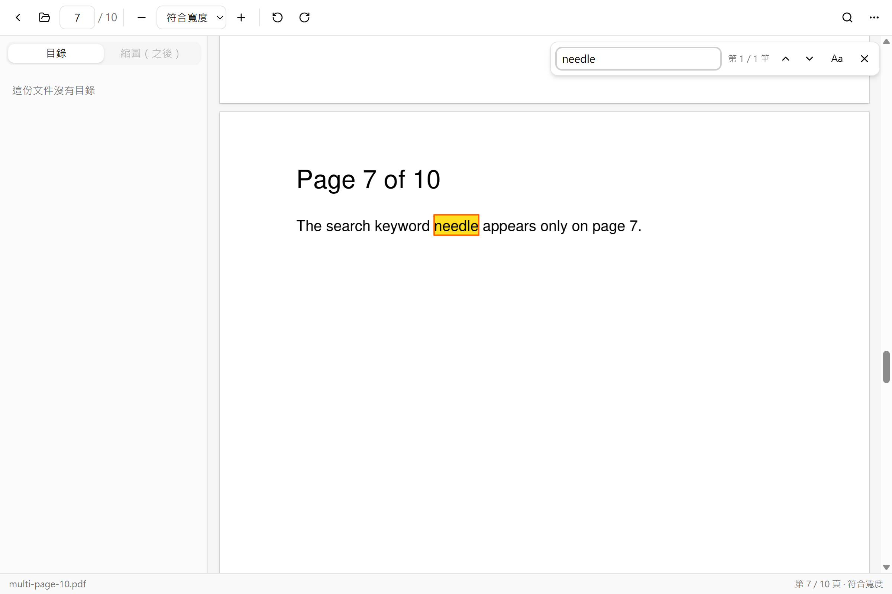
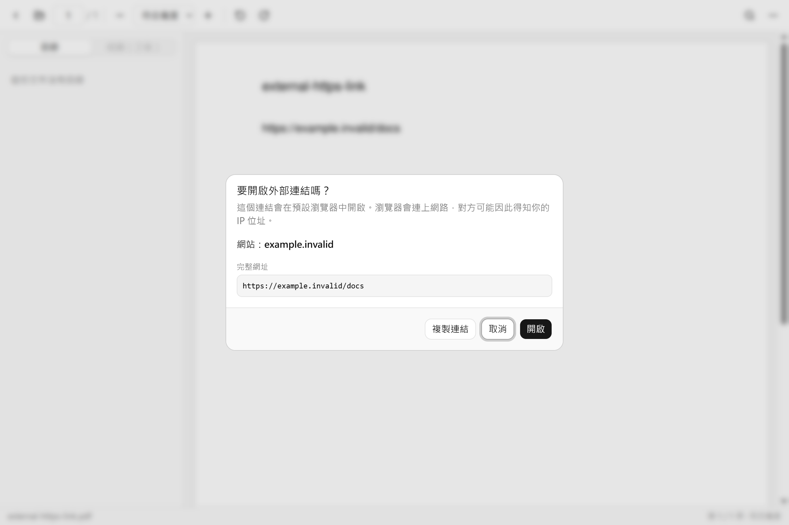
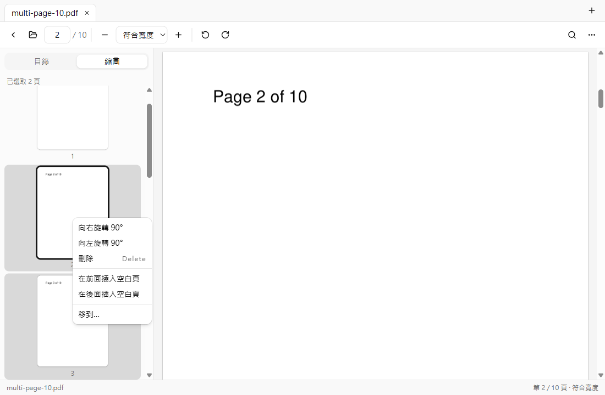
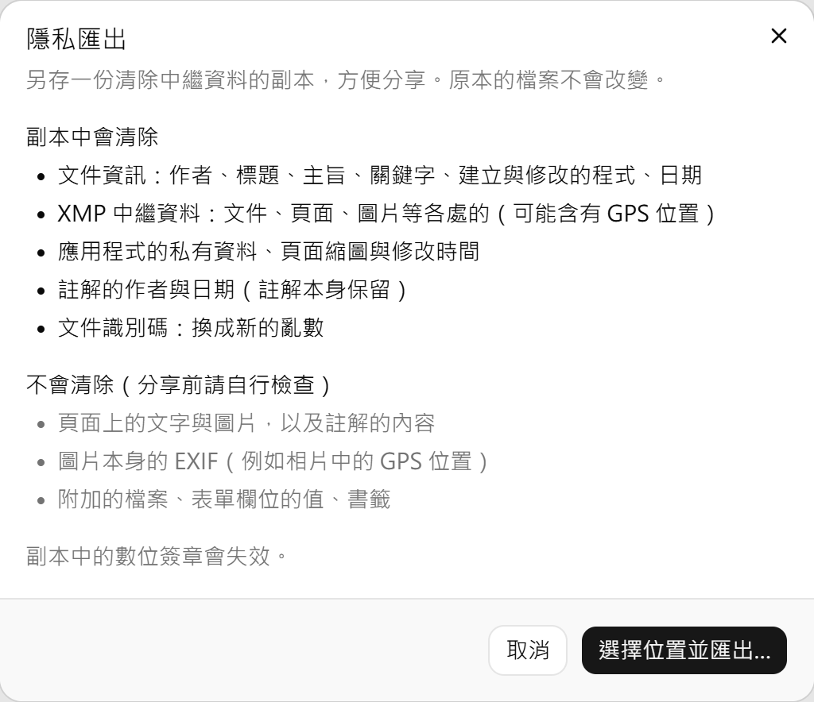
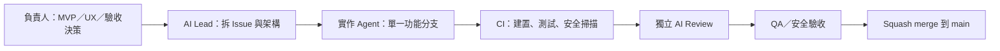

# Pdf-reader

注重隱私、完全離線的 Windows 桌面 PDF 閱讀器，也能編輯、簽署與轉檔。不會自行連網、無遙測、PDF 主動內容預設封鎖，PDF 引擎隔離在低權限子行程中執行。

> **下載**：安裝檔在 [Releases](https://github.com/winner0988/Pdf-reader/releases/latest) 頁面。安裝檔沒有程式碼簽章，Windows 會警告「不明的發行者」；先照發行說明核對 SHA-256 再安裝（[使用手冊：安裝](docs/user/01-install-and-start.md#安裝)）。
>
> **狀態：1.0 之前，持續開發中。** 下面列出的功能都已合併到 `main` 並有測試；最新發行的版本有哪些功能與修正，見 [CHANGELOG.md](CHANGELOG.md)。進度見 [工作卡](docs/backlog/README.md) 與 [Issues](https://github.com/winner0988/Pdf-reader/issues)。
>
> **設為預設 PDF 閱讀器**：安裝後在「⋯」選單選「設為預設 PDF 閱讀器」，或在檔案總管對 PDF 按右鍵 →「開啟檔案」→ PDF Reader。
>
> **系統需求**：Windows 11（x64）。畫面使用 Windows 11 內建的 Microsoft Edge WebView2；安裝檔不會下載任何東西（[packaging.md](docs/architecture/packaging.md#webview2)）。

| 全文搜尋 | 外部連結要先確認 |
|---|---|
|  |  |

| 在縮圖管理頁面 | 隱私匯出：說明會清除與不會清除什麼 |
|---|---|
|  |  |

## 功能

| 功能 | 說明 |
|---|---|
| 開啟本機 PDF | 開啟對話框（可多選）、拖放、命令列參數、從檔案總管開啟；損毀、不是 PDF、或用不支援的方式加密的檔案會顯示清楚的錯誤 |
| 分頁 | 同時開多份文件，每份一個分頁，最多 20 個；每個分頁記住自己的頁碼、縮放與搜尋 |
| 閱讀 | 虛擬滾動與 HiDPI 渲染，放大到 200% 以上時分塊渲染，高倍率也清晰；縮放（含符合寬度、符合頁面）與旋轉，只改檢視、不改檔案 |
| 目錄與縮圖 | 側欄樹狀目錄，可以只用鍵盤操作；每頁縮圖，點擊跳頁 |
| 編輯書籤 | 在目錄中新增、重新命名、刪除、上下移動與升降級書籤，可以復原，儲存後寫入 PDF |
| 附件 | 側欄列出 PDF 夾帶的檔案，可以另存到電腦（標記為來自網際網路）；app 從不直接開啟附件，可執行的檔案另存前會再確認一次 |
| 最近開啟的檔案 | 開始畫面列出最近 20 個檔案，只顯示檔名；完整路徑只存在這台電腦的 app 資料中；一鍵清除，也可以設定「不記錄此檔案」或完全不記錄 |
| 設定 | 外觀（跟隨系統、淺色、深色）、最近開啟的檔案、本機全文索引、記住的密碼、機敏文件、自訂字型、掃描頁的文字辨識與檢查更新；跨次啟動保留，並說明 app 在這台電腦上保存了哪些資料 |
| 全文搜尋 | 逐頁搜尋文字層（含 OCR 辨識出的文字）、標示結果、上一筆／下一筆、區分大小寫 |
| 在所有文件中搜尋 | 在設定中開啟本機全文索引後，`Ctrl+Shift+F` 搜尋開過的文件，點擊結果在新分頁開到那一頁。索引以 DPAPI 加密存在這台電腦；機敏文件、要密碼才能開的檔案、隨身碟或網路位置上的檔案等都不收錄 |
| 比較文字 | 開兩個以上分頁時，在「⋯」比較兩份文件的文字，依頁碼列出刪除與新增的段落，點擊跳頁，可以匯出成 .txt 或 .md；作者禁止複製的文件不能比較 |
| 選取與複製文字 | 拖曳、雙擊選詞、三擊選行，`Ctrl+C` 或右鍵複製；中文也可以；縮放、旋轉後仍對齊 |
| 開啟加密 PDF | 詢問密碼（RC4、AES-256）；密碼只交給這份文件的沙盒行程，用完即清除。勾選「記住」時才存進 Windows 認證管理員（同一個 Windows 帳號的其他程式讀得到，共用的電腦不要勾），下次自動開啟，可以隨時忘記 |
| 文件權限 | 比照 Adobe Acrobat 遵守作者的限制：禁止複製、禁止列印、只允許低解析度列印；狀態列標示「已限制」 |
| 數位簽章驗證 | 文件有簽章時，提示列說每個簽章是否成立、簽署之後有沒有被改動；面板列出簽署者與簽署時間（標示為簽署者自己聲稱），認證簽章（DocMDP）說明簽署者允許哪些變更。驗證完全離線，在 worker 的沙盒中以 Windows 的 CryptoAPI 做：不查憑證的撤銷狀態、不下載任何東西；「簽章有效」從不等於「簽署者可信」，自簽的憑證會說無法確認簽署者 |
| 簽署文件 | 用這台電腦的憑證（包含自然人憑證等晶片卡）或憑證檔（`.pfx`／`.p12`）簽署，另存成新的副本，簽章可以顯示在頁面上或不顯示。PIN 碼由 Windows 或卡片程式詢問，app 看不到；憑證檔的密碼只用於這次簽署，不會記住 |
| 列印 | `Ctrl+P`：選頁面範圍，再於系統的列印對話框選印表機、份數與方向；不經網路 |
| 匯出 | 把文字匯出為 .txt 或 Word（.docx，不保留版面），把頁面匯出為 PNG 或 JPG（72／150／300 dpi），或把選取的頁面存成新的 PDF（也可以每幾頁存成一個檔案）；只在這台電腦上產生；作者禁止複製時不能匯出 |
| 從檔案建立 PDF | 把圖片、網頁（HTML）、純文字、SVG、EPUB、XPS 轉成新的 PDF；Word、Excel、PowerPoint 是實驗性的。轉換時不連網：網頁的遠端資源不載入、指令碼不執行 |
| 儲存 | `Ctrl+S` 儲存、`Ctrl+Shift+S` 另存新檔；先寫好暫存檔才取代原檔，失敗時原檔不變；已簽章的文件以附加的方式儲存，不動原有的內容；關閉有未儲存變更的分頁或視窗時會詢問 |
| 頁面管理 | 在縮圖側欄選取頁面（點擊、`Ctrl`／`Shift`、鍵盤），永久旋轉、刪除、插入空白頁，用對話框或拖曳移動；作者不允許時停用。`Ctrl+Z`／`Ctrl+Y` 復原與重做，儲存之後才寫入檔案 |
| 註解 | 螢光筆（四種顏色）、文字附註、手繪線條（四種顏色、三種粗細）、八種標準印章與自己的圖片印章；可以選取、改色、移動、縮放與刪除，圖片印章也可以旋轉。存成標準的 PDF 註解，其他閱讀器也看得到，不寫入作者與時間；可以依頁碼匯出註解摘要（.txt 或 .md，作者禁止複製時不能用） |
| 文字方塊 | 在頁面上加一段文字，可以移動、縮放、改字、改大小與顏色；字型用這台電腦已安裝的，或匯入 TrueType 字型檔，只嵌入用到的字，其他閱讀器也顯示得出來 |
| 填寫表單 | 直接在頁面上填寫文字框、核取方塊、選項按鈕、下拉選單與清單方塊，`Tab` 依頁面的順序移動；不執行欄位的腳本（會說明）。「扁平化表單」把填好的內容變成頁面的一部分，可以復原，有簽章的文件不能扁平化 |
| 拆分與合併 | 縮圖的右鍵「插入其他檔案的頁面…」把另一份 PDF 的全部頁面放進來（帶進頁面，以及 app 支援的註解與文字方塊；不帶進主動內容與註解的動作；加密的檔案先問密碼）；匯出時可以把選的頁面存成新檔案，或每幾頁存成一個檔案 |
| 掃描頁的文字辨識 | 沒有文字層的掃描頁在背景辨識（Tesseract，在 worker 的沙盒中執行；安裝檔附繁體中文與英文的語言資料，也可以匯入其他語言），辨識出的文字可以搜尋、選取、複製與標示。結果只存在記憶體，不寫進檔案；狀態列顯示進度並可以停止，設定中可以改成手動 |
| 崩潰復原 | 編輯途中當機、被強制結束或斷電時，下次開啟同一個檔案會提示還原未儲存的變更；不需要雲端備份，也不會自動寫回原檔 |
| 安全遮蔽 | 框選，或選取文字後按右鍵，標記要遮蔽的範圍；「找出個資…」找身分證字號、電話、電子郵件、信用卡卡號、統一編號與自訂關鍵字。套用前列出不會處理的項目（書籤、文件標題等）；存檔時整份重寫，再重新開啟存好的檔案，確認遮蔽的範圍沒有文字、被移除的字也找不到，才顯示「已遮蔽並驗證」。已簽章或作者禁止修改的文件不能遮蔽 |
| 機敏文件 | 把文件標記為機敏（標記寫在檔案中，搬移或改名都不會遺失）：不記錄在最近開啟的檔案與全文索引，側欄的縮圖只畫頁框，複製的文字不進 Windows 的剪貼簿歷程與雲端剪貼簿；開著時 app 視窗不會出現在截圖、錄影與會議的螢幕分享中（擋不住相機拍攝，也擋不住有系統管理員或核心權限的程式） |
| 隱私匯出 | 「⋯」→「隱私匯出…」另存一份清除作者、軟體、時間等中繼資料的副本，對話框說明會清除與不會清除什麼；原本的檔案與未儲存的變更都不受影響 |
| 分享前淨化 | 另存一份移除動作與腳本、附件、表單腳本、XFA、多媒體與隱藏資料的副本；可以保留一般網址連結，註解可以保留、移除或平面化；寫出前會再掃描一次，確認沒有殘留。圖片本身的 EXIF 與隱藏圖層（OCG）的內容不會清除 |
| 加密並另存新檔 | 「⋯」→「加密並另存新檔…」：把目前的文件（含還沒儲存的編輯）以 AES-256 加密後另存成新檔，目前的文件與它的檔案不變。可以設開啟密碼、權限密碼，以及不許列印、不許複製、不許修改；有任何限制就一定要有與開啟密碼不同的權限密碼。有數位簽章的文件（加密要整份重寫，簽章會失效）與已加密的文件不提供 |
| 頁碼與 Bates 編號 | 另存一份加上頁碼、頁首頁尾或 Bates 編號的副本，可以先預覽 |
| 壓縮圖片 | 把文件裡的圖片重新編碼，另存成較小的副本，原檔不變；重新編碼的圖片不帶相機的資料（EXIF、GPS） |
| 批次處理 | 一次處理很多個 PDF，每個檔案產生一份副本、原檔不變：清除中繼資料、加密、清除圖片的 EXIF、分享前淨化、加浮水印（文字或圖片）、壓縮圖片、頁碼與 Bates 編號（可以跨檔案連號）。開始後可以關閉視窗，批次在通知區域的圖示中做完就結束 |
| 主動內容 | JavaScript、開檔自動動作、`/Launch`、表單送出、遠端檔案引用等一律不執行；偵測到時以橫幅列出擋下了什麼。遠端資源的網址可以在橫幅中查看，確認後才交給瀏覽器開啟，app 自己從不載入 |
| 連結 | 文件內的連結直接跳頁；外部連結顯示完整網址，確認後才交給預設瀏覽器，只允許 `http`、`https`、`mailto`；其他一律封鎖並說明原因 |

**還沒有**：表單腳本。欄位的自動計算、格式與檢查不會執行，欄位照常可以填（[#238](https://github.com/winner0988/Pdf-reader/issues/238)，等 PDF 引擎 MuPDF 更新後再做）。已知的限制見使用手冊的[常見問題](docs/user/07-faq.md#已知限制)；已定案與提議中的決定見 [docs/adr/](docs/adr/README.md)。

## 安全設計

- **不會自行連網、零遙測**：開檔、閱讀、搜尋、啟動與關閉都不連網，也不收集任何資料。唯一的連網是使用者在設定中按下「檢查更新」時，由主行程向 GitHub 查詢一次最新的版本號碼，不帶任何識別資料（[ADR 0009](docs/adr/0009-default-network-policy.md)、[update-check.md](docs/architecture/update-check.md)）。CI 會擋下網路與遙測相關的依賴，並檢查 CSP、capability 與建置產物；完整的驗證方式見 [offline-verification.md](docs/security/offline-verification.md)。
- **引擎隔離**（[ADR 0008](docs/adr/0008-pdf-worker-isolation.md)、[worker-sandbox.md](docs/architecture/worker-sandbox.md)）：
  - MuPDF 只在 `pdf_worker` 子行程中執行，**每份文件有自己的 worker**（[ADR 0012](docs/adr/0012-tabs-and-worker-per-document.md)），一份惡意 PDF 碰不到其他文件：沒有任何 capability 的 AppContainer（連 localhost 都不能連、讀不到使用者的檔案）、Job Object、Low integrity，並關閉 win32k 系統呼叫等。
  - 前端只拿得到不透明的文件代號，拿不到檔案路徑。
- **主動內容**（[active-content.md](docs/architecture/active-content.md)）：MuPDF 編譯時就不含 JavaScript 引擎；掃描只是告知，沒有「允許執行」按鈕。
- **連結**（[links.md](docs/architecture/links.md)）：主行程不接受前端傳來的網址，只接受連結的代號，並重新向 worker 取得、檢查後才開啟。
- **本機資料**（[local-data.md](docs/architecture/local-data.md)）：只有主行程讀寫 app 資料資料夾中的檔案，前端只能透過型別化的命令修改已定義的設定。
- **最近開啟的檔案**（[recent-files.md](docs/architecture/recent-files.md)）：完整路徑只存在這台電腦的 app 資料資料夾（不漫遊），前端只拿得到檔名與代號；「不記錄此檔案」只存加鹽的雜湊值，不存路徑。
- **編輯與存檔**（[saving.md](docs/architecture/saving.md)）：編輯是型別化的指令，前端只送指令、不送任何 PDF 物件，由該文件自己的 worker 套用；存檔先把完整的檔案寫進暫存檔，成功才取代原檔。崩潰復原的日誌放在 app 資料資料夾，檔名是亂數，讀取時當成不可信任的資料（[crash-recovery.md](docs/architecture/crash-recovery.md)）。
- **其他檔案的頁面與圖片**（[merge.md](docs/architecture/merge.md)、[annotations.md](docs/architecture/annotations.md)）：要插入的頁面與自訂印章的圖片都是不受信任的輸入，只在沙盒的 worker 中處理；頁面不帶進主動內容與外部資料，圖片只保留像素。
- **文字辨識**（[ocr.md](docs/architecture/ocr.md)）：Tesseract 在該文件自己的 worker 的沙盒中執行，沙盒沒有為它放寬任何一項；語言資料由主行程讀取、以位元組交給 worker，worker 不開檔案。
- **加密副本的密碼**（[encrypt-copy.md](docs/architecture/encrypt-copy.md)）：只經過一次命令，由主行程交給該文件自己的 worker；不寫進日誌或錯誤訊息，用完即清除，不存檔。只設開啟密碼時，權限密碼由主行程隨機產生，不顯示也不保存。
- **數位簽章**（[signatures.md](docs/architecture/signatures.md)）：簽章資料與憑證是不受信任的輸入，由 Windows 的 C 程式碼在 worker 的沙盒中解析；先檢查簽章涵蓋的範圍與檔案裡的簽章完全對得上，才交給 Windows 驗證；不連網，不查撤銷。
- **測試**：
  - 惡意與損毀樣本的[語料庫](tests/corpus/README.md)，全部由腳本產生；
  - 以 Playwright 操作真正 app 的[端對端測試](docs/architecture/e2e.md)；
  - IPC 解碼與開啟 PDF 的 [fuzzing](docs/security/fuzzing.md)。

## 本機開發（Windows）

需要先安裝：

- [Node.js](https://nodejs.org/) 22 LTS（版本見 `.nvmrc`）
- [pnpm](https://pnpm.io/) 12：`npm install -g pnpm@12`
- [Rust](https://rustup.rs/)（rustup；實際版本由 `rust-toolchain.toml` 自動安裝）
- Visual Studio Build Tools，勾選「使用 C++ 的桌面開發」
- [LLVM](https://llvm.org/)：`winget install LLVM.LLVM`（建置 MuPDF 需要，安裝在預設位置即可；見 [docs/architecture/mupdf-binding.md](docs/architecture/mupdf-binding.md)）
- Microsoft Edge WebView2（Windows 11 已內建）

```bash
pnpm install
cargo build -p pdf_worker   # 第一次，或 worker 有變更時；開發模式的主程式在 target/debug/ 旁邊找 pdf_worker.exe
pnpm tauri dev
```

測試：

```bash
pnpm test                          # 前端單元測試
cargo test --workspace --locked    # Rust 測試
pnpm e2e:build && pnpm e2e         # 端對端測試：建置 release 版後以 Playwright 操作
```

`pnpm bundle` 會在 `target/release/bundle/nsis/` 產出包含 `pdf_worker.exe` 的安裝檔（尚未簽章），見 [docs/architecture/packaging.md](docs/architecture/packaging.md)。完整的檢查指令見 [AGENTS.md](AGENTS.md#指令)。

> **安裝檔沒有程式碼簽章**：執行時 Windows SmartScreen 會警告「不明的發行者」。CI 建置的安裝檔附有 `<安裝檔名>.sha256`，請先以 `Get-FileHash -Algorithm SHA256 <安裝檔>` 核對雜湊值相同，再按「其他資訊」→「仍要執行」（[packaging.md](docs/architecture/packaging.md#安裝檔的-sha-256112)）。

## 技術棧

Windows-first · Tauri 2 + Rust · React + TypeScript + Vite · Tailwind + shadcn/ui · MuPDF（`pdf_worker` 子行程）· SQLite · Windows Credential Manager。理由見 [ADR 0007](docs/adr/0007-tech-stack-and-platform.md)。

## 文件導覽

| 文件 | 用途 |
|---|---|
| [使用手冊](docs/user/README.md) | 給使用者：安裝、閱讀、編輯、匯出、安全與隱私、快捷鍵、常見問題 |
| [規格書（繁中）](docs/spec/PDF_Reader_Spec_ZH_v3.md)／[Spec (EN)](docs/spec/PDF_Reader_Spec_EN_v3.md) | 完整產品需求 |
| [CONTEXT.md](CONTEXT.md) | 專案詞彙表 |
| [docs/adr/](docs/adr/README.md) | 架構決策紀錄 |
| [docs/architecture/](docs/architecture/) | 各元件的設計：IPC 合約、worker 沙盒、渲染、搜尋、連結、主動內容、編輯與存檔、註解與表單、OCR、簽署、遮蔽、機敏文件、全文索引、批次處理、打包、E2E |
| [docs/security/](docs/security/) | 離線驗證、fuzzing 與人工安全檢查 |
| [docs/ux/](docs/ux/screen-map.md) | 畫面地圖、wireframe 與各功能的截圖 |
| [docs/backlog/](docs/backlog/README.md) | 第一批（MVP）與第二批（編輯與其他功能）的工作卡 |
| [docs/workflow.md](docs/workflow.md) | 開發流程、分支與 CI 規則、GitHub 設定步驟 |
| [AGENTS.md](AGENTS.md) | AI coding agent 的工作規則 |
| [docs/planning/](docs/planning/2026-09-23-kickoff-plan.md) | 專案啟動時的規劃紀錄 |

## 開發流程

這個專案主要由 AI coding agent 依工作卡實作，每個 PR 都要通過 CI、由另一個 agent 或人 review；安全相關的變更由負責人親自審查。



細節見 [docs/workflow.md](docs/workflow.md)。

## 安全

請勿在公開管道張貼可利用的惡意 PDF；回報方式見 [SECURITY.md](SECURITY.md)。

## 授權

本專案以 [GNU Affero General Public License v3.0 或之後的版本](LICENSE)（AGPL-3.0-or-later）授權，理由與散布時的義務見 [ADR 0011](docs/adr/0011-license-and-distribution.md)。

PDF 引擎 [MuPDF](https://mupdf.com/) 由 Artifex Software 以 AGPL-3.0 授權（另有商業授權）；其他第三方套件保留各自的授權。
