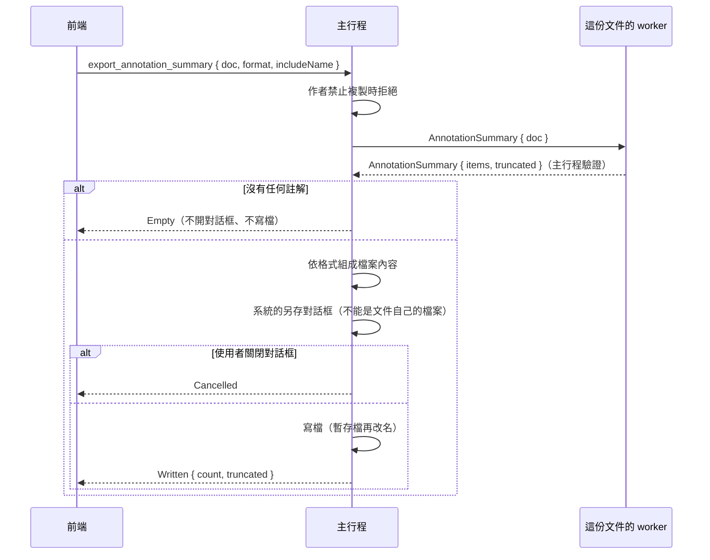

# 註解摘要匯出（B3-18）

工作卡 [#306](https://github.com/winner0988/Pdf-reader/issues/306)；規格 §6「註解標記」的延伸。畫面見 [screen-map.md](../ux/screen-map.md)「註解摘要」。

把文件裡的註解依頁碼與位置排好，存成純文字或 Markdown 檔：螢光筆標示底下的文字、附註與文字方塊的內容；手繪線條與印章只列出在第幾頁。

## 流程



- **前端只說要哪種檔案**：格式（純文字或 Markdown）、開頭要不要加檔名。**不經手檔案內容，也不含路徑**，與[匯出](export.md)相同：內容由 worker 找出、主行程組成並寫入；檔案裡的文字（種類名稱、頁碼）在 `src-tauri/src/strings.rs`。
- **作者禁止複製**（MVP-19）時停用：摘要列出螢光筆標示底下的文字，等於複製內容。選單停用並標示「作者不允許」，主行程也拒絕。
- **對話框**：`IFileSaveDialog`，建議檔名 `<原檔名>（註解摘要）.txt` 或 `.md`，`FOS_DONTADDTORECENT`；選到文件自己的檔案時以訊息方塊說明、可以再選。
- **寫檔**：與匯出純文字相同，先寫暫存檔再改名；UTF-8、沒有 BOM，每一行之後 `\r\n`。

## worker 找出的內容

`PdfDocument::annotation_summary`（`crates/pdf_worker/src/engine/annotations.rs`）：

- **列出的種類**：螢光筆標示（`Highlight`）、附註（`Text`，含回覆）、文字方塊（app 做的 `FreeText`）、手繪線條（`Ink`）、印章（`Stamp`）。連結、表單欄位、彈出視窗、其他形狀不列。
- **順序**：依頁序；同一頁依閱讀順序，由上而下、再由左而右，以每個註解**開始的位置**比較：螢光筆標示是它第一個四邊形的左上角（跨行的標示從它開始的那一行算），其他是外框的左上角。高度相差不到半點算同一行。MuPDF 的頁面座標已經套用 `/Rotate`，所以旋轉過的頁面也是畫面上看到的順序。
- **螢光筆標示的文字**：取這一頁的文字層（與選取文字相同，掃描頁面是辨識出的文字，B2-10），中心點落在標示任一個四邊形內（容許半點）的字元依序串起來；跳過的地方（換行、中間沒標到的字）照段落的接法：加一個空格，中文字之間不加（與 Word 匯出相同的規則）。沒有四邊形的標示用外框。結果是單行的顯示文字（沒有控制字元、雙向文字控制與零寬字元）。
- **附註與文字方塊**：內容照附註的清理規則（可以多行，每一行是顯示文字）。
- **手繪線條與印章**：沒有文字，只列種類與頁碼。

### 上限

| 項目 | 上限 | 超過時 |
|---|---|---|
| 一頁列出的註解 | `MAX_ANNOTATIONS_PER_PAGE`（2,000） | 其餘不列，摘要標示 `truncated` |
| 整份摘要的註解 | `MAX_ANNOTATION_SUMMARY_ITEMS`（10,000） | 停止，標示 `truncated` |
| 一個註解的文字 | `MAX_ANNOTATION_SUMMARY_TEXT_BYTES`（32 KiB） | 截斷 |
| 整份摘要的文字 | `MAX_ANNOTATION_SUMMARY_TOTAL_BYTES`（4 MiB） | 停止，標示 `truncated` |
| 一個標示的四邊形 | `MAX_ANNOTATION_QUADS`（1,000） | 改用外框 |
| 比對字元與四邊形的次數 | `MAX_SUMMARY_WORK`（2 億次，約一秒） | 停止，標示 `truncated` |

只比對標示碰得到的那幾行；真實文件遠用不到最後一項，它是擋住刻意做成讓 worker 一直算的檔案。主行程以 `request_long` 送出請求（整份文件逐頁讀取，可能與存檔一樣久）。

`truncated` 時檔案最後一行寫「（註解太多，其餘沒有列出。）」，狀態列也說明。

### 主行程的驗證

`AnnotationSummary::validate`（`crates/ipc_contract/src/validate.rs`）：項目數與總位元組數在上限內；外框是有限數字；螢光筆標示的文字是單行的顯示文字；附註與文字方塊是清理過的附註文字；手繪線條與印章沒有文字。主行程另外檢查每一項的頁碼小於文件的頁數。

## 檔案格式

純文字（每一行都標出頁碼與種類，附註的其他行縮排兩格）：

```text
報告.pdf

第 1 頁｜附註：第一行
  第二行
第 1 頁｜螢光筆標示：Privacy-first PDF Reader
第 1 頁｜印章

第 3 頁｜手繪線條
```

Markdown（每一頁一個標題，每個註解一個清單項目；附註的其他行以 `\` 換行留在同一項）：

```markdown
# 報告.pdf

## 第 1 頁

- **附註**：第一行\
  第二行
- **螢光筆標示**：Privacy-first PDF Reader
- **印章**
```

Markdown 的跳脫：文字裡 Markdown 有意義的字元（`` \ ` * _ [ ] < > | ~ # & ``）前面加 `\`；行首的 `-`、`+`、`=` 與「數字加 `.` 或 `)`」也跳脫，不會變成清單或標題。附註裡的空行在 Markdown 省略（空行會結束清單項目）。

## 測試

- worker（`engine/annotations.rs`、`engine.rs`）：
  - 閱讀順序與標示的文字：`mixed-text-zh-en.pdf` 上先標右邊的「Reader」（跨到下一行的「隱私優先」）、再標左邊的「PDF」，加上附註、印章、手繪，摘要依位置排序，跨行的英文與中文接在一起；
  - 旋轉的頁面：`rotated-page.pdf` 第 2 頁（`/Rotate 90`）上方與下方的附註與標示依畫面順序；
  - 連結、欄位、形狀、彈出視窗不列；
  - 字元中心在四邊形內（容許半點）、跨行加空格、中文字之間不加、旋轉 45 度的四邊形、沒有面積的四邊形不算；
  - 比對次數用完時停止；項目數與位元組數的上限。
- 契約：`an_annotation_summary_holds_cleaned_text_within_its_limits`。
- 主行程：純文字與 Markdown 的完整內容（含跳脫、多行附註、截斷說明）、檔名、`\r\n` 與暫存檔。
- 前端：`AnnotationSummaryDialog.test.tsx`（預設值、送出的選項、完成與截斷的說明、沒有註解、關閉另存對話框、失敗、作者禁止複製）。
- E2E：`tests/e2e/annotation-summary.spec.ts`（標兩個字後匯出 Markdown，檔案依閱讀順序列出；沒有註解時不寫檔）。
