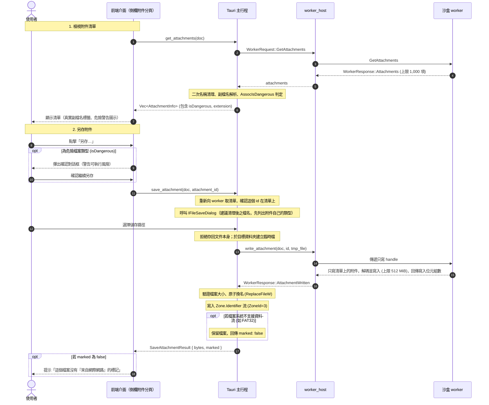

# 附件架構（Attachments Architecture）

> 本文件說明 PDF Reader 的附件（內嵌檔案）清單與另存機制（需求 B3-20，依循 [ADR 0025](../adr/0025-attachments-save-only.md) 選項 B 及 AGENTS.md 原則 3「主動內容預設封鎖」）。

---

## 1. 核心原則

1. **永遠不由 App 開啟附件**：App 內不提供任何「開啟附件」的按鈕或快捷鍵，亦不調用系統預設程式直接執行不可信的檔案。
2. **只列出與另存**：使用者可檢視文件中的附件清單，並透過系統另存對話框存入本機磁碟。
3. **標記為來自網際網路（Mark of the Web）**：另存至 NTFS 磁區時，主行程會於檔案寫入 `Zone.Identifier` 替代資料流（`[ZoneTransfer]\r\nZoneId=3\r\n`），使 Windows SmartScreen 與 Office 受保護的檢視等系統防禦機制能於使用者未來執行時進行安全檢查。
4. **內容不進 IPC 與前端**：附件解碼後的檔案內容直接由 worker 寫入主行程交出的作業系統檔案控制代碼（write-only handle），不經過 IPC 訊息，亦不載入前端記憶體。

---

## 2. 模組架構與職責劃分

---

## 3. 檔名清理規則（Sanitization）

PDF 中的檔名由不受信任的文件提供，可能夾帶路徑穿越、控制字元、RLO（雙向文字反轉）欺騙、非法字元或 Windows 保留裝置名稱。規則只寫一次（`ipc_contract::attachments::clean_attachment_name`），worker 列清單時清理一次，主行程收到清單後再清理一次（雙重防護）：

1. **路徑分離**：以 Unix（`/`）與 Windows（`\`）路徑符號切開，僅保留最後一段非空的檔名。
2. **字元過濾**：移除控制字元、隱形格式字元（雙向文字控制 U+202A–U+202E、U+2066–U+2069、U+200E、U+200F，零寬字元等，與 `ipc_contract::text` 共用同一份判定）及 Windows 檔名禁用字元（`< > : " / \ | ? *`）。冒號被移除，所以檔名不能指定替代資料流。
3. **空白與結尾點清理**：移除結尾之空白字元與半形句點（`.`），防止 Windows 檔名正規化漏洞。
4. **空檔名替換**：若清理後為空，以「附件 n」（從 1 起算）命名。
5. **保留裝置名稱防護**：若第一個點之前的部分是 Windows 裝置名稱（`CON`、`PRN`、`AUX`、`NUL`、`CONIN$`、`CONOUT$`、`COM0`–`COM9`、`LPT0`–`LPT9`，以及 `COM¹`–`COM³`、`LPT¹`–`LPT³`；不分大小寫，後面的空白也忽略），於開頭加入底線（如 `_CON.txt`）。
6. **長度上限**：截斷至 `MAX_ATTACHMENT_NAME_BYTES`（255 位元組），切在字元邊界；16 位元組以內的副檔名保留，讓長檔名仍看得出類型。

清單上的大小（`/Params /Size`）是文件自己宣稱的，只用來顯示；另存時以實際解碼的位元組數為準。

---

## 4. 危險類型判定（Dangerous File Types）

依據 ADR 0025，危險類型以系統 API 結合內建固定清單雙重把關：
1. **無副檔名**：沒有副檔名的檔案直接視為危險類型。
2. **固定清單**：
   - 含巨集之 Office 格式：`.docm`、`.dotm`、`.xlsm`、`.xltm`、`.xlam`、`.pptm`、`.potm`、`.ppam`、`.ppsm`、`.sldm`。
   - 磁碟映像檔：`.iso`、`.img`、`.vhd`、`.vhdx`。
   - 捷徑：`.lnk`、`.url`、`.settingcontent-ms`、`.library-ms`、`.search-ms`。
   - 腳本：`.hta`、`.js`、`.jse`、`.vb`、`.vbs`、`.vbe`、`.wsf`、`.wsh`、`.ws`、`.wsc`、`.ps1`、`.ps1xml`、`.ps2`、`.ps2xml`、`.psc1`、`.psc2`、`.bat`、`.cmd`、`.reg`、`.chm`。
   - 可執行檔、安裝檔與套件：`.exe`、`.com`、`.scr`、`.pif`、`.cpl`、`.msi`、`.msp`、`.jar`、`.gadget`、`.application`、`.appref-ms`、`.appx`、`.appxbundle`、`.msix`、`.msixbundle`、`.appinstaller`、`.diagcab`；Office 增益集 `.xll` 也列在上面的 Office 類。
3. **Windows `AssocIsDangerous`**：清單外的類型再問 Windows 自己的清單（含系統管理員的原則）。

清單在 `src-tauri/src/attachments.rs`，副檔名不分大小寫。

危險類型於介面標示醒目的警告圖示，另存前彈出確認對話框：「這是可以執行的檔案類型（{ext}）。它來自 PDF，可能有害。只在你信任寄件者時才開啟它。」

---

## 5. 介面選擇理由：側欄分頁 vs 對話框

在實作介面時，選擇將附件清單放置於**側欄分頁（Sidebar Tab）**而非獨立對話框（Dialog），其評估理由如下：

1. **閱讀與對照的工作流**：合約、技術手冊或作品集（portfolio）通常在內文中提及附件。側欄分頁允許使用者在滾動檢視與閱讀文件的同時瀏覽附件清單，不會遮蔽閱讀視野。
2. **一致的導覽模型**：既有側欄已包含「目錄（Outline）」、「縮圖（Thumbnails）」與「編輯（Redactions）」三個主要導覽分頁，將「附件」作為第四個導覽維度，使用者能以統一的心智模型切換。
3. **避免強制阻斷**：對話框為強制焦點模式（modal），開啟時無法操作文件縮放或頁面跳轉；側欄則保持非阻斷（non-modal），使用者可在確認或另存時自主決定時機。

---

## 6. 資安與日誌保護

1. **機敏文件警示**：若文件帶有機敏標記（`is_sensitive`），另存時明確提示使用者：「存下來的檔案不在機敏保護內。」
2. **日誌與隱私**：日誌僅記錄附件數量與操作結果，**絕不**記錄附件名稱或路徑。
3. **無最近開啟紀錄**：另存對話框設 `FOS_DONTADDTORECENT`，附件不列入 Windows 最近項目，亦不進 App 的最近開啟檔案清單。
4. **只能取出清單上的附件**：附件以其內嵌檔案串流的物件編號識別。Worker 寫檔前重新找一次附件，id 不在清單上就拒絕（`InvalidRequest`），所以 id 不能拿來讀文件裡的其他物件；同一個串流在名稱樹與頁面註解都出現時只列一次。名稱樹最多走 32 層、遇到走過的節點就停，清單最多 1,000 項。
5. **解壓縮炸彈防護**：MuPDF 會先把整個串流解碼到記憶體。它自己會擋下壓縮炸彈（`fz_read_best`：超過串流長度約 600 倍且至少 100 MiB 就停），其餘由 worker 的記憶體上限擋下；解碼後超過 512 MiB（`MAX_DOCUMENT_BYTES`）的附件也拒絕。這不是事先檢查：失敗時 worker 回傳錯誤、什麼都沒寫，主行程刪除臨時檔，worker 繼續服務。
