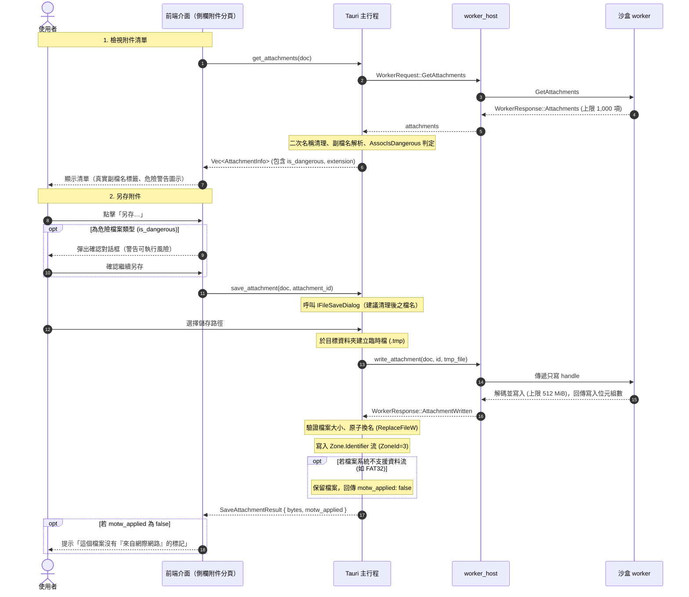

# 附件架構（Attachments Architecture）

> 本文件說明 PDF Reader 的附件（內嵌檔案）清單與另存機制（需求 B3-20，依循 [ADR 0025](../adr/0025-attachments-save-only.md) 選項 B 及 AGENTS.md 原則 3「主動內容預設封鎖」）。

---

## 1. 核心原則

1. **永遠不由 App 開啟附件**：App 內不提供任何「開啟附件」的按鈕或快捷鍵，亦不調用系統預設程式直接執行不可信的檔案。
2. **只列出與另存**：使用者可檢視文件中的附件清單，並透過系統另存對話框存入本機磁碟。
3. **標記為來自網際網路（Mark of the Web）**：另存至 NTFS 磁區時，主行程會於檔案寫入 `Zone.Identifier` 替代資料流（`[ZoneTransfer]\r\nZoneId=3\r\n`），使 Windows SmartScreen 與 Office 受保護的檢視等系統防禦機制能於使用者未來執行時進行安全檢查。
4. **內容不進 IPC 與前端**：附件解碼後的檔案內容直接由 worker 寫入主行程交出的作業系統檔案控制代碼（write-only handle），不經過 IPC 訊息，亦不載入前端記憶體。

---

## 2. 模組架構與職責劃分

---

## 3. 檔名清理規則（Sanitization）

PDF 中的檔名由不受信任的文件提供，可能夾帶路徑穿越、控制字元、RLO（雙向文字反轉）欺騙、非法字元或 Windows 保留裝置名稱。Worker 與主行程各自實作一次清理（雙重防護）：

1. **路徑分離**：去除所有 Unix（`/`）與 Windows（`\`）路徑符號，僅保留最後一段檔名。
2. **字元過濾**：移除 ASCII 控制字元、雙向文字控制字元（U+202A–U+202E、U+2066–U+2069、U+200E、U+200F）、Unicode 隱形字元及 Windows 檔名禁用字元（`< > : " / \ | ? *`）。
3. **空白與結尾點清理**：移除結尾之空白字元與半形句點（`.`），防止 Windows 檔名正規化漏洞。
4. **長度上限**：截斷至 `MAX_ATTACHMENT_NAME_BYTES`（255 位元組）。
5. **空檔名替換**：若檔名為空或全由空白/無效字元組成，自動以「附件 n」（1 為基準）命名。
6. **保留裝置名稱防護**：若主檔名符合 Windows 保留裝置名稱（如 `CON`、`PRN`、`AUX`、`NUL`、`COM1`–`COM9`、`LPT1`–`LPT9`，不論大小寫及副檔名），自動於開頭加入底線（如 `_CON.txt`）。

---

## 4. 危險類型判定（Dangerous File Types）

依據 ADR 0025，危險類型以系統 API 結合內建固定清單雙重把關：
1. **無副檔名**：沒有副檔名的檔案直接視為危險類型。
2. **固定清單**：
   - 含巨集之 Office 格式：`.docm`、`.dotm`、`.xlsm`、`.xltm`、`.xlam`、`.pptm`、`.potm`、`.ppam`、`.ppsm`、`.sldm`。
   - 磁碟映像檔：`.iso`、`.img`、`.vhd`、`.vhdx`。
   - 捷徑與腳本：`.lnk`、`.url`、`.hta`、`.js`、`.jse`、`.vbs`、`.vbe`、`.wsf`、`.wsh`、`.ps1`、`.ps1xml`、`.ps2`、`.ps2xml`、`.psc1`、`.psc2`、`.bat`、`.cmd`。
   - 可執行檔與安裝檔：`.exe`、`.com`、`.scr`、`.pif`、`.msi`、`.msp`、`.jar`、`.cpl`、`.gadget`、`.application`、`.appref-ms`、`.reg` 等。
3. **Windows `AssocIsDangerous`**：調用 Shell API 查詢系統管理原則或登錄檔中定義之危險類型。

危險類型於介面標示醒目的警告圖示，另存前彈出確認對話框：「這是可以執行的檔案類型（{ext}）。它來自 PDF，可能有害。只在你信任寄件者時才開啟它。」

---

## 5. 介面選擇理由：側欄分頁 vs 對話框

在實作介面時，選擇將附件清單放置於**側欄分頁（Sidebar Tab）**而非獨立對話框（Dialog），其評估理由如下：

1. **閱讀與對照的工作流**：合約、技術手冊或作品集（portfolio）通常在內文中提及附件。側欄分頁允許使用者在滾動檢視與閱讀文件的同時瀏覽附件清單，不會遮蔽閱讀視野。
2. **一致的導覽模型**：既有側欄已包含「目錄（Outline）」、「縮圖（Thumbnails）」與「編輯（Redactions）」三個主要導覽分頁，將「附件」作為第四個導覽維度，使用者能以統一的心智模型切換。
3. **避免強制阻斷**：對話框為強制焦點模式（modal），開啟時無法操作文件縮放或頁面跳轉；側欄則保持非阻斷（non-modal），使用者可在確認或另存時自主決定時機。

---

## 6. 資安與日誌保護

1. **機敏文件警示**：若文件帶有機敏標記（`is_sensitive`），另存時明確提示使用者：「存下來的檔案不在機敏保護內。」
2. **日誌與隱私**：日誌僅記錄附件數量與操作結果，**絕不**記錄附件名稱或路徑。
3. **無最近開啟紀錄**：附件另存之檔案不列入 Windows 最近項目，亦不進 App 的最近開啟檔案清單。
4. **解壓縮炸彈防護**：Worker 嚴格限制解碼後位元組上限為 512 MiB（`MAX_DOCUMENT_BYTES`）。超過上限或解碼錯誤立即中止、傳回錯誤並由主行程刪除臨時檔，Worker 繼續保持服務。
