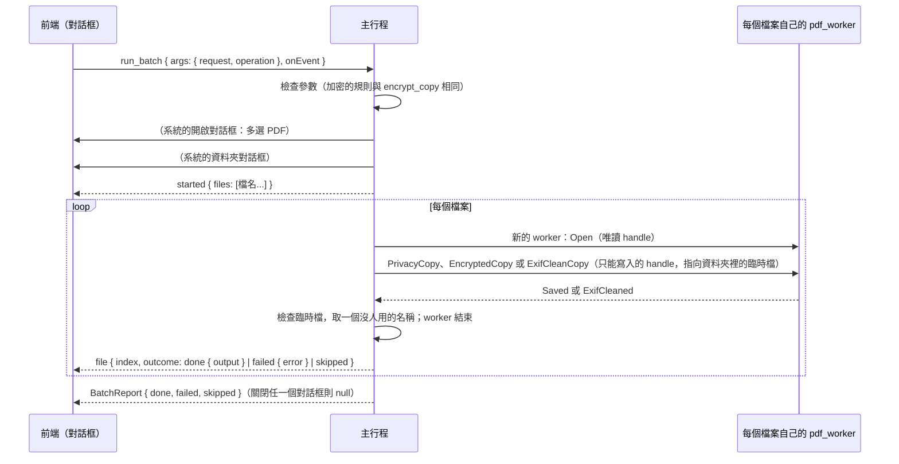

# 批次處理（B3-04）

工作卡 [#235](https://github.com/winner0988/Pdf-reader/issues/235)；規格 §7「批次處理佇列」；ADR 0005（已接受）。畫面見 [screen-map.md](../ux/screen-map.md)「批次處理（B3-04）」。

## 範圍

對多個 PDF 檔案做同一件事，每個檔案產生一份**副本**，放在使用者選的資料夾；原本的檔案不會改變。

| 操作（`BatchOperation`） | 副本 | 等於 |
|---|---|---|
| 清除中繼資料（`removeMetadata`） | `<檔名>（隱私匯出）.pdf` | 一份文件的「隱私匯出」（B2-03，[privacy-export.md](privacy-export.md)） |
| 加密（`encrypt`） | `<檔名>（已加密）.pdf` | 一份文件的「加密並另存新檔」（B2-15，[encrypt-copy.md](encrypt-copy.md)），每個檔案用同樣的密碼與限制 |
| 清除圖片的 EXIF（`removeExif`） | `<檔名>（已清除 EXIF）.pdf` | 只有批次處理有：見下方「清除圖片的 EXIF」 |

工作卡的其餘部分分開做：

- **浮水印**：worker 的操作在 [#269](https://github.com/winner0988/Pdf-reader/pull/269)，批次的選項接在它之後。
- **背景執行與系統列圖示**（ADR 0005）：新增依賴與 capability，要審查。

在那之前，處理中關閉視窗會停止批次處理，對話框有說明。

## 清除圖片的 EXIF

JPEG 放進 PDF 時是**整個檔案原樣**放進去（`/DCTDecode`），相機與之後的程式寫在裡面的東西也一起進去。這個操作把它們拿掉，**圖片不重新編碼**（不損失畫質，畫出來每個像素都一樣）：

| 拿掉 | 位置 |
|---|---|
| EXIF：相機廠牌與型號、拍攝時間、GPS 位置、EXIF 裡的縮圖 | JPEG 的 `APP1` |
| XMP（作者、程式、地點……） | JPEG 的 `APP1`，以及圖片字典的 `/Metadata` |
| IPTC 與 Photoshop 區塊（作者、說明、關鍵字） | JPEG 的 `APP13` |
| 其他程式的區段（例如 Multi-Picture 索引）、註解 | 其他 `APPn`、`COM`，不論在掃描之前或之間（漸進式 JPEG） |
| JFIF 標頭裡的縮圖（裁切或塗掉之前的樣子） | `APP0` 只留標頭本身 |
| 圖片結束之後的資料（相機的第二張圖、手機的動態相片影片） | `EOI` 之後 |
| 原圖的路徑（印前系統用）、程式的私有資料 | 圖片字典的 `/OPI`、`/PieceInfo`、`/LastModified` |

- **留下**決定顏色的區段：JFIF 標頭、ICC 色彩描述檔（`APP2`，裡面有描述檔的名稱與版權，例如「Display P3」）、Adobe 標記（`APP14`）。EXIF 的方向不需要：PDF 閱讀器畫 PDF 裡的 JPEG 時不依 EXIF 轉向（MuPDF、PDFium、pdf.js 都是），拿掉之後畫法不變。
- **藏在無損濾鏡後面的 JPEG**（`[/FlateDecode /DCTDecode]`、ASCII85、ASCIIHex、LZW、RunLength、Brotli，包括簡寫）：由 MuPDF 解開前面的濾鏡（在 worker 裡另建一個暫時的串流，用完刪掉），清除後存成單純的 `/DCTDecode`，DCT 自己的參數（`/ColorTransform`）保留。
- **沒辦法安全清除時不做副本**：JPEG 前面是會失真或不認得的濾鏡、JPEG 不是最後一個濾鏡、內容讀不到畫面（不是 JPEG、在掃描之前就截斷），這個檔案就失敗（`pictureNotCleaned`），不會產生一份「看起來清過但其實沒有」的副本。空的串流沒有東西可清。
- **找哪裡**：檔案裡每一個串流：圖片（`/Subtype /Image`，包括遮罩），以及其他以 JPEG 儲存的串流（例如頁面的縮圖 `/Thumb`）。
- **不處理**：寫在頁面內容裡的圖片（inline image，小而少見）、JPEG 2000（`/JPXDecode`，多半是掃描）自己的資訊框、附加的檔案。文件本身的中繼資料（`/Info`、目錄的 XMP 等）也不在其中，那是「清除中繼資料」（隱私匯出）的事；兩件事要分開做。
- **拒絕**：有數位簽章的文件（改了圖片簽章就失效，`invalidArgument`）與有密碼的文件（批次處理本來就略過）。
- worker：`crates/pdf_worker/src/exif.rs`（找串流、解開濾鏡、換回去）與 `jpeg.rs`（切掉區段，與「從檔案建立 PDF」共用）；副本與隱私匯出一樣，先寫進記憶體再開成第二份文件來改，原本的文件不動，最後完整重寫（不用的物件不寫出）。

## 規則

| 項目 | 規則 |
|---|---|
| 檔案 | 系統的開啟對話框選，可以多選，最多 `MAX_BATCH_FILES` = 500 個；只有 PDF |
| 資料夾 | 系統的資料夾對話框選；副本都放在這裡 |
| 順序 | 依對話框給的順序，一個接一個 |
| 每個檔案 | 在**自己的 worker** 中開啟（ADR 0012），做完副本就結束；不開分頁，不記錄在最近開啟的檔案 |
| 名稱 | 與單一文件的同一個操作建議的名稱相同（`export::stem`）；資料夾裡已經有這個名稱時改用 `名稱 (2).pdf`、`(3)`……，最多 999 |
| 不覆寫 | 副本先寫進資料夾裡的臨時檔，檢查是完整的 PDF 後才取名字；取名字用不覆寫的移動（`MoveFileExW` 不帶 `MOVEFILE_REPLACE_EXISTING`），所以**任何已經存在的檔案都不會被取代**，包括在選名稱之後才出現的同名檔案 |
| 失敗 | 一個檔案失敗（不是 PDF、損毀、太大、有密碼、有數位簽章而不能加密……）只記下原因，下一個照做；不留臨時檔 |
| 有密碼的 PDF | 略過，原因是 `encrypted`：批次處理不詢問開啟密碼 |
| 停止 | 「停止」（`cancel`）在目前的檔案做完後停下，其餘標為略過；已經做好的副本留著 |
| 原檔 | 不改變；正在分頁中開著、有未儲存變更的檔案，用的是磁碟上的檔案，不含那些變更 |

## 流程

- 命令 `run_batch` 的參數只有要做什麼（`BatchArgs`：`request`、`operation`），**沒有路徑**；檔案與資料夾都由主行程的系統對話框選。前端只看到檔名（`display_name`）。
- 進度走頻道（`BatchEvent`），與匯出（B2-04）相同；`cancel(request)` 停止。
- 加密的密碼：`BatchOperation::Encrypt` 的密碼是 `Password`（`Debug` 不印出、丟棄時清除），只交給每個檔案的 worker 一次，批次結束時隨參數一起丟棄；事件、報告與日誌都沒有它們。只有開啟密碼時，每個檔案的權限密碼由主行程隨機產生（與單一文件相同）。

## 測試

- `ipc_contract`：`a_batch_is_checked_as_its_operation_is`（加密的規則與 `EncryptArgs` 相同；JSON 的形式；多的欄位，例如路徑，被拒絕）；`ExifCleaned` 的大小與張數有界；`PictureNotCleaned` 到前端是自己的錯誤碼。
- worker：
  - `jpeg.rs`：只拿掉資訊、留下決定顏色的區段；結束之後的資料與 JFIF 縮圖拿掉；掃描之間的區段拿掉、表格留下；掃描的資料到下一個標記為止（填充位元組、重新開始標記）；截斷在掃描中的圖片。
  - `exif.rs`：相機的 JPEG 在 PDF 裡清完後頁面畫出來每個像素都一樣，再做一次沒有東西可清；三種無損濾鏡的組合讀得穿，存成單純的 JPEG 並留下自己的參數；讀不穿的六種情況拒絕；圖片字典的四個項目拿掉、文件的 XMP 留著；沒有東西可清的圖片（包括空的與藏在濾鏡後的）原樣不動；不是頁面圖片的 JPEG（縮圖）也清。
  - `engine.rs`：副本畫出來與原本相同，開著的文件仍是原樣、存檔仍有原本的圖片；加密與有簽章的文件拒絕。
  - `tests/exif_clean.rs`（真正的 worker、真正的沙盒）：語料 `benign/photo-exif.pdf` 的副本沒有任何一項私密資訊、畫出來相同，再做一次大小相同，副本的副本沒有東西可清；有簽章的文件拒絕而 worker 繼續服務。
- 主行程：
  - `batch.rs`：名稱與編號；停止。
  - `saving.rs`：`place_new` 不取代已有的檔案。
  - `documents.rs`（真的 worker）：四個檔案裡有一個加密的、一個損毀的，另外兩個做好，原檔不變，沒有臨時檔；再做一次時名稱加上 (2)；一開始就停止則全部略過；加密的副本要密碼才打得開，也打得開；清除 EXIF 時照片的副本沒有相機與作者、能開啟，有簽章的文件失敗，另一個檔案只少了圖片的 XMP（文件的中繼資料還在）。
  - `file_dialog.rs`：選檔對話框可以多選，不加入最近使用的項目。
- 前端：`Batch.test.tsx`（選單、三種操作、清除 EXIF 的說明、密碼只送一次且不留、進度與每個檔案的結果、停止、關閉系統對話框、無法開始），axe。
- E2E（`tests/e2e/batch.spec.ts`，真正的 app，系統對話框以 UI Automation 回答）：三個檔案（其中一個加密）清除中繼資料；加密兩個檔案；照片與有簽章的檔案清除 EXIF（照片的副本沒有相機、作者與縮圖，簽章檔失敗，原檔不變）。
- fuzz：`exif_clean`（任意的 PDF 位元組跑整個流程，見 [fuzzing.md](../security/fuzzing.md)）。

## 已知限制

- 背景執行、系統列圖示與浮水印還沒做（見上）。
- 清除 EXIF 不處理的部分見上方「清除圖片的 EXIF」。
- 有密碼的 PDF 一律略過。
- 檔案的順序是對話框給的順序。
