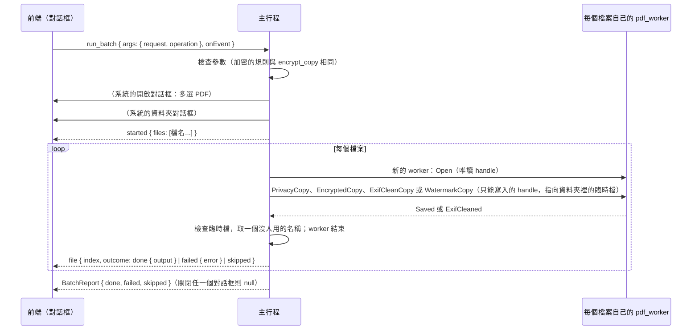

# 批次處理（B3-04）

工作卡 [#235](https://github.com/winner0988/Pdf-reader/issues/235)；規格 §7「批次處理佇列」；ADR 0005（已接受）。畫面見 [screen-map.md](../ux/screen-map.md)「批次處理（B3-04）」。

## 範圍

對多個 PDF 檔案做同一件事，每個檔案產生一份**副本**，放在使用者選的資料夾；原本的檔案不會改變。

| 操作（`BatchOperation`） | 副本 | 等於 |
|---|---|---|
| 清除中繼資料（`removeMetadata`） | `<檔名>（隱私匯出）.pdf` | 一份文件的「隱私匯出」（B2-03，[privacy-export.md](privacy-export.md)） |
| 加密（`encrypt`） | `<檔名>（已加密）.pdf` | 一份文件的「加密並另存新檔」（B2-15，[encrypt-copy.md](encrypt-copy.md)），每個檔案用同樣的密碼與限制 |
| 清除圖片的 EXIF（`removeExif`） | `<檔名>（已清除 EXIF）.pdf` | 只有批次處理有：見下方「清除圖片的 EXIF」 |
| 浮水印（`watermark`） | `<檔名>（浮水印）.pdf` | 一份文件的浮水印副本（B3-04，[watermark.md](watermark.md)），文字或圖片、位置、透明度與套用頁面 |
| 壓縮圖片（`compressImages`） | `<檔名>（已壓縮）.pdf` | 一份文件的「壓縮圖片並另存新檔」（B3-01，[compress-images.md](compress-images.md)），每個檔案用同樣的品質與最大尺寸；見下方「壓縮圖片」 |

五項操作包含清除中繼資料、加密、清除圖片 EXIF、浮水印與壓縮圖片。批次處理中可以關閉視窗，批次在系統列繼續（ADR 0005）：見下方「背景執行」；浮水印細節見 [watermark.md](watermark.md)。

批次處理中可以關閉視窗，批次在系統列繼續（ADR 0005）：見下方「背景執行」。

## 清除圖片的 EXIF

JPEG 放進 PDF 時是**整個檔案原樣**放進去（`/DCTDecode`），相機與之後的程式寫在裡面的東西也一起進去。這個操作把它們拿掉，**圖片不重新編碼**（不損失畫質，畫出來每個像素都一樣）：

| 拿掉 | 位置 |
|---|---|
| EXIF：相機廠牌與型號、拍攝時間、GPS 位置、EXIF 裡的縮圖 | JPEG 的 `APP1` |
| XMP（作者、程式、地點……） | JPEG 的 `APP1`，以及圖片字典的 `/Metadata` |
| IPTC 與 Photoshop 區塊（作者、說明、關鍵字） | JPEG 的 `APP13` |
| 其他程式的區段（例如 Multi-Picture 索引）、註解 | 其他 `APPn`、`COM`，不論在掃描之前或之間（漸進式 JPEG） |
| JFIF 標頭裡的縮圖（裁切或塗掉之前的樣子） | `APP0` 只留標頭本身 |
| 圖片結束之後的資料（相機的第二張圖、手機的動態相片影片） | `EOI` 之後 |
| 原圖的路徑（印前系統用）、程式的私有資料 | 圖片字典的 `/OPI`、`/PieceInfo`、`/LastModified` |

- **留下**決定顏色的區段：JFIF 標頭、ICC 色彩描述檔（`APP2`，裡面有描述檔的名稱與版權，例如「Display P3」）、Adobe 標記（`APP14`）。EXIF 的方向不需要：PDF 閱讀器畫 PDF 裡的 JPEG 時不依 EXIF 轉向（MuPDF、PDFium、pdf.js 都是），拿掉之後畫法不變。
- **藏在無損濾鏡後面的 JPEG**（`[/FlateDecode /DCTDecode]`、ASCII85、ASCIIHex、LZW、RunLength、Brotli，包括簡寫）：由 MuPDF 解開前面的濾鏡（在 worker 裡另建一個暫時的串流，用完刪掉），清除後存成單純的 `/DCTDecode`，DCT 自己的參數（`/ColorTransform`）保留。
- **沒辦法安全清除時不做副本**：JPEG 前面是會失真或不認得的濾鏡、JPEG 不是最後一個濾鏡、內容讀不到畫面（不是 JPEG、在掃描之前就截斷），這個檔案就失敗（`pictureNotCleaned`），不會產生一份「看起來清過但其實沒有」的副本。空的串流沒有東西可清。
- **找哪裡**：檔案裡每一個串流：圖片（`/Subtype /Image`，包括遮罩），以及其他以 JPEG 儲存的串流（例如頁面的縮圖 `/Thumb`）。
- **不處理**：寫在頁面內容裡的圖片（inline image，小而少見）、JPEG 2000（`/JPXDecode`，多半是掃描）自己的資訊框、附加的檔案。文件本身的中繼資料（`/Info`、目錄的 XMP 等）也不在其中，那是「清除中繼資料」（隱私匯出）的事；兩件事要分開做。
- **拒絕**：有數位簽章的文件（改了圖片簽章就失效，`invalidArgument`）與有密碼的文件（批次處理本來就略過）。
- worker：`crates/pdf_worker/src/exif.rs`（找串流、解開濾鏡、換回去）與 `jpeg.rs`（切掉區段，與「從檔案建立 PDF」共用）；副本與隱私匯出一樣，先寫進記憶體再開成第二份文件來改，原本的文件不動，最後完整重寫（不用的物件不寫出）。

## 壓縮圖片（B3-19）

工作卡 [#308](https://github.com/winner0988/Pdf-reader/issues/308) 的第一項；照 [ADR 0024](../adr/0024-batch-operation-admission.md) 的准入規則：

| 規則 | 怎麼符合 |
|---|---|
| 1. 單一文件已經有 | 對每個檔案送出與「壓縮圖片並另存新檔」**同一個** worker 請求（`CompressedCopy`），參數相同；worker 沒有為批次新增任何東西 |
| 2. 只產生副本 | 照下方「規則」：臨時檔、檢查是完整的 PDF、不覆寫的移動、名稱（與單一文件建議的 `<檔名>（已壓縮）.pdf` 相同）與編號 |
| 3. 不需要逐檔判斷 | 品質（高、中、低）與最大尺寸（不縮小或長邊 3000／2000／1500／1000 像素）開始前選一次，每個檔案相同；選項與預設值（中、2000）與單一文件相同 |
| 4. 簽章 | 有數位簽章的檔案失敗（worker 拒絕，與單一文件相同，原因 `invalidArgument`）；有密碼的檔案照舊略過 |
| 5. 上限 | 每個檔案：請求的時間上限 `SAVE_TIMEOUT`（5 分鐘），超過時這個檔案失敗、不留臨時檔；副本大小與其他操作相同的檢查 |
| 6. 參數 | `validate` 與單一文件共用 `check_compress_side`（`MIN_COMPRESS_SIDE_PX`～`MAX_COMPRESS_SIDE_PX`），沒有路徑；`BatchOperation` 的操作只接受自己的欄位，多的被拒絕 |
| 7. 報告 | 只有操作名稱（「壓縮圖片」）、檔名與結果 |

- 壓縮自己的時間預算（`compress::BUDGET`，150 秒）用完時，與單一文件相同：其餘的圖片保持原樣，副本照樣完成。單一文件的對話框會說「時間不夠」；批次的結果只有「完成」（`BatchOutcome` 沒有這一項），對話框的說明先講。
- 圖片沒有變小時不換，所以副本可能與原本一樣大。

## 規則

| 項目 | 規則 |
|---|---|
| 檔案 | 系統的開啟對話框選，可以多選，最多 `MAX_BATCH_FILES` = 500 個；只有 PDF |
| 資料夾 | 系統的資料夾對話框選；副本都放在這裡 |
| 順序 | 依對話框給的順序，一個接一個 |
| 每個檔案 | 在**自己的 worker** 中開啟（ADR 0012），做完副本就結束；不開分頁，不記錄在最近開啟的檔案 |
| 名稱 | 與單一文件的同一個操作建議的名稱相同（`export::stem`）；資料夾裡已經有這個名稱時改用 `名稱 (2).pdf`、`(3)`……，最多 999 |
| 不覆寫 | 副本先寫進資料夾裡的臨時檔，檢查是完整的 PDF 後才取名字；取名字用不覆寫的移動（`MoveFileExW` 不帶 `MOVEFILE_REPLACE_EXISTING`），所以**任何已經存在的檔案都不會被取代**，包括在選名稱之後才出現的同名檔案 |
| 失敗 | 一個檔案失敗（不是 PDF、損毀、太大、有密碼、有數位簽章而不能加密或壓縮……）只記下原因，下一個照做；不留臨時檔 |
| 有密碼的 PDF | 略過，原因是 `encrypted`：批次處理不詢問開啟密碼 |
| 停止 | 「停止」（`cancel`）在目前的檔案做完後停下，其餘標為略過；已經做好的副本留著 |
| 原檔 | 不改變；正在分頁中開著、有未儲存變更的檔案，用的是磁碟上的檔案，不含那些變更 |

## 流程

- 命令 `run_batch` 的參數只有要做什麼（`BatchArgs`：`request`、`operation`），**沒有路徑**；檔案與資料夾都由主行程的系統對話框選。前端只看到檔名（`display_name`）。
- 進度走頻道（`BatchEvent`），與匯出（B2-04）相同；`cancel(request)` 停止。
- 加密的密碼：`BatchOperation::Encrypt` 的密碼是 `Password`（`Debug` 不印出、丟棄時清除），只交給每個檔案的 worker 一次，批次結束時隨參數一起丟棄；事件、報告與日誌都沒有它們。只有開啟密碼時，每個檔案的權限密碼由主行程隨機產生（與單一文件相同）。

## 背景執行（ADR 0005）

規格與 ADR 0005 允許「使用者主動啟動的批次處理」在視窗關閉後繼續，這是 CONTEXT.md 的「批次處理背景服務」的全部範圍：

| 情況 | 行為 |
|---|---|
| 批次處理中關閉視窗（✕、Alt+F4） | 與任何關閉一樣，先問有沒有未儲存的變更。之後視窗**隱藏**而不是關閉，系統列出現一個圖示，提示文字說明這是批次處理、做到哪裡、做完就會結束（`PDF Reader：批次處理中（3／10），完成後就會結束`）。程式沒有別的事在背景做 |
| 圖示的選單 | 「顯示視窗」（左鍵點圖示也是）：視窗回來，圖示消失，關閉的動作取消，一切如原樣（對話框還在，繼續顯示進度）。「停止批次處理」：與對話框的「停止」相同，目前的檔案做完就停，其餘略過 |
| 視窗隱藏時又啟動一次程式（例如在檔案總管點兩下一個 PDF） | 那個檔案交給原本的程式開成分頁，視窗顯示出來，與選單的「顯示視窗」相同 |
| 批次做完（視窗仍隱藏） | 在批次的資料夾寫一份**報告**（`批次處理報告.txt`，名稱已被用時加 `(2)`、`(3)`，不會取代任何檔案）：做了什麼、資料夾、完成／失敗／略過各幾個、每個檔案的結果。接著跳出訊息方塊（標題「批次處理完成」）說結果與報告的路徑；使用者按「確定」後，程式像關閉視窗一樣結束（先前選了「不儲存」的變更這時才放棄）。圖示在訊息出現前就移除 |
| 批次做完（視窗顯示著） | 與以前一樣：對話框顯示結果，沒有報告，沒有訊息 |
| 視窗隱藏時批次已經結束，或沒有批次在跑 | 視窗照常關閉。**沒有批次就沒有圖示、沒有隱藏的視窗** |

- 不隨 Windows 啟動，不新增排程、服務或登錄項目；沒有網路。圖示只在視窗隱藏、批次進行的期間存在。
- 實作：`src-tauri/src/background.rs`。所有決定（隱藏、圖示、報告、關閉）都在**主執行緒**依序做，批次只通知「做到哪裡」與「結束了」，所以不會有兩邊同時決定的競爭：批次在關閉的那一刻剛好做完，視窗就照常關閉。Tauri 的 `tray-icon` 功能（`src-tauri/Cargo.toml`）是新的編譯時依賴（Cargo.lock 沒有變，`tray-icon`、`muda` 本來就在鎖定檔裡），不需要前端的 capability。
- 報告與訊息只有檔名與結果；批次的密碼（`Password`）不在 `Ended`，報告裡沒有。
- 對話框屬於**整個 app**（`features/batch/BatchHost`），不屬於某個畫面：批次進行時第一個文件在起始畫面上開啟、它所在的分頁被關閉，或視窗隱藏後再顯示，對話框與進度都還在。

## 測試

- `ipc_contract`：`a_batch_is_checked_as_its_operation_is`（加密的規則與 `EncryptArgs` 相同；壓縮的尺寸規則與 `CompressArgs` 相同；JSON 的形式；多的欄位，例如路徑，被拒絕，包括操作裡的）；`ExifCleaned` 的大小與張數有界；`PictureNotCleaned` 到前端是自己的錯誤碼。
- worker：
  - `jpeg.rs`：只拿掉資訊、留下決定顏色的區段；結束之後的資料與 JFIF 縮圖拿掉；掃描之間的區段拿掉、表格留下；掃描的資料到下一個標記為止（填充位元組、重新開始標記）；截斷在掃描中的圖片。
  - `exif.rs`：相機的 JPEG 在 PDF 裡清完後頁面畫出來每個像素都一樣，再做一次沒有東西可清；三種無損濾鏡的組合讀得穿，存成單純的 JPEG 並留下自己的參數；讀不穿的六種情況拒絕；圖片字典的四個項目拿掉、文件的 XMP 留著；沒有東西可清的圖片（包括空的與藏在濾鏡後的）原樣不動；不是頁面圖片的 JPEG（縮圖）也清。
  - `engine.rs`：副本畫出來與原本相同，開著的文件仍是原樣、存檔仍有原本的圖片；加密與有簽章的文件拒絕。
  - `tests/exif_clean.rs`（真正的 worker、真正的沙盒）：語料 `benign/photo-exif.pdf` 的副本沒有任何一項私密資訊、畫出來相同，再做一次大小相同，副本的副本沒有東西可清；有簽章的文件拒絕而 worker 繼續服務。
- 主行程：
  - `batch.rs`：名稱與編號；停止；全部一起停止、有沒有批次在跑。
  - `background.rs`：記錄每個檔案的結果與進度；報告的內容（每個檔案與結果，沒有密碼）；報告不取代任何檔案、名稱被用時編號、資料夾不在時是錯誤。
  - `saving.rs`：`place_new` 不取代已有的檔案。
  - `documents.rs`（真的 worker）：四個檔案裡有一個加密的、一個損毀的，另外兩個做好，原檔不變，沒有臨時檔；再做一次時名稱加上 (2)；一開始就停止則全部略過；加密的副本要密碼才打得開，也打得開；清除 EXIF 時照片的副本沒有相機與作者、能開啟，有簽章的文件失敗，另一個檔案只少了圖片的 XMP（文件的中繼資料還在）；浮水印在副本每頁畫上文字或圖片，原檔不變，重新開啟副本確認每一頁有 `/PdfReaderWatermark` 且文字能被搜尋；壓縮圖片時五個檔案裡有簽章、加密、損毀的各自失敗（簽章的原因是 `invalidArgument`），另外兩份副本頁面相同、圖片頁的副本小了一半以上，原檔不變，沒有臨時檔。
  - `file_dialog.rs`：選檔對話框可以多選，不加入最近使用的項目。
- 前端：`Batch.test.tsx`（選單、五種操作、清除 EXIF、壓縮圖片與浮水印簽章的說明、壓縮的選項與預設值和單一文件相同、浮水印欄位與數值驗證、密碼只送一次且不留、進度與每個檔案的結果、停止、關閉系統對話框、無法開始），`App.test.tsx`（批次進行時第一個文件在起始畫面上開啟，對話框與進度都還在），axe。
- E2E（`tests/e2e/batch.spec.ts`，真正的 app，系統對話框以 UI Automation 回答）：三個檔案（其中一個加密）清除中繼資料；加密兩個檔案；照片與有簽章的檔案清除 EXIF（照片的副本沒有相機、作者與縮圖，簽章檔失敗，原檔不變）；浮水印在副本每頁畫上文字且原檔不變；圖片頁與有簽章的檔案壓縮圖片（副本小了一半以上，簽章檔失敗，原檔不變）；**十個檔案（九個各要約 1.5 秒）做到一半關閉視窗**：視窗隱藏、程式還在，批次做完後資料夾有報告（每個檔案的結果）、跳出訊息，按掉後程式結束，九份副本都在；**再啟動一次程式就把視窗顯示出來**：關閉的動作取消，對話框繼續顯示、做完後說結果，程式不結束，沒有報告。
- fuzz：`exif_clean`（任意的 PDF 位元組跑整個流程，見 [fuzzing.md](../security/fuzzing.md)）。

## 已知限制

- 清除 EXIF 不處理的部分見上方「清除圖片的 EXIF」。
- 視窗隱藏時，程式只有圖示與批次：不能開新文件（要開就先顯示視窗）。
- 結束時的訊息是 Windows 的訊息方塊，不是系統通知（那要再加一個外掛與權限）；它沒有擁有者視窗，Windows 的前景限制可能讓它出現在別的視窗後面、工作列閃爍。
- 有密碼的 PDF 一律略過。
- 檔案的順序是對話框給的順序。
