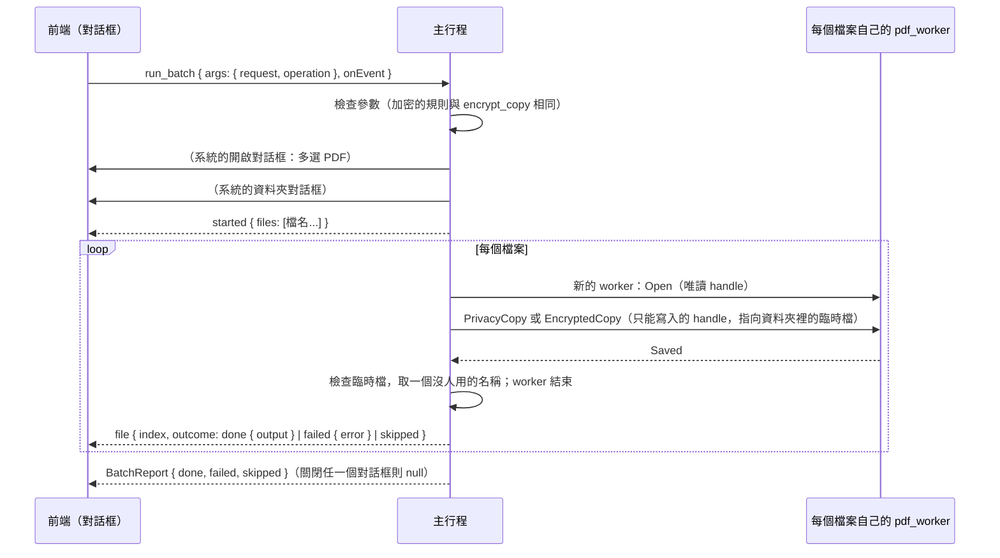

# 批次處理（B3-04）

工作卡 [#235](https://github.com/winner0988/Pdf-reader/issues/235)；規格 §7「批次處理佇列」；ADR 0005（已接受）。畫面見 [screen-map.md](../ux/screen-map.md)「批次處理（B3-04）」。

## 範圍

對多個 PDF 檔案做同一件事，每個檔案產生一份**副本**，放在使用者選的資料夾；原本的檔案不會改變。

| 操作（`BatchOperation`） | 副本 | 等於 |
|---|---|---|
| 清除中繼資料（`removeMetadata`） | `<檔名>（隱私匯出）.pdf` | 一份文件的「隱私匯出」（B2-03，[privacy-export.md](privacy-export.md)） |
| 加密（`encrypt`） | `<檔名>（已加密）.pdf` | 一份文件的「加密並另存新檔」（B2-15，[encrypt-copy.md](encrypt-copy.md)），每個檔案用同樣的密碼與限制 |

工作卡的其餘部分分開做：

- **浮水印**：新的 worker 操作，文字或圖片、位置、透明度、頁面範圍。
- **EXIF 清除**：要用到 B3-03 的 `jpeg.rs`（[#275](https://github.com/winner0988/Pdf-reader/pull/275)）。

批次處理中可以關閉視窗，批次在系統列繼續（ADR 0005）：見下方「背景執行」。

## 規則

| 項目 | 規則 |
|---|---|
| 檔案 | 系統的開啟對話框選，可以多選，最多 `MAX_BATCH_FILES` = 500 個；只有 PDF |
| 資料夾 | 系統的資料夾對話框選；副本都放在這裡 |
| 順序 | 依對話框給的順序，一個接一個 |
| 每個檔案 | 在**自己的 worker** 中開啟（ADR 0012），做完副本就結束；不開分頁，不記錄在最近開啟的檔案 |
| 名稱 | 與單一文件的同一個操作建議的名稱相同（`export::stem`）；資料夾裡已經有這個名稱時改用 `名稱 (2).pdf`、`(3)`……，最多 999 |
| 不覆寫 | 副本先寫進資料夾裡的臨時檔，檢查是完整的 PDF 後才取名字；取名字用不覆寫的移動（`MoveFileExW` 不帶 `MOVEFILE_REPLACE_EXISTING`），所以**任何已經存在的檔案都不會被取代**，包括在選名稱之後才出現的同名檔案 |
| 失敗 | 一個檔案失敗（不是 PDF、損毀、太大、有密碼、有數位簽章而不能加密……）只記下原因，下一個照做；不留臨時檔 |
| 有密碼的 PDF | 略過，原因是 `encrypted`：批次處理不詢問開啟密碼 |
| 停止 | 「停止」（`cancel`）在目前的檔案做完後停下，其餘標為略過；已經做好的副本留著 |
| 原檔 | 不改變；正在分頁中開著、有未儲存變更的檔案，用的是磁碟上的檔案，不含那些變更 |

## 流程

- 命令 `run_batch` 的參數只有要做什麼（`BatchArgs`：`request`、`operation`），**沒有路徑**；檔案與資料夾都由主行程的系統對話框選。前端只看到檔名（`display_name`）。
- 進度走頻道（`BatchEvent`），與匯出（B2-04）相同；`cancel(request)` 停止。
- 加密的密碼：`BatchOperation::Encrypt` 的密碼是 `Password`（`Debug` 不印出、丟棄時清除），只交給每個檔案的 worker 一次，批次結束時隨參數一起丟棄；事件、報告與日誌都沒有它們。只有開啟密碼時，每個檔案的權限密碼由主行程隨機產生（與單一文件相同）。

## 背景執行（ADR 0005）

規格與 ADR 0005 允許「使用者主動啟動的批次處理」在視窗關閉後繼續，這是 CONTEXT.md 的「批次處理背景服務」的全部範圍：

| 情況 | 行為 |
|---|---|
| 批次處理中關閉視窗（✕、Alt+F4） | 與任何關閉一樣，先問有沒有未儲存的變更。之後視窗**隱藏**而不是關閉，系統列出現一個圖示，提示文字說明這是批次處理、做到哪裡、做完就會結束（`PDF Reader：批次處理中（3／10），完成後就會結束`）。程式沒有別的事在背景做 |
| 圖示的選單 | 「顯示視窗」（左鍵點圖示也是）：視窗回來，圖示消失，關閉的動作取消，一切如原樣（對話框還在，繼續顯示進度）。「停止批次處理」：與對話框的「停止」相同，目前的檔案做完就停，其餘略過 |
| 視窗隱藏時又啟動一次程式（例如在檔案總管點兩下一個 PDF） | 那個檔案交給原本的程式開成分頁，視窗顯示出來，與選單的「顯示視窗」相同 |
| 批次做完（視窗仍隱藏） | 在批次的資料夾寫一份**報告**（`批次處理報告.txt`，名稱已被用時加 `(2)`、`(3)`，不會取代任何檔案）：做了什麼、資料夾、完成／失敗／略過各幾個、每個檔案的結果。接著跳出訊息方塊（標題「批次處理完成」）說結果與報告的路徑；使用者按「確定」後，程式像關閉視窗一樣結束（先前選了「不儲存」的變更這時才放棄）。圖示在訊息出現前就移除 |
| 批次做完（視窗顯示著） | 與以前一樣：對話框顯示結果，沒有報告，沒有訊息 |
| 視窗隱藏時批次已經結束，或沒有批次在跑 | 視窗照常關閉。**沒有批次就沒有圖示、沒有隱藏的視窗** |

- 不隨 Windows 啟動，不新增排程、服務或登錄項目；沒有網路。圖示只在視窗隱藏、批次進行的期間存在。
- 實作：`src-tauri/src/background.rs`。所有決定（隱藏、圖示、報告、關閉）都在**主執行緒**依序做，批次只通知「做到哪裡」與「結束了」，所以不會有兩邊同時決定的競爭：批次在關閉的那一刻剛好做完，視窗就照常關閉。Tauri 的 `tray-icon` 功能（`src-tauri/Cargo.toml`）是新的編譯時依賴（Cargo.lock 沒有變，`tray-icon`、`muda` 本來就在鎖定檔裡），不需要前端的 capability。
- 報告與訊息只有檔名與結果；批次的密碼（`Password`）不在 `Ended`，報告裡沒有。
- 對話框屬於**整個 app**（`features/batch/BatchHost`），不屬於某個畫面：批次進行時第一個文件在起始畫面上開啟、它所在的分頁被關閉，或視窗隱藏後再顯示，對話框與進度都還在。

## 測試

- `ipc_contract`：`a_batch_is_checked_as_its_operation_is`（加密的規則與 `EncryptArgs` 相同；JSON 的形式；多的欄位，例如路徑，被拒絕）。
- 主行程：
  - `batch.rs`：名稱與編號；停止；全部一起停止、有沒有批次在跑。
  - `background.rs`：記錄每個檔案的結果與進度；報告的內容（每個檔案與結果，沒有密碼）；報告不取代任何檔案、名稱被用時編號、資料夾不在時是錯誤。
  - `saving.rs`：`place_new` 不取代已有的檔案。
  - `documents.rs`（真的 worker）：四個檔案裡有一個加密的、一個損毀的，另外兩個做好，原檔不變，沒有臨時檔；再做一次時名稱加上 (2)；一開始就停止則全部略過；加密的副本要密碼才打得開，也打得開。
  - `file_dialog.rs`：選檔對話框可以多選，不加入最近使用的項目。
- 前端：`Batch.test.tsx`（選單、兩種操作、密碼只送一次且不留、進度與每個檔案的結果、停止、關閉系統對話框、無法開始），`App.test.tsx`（批次進行時第一個文件在起始畫面上開啟，對話框與進度都還在），axe。
- E2E（`tests/e2e/batch.spec.ts`，真正的 app，系統對話框以 UI Automation 回答）：三個檔案（其中一個加密）清除中繼資料；加密兩個檔案；**十個檔案（九個各要約 1.5 秒）做到一半關閉視窗**：視窗隱藏、程式還在，批次做完後資料夾有報告（每個檔案的結果）、跳出訊息，按掉後程式結束，九份副本都在；**再啟動一次程式就把視窗顯示出來**：關閉的動作取消，對話框繼續顯示、做完後說結果，程式不結束，沒有報告。

## 已知限制

- 浮水印與 EXIF 清除是別的 PR（見上）。
- 視窗隱藏時，程式只有圖示與批次：不能開新文件（要開就先顯示視窗）。
- 結束時的訊息是 Windows 的訊息方塊，不是系統通知（那要再加一個外掛與權限）；它沒有擁有者視窗，Windows 的前景限制可能讓它出現在別的視窗後面、工作列閃爍。
- 有密碼的 PDF 一律略過。
- 檔案的順序是對話框給的順序。
