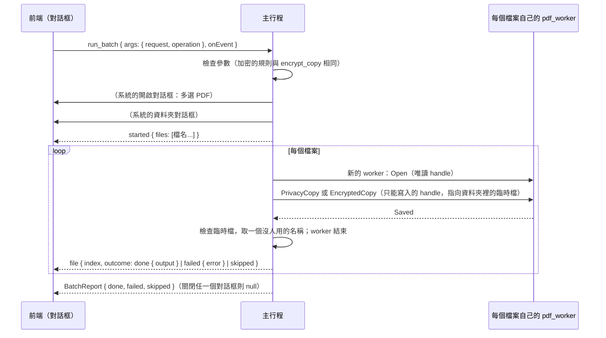

# 批次處理（B3-04）

工作卡 [#235](https://github.com/winner0988/Pdf-reader/issues/235)；規格 §7「批次處理佇列」；ADR 0005（已接受）。畫面見 [screen-map.md](../ux/screen-map.md)「批次處理（B3-04）」。

## 範圍

對多個 PDF 檔案做同一件事，每個檔案產生一份**副本**，放在使用者選的資料夾；原本的檔案不會改變。

| 操作（`BatchOperation`） | 副本 | 等於 |
|---|---|---|
| 清除中繼資料（`removeMetadata`） | `<檔名>（隱私匯出）.pdf` | 一份文件的「隱私匯出」（B2-03，[privacy-export.md](privacy-export.md)） |
| 加密（`encrypt`） | `<檔名>（已加密）.pdf` | 一份文件的「加密並另存新檔」（B2-15，[encrypt-copy.md](encrypt-copy.md)），每個檔案用同樣的密碼與限制 |

這是第一部分。工作卡的其餘部分分開做：

- **浮水印**：新的 worker 操作，文字或圖片、位置、透明度、頁面範圍。
- **EXIF 清除**：要用到 B3-03 的 `jpeg.rs`（#265 合併後）。
- **背景執行與系統列圖示**（ADR 0005）：新增依賴與 capability，要審查。

在那之前，處理中關閉視窗會停止批次處理，對話框有說明。

## 規則

| 項目 | 規則 |
|---|---|
| 檔案 | 系統的開啟對話框選，可以多選，最多 `MAX_BATCH_FILES` = 500 個；只有 PDF |
| 資料夾 | 系統的資料夾對話框選；副本都放在這裡 |
| 順序 | 依對話框給的順序，一個接一個 |
| 每個檔案 | 在**自己的 worker** 中開啟（ADR 0012），做完副本就結束；不開分頁，不記錄在最近開啟的檔案 |
| 名稱 | 與單一文件的同一個操作建議的名稱相同（`export::stem`）；資料夾裡已經有這個名稱時改用 `名稱 (2).pdf`、`(3)`……，最多 999 |
| 不覆寫 | 副本先寫進資料夾裡的臨時檔，檢查是完整的 PDF 後才取名字；取名字用不覆寫的移動（`MoveFileExW` 不帶 `MOVEFILE_REPLACE_EXISTING`），所以**任何已經存在的檔案都不會被取代**，包括在選名稱之後才出現的同名檔案 |
| 失敗 | 一個檔案失敗（不是 PDF、損毀、太大、有密碼、有數位簽章而不能加密……）只記下原因，下一個照做；不留臨時檔 |
| 有密碼的 PDF | 略過，原因是 `encrypted`：批次處理不詢問開啟密碼 |
| 停止 | 「停止」（`cancel`）在目前的檔案做完後停下，其餘標為略過；已經做好的副本留著 |
| 原檔 | 不改變；正在分頁中開著、有未儲存變更的檔案，用的是磁碟上的檔案，不含那些變更 |

## 流程

- 命令 `run_batch` 的參數只有要做什麼（`BatchArgs`：`request`、`operation`），**沒有路徑**；檔案與資料夾都由主行程的系統對話框選。前端只看到檔名（`display_name`）。
- 進度走頻道（`BatchEvent`），與匯出（B2-04）相同；`cancel(request)` 停止。
- 加密的密碼：`BatchOperation::Encrypt` 的密碼是 `Password`（`Debug` 不印出、丟棄時清除），只交給每個檔案的 worker 一次，批次結束時隨參數一起丟棄；事件、報告與日誌都沒有它們。只有開啟密碼時，每個檔案的權限密碼由主行程隨機產生（與單一文件相同）。

## 測試

- `ipc_contract`：`a_batch_is_checked_as_its_operation_is`（加密的規則與 `EncryptArgs` 相同；JSON 的形式；多的欄位，例如路徑，被拒絕）。
- 主行程：
  - `batch.rs`：名稱與編號；停止。
  - `saving.rs`：`place_new` 不取代已有的檔案。
  - `documents.rs`（真的 worker）：四個檔案裡有一個加密的、一個損毀的，另外兩個做好，原檔不變，沒有臨時檔；再做一次時名稱加上 (2)；一開始就停止則全部略過；加密的副本要密碼才打得開，也打得開。
  - `file_dialog.rs`：選檔對話框可以多選，不加入最近使用的項目。
- 前端：`Batch.test.tsx`（選單、兩種操作、密碼只送一次且不留、進度與每個檔案的結果、停止、關閉系統對話框、無法開始），axe。
- E2E（`tests/e2e/batch.spec.ts`，真正的 app，系統對話框以 UI Automation 回答）：三個檔案（其中一個加密）清除中繼資料；加密兩個檔案。

## 已知限制

- 背景執行、系統列圖示、浮水印與 EXIF 清除還沒做（見上）。
- 有密碼的 PDF 一律略過。
- 檔案的順序是對話框給的順序。
