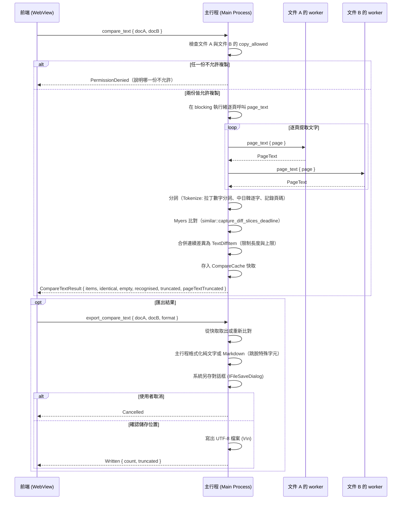

# 分頁文字比較（B3-24，E9）

工作項目 [#378](https://github.com/winner0988/Pdf-reader/issues/378)；依計畫 E9 與架構方針實作。
比對兩個已經開啟的分頁的文字內容（例如同一份合約或文件的不同修訂版本），依頁碼列出文字差異，支援點擊跳頁，並可將差異匯出為純文字或 Markdown 檔案。

## 流程

## 為什麼在主行程比對？

1. **避免龐大文字跨 IPC 傳輸**：大文件（如數百頁）包含數十萬字元與標記，若傳至前端 JavaScript 處理，會在 IPC 序列化、反序列化以及 V8 垃圾回收中造成介面卡頓。
2. **高效能與時間上限**：主行程在 Tokio 的 `blocking` 執行緒池執行比對，採用原生編譯的 Myers 演算法（`similar`），具備 `capture_diff_slices_deadline` 時間上限機制，即使萬頁或巨幅文字差異也能在時限內及時截斷並返回，不卡住使用者介面。
3. **記憶體安全與權限隔離**：文字僅在後端記憶體中短暫存在於比對與快取結構，不對前端 WebView 曝露整份文件的原始文字串流。比對過程不連續持有 `with_document` 鎖，僅在逐頁提取文字時鎖定單一頁面，不影響其他 worker 操作。

## 為什麼匯出不經過前端？

依循 ADR 0008 與 E8（[annotation-summary.md](annotation-summary.md)）的既有模式：
1. **防止文件內容跨 WebView 洩漏**：前端僅傳送格式選項（純文字或 Markdown）與文件識別代號，不經由前端傳輸匯出內容或檔案路徑。
2. **原生系統檔案對話框整合**：主行程直接呼叫 Windows 原生 `IFileSaveDialog`，取得路徑後由後端安全寫入，並保證寫出格式為標準 UTF-8、換行符為 `\r\n`，以及 Markdown 特殊符號的完整安全跳脫。匯出檔的中文文字全數集中於 `src-tauri/src/strings.rs`。
3. **快取重複利用與失效機制**：
   - 上一次比對成功的結果留存在主行程記憶體快取（`CompareCache`，受 `MAX_COMPARE_CACHE_BYTES` 限制）。
   - **文件關閉失效**：任一相關文件於分頁關閉（`close_tab`）時，立即從快取中移除該記錄（`invalidate_doc`）。
   - **編輯重算檢驗**：快取中一併記錄比較時兩份文件的編輯次數（`edit_count_a`、`edit_count_b`）。使用者點擊匯出時，後端檢查兩份文件目前的 `edit_count` 是否與快取相符；若任一文件在比較之後又曾編輯過，則捨棄快取、重新執行比對以確保匯出內容最新。

## 分詞規則（Tokenization）

- **拉丁字母與數字**：以連續英文字母、數字為一個詞單位；空白與標點符號分開。
- **中日韓漢字與全形標點**：依 Unicode 範圍（`\u{4e00}..\u{9fff}`、全形標點等）每個字作為獨立詞單位。
- **位置與空格記憶**：每個 Token 記錄其所屬的 0-indexed 頁碼，以及是否前置空白（`has_leading_space`），合併輸出時能精確還原詞間間隔與中英混排原貌。

## 資源上限（limits.rs）

| 項目 | 上限值 | 理由與量測 | 超過時行為 |
|---|---|---|---|
| 最大比對頁數 | `MAX_COMPARE_PAGES`（2,000 頁） | 涵蓋常見合約與長篇論文，避免極端巨量頁面佔用記憶體 | 超出之頁數不提取，結果標示 `truncated = true` |
| 最大詞單位數 | `MAX_COMPARE_TOKENS`（500,000 個） | 50 萬詞約相當於百萬字，在 16 GB 記憶體下佔用約 15 MB 空間 | 停止提取，標示 `truncated = true` |
| 最大差異處數 | `MAX_COMPARE_DIFF_ITEMS`（2,000 處） | 前端清單渲染與檢閱的人類合理上限，避免 DOM 節點過多 | 停止加入新 hunk，標示 `truncated = true` |
| 差異段文字長度 | `MAX_COMPARE_TEXT_BYTES`（4,096 位元組） | 避免單一巨大段落撐爆 UI 卡片或匯出檔 | 截斷多餘文字並標記 `truncated = true` |
| 比對時間上限 | `MAX_COMPARE_DEADLINE_MILLIS`（10,000 毫秒） | 10 秒硬性逾時，保證 Myers 比對最差情況不卡住 | 中止比對迴圈，標示 `truncated = true` |
| 結果快取上限 | `MAX_COMPARE_CACHE_BYTES`（10 MiB） | 限制主行程保留的最新比對結果記憶體 | 超過大小則不保留快取，下次匯出重新比對 |

## 外部相依套件

- **`similar`**（`version = "2.7", default-features = false`）：
  - 授權：Apache-2.0。
  - 無任何傳遞相依（transitive dependencies），`Cargo.lock` 僅增加 `similar v2.7.0` 一個套件。
  - 符合 `cargo deny check` 的授權與安全性規則。

## 測試

- **單元測試**：
  - `src-tauri/src/compare/tokenize.rs`：中英混合分詞、全形半形標點、換行空格還原。
  - `src-tauri/src/compare/mod.rs`：新增、刪除、修改、完全相同、完全不同、截斷與時間上限。
  - `src-tauri/src/export.rs`：純文字與 Markdown 輸出格式化、Markdown 特殊字元跳脫、檔名清理。
  - `crates/ipc_contract/src/validate.rs`：參數驗證（超出範圍代號、格式檢查）。
- **主行程整合測試**：
  - `src-tauri/src/documents.rs` 的 `compare_tests`：以真實 worker 提取並比對 `contract-v1.pdf` 與 `contract-v2.pdf`，驗證跨頁修改與差異頁碼正確；驗證禁止複製文件的權限攔截。
- **前端測試**：
  - `src/features/compare/CompareDialog.test.tsx`：分頁下拉選單、執行比對、載入狀態、相同/無文字提示、差異列表、跳頁呼叫、匯出純文字與 Markdown、錯誤提示。
  - `src/features/shell/ReaderShell.test.tsx`：單一分頁時停用並顯示說明、禁止複製時停用並顯示說明、多個分頁時啟用並開啟對話框。
- **E2E 測試**：
  - `tests/e2e/compare.spec.ts`：以真實應用程式開啟兩個合約分頁，呼叫比較文字，驗證差異清單，點擊跳頁，透過另存對話框匯出 Markdown 並驗證檔案內容。
