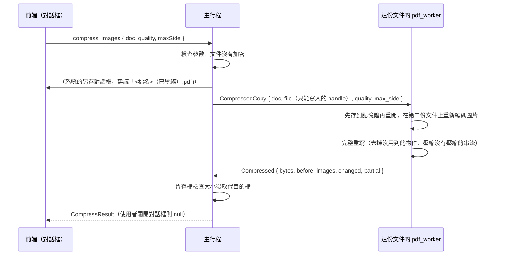

# 壓縮圖片並另存新檔（B3-01）

工作卡 [#232](https://github.com/winner0988/Pdf-reader/issues/232)；規格 §5「本地圖片壓縮」：圖片的編碼與壓縮在本機完成，絕不依賴雲端服務。畫面見 [screen-map.md](../ux/screen-map.md)「壓縮圖片並另存新檔（B3-01）」。

## 範圍

- 把目前的文件（含還沒儲存的編輯）的**圖片重新編碼成較小的 JPEG**，另存成**新檔**。目前的文件與它的檔案不會改變；副本不加入最近開啟的檔案。
- 兩個選項：**品質**（高、中、低；JPEG 品質 85、70、50）與**圖片的最大尺寸**（長邊最多多少像素：不縮小、3000、2000、1500、1000；超過的圖片縮小到這個大小，形狀不變）。
- 存完告訴使用者結果：副本多大、不壓縮圖片時會多大、文件裡有幾張圖片、其中幾張重新編碼了。
- **不做**：用雲端服務壓縮（規格禁止）、批次壓縮（ADR 0005）、已加密與有簽章的文件、JBIG2／CCITT／JPEG 2000 的圖片（掃描頁，通常已經很小）、內嵌在頁面內容裡的小圖（inline image）、依圖片在頁面上的實際大小換算 DPI（只看圖片自己的像素）、儲存時順便壓縮（只做成副本，原檔不動）。

## 哪些圖片會重新編碼

每一張圖片都各自判斷。只有**不會改變它在頁面上的意思**、而且**真的變小**的才會換掉；其他一律原樣留著。

| 情況 | 做法 |
|---|---|
| 8 位元、一個灰階樣本或三個顏色樣本（`DeviceGray`、`DeviceRGB`、`CalGray`、`CalRGB`，或 ICC 設定檔說明 `/N` 是 1 或 3）；濾鏡是 Flate、LZW、ASCIIHex、ASCII85、RunLength 或 JPEG（`DCTDecode`） | 看。**色彩空間的條目不動**，所以數字的意思不變；`/Decode`、`/Interpolate` 等也保留 |
| 色盤（`Indexed`）、`DeviceCMYK`、`Lab`、`Separation`、`DeviceN`、沒有色彩空間、不是 8 位元 | 原樣 |
| 遮罩圖片（`/ImageMask true`）、有 `/Mask`（色彩鍵遮罩或遮罩圖片） | 原樣：換編碼會改變哪些像素是透明的 |
| 另一張圖片的 `/SMask`（半透明遮罩） | 原樣，也不算進「圖片數」：JPEG 會讓邊緣的透明度模糊。帶著 `/SMask` 的**那張圖片**照常處理（遮罩的大小可以和圖片不同，這是標準允許的） |
| CCITT、JBIG2、JPEG 2000 或 Crypt 濾鏡 | 原樣 |
| 超過 3,600 萬像素（`MAX_PIXELS`），或邊長超過 65,535 | 原樣：解碼與縮小要花的記憶體與時間 |
| 解碼失敗、解出來的大小與它說的不同 | 原樣（損壞的圖片不會讓整份副本失敗） |
| 重新編碼後的檔案沒有小到原本的 90% 以下 | 原樣：已經很小的圖片、線條圖與螢幕截圖（Flate 比 JPEG 小）都不會被換成更糟的 |

換掉的圖片：濾鏡改成 `DCTDecode`、`/DecodeParms` 刪掉、`/Width`、`/Height` 與 `/BitsPerComponent` 照新的圖片寫，**`/Metadata`（圖片自己的 XMP）一併刪除**。

## 流程

- 命令 `compress_images` 的參數是 `CompressArgs`（見 [ipc-contract.md](ipc-contract.md)）：文件代號、品質與尺寸上限（`null` 或 256 到 16,384 像素），**沒有路徑**；另存對話框由主行程顯示。
- worker 請求 `CompressedCopy`：與 `Save` 相同，worker 只拿到一個只能寫入的 handle，看不到路徑；回 `Compressed`。逾時 5 分鐘（`SAVE_TIMEOUT`）。
- **開著的文件不變**：和隱私匯出、加密副本一樣，worker 先把文件（含未存的編輯）寫進記憶體再重開，換圖片的是重開的第二份。主行程的測試與沙盒測試確認：複製之後再複製一次得到同樣大小，頁面畫出來一樣。
- `before` 是第二份文件在換圖片**之前**以同樣的選項寫出的大小（完整重寫、沒用到的物件去掉、串流壓縮），所以 `before` 與 `bytes` 的差就是換圖片省下的，不含重寫本身省下的。

## 規則

| 項目 | 規則 |
|---|---|
| 已加密的文件 | 拒絕：worker 不保存密碼，副本若用別的設定，會丟掉作者要求的保護（與隱私匯出相同）。選單項目停用 |
| 有數位簽章的文件 | 拒絕：換了圖片的檔案不再是簽章涵蓋的內容（比照加密副本）。worker 回 `InvalidRequest`，**沒有檔案被留下** |
| 文件自己的檔案 | 不能是目的地（大小寫不同的寫法也算同一個檔案），主行程以訊息方塊請使用者另選 |
| 尺寸上限 | 不是 `null` 時必須是 256 到 16,384；主行程（`CompressArgs::validate`）與 worker 各檢查一次 |
| 時間 | 所有圖片合計最多 150 秒（`compress::BUDGET`）；用完時剩下的圖片原樣留著，`partial` 是 true，畫面會說明。逾時 5 分鐘是整個請求，還要留時間寫檔 |

## 圖片是不受信任的輸入

- 圖片由 worker 裡的 MuPDF 解碼（與畫出頁面時相同的程式碼，同一個沙盒：Job Object、受限權杖、Low 完整性、沒有網路）；縮小與編碼是純 Rust（`jpeg-encoder`，已是依賴，沒有 `unsafe`）。**沒有新依賴。**
- 先看圖片字典（像素數、色彩空間、濾鏡）才解碼；解碼出來的位元組數必須剛好是 寬 × 高 × 樣本數；換上去之前用 MuPDF 讀回新檔的標頭，確認大小與樣本數。
- 記憶體：一次只處理一張，最多 3,600 萬像素（RGB 約 108 MB）；整個 worker 有 2 GiB 的上限（[worker-sandbox.md](worker-sandbox.md)）。
- **已知的限制**：MuPDF 解碼一個串流時會把解出的全部資料放進記憶體，圖片字典說的大小無法限制它。一個故意做成「壓縮炸彈」的 Flate 串流可以讓這一步用掉 worker 的記憶體上限；結果是 worker 被結束、文件的畫面請求失敗後重開（崩潰復原會還原編輯），不是別的後果。頁面內容串流有同樣的性質，所以這不是新的風險類別。
- 模糊測試：`fuzz/fuzz_targets/compress_images.rs` 以任意的 PDF 位元組跑整個流程（開啟、重新編碼、寫出），與 `open_document` 同樣的設定。

## 中繼資料

- 重新編碼出來的 JPEG 只有像素：相機型號、GPS、拍攝時間（EXIF）、色彩設定檔的區段（APPn）都不會被寫進去，圖片自己的 `/Metadata` 也刪掉。
- **沒有換掉的圖片原樣不動**，裡面的 EXIF 也在。[隱私匯出](privacy-export.md)清除的是文件的中繼資料，不是圖片裡的；只剝掉 JPEG 的區段而不重新編碼（不損失畫質）是[批次處理](batch.md)的「清除圖片的 EXIF」（B3-04）。

## 測試

- worker（`compress.rs` 的單元測試）：縮小的平均（整數倍與非整數倍、平的圖片仍是平的、權重加總為一）、大小的計算；一張照片重新編碼後小很多、頁面畫出來幾乎一樣、品質越低越小；不超過上限的圖片大小不變、沒壓縮的圖片變成 JPEG（彩色與灰階）；不會更小的圖片（已經很差的 JPEG、線條圖）原樣；遮罩原樣且不算數；色盤、遮罩圖片、16 位元、CMYK、色彩鍵遮罩、CCITT、JPEG 2000、太大、沒有色彩空間、Lab、Crypt、零寬度的圖片都原樣，對照組（同樣的資料、普通的色彩空間）換了；損壞、太短、空的串流原樣、其他照常；相機的資料（EXIF 區段）不在新圖片裡，圖片自己的 XMP 也一併刪除；不是尺寸的上限被拒絕；時間用完時其餘原樣；副本比較小、重開後有同樣的頁面、開著的文件畫出來沒變；加密與有簽章的文件被拒絕且沒有寫出任何東西。
- 真的沙盒（`tests/compress.rs`）：worker 寫出較小的副本、副本可以開啟與畫出頁面、再複製一次得到同樣的大小；簽章的文件與不合規則的上限被拒絕（`InvalidRequest`），之後 worker 還能用。
- 主行程（`documents.rs`）：副本含未存的編輯、文件與檔案不變、結果的位元組數等於檔案大小；不能覆蓋文件自己的檔案（大小寫不同也算）；加密與有簽章的文件被拒絕、沒有留下檔案。
- 契約：`CompressArgs` 的尺寸範圍、`Compressed` 回應的大小與數量檢查（`validate.rs`）、模糊測試種子。
- 畫面（`src/features/saving/`）：`Compress.test.tsx`——大小怎麼說、結果怎麼說（少了多少、幾張圖片、沒有變小、沒有圖片、時間不夠）；對話框一開始的選項、送出的參數（每一種品質與尺寸）、結果留在對話框裡直到按「完成」、關閉系統的對話框後可以再試、失敗的說明、每次開啟都重新開始、加密的文件停用並說明、沒有主行程時停用；`AccessibilityComponents.test.tsx` 的 axe 檢查（選項與結果兩個狀態）。
- 真的 app（`tests/e2e/compress-images.spec.ts`）：用腳本做一份有 900 × 600 照片的 PDF，選「低」品質、存成副本；對話框說 1 張圖片中的 1 張重新編碼了、副本的位元組數不到原檔的四分之一且有 `/DCTDecode`、原檔的雜湊沒變、原本的分頁還是原本的文件；副本開啟後照片畫得出來（頁面四分之一以上不是白的）。沒有圖片的文件照實說，副本仍然寫出。`accessibility.spec.ts` 在兩種主題下檢查這個對話框。
