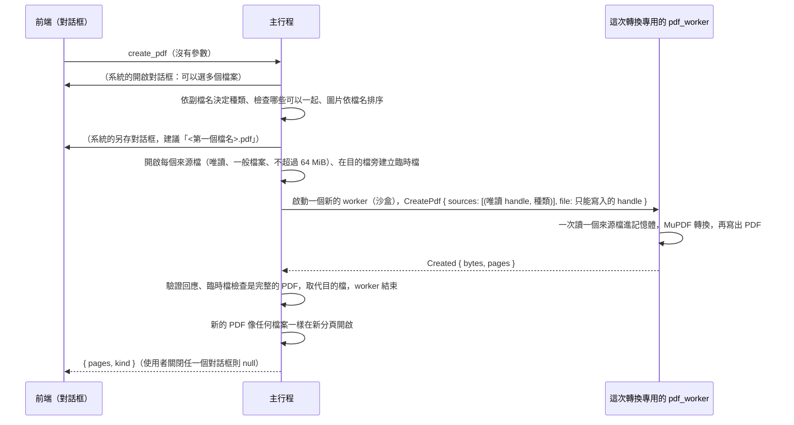

# 從檔案建立 PDF（B3-03）

工作卡 [#234](https://github.com/winner0988/Pdf-reader/issues/234)；規格 §7「格式匯入／建立 PDF」。畫面見 [screen-map.md](../ux/screen-map.md)「從檔案建立 PDF（B3-03）」。

## 範圍

把下面這些檔案轉成一份**新的 PDF**，新的 PDF 在新分頁開啟；來源檔不會改變：

| 種類（`CreateKind`） | 副檔名 | 一次幾個 | 備註 |
|---|---|---|---|
| 圖片（`image`） | png、jpg、jpeg、gif、bmp、tif、tiff | 1～200 個 | 一張一頁，依檔名排序 |
| 網頁（`html`） | html、htm、xhtml | 1 個 | 排版成 A4 |
| 純文字（`text`） | txt | 1 個 | UTF-8 或 UTF-16（有位元組順序記號），排版成 A4 |
| 電子書（`epub`） | epub | 1 個 | 排版成 A4 |
| XPS（`xps`） | xps、oxps | 1 個 | 固定版面，頁面大小照檔案 |
| SVG（`svg`） | svg | 1 個 | 一頁，大小照圖 |
| Word、Excel、PowerPoint（`docx`、`xlsx`、`pptx`） | docx、xlsx、pptx | 1 個 | **實驗性**：用 MuPDF 內建的轉換，版面不會和 Office 一樣；對話框說明（負責人 2026-10-13 決定） |

- **不做**：舊的二進位 Office 格式（doc、xls、ppt）、RTF、Markdown、CBZ、HEIC、WebP，以及把 PDF 當來源（見下方「給錯副檔名的檔案」）；排圖片頁的順序要自己排（依檔名），沒有拖曳排序；批次轉換（ADR 0005）。
- 取得檔案與位置的兩個對話框都由主行程顯示，路徑不會到前端（ADR 0008）。

## 規則

| 項目 | 規則 |
|---|---|
| 種類 | 主行程依**副檔名**決定（`src-tauri/src/create_pdf.rs`，不分大小寫，一個種類的副檔名只列在一處，開啟對話框的篩選器也由它產生）。其他副檔名拒絕（`InvalidArgument`） |
| 一起 | 只有圖片可以多個（最多 `MAX_CREATE_SOURCES` = 200）；其他種類一次一個檔案，否則拒絕。圖片依**檔名**排序，不分大小寫，連續的數字當數字比（`2.png` 在 `10.png` 之前） |
| 來源檔大小 | 每個最多 64 MiB（`MAX_SOURCE_BYTES`）：主行程在**開啟的檔案**上檢查（`open_create_source`，之後不能在檢查和讀取之間被換掉），worker 讀取時再多讀一個位元組檢查一次 |
| 頁數 | 最多 100,000 頁（`MAX_PAGE_COUNT`）：圖片逐張檢查；其他種類在排版之後、轉換之前檢查 |
| 圖片 | 單張最多 6,400 萬畫素、長邊最多 65,535 畫素；不是 JPEG 的圖片，像素在 PDF 寫出前不壓縮，所有這類圖片合計最多 768 MiB（`MAX_RAW_BYTES`），超過就是 `PictureTooLarge` |
| 輸出 | 最多 512 MiB（`MAX_DOCUMENT_BYTES`），寫入時超過就失敗；臨時檔檢查是完整的 PDF 才取代目的檔 |
| 時間 | 5 分鐘（`SAVE_TIMEOUT`），逾時 worker 被終止、不留檔案 |
| 目的檔 | 不能是任何一個來源檔（`same_file`，大小寫不同的寫法也算同一個檔案）：選了來源檔時，主行程以訊息方塊請使用者另選，開始轉換前再檢查一次；已存在時由系統的另存對話框詢問，成功後才取代 |
| 加密的來源 | 需要密碼的檔案（例如加密的 DOCX）拒絕：不問密碼 |
| 空的來源 | 沒有內容的文字（空的、只有空白）、沒有頁面的檔案：拒絕（`InvalidSource`），不留下零頁的 PDF |

## 流程

- 命令 `create_pdf` **沒有參數**：要哪些檔案、放在哪裡都是主行程的系統對話框問的。回傳 `CreateResult`（`pages`、`kind`；見 [ipc-contract.md](ipc-contract.md)）或 `null`。同一時間只有一次：進行中再呼叫立即回 `null`。
- **為什麼用專用的 worker**：沒有文件開著也要能轉換（開始畫面），而且轉換是不受信任的檔案進到 MuPDF 的新入口，不該和使用者正在讀的文件共用一個行程（ADR 0012 的精神）。worker 在轉換結束時隨著 `WorkerHost` 一起結束，MuPDF 的狀態（樣式表、快取）不會留到下一次。
- worker 請求 `CreatePdf`：與 `Save` 相同，worker 只拿到唯讀 handle（來源）與只能寫入的 handle（輸出），**看不到路徑**；沒有開啟任何文件。一次只在記憶體中放一個來源檔（圖片除外，見下）。
- 回應 `Created` 在主行程驗證（`ipc_contract::validate`）：頁數在 1 到 `MAX_PAGE_COUNT`，位元組數不超過 `MAX_DOCUMENT_BYTES`。

## 轉換的做法

### 圖片

- 一張圖片一頁，**頁面就是圖片**：用圖片自己的解析度換算成點（沒有寫解析度時 96 dpi）；長邊最多 1190 點（A3）、最少 144 點，比例不變。
- JPEG 以原檔放進 PDF（`/DCTDecode`，不重新編碼，沒有畫質損失），**但先拿掉不是畫面的資訊**（`crates/pdf_worker/src/jpeg.rs`）：EXIF 與 XMP（`APP1`）、IPTC 與 Photoshop 區塊（`APP13`）、其他應用程式的 `APPn`、註解（掃描之間的也算）、JFIF 標頭裡的縮圖、圖片結束之後的資料（B3-04 起，與批次處理的[清除圖片的 EXIF](batch.md) 共用）。保留決定顏色的區段：JFIF（`APP0`）、ICC 描述檔（`APP2`）、Adobe 標記（`APP14`）。EXIF 的方向是唯一讀出來用的：轉成頁面的 `/Rotate`，照片拿起來是橫的就轉正。
- 其他格式（PNG、GIF、BMP、TIFF）解成像素再放進 PDF，所以**文字區塊、EXIF、色彩設定以外的東西都不會帶進去**；寫出時壓縮（Flate）。
- 解碼前先看標頭的尺寸（`stamp-huge-dimensions.png` 謊稱 6 萬 × 6 萬畫素、只有 116 位元組：不解碼就拒絕）。

### 網頁、文字、電子書、XPS、SVG、Office

- `Document::from_bytes(bytes, 副檔名)`：來源檔是**位元組**，不是路徑，所以頁面裡指向其他檔案的 `file:` 連結、相對路徑都找不到東西。
- 可重排的種類（網頁、文字、EPUB）排版成 A4（595 × 842 點）、字級 11 點、四邊 54 點（0.75 吋）的邊界；邊界是 MuPDF 的使用者樣式表 `@page { margin: 54pt }`。**樣式表是整個行程共用的**（所有執行緒的 MuPDF context 看到同一份），所以一次只轉換一個來源（`ONE_AT_A_TIME`），不用「設定後還原」的守衛：每次轉換都先設定，結果和上一次轉換無關。
- 固定版面的種類（XPS、SVG、Office 的轉換結果）頁面大小照來源。
- 文字檔：UTF-8（有或沒有位元組順序記號）或有位元組順序記號的 UTF-16，先轉成 UTF-8；別的編碼拒絕，因為 MuPDF 會把它們當成別的東西讀，產生一頁亂碼比沒有結果更糟。
- 轉換的結果再寫出：丟掉沒用到的物件（`garbage`）、壓縮內容與字型。

### 不帶出來源的資訊

- 輸出 PDF 的**文件資訊字典（`/Info`）一律拿掉**，包含 MuPDF 自己放在目錄裡的 `/Producer`。測試（`made()`）檢查每一個輸出都沒有 `/Info` 與 `/Producer`。
- 來源檔的作者、標題、日期（Office 的 `docProps/core.xml`、EPUB 的 `dc:creator`）不會被轉換成 PDF 的任何東西；測試用的樣本在這些地方放了 `Jane Q. Private-Author`，輸出中找不到。
- 圖片只留下畫面（見上）。

### 不執行、不連網

- MuPDF 的 JavaScript 是編譯期關閉的（[mupdf-binding.md](mupdf-binding.md)）；網頁裡的 `<script>` 不會執行（測試的網頁用 `document.write("SCRIPT RAN")`，輸出中沒有）。
- MuPDF 的 HTML 引擎沒有網路程式碼；而且來源是位元組，`<link>`、``、`<iframe>`、`background-image:url(file:///…)` 都找不到東西，被略過（測試的網頁全都有，指向 `.invalid` 與 `C:\Windows\win.ini`）。worker 的沙盒也沒有網路與檔案的權限。
- 輸出沒有連結註解、動作或腳本。

### 給錯副檔名的檔案

MuPDF 除了副檔名，也看**內容**決定怎麼讀。所以把 PDF 改名成 `.txt`、`.docx` 或 `.epub` 給它，它還是當 PDF 讀；轉換只複製頁面的內容，`/OpenAction`、`/AA`、`/Launch`、`/JavaScript`、連結與其他註解**都不會帶出來**（測試 `a_pdf_given_as_another_kind_brings_none_of_what_it_does_on_its_own`）。這不是功能（PDF 不是支援的來源，也不在開啟對話框的篩選器裡），只是不會造成問題。需要密碼的拒絕。

## MuPDF 的功能開關

每開一項就多一個解析器（新的攻擊面），逐項評估（工作卡要求）：

| Cargo feature | 決定 | 理由 |
|---|---|---|
| `html` | 開啟 | 網頁、純文字、EPUB 的排版引擎（內含 gumbo 的 HTML5 解析器）。需要它才有這三種 |
| `epub` | 開啟 | EPUB 的讀取器（ZIP 加 XML，用 `html` 排版） |
| `svg` | 開啟 | SVG 的讀取器與繪圖（XML） |
| `xps` | 開啟 | XPS 的讀取器（ZIP 加 XML） |
| `img`、`cbz` | **不開** | 「把圖片或 CBZ 當成文件開啟」：不需要。圖片是以 `Image` 加進 PDF 的頁面，與這兩個開關無關（測試證明 PNG、JPEG、GIF、BMP 都能轉） |
| `js` | **不開** | 同前（ADR 0001） |
| `libarchive`、`docx-output`、`brotli`、`system-fonts` | **不開** | 不需要；`docx-output` 的 DocumentWriter 只能寫到路徑，不符合 ADR 0008 |
| Office 讀取器（docx、xlsx、pptx）、txt | 一直都有 | 不屬於任何 feature，MuPDF 一直編譯進來；「實驗性」的是轉換的品質，不是解析器的有無 |

- 以前 worker 只開 PDF，新增的四個讀取器是這張卡的新攻擊面，所以 `needs-security-review`，並且有 fuzz 目標（見下）。
- **開啟文件的路徑沒有變寬**：它仍然要求 `%PDF-` 檔頭、以 PDF 的 MIME 開啟，結果不是 PDF 文件就拒絕。MuPDF 也看內容選讀取器，所以同時是 PDF 檔頭又是 EPUB／XPS 的混合檔，理論上會被新的讀取器解析一部分才被拒絕；這和原本就編進來的 Office、txt、fb2、mobi 讀取器一樣，發生在沙盒內，`open_document` 的 fuzz 目標涵蓋。
- 這四個 feature 讓 `pdf_worker.exe` 增加的大小記在 PR。

## 惡意與異常的樣本

`tests/corpus/sources/`（`generate.py` 產生，位元組可重現；ZIP 不壓縮、日期固定 1980-01-01）：

| 樣本 | 內容 | 預期 |
|---|---|---|
| `text.txt`、`picture.svg`、`page.xps`、`book.epub`、`letter.docx`、`sheet.xlsx`、`slides.pptx` | 每種格式一個正常的樣本 | 轉成 PDF 並能開啟，文字可以找到 |
| `web-page.html` | 連到 `.invalid` 主機的樣式表、指令碼、圖片、`file:` 的框架與背景圖，以及自己的指令碼 | 只留下文字；不執行、不連網、不讀檔 |
| `bomb-declared-size.docx` | 文字部分謊稱解開後有 3.5 GiB，檔案只有 2 KB（MuPDF 依宣告的大小配置緩衝區，不看實際大小） | 在 worker 2 GiB 的記憶體上限內配置失敗：錯誤 `corrupted`，worker 繼續服務 |
| `images/stamp-huge-dimensions.png`、`stamp-exif.jpg`、`stamp-metadata.png` | 見 [annotations.md](annotations.md) | 巨大尺寸被拒絕；EXIF 與文字區塊不帶出來 |

另有執行時產生的**真的**炸彈（`pdf_worker/tests/create_pdf.rs`）：一個約 10 MB 的 Word 檔，文字部分解開後是 1.5 GiB（6,000,000 個重複 258 位元組的區塊，手寫的 deflate，每 258 位元組只花 13 位元）。MuPDF 配置 1.5 GiB 並解開，再解析時超過記憶體上限，約 5 秒後以錯誤結束，worker 與 app 都沒事。

## 測試

- `pdf_worker/src/engine/create.rs`（單元）：每個種類；文字的編碼；網頁不執行不連網；Office 不帶作者；圖片只留像素（沒有 EXIF）、方向轉正、多張一起、頁面大小的規則；讀不了的來源是錯誤而不是半成品；所有圖片的像素合計有上限；PDF 給成別的種類不帶出主動內容；每個輸出都沒有 `/Info`。`jpeg.rs`：拿掉的與留下的區段、方向、壞檔回 `None`。
- `pdf_worker/tests/create_pdf.rs`（真正的 worker、真正的沙盒）：八種格式的樣本（文字都在、作者與連結與腳本都不在）；圖片一起；圖片與文件不能一起、太多檔案、沒有檔案；不是它說的格式、巨大的圖片、太大的來源檔（都是錯誤，worker 繼續服務）；兩個炸彈。
- 主行程：`create_pdf.rs`（副檔名到種類、哪些可以一起、檔名排序），`documents.rs`（用真的 worker 做出 PDF 再開啟、不能蓋掉來源檔、失敗時目的檔原封不動且沒有留下臨時檔、不存在的檔案／資料夾／太大／唯讀的目的檔、炸彈），`file_dialog.rs`（對話框的選項與篩選器）。
- 前端：`Create.test.tsx`（對話框說明格式與實驗性、沒有主行程時不提供、選單項目、進行中不能關閉、關閉系統對話框回到對話框、失敗說明）、無障礙（axe）。
- E2E（`tests/e2e/create-pdf.spec.ts`，真正的 app，系統對話框以 UI Automation 回答）：Word 檔到分頁；兩張圖片；網頁；取消；損壞與炸彈的錯誤之後 app 繼續用；開著文件時從選單。
- fuzz：`fuzz/fuzz_targets/create_pdf.rs`（第一個位元組決定種類，其餘是檔案；種子是上面的樣本），CI 的 `Fuzz` 工作每週與 PR 都跑；見 [fuzzing.md](../security/fuzzing.md)。

## 已知限制

- 副檔名決定種類：`.htm` 改名成 `.txt` 會被當純文字（頁面是標籤文字）。
- 圖片的順序只有檔名一種；要別的順序請先改檔名。
- 大型的純文字（幾十 MB）會產生幾萬頁，可能要幾分鐘，最長 5 分鐘（逾時就是失敗）；沒有取消鍵。
- Office 文件：表格、圖表、文字方塊、頁首頁尾、字型都可能和原本不同。這是實驗性的原因。
- 字型：沒有系統字型（沙盒不讀）；只有內建的標準 14 字型與 Droid CJK 備援字型，所以其他字型的文字會換成它們。
