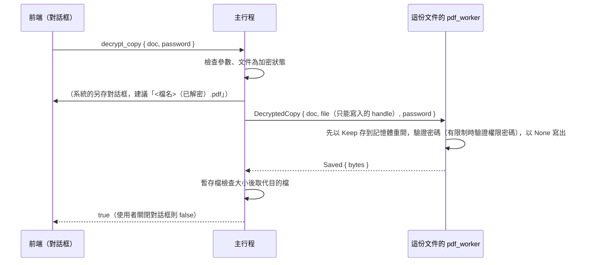

# 另存沒有密碼的副本

工作卡 [#586](https://github.com/winner0988/Pdf-reader/issues/586)；對應 Acrobat 的「Remove Security」。畫面見 [screen-map.md](../ux/screen-map.md)「另存沒有密碼的副本」。

## 範圍

- 把目前開著的加密文件（含還沒儲存的編輯），另存成一份**沒有密碼、沒有限制**的新檔。目前的文件與它的檔案不會改變；副本不加入最近開啟的檔案。
- 只有加密的文件才適用；沒有加密的文件停用該選單項目。
- **不做**：批次解除密碼（ADR 0024）、憑證加密文件的解密、更改密碼（只支援另存為無密碼副本）。

## 規則

| 項目 | 規則 |
|---|---|
| 密碼驗證 | 若文件有任何限制（由作者在 `/P` 設定），必須驗證輸入的密碼為權限密碼（owner password）；若只有開啟密碼而無任何限制，輸入開啟密碼即可 |
| 無密碼但有限制的文件 | 雖然開啟時不用密碼，但另存無密碼副本時仍必須輸入權限密碼（不可為空） |
| 密碼驗證演算法 | 使用 `owner_password::is_owner_password(bytes, password)` 驗證權限密碼 |
| 錯誤回傳 | 密碼錯誤回傳 `WorkerError::Encrypted`（`ErrorCode::Encrypted`）；若有限制但輸入的密碼非權限密碼，回傳 `WorkerError::NotAllowed`（`ErrorCode::NotAllowed`） |
| 有數位簽章的文件 | 拒絕：解密需重寫檔案，簽章會失效。worker 拒絕（回傳 `WorkerError::Signed`），不留下任何檔案 |
| 文件自己的檔案 | 不能是目的地（比照其他另存副本操作），主行程提示使用者另選 |
| 開著的文件狀態 | 不可被改為未加密：worker 必須先以 `Encryption::Keep` 存到記憶體，重開驗證後再以 `Encryption::None` 寫出副本 |

## 流程

- 命令 `decrypt_copy` 參數為 `DecryptArgs`（見 [ipc-contract.md](ipc-contract.md)）：`{ doc: DocumentId, password: Password }`，沒有路徑；另存對話框由主行程顯示。
- worker 請求 `DecryptedCopy`：worker 拿到唯寫 handle，不存取路徑；回傳 `Saved { incremental: false }`。逾時 5 分鐘（`SAVE_TIMEOUT`）。
- **為什麼 worker 要先以 Keep 存到記憶體再重開**：若直接使用當前文件寫出，MuPDF 可能破壞開著文件的 trailer，導致後續儲存變成未加密。因此先存到記憶體保留加密，重開後再以 `Encryption::None` 寫出。

## 密碼的處理

規則同 [encryption.md](encryption.md) 與 [encrypt-copy.md](encrypt-copy.md)：不寫進日誌或錯誤訊息，用完即清除，不存檔。

| 位置 | 做法 |
|---|---|
| 對話框 | 密碼欄位是 `type="password"`（`autoComplete="off"`），對話框關閉、每次送出（成功或失敗）後立即清空 |
| IPC 型別 | `Password`：`Debug` 不印出內容、丟棄時以 `zeroize` 清除；`DecryptArgs` 的 `Debug` 也不會印出密碼 |
| 主行程 | 密碼只放進送給 worker 的單一請求；frame 送出後以 `send_wiped` 清除 |
| worker | 請求以 `receive_wiped` 清除；驗證與寫出後不保留 |
| 錯誤訊息 | 沒有密碼，也沒有 worker 的內部字串 |

## 測試

- `ipc_contract`：`what_a_decrypted_copy_needs_is_checked`（doc > 0、密碼非空且不大於 127 位元組、不含 NUL）；模糊測試種子包含 `DecryptedCopy`。
- `pdf_worker/src/engine.rs`：單元測試涵蓋一般加密文件（AES-256、RC4-40）、有限制文件（需權限密碼）、有簽章文件（拒絕）、未加密文件（拒絕）、解密後原文件仍能存為加密。
- `pdf_worker/tests/decrypt_copy.rs`（真實 worker、真實沙盒）：真實 IPC handle 寫入、有限制與無限制、簽章拒絕、密碼錯誤不崩潰 worker。
- 主行程（`documents.rs`）：副本含未儲存編輯、原文件保持加密、不可覆寫自身、未加密或簽章文件拒絕。
- 前端（`Decrypt.test.tsx`）：對話框介面、送出密碼、關閉/失敗後清空密碼、錯誤代碼訊息對應、未加密文件停用、axe 無障礙檢驗。
- E2E（`tests/e2e/decrypt.spec.ts`）：真實 app 開啟受限檔案、輸入使用者密碼提示需權限密碼、輸入權限密碼成功另存、原檔不變、副本開啟無密碼無限制、未加密文件選單停用。

## 已知限制

- 僅支援對目前已開啟的加密文件另存無密碼副本；不支援未開啟文件的批次解密（ADR 0024）。
- 有數位簽章的文件無法解密（重寫會使簽章失效）。
