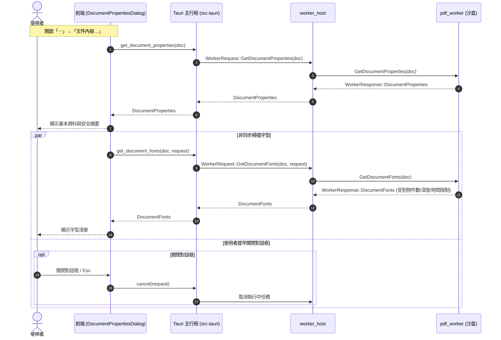

# 文件內容與安全摘要架構（Document Properties & Security Summary Architecture）

> 本文件說明 PDF Reader 的「文件內容」對話框（Issue #441, B5-04）架構與實作設計。

---

## 1. 概述與安全邊界

「文件內容…」對話框位於工具列「⋯」選單中，提供唯讀的文件檢視，呈現三大區塊：
1. **基本資料（General）**：檔案名稱、大小、頁數、頁面尺寸（單一或多種尺寸）、PDF 規格版本、文件資訊字典（標題、作者、主題、關鍵字、建立程式、產生程式）、建立與修改時間（含時區解析）、XMP 複合中繼資料存在性，以及附件數量。若未加密，提供「另存不含中繼資料的副本」隱私匯出快捷操作。
2. **安全摘要（Security）**：加密演算法說明、數位簽章數量、機敏文件標記狀態、使用者權限矩陣（列印、複製、編輯、填表、註解、組合頁面），以及主動內容安全掃描結果。
3. **字型（Fonts）**：掃描並列出文件中所有頁面與 Form XObject 所參照或嵌入的字型名稱、類型（Subtype）與嵌入狀態。

### 安全原則
- **不受信任的資料解析一律在沙盒 Worker 中進行**：惡意 PDF 可能含有循環參照、惡意構造的巨大字型字典或無限遞迴的 Form XObject。所有資料萃取由 `crates/pdf_worker` 執行，主行程與前端不直接碰觸原始二進位解析。
- **嚴格的有界遍歷（Bounded Traversal）**：針對字型搜尋與頁面資源遍歷，實作硬性上限防止資源耗盡攻擊（DoS）。
- **取消與非同步設計**：字型掃描為非同步任務，支援 `cancel(request)` 取消正在執行的工作，防止使用者關閉對話框後背景仍持續運算。
- **不洩漏路徑（Privacy Protection）**：前端 IPC 型別絕不包含檔案本機絕對路徑，一律使用 `displayName`（檔名）。

---

## 2. 系統架構與循序圖

---

## 3. 防護上限與邊界值（Limits）

所有防護上限集中定義於 `crates/ipc_contract/src/limits.rs`：

| 常數名稱 | 上限值 | 目的 |
|---|---|---|
| `MAX_PROPERTY_TEXT_BYTES` | 4,096 bytes | 單一中繼資料文字長度上限（標題、作者、程式名稱等），超出截斷 |
| `MAX_FONT_ENTRIES` | 500 項 | 回傳字型最大數量，防止字型清單灌爆記憶體與 IPC |
| `MAX_FONT_RESOURCE_OBJECTS` | 10,000 個 | 字型掃描遍歷之 PDF 物件總數上限，防止惡意龐大物件圖耗損 CPU |
| `MAX_FONT_RESOURCE_DEPTH` | 32 層 | 巢狀 Resources 與 Form XObject 遞迴深度上限，防止堆疊溢位（Stack Overflow） |
| `MAX_FONT_TIME_MILLIS` | 2,000 ms | 單次字型掃描 CPU 時間上限，超時立即中斷並標記 `complete: false` |
| `MAX_PAGE_PARENT_DEPTH` | 64 層 | 頁面節點向上尋找繼承 Resources 之深度上限，防止頁面樹循環 |

---

## 4. 字型萃取與處理細節

1. **子集前綴去除（Subset Prefix Stripping）**：
   - PDF 規格（ISO 32000-1 §9.6.4）規定嵌入子集字型名稱格式為 `6個大寫字母 + '+' + 基礎名稱`（例如 `ABCDEF+Helvetica`）。
   - 解析時自動偵測 `^[A-Z]{6}\+` 並剔除前綴，正規化為 `Helvetica`。
2. **大小寫不敏感去重（Case-Insensitive Deduplication）**：
   - 同一字型在不同頁面可能以不同大小寫命名；內部使用不分大小寫去重，保留首次見到的顯示名稱與嵌入屬性。
3. **嵌入狀態判定**：
   - 檢查字型字典與其描述元（FontDescriptor）是否包含 `FontFile`、`FontFile2`（TrueType）或 `FontFile3`（CFF/OpenType）。
