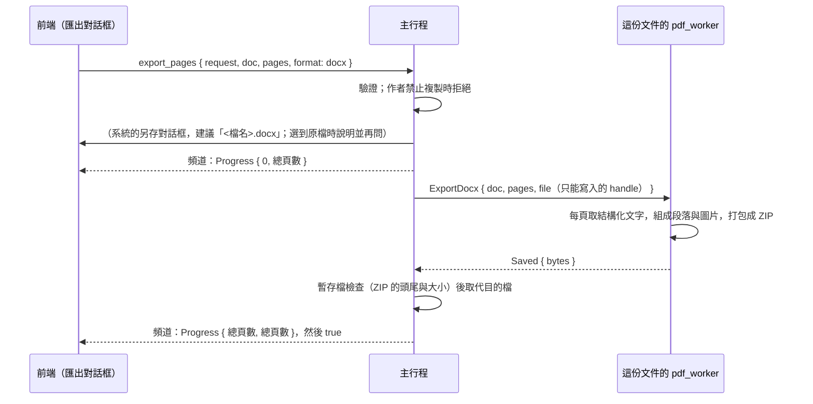

# 匯出 Word（.docx）（B3-02）

工作卡 [#233](https://github.com/winner0988/Pdf-reader/issues/233)；規格 §7「格式匯出」。在匯出對話框（[export.md](export.md)）選「Word 文件」，把選的頁面存成一個 `.docx`：頁面上的**文字**（段落，字型、大小、粗體、斜體、顏色、底線與刪除線）與**圖片**，依閱讀順序排列。**版面不保留**：欄位、表格、文字方塊、圖片在頁面上的位置都不會。要原樣請存成 PDF。畫面見 [screen-map.md](../ux/screen-map.md)「匯出」。

## 為什麼自己做，不用 MuPDF 內建的 DOCX 輸出

MuPDF 有自己的 DOCX 寫出器（`docx-output`，會多編譯 `extract` 函式庫），但 Rust 繫結的 `DocumentWriter` 只收「要寫的**檔案路徑**」：worker 依 [ADR 0008](../adr/0008-pdf-worker-isolation.md) 沒有路徑，只拿到一個只能寫入的 handle。要用它只有三條路，都不好：

- 讓 worker 寫到 AppContainer 自己的暫存資料夾再讀回來：worker 開始自己開路徑，與 ADR 0008 的字面衝突（要改 ADR）；
- 直接呼叫 `fz_new_document_writer_with_buffer`（`mupdf-sys`）：C 的例外是 `longjmp`，不能跨過 Rust 的堆疊（見 `owner_password.rs` 的說明）；出錯時整個行程結束，而壞的 PDF 一定會讓它出錯；
- 自己寫一層 C：要改 `mupdf-sys`。

所以 worker 用它本來就要給每個功能用的**結構化文字**（`TextPage`：區塊、行、每個字的字型旗標、大小、顏色）自己組出 `.docx`。純 Rust，沒有新依賴，沒有 `unsafe`，也沒有開 `docx-output`（不增加編譯時間與安裝檔大小）。若將來繫結有了以輸出串流為目標的寫出器，可以換掉，介面（`ExportDocx`）不變。

## 流程

- 與其他格式相同：**前端只說要匯出什麼**，不含路徑；worker 只拿到新暫存檔的只寫 handle（與 `Save`、`SavePages` 相同），主行程檢查寫好的檔案才取代目的檔，失敗時目的檔不變、不留暫存檔（[saving.md](saving.md)）。
- 整份文件一個請求，worker 中途不回報：進度只有開始與結束。按「停止」只在請求送出前有用；worker 做完才寫檔，所以不會留下半個檔案。
- 逾時 5 分鐘（`SAVE_TIMEOUT`）；頁數最多 `LIMITS.maxExportPages`（1,000，與純文字相同）。
- **權限**：作者禁止複製時拒絕（與純文字相同，主行程與命令各檢查一次）；**加密的文件可以匯出**（文件已開啟，內容與純文字一樣能取得；Word 文件本身沒有加密）；有數位簽章的文件可以（這是新檔案）。
- 不能是文件自己的檔案（大小寫不同也算同一個，使用者把檔名打成 `.pdf` 也一樣）：以訊息方塊說明、再問一次。

## 內容

| 項目 | 做法 |
|---|---|
| 段落 | MuPDF 的一個文字區塊是一個段落；區塊裡的行以一個空格接起來（中日韓文字之間不加；一行結尾是連字號、下一行以小寫字母開頭時不加空格，連字號留著）；沒有看得見的字的區塊不寫 |
| 每個字的樣子 | 大小（半點）、粗體、斜體、顏色（黑色不寫）、底線、刪除線；相同的連續字合成一個 run |
| 字型 | **不讀字型的名稱**：繫結取名稱的函式遇到不是 UTF-8 的名稱會 panic（模糊測試第一輪就找到）；PDF 的字型多半是以產生它的程式命名的子集，讀者的電腦也沒有。改依 MuPDF 對字型的判斷選 Windows 都有的三個家族：等寬 → Courier New，襯線 → Times New Roman，其他 → Arial；符號字型的私有區字元（項目符號、箭頭）用 Symbol。中日韓文字用文件預設的東亞字型（微軟正黑體） |
| 圖片 | 文字頁面裡的圖片區塊，以 PNG 放進 `word/media/`，依區塊在頁面上的大小（比文字寬時等比縮小到放得進）內嵌在自己的段落；只收灰階與 RGB（CMYK 等略過）、單張不超過 2,500 萬像素、全部最多 2,000 張、64 MB |
| 頁面 | 每頁一節（`w:sectPr`），大小就是頁面的大小（橫向頁面標橫向），邊界是短邊的十分之一（最少 0.25 吋，最多 1 吋）；沒有內容的頁面是一個空段落（節需要它） |
| 字元 | 控制字元、看不見的格式字元、雙向控制字元與零寬字元不寫（與純文字相同的原則）；`& < > "` 跳脫 |

## 檔案（OPC 套件，ZIP）

`[Content_Types].xml`、`_rels/.rels`、`word/document.xml`、`word/styles.xml`、`word/_rels/document.xml.rels`，有圖片時加 `word/media/imageN.png`。

- **沒有 `docProps`**：沒有作者、建立者、建立與修改時間。ZIP 裡每個檔案的時間是 1980-01-01（格式能說的第一天），所以檔案不會說它是什麼時候、在哪裡做的（隱私的原則，與[隱私匯出](privacy-export.md)一致）。
- **ZIP 只用「儲存」（不壓縮）**：Word 與所有讀取器都接受；沒有解壓縮炸彈要防，也不需要壓縮函式庫。檔案比壓縮的大。
- 大小上限 192 MB（`MAX_DOCX_BYTES`），超過時失敗（`LimitExceeded`），不寫出不完整的檔案。

## 驗證

- worker（`engine/docx.rs`、`zip.rs`）：CRC-32 的標準檢查值、ZIP 的目錄與本地標頭一致且讀得回來、時間是 1980、大小上限與檔案數上限；兩種文字都在（中英文）、run 的字型家族、粗體、斜體、顏色、大小；段落與標題與連字號的接法、中文行之間不加空格；`& < > "` 跳脫；每頁一節、依要求的順序、各自的大小與方向；沒有內容的頁面；不合規則的請求（沒有頁面、不存在、重複）；套件的組成與沒有任何作者或日期；圖片是套件中的 PNG、有關聯、大小以 EMU 計；太寬的圖片等比縮小；**字型名稱不是 UTF-8 的 PDF 不會 panic**；**MuPDF 自己能把寫出的文件讀回來並取出同樣的字**（第二個讀取器）。每個 XML 都以一個小的檢查函式確認標籤成對、屬性有引號、`&` 都是實體。
- 真的沙盒（`tests/docx.rs`）：worker 透過只寫 handle 寫出、順序依要求、文件不變；不合規則的請求被拒絕後 worker 還能用。
- 主行程（`documents.rs`、`saving.rs`）：含未存的編輯（轉過的頁面是橫向的節）、文件與檔案不變、不能覆蓋自己的檔案、沒有頁面或重複的頁面被拒絕；作者禁止複製時拒絕、加密的文件可以匯出；暫存檔的 ZIP 檢查（頭尾、大小、註解長度）。
- 前端與 E2E：對話框送出 `{ kind: "docx" }` 與說明；停止時沒有寫出任何頁面；真的 app 匯出後，用腳本讀 ZIP（CRC 也檢查）、以瀏覽器的 XML 解析器解析每個部分，段落是 `Privacy-first PDF Reader` 與 `隱私優先的 PDF 閱讀器`。
- 套件結構另外用 .NET 的 `System.IO.Packaging`（OPC 讀取器）與 `System.Xml` 開過一次，內容類型與關聯都解得開。
- **沒有在 Word 本身開過**：這台電腦的 Word 無法以自動化啟動（要使用者操作），所以 `w:` 標記的細節（子元素順序、必要的屬性）只依規格、MuPDF 的讀取器與上面的檢查。請負責人用 Word 開一份匯出的檔案看看，有問題告訴我。

## 限制

- 沒有表格、欄位、文字方塊、頁首頁尾、超連結、書籤、清單的編號：它們的文字以段落出現，圖片以內嵌圖片出現。
- 直書的文字是橫排的段落。
- 掃描頁（圖片頁）沒有文字，只有一張圖片；OCR 辨識出的文字（B2-10）不在其中。
- 圖片只有區塊的外框，旋轉或剪裁的圖片以外框的大小放。
