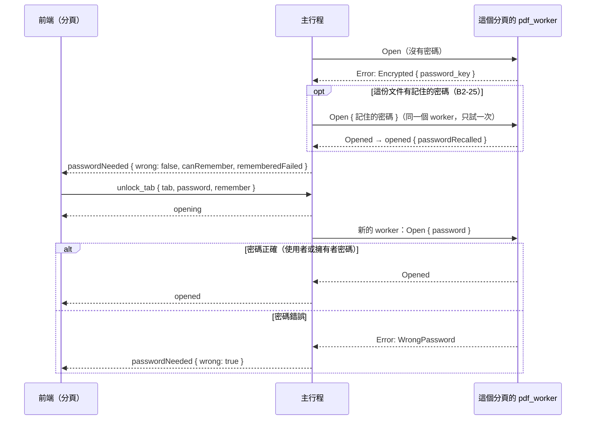

# 開啟加密 PDF（MVP-16）

工作卡 [#71](https://github.com/winner0988/Pdf-reader/issues/71)；規格 §3「檔案加密與權限」中開啟的部分（寫出加密的副本見 [encrypt-copy.md](encrypt-copy.md)）。畫面見 [screen-map.md](../ux/screen-map.md) §2「需要密碼」。

## 流程

- **支援**：MuPDF 的標準安全處理程序（RC4、AES-128、AES-256），使用者密碼與擁有者密碼都能開啟。語料測試的是 RC4 40-bit（R2）與 AES-256（R6）兩個樣本。
- **使用者密碼為空**的文件（只設權限密碼）照常直接開啟，不會詢問；作者設定的權限照樣生效（見下方「權限」）。
- **不支援**：以憑證加密（`/Adobe.PubSec`）或其他安全處理程序、MuPDF 不認得的加密版本。MuPDF 開檔時就拒絕，worker 回報 `unsupportedEncryption`，分頁說明原因，不會被當成損毀。
- **取消**就是關閉這個分頁。
- 每份文件有自己的 worker（ADR 0012），所以密碼只送到這個分頁的 worker。

## 密碼的處理

規則：不寫進日誌或錯誤訊息，用完即從記憶體清除，只由主行程轉交給該文件的 worker，不存檔。

| 位置 | 做法 |
|---|---|
| 前端 | 密碼欄位送出後立刻清空；密碼只經過一次 `unlock_tab`。 |
| IPC 型別 | `Password`（`ipc_contract::types`）：`Debug` 只顯示 `Password(..)`，所以任何日誌、錯誤或 `{:?}` 都印不出密碼；被丟棄時以 `zeroize` 清除記憶體。 |
| 主行程 | 先檢查（不可為空、不可含 NUL、最多 `MAX_PASSWORD_BYTES` = 1,024 bytes），放進送給 worker 的 `Open` 請求；送出後編碼的 frame 以 `frame::send_wiped` 清除，請求本身隨即丟棄。**不保留密碼**。 |
| worker | 讀取請求改用沒有緩衝的標準輸入（標準函式庫的緩衝無法清除），收到的 frame 以 `frame::receive_wiped` 清除；密碼交給 MuPDF 驗證後，`open` 結束時丟棄。判斷是否為擁有者密碼（#88）時交給 MuPDF 的複本，用完即以 `zeroize` 清除。之後 MuPDF 只保留解密所需的金鑰。 |

### 做不到的部分

- **WebView 與 Tauri 的 IPC**：JavaScript 字串無法清除，Tauri 反序列化時的暫存也不在我們的控制範圍內。它們會隨著記憶體重複使用而被覆蓋。
- **MuPDF 的 Rust 繫結**：`authenticate` 會把密碼複製成 C 字串，用完沒有清除；這個暫存只存在沙盒中的 worker 裡，文件關閉時 worker 就結束。
- **MuPDF 本身**：驗證密碼時會轉換編碼、複製到自己堆疊上的緩衝區，沒有清除；同樣只在沙盒中的 worker 裡。
- **作業系統的管線緩衝區**。

### worker 崩潰時

一般文件在 worker 崩潰後，會在新的 worker 中重新開啟（使用者看不出來）。以密碼開啟的文件做不到：密碼沒有保留。所以主行程放棄這份文件，分頁改回「需要密碼」（`passwordNeeded { wrong: false }`），使用者重新輸入後再開啟。**有記住密碼的文件例外**（B2-25）：主行程以同一把鍵向認證管理員取回密碼，自己開新的 worker 重新開啟，分頁直接回到 `opened`（新的 `DocumentId`），尚未存檔的編輯由日誌補上（B2-13），使用者看不到密碼對話框；取不回來（記錄被刪、認證管理員出錯）或密碼不對時才問。

同樣的原因，**復原**以密碼開啟的文件的編輯時（B2-05），要再輸入一次密碼（#94 的決定）：復原要從原始位元組重新開啟文件（ADR 0013）。有記住密碼的文件由主行程自己取回密碼，頁面不必送（也就不問）；沒有記住的維持這個決定。

- 密碼只隨那一次復原請求（`undo_edit` → `WorkerRequest::Revert`）送到 worker，處理方式與開檔時相同：送出的 frame 清除、worker 收到後清除、用完即丟。
- worker 保留的原始位元組仍是加密的，與磁碟上的檔案相同。
- 見 [page-management.md](page-management.md)「復原與重做」。

## 記住的密碼的查找鍵（ADR 0017，B2-23）

worker 回報「需要密碼」（`Error: Encrypted`）時，`WorkerError.password_key` 帶一把鍵，之後主行程（B2-25）用它向 Windows 認證管理員找這份文件記住的密碼。

- **鍵**：`SHA-256("pdf-reader/password-key/v1" ‖ R ‖ /U)`，32 位元組。`R` 是 `/Encrypt` 的修訂版（2 到 6）的一個位元組；`/U` 是使用者密碼的驗證資料，只取 MuPDF 拿來驗證密碼的部分：修訂版 2 到 4 的前 32 位元組，5 與 6 的前 48 位元組（雜湊與兩個鹽值）。這兩個值依規格不加密，不需要密碼就讀得到，**不必寫進、也不改 PDF**。
- **沒有鍵**：不是標準安全處理程序、`R` 不在 2 到 6、`/U` 不存在、不是字串或太短。那份文件就不能記住密碼，其他一切照常。
- **跟著檔案走**：複製、搬移、改名都不影響；app 自己存檔（保留加密）不改 `/R` 與 `/U`，所以存檔後鍵不變；檔案被重新加密（換密碼，或同一個密碼但鹽值是新的亂數）鍵就變了，記住的舊密碼不會被拿去試新的加密。
- **不是 `/ID`**：`/ID` 認得的是「文件」，不是「這個密碼」：同一份文件以另一個密碼加密，`/ID` 不變。
- **只有 `Encrypted` 有鍵**：`WrongPassword` 與其他錯誤都沒有（`validate` 檢查）。鍵是查找用的名字，不是祕密（`Debug` 只顯示前四個位元組）；worker 不受信任，主行程只把記住的密碼送給回報那把鍵的那個 worker（B2-25）。
- 程式：`crates/pdf_worker/src/password_key.rs`（`of`、`derive`），在 `serve.rs` 的 `open` 回報；測試：`tests/password_key.rs`（語料的兩個加密樣本、存檔、重新加密、手工做的 `/Encrypt`）與 `tests/encryption.rs`（沙盒中的 worker）。

## 權限（MVP-19）

工作卡 [#82](https://github.com/winner0988/Pdf-reader/issues/82)。負責人在 [#70](https://github.com/winner0988/Pdf-reader/issues/70) 決定比照 Adobe Acrobat 遵守 PDF 的權限。

| `/P` 的位元（ISO 32000-2 表 22） | 沒有這個位元時 | app 的行為 |
|---|---|---|
| 5：複製文字 | 禁止複製 | 仍可選取；`Ctrl+C` 不複製，狀態列說明原因；右鍵「複製」停用並標示「作者不允許」 |
| 3：列印 | 禁止列印 | 「⋯」→「列印…」停用並標示「作者不允許」；`Ctrl+P` 在狀態列說明原因 |
| 12：高品質列印（R3 以上） | 允許列印，但只能低解析度 | 以 150 dpi（Acrobat 的「低解析度」）而不是 200 dpi 列印；列印對話框說明 |
| 6：註解（B2-07） | 禁止新增、變更與移除註解 | 主行程拒絕註解的編輯（`apply_edit`）；列出頁面的註解（`get_page_annotations`）不受影響。畫面見 [annotations.md](annotations.md) |
| 9：填寫表單（R3 以上），或 6 | 禁止填寫表單與扁平化（B2-09） | 主行程拒絕欄位與扁平化的編輯；欄位仍然列出。第 6 位元涵蓋填寫表單；R2 沒有第 9 位元（保留位，一律是 1），只看第 6 位元。見 [forms.md](forms.md) |

- 受限制的文件在狀態列顯示「已限制：…」，例如「已限制：不可複製、不可列印」。未加密的文件全部允許。
- **讀取**：worker 從 trailer 的 `/Encrypt` 讀 `/P` 與 `/R`（`engine::PdfDocument::permissions`），以 `DocumentPermissions`（`copy`、`print`、`printHighQuality`、`modify`、`assemble`、`annotate`、`fillForms`）放進 `OpenedDocument` 與 `DocumentInfo` 交給前端。只用物件 API，沒有 `unsafe`。以擁有者密碼開啟的文件則全部允許（見下方「擁有者密碼」）。
- **沒有用 `mupdf` 的 `PdfDocument::permissions()`**：繫結以 `Permission::from_bits(...)` 轉換 `/P`，失敗時當成「全部允許」。真正的 `/P` 都設了保留位元，所以一律失敗，結果永遠是全部允許。
- 修訂版 2（R2，40-bit RC4）沒有高品質列印位元：允許列印就是完整品質。
- **權限不是安全邊界**，而是文件作者的要求：能開啟文件就能解密全部內容，其他程式也可以不理會。app 遵守它，但不宣稱能防止擷取。
- 語料：
  - `benign/restricted-no-copy-no-print.pdf` 與 `benign/restricted-low-res-print.pdf`：AES-256，使用者密碼為空，擁有者密碼 `owner`；
  - `benign/restricted-open-password.pdf`：AES-256，使用者密碼 `user`、擁有者密碼 `owner`，禁止複製與列印。

### 擁有者密碼

工作卡 [#88](https://github.com/winner0988/Pdf-reader/issues/88)，負責人選擇由 worker 直接呼叫 MuPDF 的 C 函式。

- 與 Acrobat 相同：需要密碼的文件以**擁有者密碼**開啟時，解除所有限制（`DocumentPermissions` 全部允許）；以使用者密碼開啟時，作者的限制照樣生效。
- 只設權限密碼（使用者密碼為空）的文件開啟時不需要密碼，所以不會輸入擁有者密碼，限制一律生效，也與 Acrobat 相同。
- **做法**：`mupdf` 繫結的 `authenticate` 只回傳成功與否。所以密碼通過繫結的驗證後，`owner_password::is_owner_password` 以 `mupdf-sys` 另開一次同一份文件，呼叫 `pdf_authenticate_password`，看 MuPDF 回報的是不是擁有者密碼（4）：
  - 只有需要密碼的文件才會多開一次；檔案內容以共用的方式交給 MuPDF，不另外複製；
  - 為何安全：見 [mupdf-binding.md](mupdf-binding.md) 的「目前的 API」；
  - 結果只存在 worker 的 `PdfDocument` 中，文件關閉即丟棄。
- 測試：
  - `owner_password` 與 `engine` 的單元測試；
  - `tests/encryption.rs`：在沙盒中的 worker 裡，AES 與 RC4 的樣本都測；
  - E2E `permissions.spec.ts`：在真正的 app 中，使用者密碼不能複製、列印，擁有者密碼都可以。

## 記住的密碼放在哪裡（ADR 0017，B2-24）

`src-tauri/src/credentials.rs`：app 自己不存密碼，交給 Windows 的認證管理員（`CredWriteW`、`CredReadW`、`CredDeleteW`、`CredEnumerateW`，`windows-sys` 多一個 `Win32_Security_Credentials` feature，沒有新套件；`unsafe` 限於這個模組，每個區塊寫明為什麼安全）。

- **條目**：類型 `CRED_TYPE_GENERIC`；名稱 `PdfReader/password/v1/<64 位十六進位的鍵>`（鍵見上一節；`v1` 是鍵的版本，換算法就開 `v2`，舊條目不再被找到）；使用者名稱 `PDF Reader`；說明一行文字；密碼的 UTF-8 位元組；`CRED_PERSIST_LOCAL_MACHINE`（跨登出與重開機，不隨網域設定檔漫遊）。**條目裡沒有檔名、路徑或任何文件內容**；Windows 的認證管理員看得到，使用者也能從那裡刪。
- **上限**：密碼 1 到 1,024 個位元組（認證管理員自己的上限是 2,560）；最多 256 項，第 257 項被拒絕（`Full`），不會默默蓋掉別的；已經有的檔案可以改密碼。
- **用法**：`remember`（覆蓋原有的）、`recall`、`forget`、`count`、`forget_all`（只動這一組的名稱前綴）。讀回的密碼放在會清除的字串裡；Windows 交出來的緩衝區先把密碼清零再還給它。條目被別人改成不是文字時回 `Damaged`；Windows 做不到（服務停用、原則禁止）時回 `Unavailable(錯誤碼)`，由呼叫的人決定（不擋開檔）。
- **一次一個呼叫**：模組內有一把鎖，同一個行程的呼叫排隊進認證管理員。它的資料存在 Windows 重寫的檔案裡，多個執行緒同時寫與刪時，測試中看到剛刪掉的條目又出現（平行跑的測試留下了三個條目）；加了鎖之後平行跑五次都乾淨。
- **只有主行程用**：worker 的沙盒碰不到認證管理員，也不該看到別份文件的密碼。命令與開檔流程是 B2-25（[#220](https://github.com/winner0988/Pdf-reader/issues/220)）。
- **測試**用真正的認證管理員，但各用自己的名稱前綴（`PdfReaderTest/<行程>-<名稱>/`），每個測試結束都清掉，失敗也一樣；不碰使用者自己的條目。

## 記住的密碼的使用（ADR 0017，B2-25）

實作在 `src-tauri/src/documents.rs`（`load_with`、`lose`、`undo`、`forget_*`）與 `commands.rs`。規則照 ADR 0017 的「信任規則」：

- **開檔**：worker 回報「需要密碼」並帶鍵時，主行程向認證管理員找（`Credentials::recall`）；有就用**同一個 `WorkerHost`**（這個分頁自己的 worker，也就是回報那把鍵的那一個）送出，**只試一次**。成功：文件直接開啟，`DocumentInfo.passwordRecalled`。失敗（`WrongPassword`）：照常問使用者，`passwordNeeded` 帶 `rememberedFailed`（使用者沒有輸入錯的東西，所以 `wrong` 是 `false`），**記錄不刪**（被攻陷的 worker 不能藉由回報別人的鍵來刪記錄）。其他錯誤（檔案損毀等）照原樣回報。
- **記住**：`unlock_tab` 的 `remember` 為真（畫面預設不勾）時，**密碼打開了文件之後**才存；輸入錯誤的不存；存的是使用者輸入的那一個（使用者密碼或擁有者密碼）；已有記錄就覆蓋。存不進去不阻擋開檔，`unlock_tab` 回 `UnlockOutcome.notRemembered`：`noKey`（檔案沒有鍵）、`full`（滿 256 項）、`unsuitable`（空的或太長）、`unavailable`（認證管理員做不到，或這次執行沒有憑證庫）。
- **畫面拿到的**：`passwordNeeded.canRemember`（有鍵而且有憑證庫，才顯示勾選）、`rememberedFailed`；`DocumentInfo.passwordRemembered`（有記錄：可以忘記）與 `passwordRecalled`（這次是用記住的密碼開的：提示列）。**拿不到鍵與密碼。**
- **忘記**：`forget_password(tab)` 刪這份文件的記錄（文件開著，回傳的新狀態 `passwordRemembered: false`）；`forget_all_passwords()` 刪全部（只動這一組前綴），開著的文件同樣收到新狀態；`get_remembered_passwords()` 回 `{ count, limit }`，沒有逐項列表。認證管理員出錯時回 `credentialsUnavailable`。
- **存檔、加密副本與隱私匯出**：存檔保留加密時 `/U` 不變，記錄存檔後仍然找得到；加密副本有新的 `/U`，不套用任何記錄；隱私匯出的副本不繼承。
- **合併別的檔案的加密來源**（B2-06）仍然每次詢問：ADR 0017 沒有涵蓋它。
- **測試**（`documents.rs` 的 `with_worker`，用真正的 worker 與認證管理員，各用自己的前綴並在結束時清掉）：勾選記住後換一個「執行」與檔名也不問、沒勾就什麼都不留且錯誤的密碼不存、記錄不對時只試一次並留著記錄、復原不問、worker 被殺後自己重新開啟、忘記單一與全部（開著的文件收到新狀態）、滿了與沒有憑證庫時說明原因而文件照常開啟。

## 尚未處理

- **記住密碼的畫面**（密碼對話框的勾選、提示列的「已用記住的密碼開啟」與「忘記」、「⋯」選單、設定頁的項數與「全部忘記」，以及端對端）：B2-26（[#221](https://github.com/winner0988/Pdf-reader/issues/221)）。
