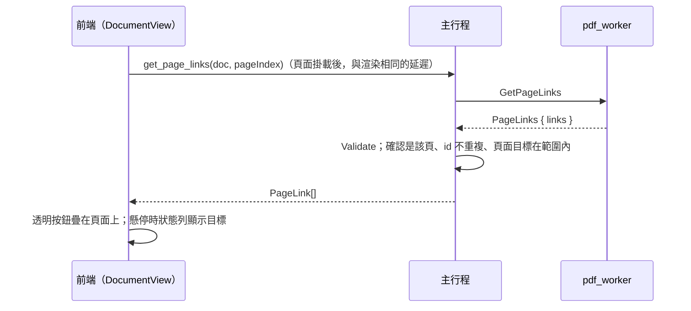
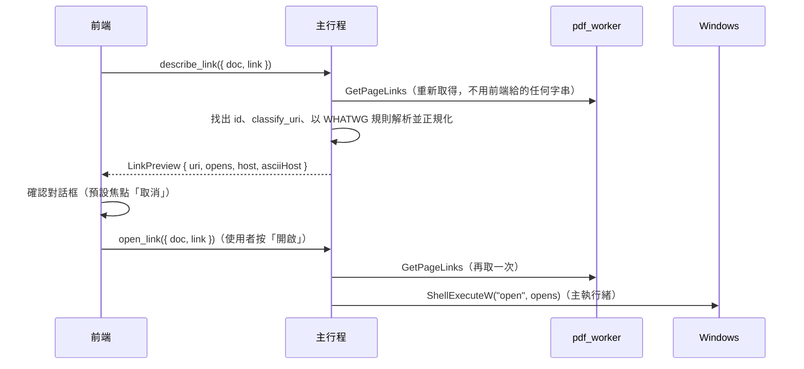

# 頁面連結

對應工作卡 MVP-12：連結的擷取與顯示（12a），以及外部連結的確認與開啟（12b）。

## 流程

## worker：擷取（`PdfDocument::page_links`）

- 自己讀頁面的 `/Annots`，只取 `/Subtype /Link`。
  - 不用 MuPDF 的連結清單：它把動作轉成 URI（`/Launch` 變成 `file:` 連結），就分不出是哪一種動作了。
  - 讀不了的註解跳過；每頁最多 `MAX_LINKS_PER_PAGE`（2,000）個。
- **位置**：`/Rect` 的四個角以頁面的轉換矩陣（`page_ctm`，包含 `/Rotate`、CropBox 與 y 軸翻轉）換到頁面空間，取外接矩形。
  - 頁面空間與文字位置、搜尋結果相同。
  - 測試以「連結框住它上面的字」驗證旋轉 90°／180°／270° 與位移的 MediaBox／CropBox。
- **目標**：與目錄共用 `action_target`（先 `/Dest`，再 `/A`），再轉成合約的 `LinkTarget`：
  - 頁面目標必須在文件內，否則這個連結不回報（沒有可點的地方）；
  - `/URI` 由 `classify_uri` 分類，見 [ipc-contract.md](ipc-contract.md)；
  - 其他動作一律 `blocked`，並附原因。
- **id**：`LinkId { pageIndex, index }`，index 是該頁回報順序。12b 的「開啟連結」只接受這個 id，不接受前端傳來的 URI 字串。

## 前端：疊加層（`src/features/links/`、`DocumentView`）

- `createLinkSource`：每份文件每頁只問一次。失敗不記住，下次顯示這頁時再問。
- 每個掛載的頁面有一層透明按鈕，位置以 `rectToBox` 依縮放與旋轉換算。
  - 按鈕放在頁面元素**旁邊**而不是裡面：頁面對輔助技術是一張圖（`role="img"`），裡面的按鈕會被隱藏。
  - 按鈕可用鍵盤聚焦，聚焦時與懸停一樣在狀態列顯示目標。
- **說明文字**（狀態列與按鈕的無障礙名稱，`linkHoverText`）：
  - 內部：「前往第 n 頁」；
  - 外部：完整 URL，隱藏字元以 `[U+XXXX]` 標示，狀態列最多 300 字；
  - 封鎖：「已封鎖：<原因>」。
- **點擊**：內部連結直接跳頁；外部連結開啟確認對話框；封鎖的連結開啟「已封鎖的連結」對話框。**前端本身永遠不開啟任何東西。**

## 開啟外部連結（12b）

- **只以 id 指名**：`LinkArgs` 只有 `doc` 與 `link`，其他欄位（例如 `uri`）會被拒絕。主行程每次都向 worker 重新取得該頁的連結，所以前端無法要求開啟任意網址；連結 id 不存在或不是網頁連結時回傳 `invalidArgument`。
- **再次檢查與正規化**（`src-tauri/src/links.rs`）：
  - `classify_uri`：只允許 `http`、`https`、`mailto`；
  - 以 WHATWG URL 規則解析（`url` crate，與瀏覽器相同）。解析不了的網址，在 `get_page_links` 時就改成「已封鎖：不支援的連結類型」，讓狀態列的說明與點擊結果一致；
  - `opens`：主機轉成 punycode，其餘非 ASCII 百分比編碼；另外把空白、`"`、`<`、`>`、`\`、`^`、`` ` ``、`{`、`|`、`}` 也編碼。交給系統的只有可列印 ASCII，沒有任何命令列可能誤讀的字元；
  - `host` 是解析後實際會連線的主機（`https://bank.example@evil.example/` 的主機是 `evil.example`），以 Unicode 顯示；對 `mailto` 則是依序收集路徑（以 `,`、`;` 分隔）與 `to`、`cc`、`bcc` 標頭中的收件人網域，不分大小寫去重後以 `, ` 連接；與 punycode 不同時一併提供 `asciiHost`，前端顯示 IDN 警示。網域中的隱藏字元以 `[U+XXXX]` 標示並警示。
- **交給系統**（`src-tauri/src/opener.rs`）：
  - `ShellExecuteW(NULL, "open", opens, NULL, NULL, SW_SHOWNORMAL)`，網址是唯一的檔案參數，不組任何命令列。
  - 在主執行緒執行，那裡的 COM 已經依 Shell 的需求初始化。
  - 這是主行程唯一的 `unsafe`（工作區預設 `deny`，此模組明確允許並附 SAFETY 說明）。
- **確認對話框**（`LinkDialogs.tsx`，screen-map 第 4 節）：
  - 內容：粗體主機；IDN 警示附 punycode；隱藏字元警示；完整網址放在可捲動、可選取、固定由左到右的區塊，隱藏字元以 `[U+XXXX]` 標示，絕不截斷。
  - 按鈕：「複製連結」（複製 `opens`）、「取消」（預設焦點；`Esc` 等同取消）、「開啟」。
  - 系統無法開啟時，對話框留著並顯示錯誤。
- **已封鎖的連結**：
  - 內容：原因說明，以及 PDF 提供的內容（worker 已整理成純文字，僅供檢視）。
  - 只有「複製內容」與「關閉」兩個按鈕。

## 遠端引用的網址（B3-08）

[ADR 0022](../adr/0022-remote-resources-never-loaded.md)：app 永遠不載入 PDF 引用的遠端資源，但使用者可以把有 `http`／`https` 網址的遠端引用交給瀏覽器開啟。

- 網址由 worker 的掃描收集（`SecurityReport.remoteAddresses`，見 [active-content.md](active-content.md#遠端引用的網址b3-08adr-0022)），隨 `DocumentInfo` 交給前端顯示。
- 以位置指名：`RemoteAddressArgs { doc, index }`，同樣拒絕其他欄位。
- `describe_remote_address`／`open_remote_address`：主行程從它最後交給前端的 `DocumentInfo` 取出第 `index` 個網址，再檢查一次只有 `http`／`https`（`is_web_address`，不允許 `mailto`），然後走與頁面連結相同的 `links::preview` 與開啟方式。
- 前端：已封鎖內容明細的「可以在瀏覽器開啟的網址」，每個網址一個「在瀏覽器開啟…」，開啟與連結相同的確認對話框；一次一個，沒有「全部開啟」。
- 位置的穩定：文件開著時，清單只在插入其他檔案的頁面時在後面加長、復原時從後面縮短（`Sources::security`），所以確認期間位置不會指到別的網址。

## 目錄中的外部連結（#49）

- 目錄項目不屬於任何頁面，沒有 `LinkId`，改以它在目錄中的位置指名：`OutlineLinkArgs { doc, item }`，同樣拒絕其他欄位。
- `describe_outline_link`／`open_outline_link`：主行程向 worker 重新取得目錄、取出第 `item` 項，再走與頁面連結相同的檢查（`links::preview`）與開啟方式。
- 目錄中解析不了的網址，同樣在 `get_outline` 時改成封鎖。
- 封鎖的目錄項目不需要主行程：前端直接開啟「已封鎖的連結」對話框。

## 性質測試（#616）

為防止連結解析與路徑判定出現非預期的邊界錯誤（如 #610 與 #611），在 `src-tauri/src/links.rs` 與 `src-tauri/tests/network_path.rs` 引入了性質測試（property-based testing）。為了不額外引入 `proptest` 及其依賴樹、保持依賴乾淨且保證測試結果在 CI 100% 確定性可重現，實作內建了輕量 SplitMix64 虛擬亂數產生器與自動反例縮小（shrinking）演算法。

### 八條性質

1. **允許協定限制**：`preview` 成功的網址，其交給系統開啟的網址（`opens`）以 WHATWG 解析後之 scheme 必定僅為 `http`、`https` 或 `mailto`。
2. **協定不變性**：`Url::parse(opens)` 的 scheme 與 `Url::parse(輸入)` 的 scheme 必定一致。
3. **命令列安全性**：`opens` 僅包含可列印 ASCII 字元（`is_ascii_graphic`），且絕不包含 `ALWAYS_ENCODED` 字元（空白、引號、反斜線等）。
4. **主機一致性**：對 `http` 與 `https` 連結，確認對話框顯示的 `host` 與 `Url::parse(opens)` 之主機轉 Unicode 後完全一致。
5. **冪等性**：對已經產生的 `opens` 再次呼叫 `preview`，其 `opens` 與 `host` 均保持不變。
6. **不崩潰保證**：任何隨機字串輸入（含控制字元、非法跳脫等），`preview` 均不引發 panic。
7. **收件人網域完整性**：對 `mailto` 連結，路徑與標頭（`to`、`cc`、`bcc`）中每個預期收件人的網域（依 WHATWG percent-decode 解碼）必定出現在 `host` 清單中（不分大小寫）。
8. **網路路徑與 Windows 一致性**：在 Windows 上，`PathCreateFromUrlW` 轉換成功之路徑以 `\\` 開頭（UNC 網路共用路徑）若且唯若 `is_network_path` 回傳 `true`。

### 產生器設計

- **一般網址產生器（性質 1～6）**：隨機混合大小寫的 scheme（`http`、`https`、`mailto`、`file`、`javascript` 等與隨機字串）；隨機分隔符號（`://`、`:/\\`、`:\\\\` 等）；主機與路徑隨機組合合法與不合法 `%XX` 跳脫（如 `%+0`、`%G1`、單獨 `%`）、標點（`@`、`,`、`;`、`?`、`#`、`&`、`=`）、反斜線、空白、控制字元（`\u{0}`～`\u{1F}`、`\u{7F}`、`\u{200B}`）、IDN（如 `例子`、`bücher`、`xn--`）、IPv6（`[::1]`）、連接埠（`:port`）、`localhost` 各種形態與一般字母數字，長度 0 到 200 字元。
- **mailto 網址產生器（性質 7）**：先隨機決定 1～4 位收件人（本地端由 `[a-z0-9._+-]` 組成，網域包含大小寫、`.`、`-`、Unicode 字元與合法/不合法 `%XX` 跳脫，避開 `%2C`、`%3B`、`%40`、`%26`、`%3D`、`%3F`、`%23` 等分隔字元），隨機以 `,`、`;`、`%2C`、`%3B` 連接，部分放置於路徑，部分分組放入隨機大小寫之 `?to=`、`?cc=`、`?bcc=` 參數。
- **file 網址產生器（性質 8）**：偏向 `file:` 網址，隨機產生 0 到 4 個 `/` 或 `\`；主機從 `localhost`、`LOCALHOST`、`localhost.`、`localhost.example`、`localhostserver`、`localhost:445`、`%6Cocalhost`、空字串、`127.0.0.1`、`[::1]` 及隨機伺服器名稱中選取；路徑由 `C:/doc.pdf`、`share/doc.pdf` 等片段組成。

### 種子、案例數與失敗重現

- **案例數與種子**：
  - 性質 1～6（一般網址）：種子 `0x616_0001`，10,000 個案例。
  - 性質 7（mailto）：種子 `0x616_0002`，5,000 個案例。
  - 性質 8（網路路徑）：種子 `0x616_0003`，10,000 個案例。
- **失敗重現方式**：失敗時測試會透過 panic 訊息輸出 `Seed`、`Case`、`Original` 與縮小後的 `Shrunk` 字串。若需重現，可在對應測試中將種子直接指定為報告之 `Seed`，並以該 `Case` 編號單獨測試。

### 負控制驗證結果

1. **性質 7（暫時移除 #610 修復）**：
   - 暫時將 `mail_domains` 還原為舊版 `mail_domain`（僅讀取第一收件人）、`percent_decode` 移除十六進位字元過濾。
   - 執行 `cargo test -p pdf-reader --locked properties`：性質 7 立即在 Case 0 失敗。
   - 原反例：`"mailto:ryr_@Invalid%2c6@EXAMPLE例子mail%61?Bcc=wu5hwe54@testInvalid%C0"`。
   - 縮小後反例：`"Invalid"`（證明多收件人/跳脫字元遺漏被成功捕捉）。
2. **性質 8（暫時移除 #611 修復）**：
   - 暫時將 `is_network_path` 的主機判斷改回舊版 `starts_with("localhost")`。
   - 執行 `cargo test -p pdf-reader --locked --test network_path`：性質 8 立即在 Case 2 失敗。
   - 原反例：`"file://localhostserver/test/file.txt"`（Windows 轉出 `\\localhostserver\test\file.txt`，但 `is_network_path` 回傳 `false`）。
   - 縮小後反例：`"file://localhostt"`（證明以 localhost 開頭之非本機主機被成功捕捉）。
