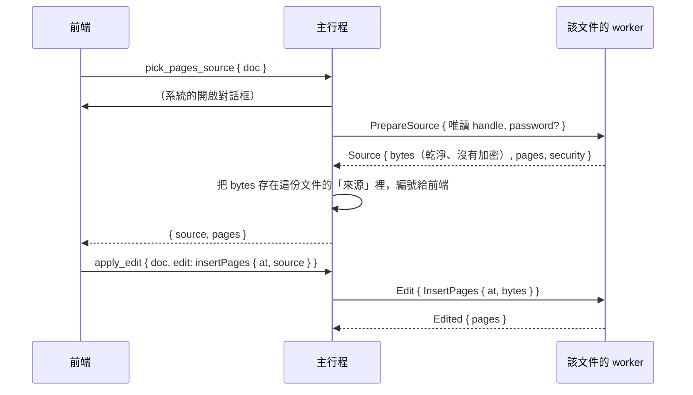

# 合併文件：插入其他檔案的頁面（B2-06）

工作卡 [#95](https://github.com/winner0988/Pdf-reader/issues/95) 的第二部分（第一部分是[拆分](split.md)）；規格 §6「拆分／合併 PDF」。這份文件描述整個功能：**worker 這一端**（`PrepareSource`、`InsertPages`）、**主行程**（來源檔的保管、編輯歷史、崩潰復原、警示橫幅）與畫面。

## 使用者做什麼

縮圖的右鍵功能表：「在這一頁之前（之後）插入其他檔案的頁面…」。主行程顯示系統的開啟對話框，選好 PDF 之後，那個檔案的**全部頁面**依原來的順序插入。加密的檔案先問密碼（與開啟檔案相同的對話框，MVP-16）。插入是一個編輯：可以復原、重做，存檔時才寫進檔案。

## 流程

- 路徑只在主行程；worker 只拿到來源檔的唯讀 handle（ADR 0008）。每個來源檔都在目前文件的沙盒 worker 中開啟。
- 前端只拿到編號與頁數，拿不到路徑或檔案內容。

## 來源檔怎麼處理（worker：`PdfDocument::prepare_source`）

來源檔是不受信任的 PDF，**這一步就在沙盒中完成**，之後的每一次都只用這一步做出來的乾淨副本：

- 以 MuPDF 開啟（加密的檔案用使用者給的密碼；密碼不留）；沒有頁面或超過 `MAX_PAGE_COUNT` 頁的拒絕。
- **作者的權限**：有密碼保護、且沒有「複製／取出」（`/P` 第 5 位元，Acrobat 稱為「擷取頁面」）的檔案不能取出頁面（`NotAllowed`）；用擁有者密碼開啟時沒有限制，與 Acrobat 相同（#88）。
- **掃描主動內容**（MVP-11 的掃描）：結果隨副本回來，由主行程併入文件的警示橫幅（見下方「主行程」）。
- **寫出乾淨、沒有加密的副本**：MuPDF 重新寫一次（回收沒有用到的物件，並明確指定不加密），所以之後不需要密碼，也不必再修復一次損毀的檔案。副本最多 `MAX_SOURCE_BYTES`（64 MiB），超過時 `LimitExceeded`；來源檔本身也最多這麼大（主行程在 worker 讀取之前就檢查）。

## 頁面怎麼放進來（worker：`PdfDocument::insert_pages`）

用 MuPDF 的 `insert_pdf`（graft）把來源檔的頁面放到第 `at` 頁之前（`at` 等於頁數時放在最後）。放進來的是**頁面上的內容**：內容串流與它用到的資源（字型、圖片、表單 XObject）。

- **不會帶來的**：連結與表單欄位（MuPDF 的 graft 不複製；ADR 0019 §1）；整份文件層級的東西：`/OpenAction`、文件的 JavaScript、`/AcroForm`、XFA、嵌入的檔案、書籤（目錄）、標籤。所以來源檔的書籤與連結不會出現在合併後的文件。註解除了 app 支援的五種註解外，其他種類一律不帶。
- **主動內容與外部資料**：`scrub.rs` 再檢查一次放進來的頁面用到的所有物件（只看 graft 新做出來的物件，文件原有的絕不碰）：串流的資料在別的檔案或網址（`/F`、`/FFilter`、`/FDecodeParms`；`malicious/remote-filespec.pdf` 的圖片就是這樣）、顯示別的檔案的頁面的表單（`/Ref`）、動作的觸發（`/AA`）一律拿掉；頁面本身的 `/AA`、`/Annots`、`/B` 也拿掉（graft 本來就沒有做出它們，這是防止 graft 以後改變行為）。原頁面的 `/Annots` 清除後，再以現有函式重建合法的五種 app 註解（見下節）。
- 來源檔損毀、位置或頁數不合時文件維持原樣：先檢查，MuPDF 的 graft 在一個操作中完成，失敗就整個放棄。放進來之後檢查的物件太多（`TooComplex`，超過 200 萬個）而失敗時，文件已經多了這些頁面：回 `LimitExceeded`，主行程（與其他編輯中途失敗相同）把文件從檔案與編輯歷史重新開啟。

## 帶著 app 的註解（B3-23，ADR 0019）

當插入其他檔案的頁面時，保留並重建來源頁面上由本 app 資料模型支援的五種註解（ADR 0019）：螢光筆、附註、手繪、印章（標準印章與自訂圖片印章）以及文字方塊。

1. **只在 worker 裡讀乾淨副本**：
   - 讀取的對象是 `prepare_source` 做出的乾淨且未加密的副本，絕不直接讀取使用者選取的不受信任原始檔案。
   - 只讀取 app 支援的欄位：
     - **螢光筆**（Highlight）：四邊形頂點（`QuadPoints`）、色彩（轉成 app 色票中最接近的色彩）。
     - **附註**（Text/Note）：位置範圍（`Rect`）、文字內容（`Contents`）、色彩。
     - **手繪**（Ink）：筆畫清查（`InkList`）、線條粗細（`BS.W`）、色彩。
     - **印章**（Stamp）：標準印章名稱（`Name`），或自訂圖片印章（從外觀串流中抽取出 PNG 像素資料）。
     - **文字方塊**（FreeText 帶有 `/PdfReaderTextBox`）：位置範圍、文字內容、原始字型家族名稱、字型大小與樣式色彩。
   - **不複製來源檔的物件**：完全不複製來源 PDF 中的字典、串流、外觀（`/AP`），亦不讀取 `/A`、`/AA`、`/Popup`、`/IRT` 等不支援欄位。
   - **嚴格驗證與略過**：判斷能不能帶看欄位是否符合 app 的資料模型與 `Validate` 規則，不信任來源檔的 `/Producer`。幾何座標不合法、不在頁面邊界內、色彩不在色票內、印章名稱不認得、手繪點數超過 `MAX_INK_POINTS`、文字長度超出上限或含不允許字元（`check_note_text`、`check_text_box_text`）的項目，**一律直接略過**，其餘合法的註解照常帶入。
2. **以現有的建立函式重建**：
   - 在 graft 頁面放進來並經 `scrub_pages` 清除原有 `/Annots` 之後，在第 `at + i` 頁依序呼叫現有的重建函式：`add_highlights`、`add_note`、`add_ink`、`add_stamp`、`add_image_stamp`、`place_text_box`。
   - 旋轉與 CropBox：來源頁與放進來的頁面維持同一個頁面空間，確保有旋轉（`/Rotate`）或 CropBox 不在原點時座標位置依舊精確。
3. **文字方塊的字型由主行程協助準備**：
   - worker 處於沙盒之中，無法存取作業系統已安裝的字型或自訂匯入字型。
   - 在 `prepare_source` 階段，worker 回傳 `WorkerResponse::Source`，內含來源檔中解析出的文字方塊清單（`text_boxes: Vec<SourceTextBox>`）。
   - 主行程（`documents.rs`）保管可用字型清單，為每個文字方塊準備排版模型（`prepare_text_box`）：
     - 若目前電腦或已匯入字型中有相符的字型家族且排版無缺字，則採用該字型；
     - 若無相符字型或排版缺字，則退回文字方塊預設字型清單（微軟正黑體、微軟雅黑、Yu Gothic、Segoe UI、Arial）依序嘗試；
     - 若所有候選字型皆無法排版，則略過該文字方塊。
   - 準備好的文字方塊模型（`InsertedTextBox`）算入 `MAX_SOURCES_BYTES` 保管上限，並隨 `WorkerEdit::InsertPages` 傳遞給 worker 進行放置。
4. **單一編輯操作與重播**：
   - 整個插入操作（含頁面與所有重建的註解）依然是單一編輯（`WorkerEdit::InsertPages`）。
   - 復原、重做與 worker 重啟（`WorkerEdit::of`）皆由主行程帶著保管的同一份來源副本與文字方塊排版模型，因此重播結果保證相同。崩潰復原日誌規則維持不變。

## 上限

| 上限 | 值 | 在哪裡檢查 |
|---|---|---|
| 一個來源檔 | `MAX_SOURCE_BYTES`（64 MiB） | 主行程（檔案大小）與 worker（讀取與副本） |
| 一份文件保管的來源 | `MAX_SOURCES_BYTES`（128 MiB） | 主行程（含 PDF 副本與文字方塊模型資料） |
| 來源檔註解數量 | `MAX_SOURCE_ANNOTATIONS`（10,000） | worker（抽取時檢查，超過的項目略過） |
| 頁數 | 合併後最多 `MAX_PAGE_COUNT` | worker（`TooManyPages`） |

## 測試

- worker 單元測試（`crates/pdf_worker/src/engine.rs`、`tests/merge.rs`）：
  - 頁面放在指定的位置（中間、最前、最後）、頁面的大小與順序、存檔後重新開啟畫出來的與原來的頁面一樣；
  - 插入時五種 app 註解（螢光筆、附註、手繪、印章、文字方塊）在新位置正確重建，顏色、筆畫、印章外觀與文字維持原樣；
  - 惡意來源檔中的 `/A`、`/AA`、`/JavaScript`、`/Launch` 或帶動作的 `/Popup` 在重建時徹底拋棄，存檔後的二進位檔案找不到這些字典鍵；
  - 幾何不合法、色票外顏色、文字超長或含禁止字元的項目被略過，合法項目照常帶入；
  - 旋轉（`/Rotate`）與 CropBox 移動過的頁面，重建後的註解幾何位置維持正確；
  - 復原、重做以及 worker 重啟後，重播得到的頁面與註解完全相同；
  - 加密的檔案：沒有密碼、密碼不對、密碼正確（副本沒有加密、可以不用密碼開啟）；作者不允許取出頁面、擁有者密碼解除；
  - 十三種惡意語料（`malicious/`）：掃描有發現、合併存檔後的檔案找不到對應名稱；
  - 來源檔不是 PDF、位置不存在時，文件不變。
- 主行程測試（`documents.rs`）：
  - 文字方塊模型準備：有字型時採用原樣，缺字型或缺字時依序退回預設字型，全部無法排版時略過；
  - 來源與文字方塊模型算入 `MAX_SOURCES_BYTES` 上限，存檔後跟隨來源副本一併清除；
  - 插入、復原、重做、worker 重啟皆能正確重播。
- 合約（`crates/ipc_contract`）：`Source` 與 `InsertPages` 攜帶文字方塊的驗證、上限與模糊測試種子。
- 語料與端對端（`tests/corpus/`、`tests/e2e/merge.spec.ts`）：
  - 語料產生含五種註解與惡意動作的測試樣本（`malicious/annotations-action.pdf`）；
  - E2E 測試驗證插入後五種註解在新頁面上、文字方塊內容可全文搜尋與導航、存檔後檔案無惡意動作、重新開啟後註解與文字方塊依然完整呈現。

## 主行程（`src-tauri/src/sources.rs`、`documents.rs`、`recovery.rs`、`commands.rs`）

- **命令**：`pick_pages_source { doc }`（開啟對話框 → 檢查檔案（一般檔案、不超過 64 MiB）→ `PrepareSource`）回 `PagesSource { source, pages }`；加密的檔案回 `encrypted`，路徑記在這份文件的 `pending_source`（只在主行程），前端問密碼後呼叫 `unlock_pages_source { doc, password }`，密碼不對時檔案繼續等。作者不允許變更頁面（`/P` 的整理頁面與修改都沒有）的文件，連對話框都不顯示。
- **保管**（`Sources`）：worker 做出的乾淨副本由主行程保管，只要編輯歷史（做過的與復原後還可以重做的）有一個編輯用到就留著；選了新的檔案時，沒有編輯用到的就丟掉（使用者改選另一個）；存檔後全部丟掉（檔案已經有那些頁面）。每份文件最多 `MAX_SOURCES`（16）個、共 `MAX_SOURCES_BYTES`（128 MiB），放不下時 `limitExceeded`，請先存檔。
- **編輯**：`Edit::InsertPages { at, source }` 經過 `apply_edit`：與整理頁面相同要作者允許；頁數（來源的頁數）與位置先檢查，合併後不超過 `MAX_PAGE_COUNT`。復原是重開文件再套用其餘的編輯、worker 重啟時也是：每次都把副本連同編輯交給 worker（`WorkerEdit::of`；找不到副本時拒絕），這樣的請求等候的時間與存檔相同（`request_long`）。
- **警示橫幅**：來源檔的掃描結果（worker 回的 `security`）在編輯還在歷史裡時，併入文件的 `DocumentInfo.security`（同一種類的數量相加，掃描沒完成就是沒完成）；復原後不見，重做後回來，存檔後（檔案已經沒有那些內容）也不見。
- **崩潰復原日誌**：見 [crash-recovery.md](crash-recovery.md)「插入其他檔案的頁面」：日誌只記到第一個插入之前的編輯，`lost` 記下被留在外面的有幾個；下次開啟時提示列用 `partial` 或 `lost` 說明（擁有者 2026-10-07 的決定）。
- 測試：`sources.rs`（保留與丟棄、編號、上限、橫幅的數字）；`documents.rs`（真的 worker）：插入、復原、重做、worker 掛掉後重開都在，存檔後的副本有那些頁面；惡意來源的內容在橫幅上、只在頁面還在的時候；加密檔案要密碼、密碼不對、作者不允許取出頁面、擁有者密碼解除；不是 PDF、不存在、位置不對、不存在的來源被拒絕；作者不允許變更頁面的文件；日誌的 `partial` 與 `lost`（還原能還原的、只能捨棄）；`recovery.rs`：`lost` 的記錄與讀取、含有插入的日誌不合格。

## 畫面（`src/features/thumbnails/`、`ReaderShell.tsx`）

- 縮圖的右鍵功能表多了 `pages.insertFileBefore`、`pages.insertFileAfter`（`Thumbnails` 的 `PageEditing.insertFrom`；沒有就不顯示，作者不允許變更頁面時停用）。位置是第一個（之前）或最後一個（之後）選取的頁面；插入的頁面成為選取的頁面。
- `ReaderShell.insertFrom(at)`：`pickPagesSource(doc)`；回 `encrypted` 時，`SourcePasswordDialog` 要密碼，`unlockPagesSource(doc, password)`，密碼不對再問，取消就不插入（不顯示訊息）；成功後 `applyEdit(doc, { kind: "insertPages", at, source })`。失敗的訊息在縮圖上方：`notAllowed` → 作者不允許；`limitExceeded`／`tooLarge` → 太大或超過上限；其他 → 無法使用這個檔案。
- **警示橫幅**：使用者每次關閉橫幅，`ReaderShell` 都記下當時橫幅說的內容（發現的種類與掃描是否完成）；只有說了從沒說過的內容（插入的檔案帶來新的發現）才再顯示，編輯本身（新的文件編號）、復原與重做回到說過的內容都不會讓它回來。
- 測試：`Thumbnails.test.tsx`（選單項目與位置、插入後的選取、關閉對話框、三種失敗的說明、沒有 `insertFrom` 時不顯示）；`Merge.test.tsx`（`ReaderShell`：選檔案後套用編輯、關閉對話框不套用、加密檔案的密碼：不對的說明、再試、取消、作者不允許的說明；橫幅的重新顯示）。
- E2E（`tests/e2e/merge.spec.ts`，真正的 app 與真正的系統對話框）：從多頁文件的第 3 頁之後插入 `mixed-page-sizes.pdf`，14 頁、依序（以搜尋與狀態列確認每一頁在哪裡）、插入的頁面被選取，復原與重做，另存新檔重新開啟仍是 14 頁、依序；插入含 `/OpenAction` 與 JavaScript 的檔案：橫幅出現（關閉後復原再重做仍是關閉的；再插入另一種內容的檔案才又出現）、存檔後橫幅消失，檔案中找不到 `/S /JavaScript`、`/JS`、`/OpenAction` 的字典；加密的檔案：密碼不對的說明、正確的密碼，作者不允許取出頁面的檔案被拒絕；插入後 app 結束，下次開啟提示列說明無法還原（`recovery.lost`，沒有「還原變更」），捨棄後文件仍是 10 頁。
