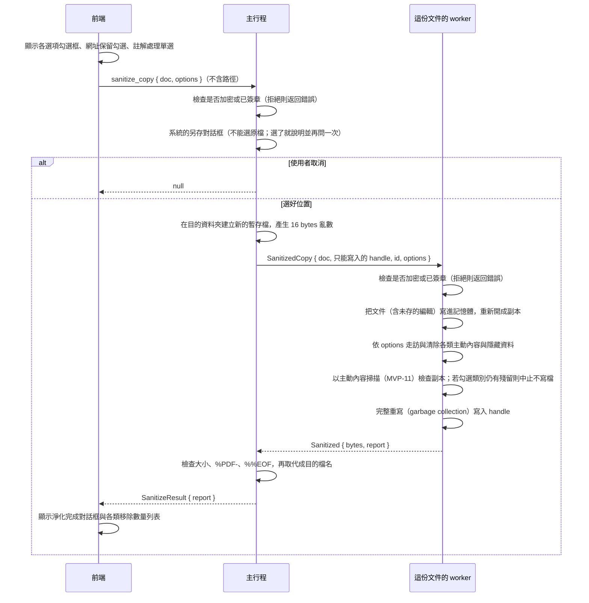

# 分享前淨化（B3-15）

> 機敏標記（B3-05）是文件資訊字典的一項：淨化副本清除該項目，因此淨化後的副本不是機敏文件，原本的檔案不變（ADR 0004，見 [sensitive-files.md](sensitive-files.md)）。

工作卡 [#303](https://github.com/winner0988/Pdf-reader/issues/303)；規格「分享前淨化：拿掉主動內容與隱藏資料的副本」。「⋯」→「分享前淨化…」另存一份拿掉主動內容（JavaScript、開啟動作、危險連結、表單腳本、附件、XFA、多媒體）與隱藏資料（中繼資料、縮圖、私有應用程式資料）的副本，避免外流或執行惡意程式碼；**原本的檔案、開著的文件與它未儲存的變更都不受影響**。

## 流程

- **worker 開著的文件完全不變**：淨化只在副本上做。副本是把目前的文件（包含尚未儲存的編輯）寫進記憶體後重新開啟的另一份文件。
- **寫檔安全**：沿用存檔（B2-02，[saving.md](saving.md)）的做法：worker 只拿到新暫存檔的只寫 handle，主行程檢查 `%PDF-` 與 `%%EOF` 後才取代成目的檔名；失敗時目的檔不會出現半個檔案。
- **寫出前再檢查（雙重防線）**：在 worker 內部寫檔前，使用主動內容掃描引擎（MVP-11）檢查處理後的副本；勾選的類別若有任何一項掃描非零，整個操作失敗拒絕輸出（不會輸出只淨化一半的檔案）。
- **不能覆寫原檔**：主行程以系統解析後的路徑比對；對話框選到原檔時彈出提示並要求重選。
- **不加入最近開啟的檔案**，分頁仍然顯示原本的文件。

## 清除項目與對應 PDF 鍵

| 類別選項 | 涉及的 PDF 物件與鍵 | 做法與計數規則 |
|---|---|---|
| **動作與 JavaScript** (`actions`) | • Catalog 的 `/OpenAction` • Catalog、Page、Annot、Field 的 `/AA`（所有 Additional Actions） • `/Names` 字典的 `/JavaScript` • 各物件（連結、書籤、widget 等）類型為 `JavaScript`、`Launch`、`SubmitForm`、`ImportData`、`GoToR`、`GoToE`、`ResetForm`、`Rendition`、`RichMediaExecute` 的動作，包含 `/Next` 串起的後續動作 | 移除動作字典與鍵；串列中的子動作遞迴處理。若連結註解只剩被移除的動作且無 Destination，則刪除整個連結註解。計入 `actions`。 |
| **網址連結** (`keep_web_links`) | • 連結註解中的 `/S /URI` • 書籤與其他項目的 URI 動作 | 若 `keep_web_links` 為 true，僅保留 `http`、`https`、`mailto`；其餘危險 scheme（`file:`、`smb:`、`javascript:`、UNC 路徑、`ms-` 等）一律移除（原則 5）。若為 false，所有 URI 連結皆移除。移除計入 `links`。 |
| **內嵌檔案與附件** (`attachments`) | • `/Names` 的 `/EmbeddedFiles` • `/Subtype /FileAttachment` 註解 • 任何字典的 `/AF`（關聯檔案陣列） • Catalog 的 `/Collection` • 串流字典的外部參照 `/F` | 移除目錄、參照與附件註解。計入 `attachments`。 |
| **表單腳本** (`form_scripts`) | • 表單欄位的 `/AA` • AcroForm 字典的 `/CO`（計算順序陣列） | 移除腳本鍵與計算陣列；**保留欄位的值（`/V`）與外觀（`/AP`）**。計入 `form_scripts`。 |
| **XFA 動態表單** (`xfa`) | • AcroForm 的 `/XFA` • Catalog 的 `/NeedsRendering` | 移除鍵，使文件回退為標準靜態 PDF 表單。計入 `xfa`。 |
| **多媒體內容** (`rich_media`) | • `/Subtype` 為 `RichMedia`、`Screen`、`Movie`、`Sound`、`3D` 的註解 | 移除註解字典與頁面 `/Annots` 參照。計入 `rich_media`。 |
| **隱藏資料** (`hidden_data`) | • Trailer 的 `/Info` • 各物件的 `/Metadata`（XMP） • 各物件的 `/PieceInfo`（私有資料） • 各物件的 `/LastModified` • 頁面的 `/Thumb`（縮圖） • 註解的 `/T`（作者）、`/M`、`/CreationDate` • Trailer 的 `/ID` 替換為全新 16 bytes 亂數 | 與隱私匯出相同的走訪清除邏輯。計入 `hidden_data`。 |
| **註解處理** (`annotations`) | • `Keep`：保留所有非多媒體、非附件註解。 • `Remove`：移除所有非 Widget、非 Link 的註解（如高亮、筆跡、便利貼、幾何圖形等）。 • `Flatten`：呼叫 MuPDF 的 `PdfDocument::bake(true, false)` 將註解平面化為頁面內容，不可再編輯，表單欄位不烤。 | `Remove` 或 `Flatten` 時計入 `annotations`。 |

## 不拿掉的東西

對話框明確列出以下項目，提醒使用者分享前自行檢查：
1. **頁面文字與圖片內容**：文件的排版文字、向量繪圖與內嵌點陣圖；
2. **圖片本身的 EXIF**：若圖片本身含有相機資訊或 GPS 座標，淨化不會解碼重新壓縮圖片（欲去除 EXIF 可使用批次處理中的清除 EXIF 功能）；
3. **隱藏圖層（選用內容群組 OCG）中的內容**：PDF 的可選內容圖層不會被合併或刪除。

## 拒絕的情況

1. **已簽章的文件**：
   - 淨化重寫文件會破壞數位簽章，使簽章驗證失效；
   - 工具列「⋯」選單停用並以捷徑文字提示「已簽章的文件不適用」；
   - 主行程與 worker 均主動檢查並拒絕已簽章文件（`InvalidArgument`）。
2. **加密的文件**：
   - worker 開檔後不保留密碼，無法重新加密；且未加密副本會使原作者的安全限制失效；
   - 工具列「⋯」選單停用並提示「加密的文件不適用」；
   - 主行程與 worker 均主動檢查並拒絕加密文件（`InvalidArgument`）。

## 驗證

- **Rust 單元與整合測試**（`crates/pdf_worker/tests/sanitize.rs`）：
  - 語料庫 `tests/corpus/malicious/` 的每一份文件，全勾淨化後：
    - 主動內容掃描（`active_content`）結果為 0 findings；
    - 輸出副本可正常被 MuPDF 開啟；
    - 回報的移除項目數量大於 0。
  - 語料庫 `tests/corpus/benign/` 中所有非簽章、非加密文件，淨化後（保留註解）：
    - 每一頁渲染出的 RGBA 點陣圖與原本逐像素完全相同。
  - `Flatten` 模式測試：平面化後無殘留標記註解，表單欄位保留，畫面渲染差異小於 1%（僅有些微抗鋸齒差異）。
  - `Remove` 模式測試：標記註解被清除，Widget 與 Link 依選項保留。
  - 連結 scheme 測試：`keep_web_links = true` 保留 http/https/mailto，移除 file/smb 等危險 scheme；`keep_web_links = false` 移除所有網址連結。
  - 簽章文件與加密文件拒絕測試。
  - Worker 原本開著的文件不受影響測試。
- **前端單元測試**（`src/features/saving/SanitizeDialog.test.tsx`）：
  - 對話框預設值（全選清除項目、保留網址、保留註解）；
  - 機敏文件備註與不清除項目清單；
  - 表單選項傳遞與送出；
  - 成果報告各項目數量顯示與零項目顯示；
  - 失敗訊息警示；
  - 已簽章與加密文件的選單停用狀態。
- **可訪問性測試**（`src/features/shell/AccessibilityComponents.test.tsx`）：
  - `SanitizeDialog` 通過無障礙無違規檢查。
- **E2E 測試**（`tests/e2e/sanitize.spec.ts`）：
  - 開啟含惡意 OpenAction 的檔案，執行淨化另存，驗證原檔 SHA-256 不變，開啟新檔無主動內容警示。
