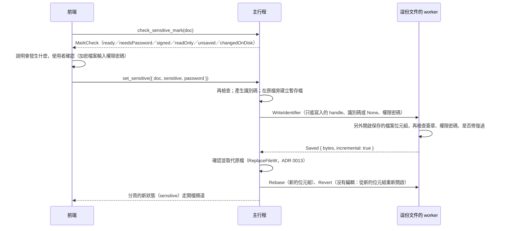

# 機敏文件（B3-05）

工作卡 [#236](https://github.com/winner0988/Pdf-reader/issues/236)；規格 §3「機敏文件與系統層級外洩防護」；[ADR 0004](../adr/0004-sensitive-file-scope.md)、[ADR 0010](../adr/0010-document-id-write-safety.md)。畫面見 [screen-map.md](../ux/screen-map.md)「機敏文件」。

## 標記是什麼

| 項目 | 內容 |
|---|---|
| 位置 | 檔案的文件資訊字典（`/Info`）中的一項：`/PdfReaderDocumentId` |
| 值 | 文件識別碼（ADR 0010）：主行程以作業系統的亂數（`getrandom`）產生的 16 bytes，寫成 32 個小寫十六進位數字 |
| 意義 | 有這一項、而且是 app 寫的格式（32 個十六進位數字的字串），檔案就是**機敏文件**；其他內容不算 |

- **標記在檔案本身**（ADR 0004）：搬移、改名、複製檔案都仍是機敏文件；在另一台裝了這個 app 的電腦上也是。
- **檔案裡只有一個亂數**：沒有「機敏」字樣，拿到檔案的人看不出它被標記為機敏，只看得出這個 app 寫過一個識別碼。
- **依附在文件識別碼上**（CONTEXT.md）：現在文件識別碼只有機敏標記使用（ADR 0017 讓密碼記憶不再使用它），所以「有識別碼」就是「機敏」。之後若有其他功能需要文件識別碼，要先區分兩者（例如在本機記錄哪些識別碼是機敏的），並修訂本文件。
- **取消標記也要寫檔案**（取出那一項），所以只在檔案開著時提供，從它的「⋯」選單。
- **隱私匯出**刪除整個文件資訊字典，副本不是機敏文件，原本的檔案不變（ADR 0004）。一般存檔與另存新檔保留文件資訊字典，所以仍是機敏文件。

## 寫入（ADR 0010）

- **只在使用者明確操作時寫入**；開檔、閱讀、一般存檔都不寫入（ADR 0010、ADR 0013）。
- **寫入前先說明**（`check_sensitive_mark`），由使用者確認；第一個不能寫的原因，持續最久的在前：
  - **已簽章**（`/SigFlags` 第 1 位元，或有值的簽章欄位）：拒絕並說明，寫入任何東西都會讓簽章驗證顯示「簽署後已被修改」，禁止修改的認證簽章（DocMDP P=1）更會失效；沒有「仍要標記」的選項；
  - **唯讀檔案**：拒絕；資料夾不能寫入則在寫入時才知道，同樣說明；
  - **其他程式改過檔案**（大小或修改時間不同）：拒絕，請重新開啟；
  - **有未儲存的變更**（或上次留下、還沒回答的變更，B2-13）：拒絕，否則它們會一起寫進檔案；
  - **加密**：需要權限密碼（不是開啟密碼）；
  - 其他：說明「會在檔案結尾附加一筆紀錄，原本的內容不變，但修改時間會改變」。
- **增量更新**：worker 把它保存的檔案位元組（開啟或上次存檔時的檔案，主行程已確認沒被改過）**另外開啟一份**，在 `/Info` 放入或取出那一項（沒有 `/Info` 時新增一個，由增量更新自己的 trailer 指向它），以 MuPDF 的增量寫出：檔案原本的位元組在前，一個也不變，後面是更新。開著的文件與它的編輯都不碰。
  - MuPDF 開啟時修復過的檔案（結構有誤）不能只附加：拒絕，請先另存新檔（完整重寫），再標記新的檔案。
- **寫檔**依 ADR 0013 的存檔流程：暫存檔完整寫好、確認大小與 `%PDF-`／`%%EOF` 後才取代原檔；失敗時原檔不變。
- **之後**：worker 改保存新的位元組（`Rebase`），並從它重新開啟文件（`Revert`，沒有編輯）：之後的一般存檔（完整重寫）也帶著標記。文件換一個新的 `DocumentId`，頁面不變。重新開啟失敗時，下一個請求從檔案重新開啟（以密碼開啟的文件會再問密碼）。
- **加密的檔案**：識別碼和檔案裡其他字串一樣被加密，用開啟密碼或權限密碼開啟都認得出標記。權限密碼只送給這份文件的 worker 一次，用完即清除，不保留。
- **取消標記**：同樣的流程，取出那一項。增量更新不重寫前面的內容，所以舊的識別碼仍留在檔案較早的版本中（不再生效）；隱私匯出會清掉。

## 讀取

- worker 開啟文件時回報 `signed` 與 `identifier`（`OpenedDocument`）；主行程只把 `DocumentInfo.sensitive` 告訴前端，識別碼不離開主行程。

## 機敏文件的保護

| 保護 | 做法 |
|---|---|
| 剪貼簿 | 複製的文字由主行程寫入，不進 Windows 的剪貼簿歷程與雲端剪貼簿（下節） |
| 最近開啟的檔案 | 一律不記錄：開啟時、標記時從清單移除，不留雜湊值；「⋯」選單沒有「不記錄此檔案」（[recent-files.md](recent-files.md)） |
| 螢幕擷取 | 開著時整個視窗排除在擷取之外（下節，B3-13） |
| 狀態列 | 顯示「機敏文件」，以及「防截圖：開」 |
| 縮圖 | 側欄的縮圖只是頁框，不畫出頁面；檔案總管的縮圖不受影響（下方〈縮圖〉一節，B3-10） |

### 剪貼簿

- 命令 `copy_protected_text`（`src-tauri/src/clipboard.rs`）：`OpenClipboard`（app 的視窗，被占用時重試 10 次）、`EmptyClipboard`，**先**放三個 Windows 的格式（「Cloud Clipboard and Clipboard History Formats」）：
  - `CanIncludeInClipboardHistory`＝0（DWORD）：不進剪貼簿歷程（Win+V）；
  - `CanUploadToCloudClipboard`＝0：不同步到雲端剪貼簿；
  - `ExcludeClipboardContentFromMonitorProcessing`：遵守它的剪貼簿監看程式略過這次內容；

  再放文字（`CF_UNICODETEXT`，換行改為 `\r\n`）。任何一個格式放不進去就不放文字。
- 走這條路的：頁面上選取的文字（`Ctrl+C`、右鍵「複製」）、連結對話框的「複製」，以及**顯示機敏文件時 WebView 自己的複製與剪下**（表單欄位、搜尋框、對話框裡的文字：攔下 `copy`／`cut` 事件，剪下的文字也從欄位刪除）。其他文件維持 `navigator.clipboard.writeText`。
- 檢查：最多 16 MiB（`LIMITS.maxClipboardTextBytes`，UTF-8），不能有 NUL；頁面先檢查大小，太多時說明，不複製。
- **限制**：只有遵守這些格式的程式（Windows 的剪貼簿歷程、雲端剪貼簿，以及大多數剪貼簿管理程式）會略過；任何程式仍能讀到目前剪貼簿上的內容，這是剪貼簿的本質。
- 不讀剪貼簿；命令能寫入的只是頁面原本就能以 `navigator.clipboard` 寫入的文字。

### 螢幕擷取（B3-13）

工作卡 [#301](https://github.com/winner0988/Pdf-reader/issues/301)；[ADR 0023](../adr/0023-sensitive-capture-protection.md)（選項 B）。

- **做法**：`src-tauri/src/capture.rs`。只要有一個開著的分頁是機敏文件，主行程對 app 的視窗呼叫 `SetWindowDisplayAffinity(WDA_EXCLUDEFROMCAPTURE)`：畫面上照常顯示，但 PrintScreen、剪取工具、錄影、視訊會議的螢幕分享、遠端協助與 Windows.Graphics.Capture 拿到的這個視窗是空的（看到它後面的東西）。最後一個機敏分頁關閉或取消標記後設回 `WDA_NONE`。設定後以 `GetWindowDisplayAffinity` 讀回確認。
- **整個視窗一起**：這個設定以頂層視窗為單位，app 是單一視窗、多分頁（ADR 0012），所以開著機敏文件時，其他分頁也擷取不到；每個分頁的狀態列都顯示「防截圖：開」，說明為什麼。
- **時機**：主行程送出分頁的新狀態（`Opened`）給前端之前，先依「有沒有開著的機敏分頁」設定視窗（`commands.rs` 的 `report`）；所以開檔、輸入密碼後開啟、重試、標記為機敏時，文件的第一個畫面出現前視窗已經排除。關閉分頁（以及其他分頁變動）之後再看一次（`after_tabs_changed`），取消標記也走 `report`。
- **前端**：狀態改變時（關、開、失敗）主行程在開檔頻道送 `CaptureProtection`；重新載入的頁面訂閱時先收到目前的狀態。狀態列：開時「防截圖：開」，失敗時紅字「這台電腦無法阻擋螢幕擷取」。
- **失敗**：Windows 10 2004 以前不認得 `WDA_EXCLUDEFROMCAPTURE`（呼叫失敗，或讀回的不是它）：狀態是「失敗」，文件照常開啟；之後每次有變動都再試一次，成功了警告就消失。視窗無法設回 `WDA_NONE` 時維持「開」，狀態列照實說。
- **其他視窗**：app 只有這一個 WebView 視窗。列印預覽是 WebView2 的列印對話框（[printing.md](printing.md)），畫在這個視窗裡，應該一起排除，但還沒有以擷取確認（ADR 0023 的 POC 第 2 點；本機不做桌面擷取）。系統的開檔與存檔對話框、訊息方塊不顯示文件內容，沒有設定。
- **限制**（使用手冊要寫）：
  - 擋不住用手機拍螢幕，也擋不住有系統管理員或核心權限的程式。
  - 開著機敏文件時，螢幕分享與遠端協助看到的是空白：要分享，先關閉機敏文件或取消標記。
  - 放大鏡等輔助工具是否受影響，ADR 0023 的 POC 第 3 點還沒做（本機不做桌面擷取）。
- **測試**：`capture.rs` 的單元測試（狀態轉換：開、關、失敗後再試、設不回去時維持開、沒有視窗時不動；以及在一個不顯示的視窗上真的呼叫 Windows，讀回設定值）。E2E 讀 app 視窗的 display affinity（`GetWindowDisplayAffinity`，不擷取畫面）：標記、關閉、重新開啟、另一個分頁、取消標記；以擷取驗證視窗內容不在擷取中的測試只在 CI（或 `E2E_CAPTURE=1`）執行，**本機不做桌面擷取**。

## 在這台電腦上標記的檔案（設定）

- `sensitive.json`（app 的本機資料資料夾，[local-data.md](local-data.md)）：每筆是文件識別碼與**檔名**，沒有路徑；最新標記的在前，最多 1,000 筆（再標記一份時最舊的一筆離開清單，檔案的標記不變）。
- 只記錄在這台電腦上**標記**的檔案：開啟在別處標記的檔案不會加進來（不因為開啟而留下紀錄）。清單上的檔案開啟時，更新成它現在的檔名（可能改名了）；在這裡取消標記時移除。
- 設定頁列出檔名，標示「已開啟」的，可以逐筆「移除」（只是不再列出，檔案仍是機敏文件）。取消標記要寫檔案，需要路徑，所以只在開著的檔案的「⋯」選單提供。
- 讀取：超過 2 MiB、不是 JSON、版本不對或有未知欄位時當成沒有清單；不對的項目（識別碼不是 32 個十六進位數字、檔名像路徑）略過。

## 縮圖（B3-10）

工作卡 [#241](https://github.com/winner0988/Pdf-reader/issues/241)；[2026-10-20 的規劃](../planning/2026-10-20-plan-to-nov-20.md)決定 D2 選 B：只在 app 自己的畫面做到。

- **側欄**（`src/features/thumbnails/Thumbnails.tsx` 的 `sensitive`）：機敏文件的「縮圖」分頁不送出任何縮圖的渲染請求。每一頁是同樣大小的空白頁框，中間一個圖示，下方是頁碼，清單上方一行說明。點擊跳頁、方向鍵、選取、右鍵功能表與拖曳照常。
- **開著時標記**：已經畫出的縮圖立刻移除，還在等的渲染取消；取消標記後縮圖照常渲染。
- **快取**：主行程的頁面快取（`src-tauri/src/render.rs`）只在記憶體，只保留開著的文件（`retain_documents`）。機敏文件沒有縮圖的渲染，所以快取裡沒有它的縮圖；閱讀時的頁面照常渲染與快取，關閉文件時釋放。
- **檔案總管的縮圖不受影響**（限制，使用手冊要寫）：
  - 檔案總管與桌面的 PDF 縮圖，由 `.pdf` 的預設應用程式（例如 Edge）的縮圖提供者在檔案總管的行程裡產生，存在 Windows 的縮圖快取。Windows 沒有讓單一檔案不產生縮圖的設定。
  - app 不註冊自己的縮圖提供者（選項 C）：那是在檔案總管行程裡執行的原生 DLL，只在 app 是預設應用程式時有效，風險與收益不成比例。
  - 需要時，使用者可以在檔案總管的「資料夾選項」→「檢視」勾選「永遠顯示圖示，不顯示縮圖」（對所有檔案），並以「磁碟清理」清除「縮圖」，移除已經產生的縮圖。
- **測試**：`Thumbnails.test.tsx`（標記後不再渲染、正在等的取消、沒有畫布、仍能跳頁與捲動）、`ReaderShell.test.tsx`（機敏文件的側欄沒有畫布、一般文件有）、axe（`Accessibility.test.tsx`）；E2E（`tests/e2e/thumbnails.spec.ts`）：真的 app 標記後縮圖只剩頁框、點擊仍跳頁，關閉後重新開啟一開始就沒有縮圖。

## 信任（ADR 0002）與 ADR 0010 的 POC

ADR 0010 寫著「實作機敏標記前，以 POC 決定如何避免使用者剛給的信任因此失效，並補進本 ADR」。目前「信任後載入」延後實作（ADR 0009、規格 §3），app 沒有任何信任的資料，寫入識別碼不會讓任何信任失效。實作信任時（另立 ADR），要處理內容雜湊與增量更新的關係（例如雜湊只算不含文件資訊字典的內容，或在寫入識別碼時一併更新信任）。是否把這一點補進 ADR 0010，由負責人決定。

## 驗證

- worker（`crates/pdf_worker/src/engine/identifier.rs`）：
  - 增量更新：寫出的檔案以原本的位元組開頭、一個不變，後面只多一點；重新開啟認得出識別碼，頁數不變；取消後認不出；
  - 文件資訊字典的其他項目不變；
  - 已簽章（`signed.pdf`、`signed-docmdp-p1.pdf`）拒絕，什麼都沒寫；
  - 加密（RC4、AES-256、有開啟密碼與只有權限的）：沒有密碼、密碼不對、開啟密碼都拒絕；權限密碼寫得進去，檔案仍加密，兩個密碼都認得出標記，識別碼在檔案中是加密的；
  - MuPDF 修復過的檔案拒絕；
  - 只有 app 寫的格式算是標記。
- 真的沙盒（`crates/pdf_worker/tests/sensitive.rs`）：開啟時回報的 `signed` 與 `identifier`；寫入、取消；已簽章與加密檔案的拒絕，worker 繼續服務。
- 主行程：
  - `documents.rs`（真正的 worker）：標記後原本的位元組不變、另一個名字與資料夾的副本仍是機敏、編輯後存檔仍是機敏、隱私匯出的副本不是、取消後不是；已簽章、未儲存、被其他程式改過、唯讀都拒絕且檔案不變、沒有留下暫存檔；加密檔案只接受權限密碼，標記後仍以開啟密碼開啟、作者的限制不變；
  - `sensitive.rs`：清單的順序、上限、改名、移除、沒有路徑、不是 app 寫的檔案；
  - `recent.rs`：機敏文件從清單移除且不留雜湊值；
  - `clipboard.rs`：換行；真正的剪貼簿（三個格式與文字）只在 CI 或 `PDF_READER_TEST_CLIPBOARD=1` 時測試，不碰開發者的剪貼簿。
- 前端：對話框的每種檢查結果、權限密碼（送出後清空、錯誤的說明）、寫入失敗的說明；設定的清單；機敏文件的複製（`Ctrl+C`、右鍵、欄位的複製與剪下）走主行程、不寫頁面的剪貼簿；選單與狀態列；無障礙（axe）。
- E2E（`tests/e2e/sensitive.spec.ts`）：在真正的 app 標記，檔案以原本的位元組開頭；`recent.json` 沒有它、`sensitive.json` 只有檔名；關閉、改名並搬到另一個資料夾後重新開啟仍是機敏，設定列出新檔名；取消後回到最近開啟的檔案；已簽章的檔案被拒絕且不變。真正的剪貼簿（三個格式、值為 0、頁面沒有自己寫入）只在 CI 或 `E2E_CLIPBOARD=1` 時執行。
