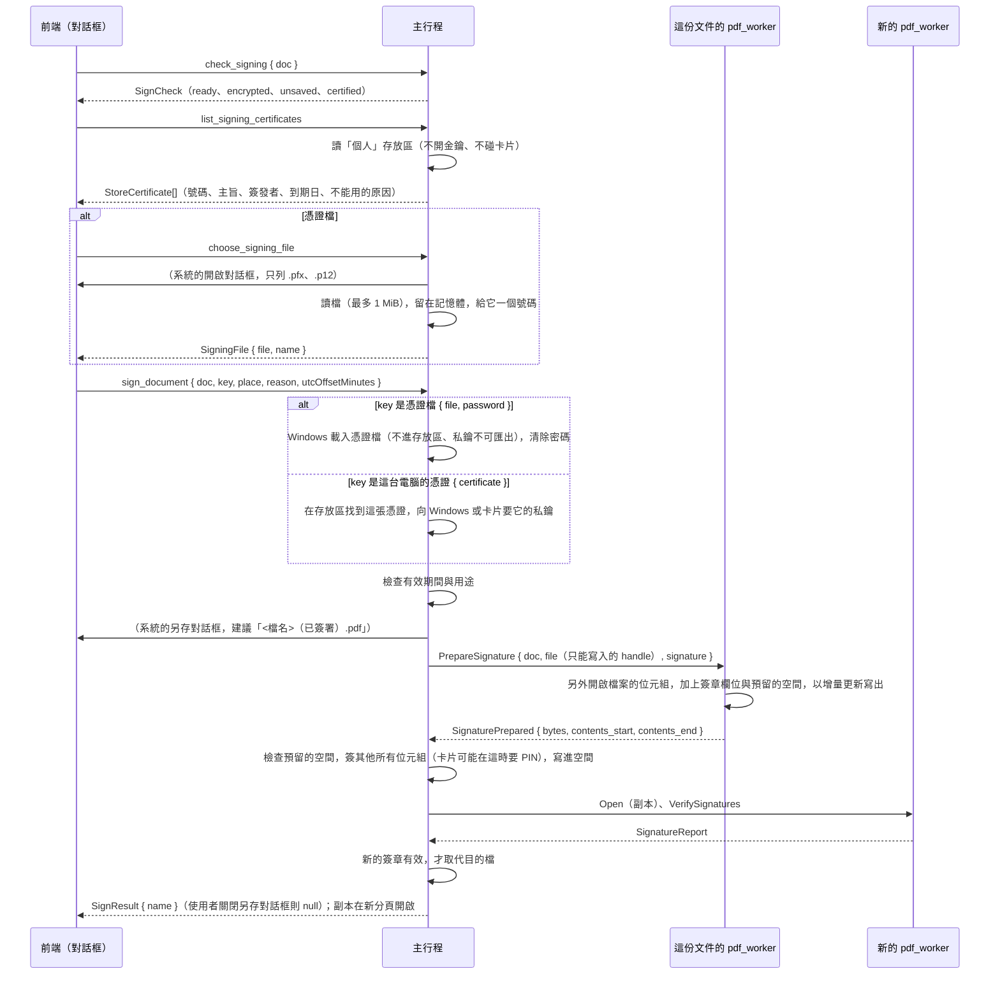

# 簽署文件（B3-06）

工作卡 [#237](https://github.com/winner0988/Pdf-reader/issues/237)；[ADR 0020](../adr/0020-document-signing.md)（負責人於 2026-10-21 接受選項 B）；規格 §3「本地數位簽章」的**簽署**部分。驗證見 [signatures.md](signatures.md)，畫面見 [screen-map.md](../ux/screen-map.md)「簽署文件（B3-06）」。

## 範圍

- 用使用者的憑證簽署目前的文件，存成**另一個檔案**（建議檔名 `<原檔名>（已簽署）.pdf`），並在新分頁開啟。目前的文件與它的檔案不會改變。憑證有兩種來源：
  - **這台電腦的憑證**：Windows 憑證存放區（目前使用者的「個人」存放區）裡有私鑰的憑證，包含讀卡機裡的自然人憑證、工商憑證等智慧卡。私鑰留在 Windows 或卡片裡，PIN 由 Windows 或卡片的程式詢問；
  - **憑證檔**：`.pfx`／`.p12`（PKCS #12），有密碼。
- 簽章可以顯示在目前這一頁的一個角落（簽署者、日期與原因的方框），或不顯示在任何頁面上。原因可以不填。
- 簽章是 `adbe.pkcs7.detached`：CMS、SHA-256，帶簽署時間屬性與憑證鏈。時間是這台電腦的時間，**沒有時間戳記**。
- **完全離線**：不查 OCSP／CRL、不下載中繼憑證。組憑證鏈時要 Windows 只用快取、不自動更新根憑證（`CERT_CHAIN_CACHE_ONLY_URL_RETRIEVAL`、`CERT_CHAIN_DISABLE_AUTH_ROOT_AUTO_UPDATE`）。
- **不做**：
  - 記住上次用哪一張憑證（ADR 0020 允許記住憑證指紋，之後再做）；
  - 時間戳記（RFC 3161）、內嵌撤銷資訊（DSS／LTV）、PAdES 的基準等級；
  - 認證簽章（DocMDP），以及簽署文件裡既有的空白簽章欄位：一律加一個新的欄位；
  - 已加密的文件、還沒儲存的變更；
  - 自訂外觀（圖片、手寫簽名）。

## 流程

1. 對話框一開啟就呼叫 `check_signing`，不能簽的文件在問使用者任何事之前就說明原因（見下方「拒絕的文件」）。
2. 對話框同時呼叫 `list_signing_certificates`，列出這台電腦的憑證；有可以簽署的，就預設用這台電腦的憑證，否則預設用憑證檔。
3. 選憑證檔時，`choose_signing_file`：主行程顯示開啟對話框，讀進憑證檔的位元組，回給頁面一個號碼與檔名，**沒有路徑**。
4. `sign_document` 的參數是 `SignArgs`（見 [ipc-contract.md](ipc-contract.md)）：文件代號、`key`（憑證檔的號碼與密碼，或這台電腦的憑證的號碼）、位置（頁碼與角落，或 `null`）、原因與這台電腦的時區。主行程先取得憑證與私鑰，密碼不對或憑證不能用時，在另存對話框出現**之前**就說，什麼都沒寫。
5. 主行程顯示另存對話框。不能選文件自己的檔案：以訊息方塊說明（`SIGNED_COPY_SAME_FILE_MESSAGE`）後再問一次。
6. 文件自己的 worker 準備副本（`PrepareSignature`），主行程簽署並填入簽章，**另一個新的 worker** 驗證副本，有效才取代目的檔，副本在新分頁開啟。任何一步失敗都只留下原本的目的檔（如果有的話），暫存檔刪除。

## 誰做什麼

### worker（`crates/pdf_worker/src/engine/signing.rs`）

- 用的是文件開啟時或上次存檔時的**檔案位元組**（`originals`），另外開啟一份：開著的文件與它還沒儲存的編輯都不動。
- 拒絕：
  - 加密的文件（`NotAllowed`；要密碼才能開的是 `Encrypted`）；
  - 認證簽章不允許任何變更（DocMDP `/P 1`）的文件（`NotAllowed`）；
  - MuPDF 修復過才開得起來的檔案（`NotAppendable`，回 `Corrupted`）：原本的位元組不能原樣保留，沒有東西可以接在後面。
- 加上一個簽章欄位：
  - **簽章字典**：`/Type /Sig`、`/Filter /Adobe.PPKLite`、`/SubFilter /adbe.pkcs7.detached`、`/Name`（簽署者，UTF-16）、`/M`（簽署時間，帶時區）、`/Reason`（有填才有）、`/ByteRange`，以及 `/Contents`：32 KiB 的十六進位 0（`SIGNATURE_RESERVE_BYTES`）。
  - **Widget**：`/FT /Sig`；名稱是 `SignatureN`，N 是還沒用過的最小數字；`/F 132`（列印、鎖定）。放進頁面的 `/Annots` 與 AcroForm 的 `/Fields`，`/SigFlags` 設為 3。
  - **看得見的簽章**：頁面角落一個 216 × 54 pt 的方框，離邊 36 pt，依頁面的旋轉放在使用者看到的那個角落；字是 9 pt 的內建 Droid Sans Fallback，內容由主行程給（`strings::signature_lines`：「數位簽署：…」「日期：…（UTC+08:00）」「原因：…」）。**看不見的簽章**在第一頁，沒有面積。
- 以**增量更新**寫出：原本的位元組在前，一個都不變。再填入 `/ByteRange` `[0 a b c]`：`/Contents` 的 `<…>` 以外的每一個位元組；回報 `/Contents` 的位置（`contents_start`、`contents_end`）。
- 逾時 5 分鐘（`SAVE_TIMEOUT`），handle 與 `Save` 一樣只能寫入，worker 看不到路徑。

### 主行程（`src-tauri/src/signing.rs`、`documents.rs`）

- 檢查 worker 回報的位置在檔案裡，而且那裡正好是 `<`、偶數個十六進位 0、`>`（`is_room`），才把前後兩段位元組交給 Windows 簽（`CryptMsgOpenToEncode`，`CMSG_DETACHED_FLAG`）。簽章放不進空間時是 `signatureTooLarge`，不寫。
- 把簽章以大寫十六進位寫進空間（`fill_room`），其他位元組不動。
- 簽署時**不鎖住文件**：worker 準備好副本後就放開文件，再簽署。卡片的 PIN 可能要使用者想一下，這段時間分頁照常使用。
- **另一個新的 worker** 開啟副本，用 B2-14 的驗證檢查它：要有一個簽章是 `Valid` 才算數。`Valid` 只給涵蓋整個檔案的簽章，所以這一個一定是剛加上的。否則是 `signatureNotValid`，暫存檔刪除。
- 驗證過才取代目的檔：暫存檔在目的檔旁邊，取代的方式同 `Save`（見 [saving.md](saving.md)）。

## 憑證檔與密碼

- 憑證檔由主行程讀，最多 `MAX_CERTIFICATE_FILE_BYTES`（1 MiB）。位元組留在主行程的記憶體裡，直到選了另一個檔或 app 結束；丟掉時清除（`Zeroizing`）。頁面只拿到號碼與檔名，**永遠拿不到路徑與位元組**。只有最後選的那個號碼有效。
- 密碼只在 `sign_document` 送一次，交給 Windows 載入憑證檔後立刻清除（`Password` 在丟掉時清除）。app 不記住憑證檔或密碼；頁面在失敗、完成與關閉對話框時清空密碼欄。
- 載入憑證檔用 `PFXImportCertStore(PKCS12_NO_PERSIST_KEY | PKCS12_ALWAYS_CNG_KSP)`，**沒有** `CRYPT_EXPORTABLE`：
  - 私鑰只在記憶體裡，不寫進使用者的金鑰檔，也不能匯出；
  - 憑證只在記憶體中的存放區，不進 Windows 的「個人」存放區；
  - CI 上的測試確認簽署前後，使用者的金鑰資料夾（`%APPDATA%` 與 `%LOCALAPPDATA%` 底下的 `Microsoft\Crypto`、`Microsoft\SystemCertificates`）沒有任何變化（ADR 0020 POC 第 4 項）。
- 密碼不對，與檔案不是憑證，說的是同一句話（`certificateUnreadable`），不透露是哪一個。
- 拒絕的憑證：
  - 檔案裡沒有私鑰（`certificateNotForSigning`）；
  - 已經過期（`certificateExpired`）、還沒生效（`certificateNotYetValid`）；
  - 金鑰用途有寫、但不含數位簽章或不可否認（`certificateNotForSigning`）。沒有寫用途的憑證可以用。
- 簽署者的名字取自憑證的 CN，沒有的話用 Windows 顯示的名稱；清理控制字元後最多 256 bytes。

## 這台電腦的憑證（Windows 憑證存放區）

- `list_signing_certificates` 只**讀**目前使用者的「個人」存放區（`CertOpenStore`，`CERT_SYSTEM_STORE_CURRENT_USER`，唯讀）：
  - 列出有私鑰的憑證，也就是 Windows 知道私鑰在哪裡的（`CERT_KEY_PROV_INFO_PROP_ID`）：在使用者的金鑰存放區，或在卡片上。卡片插著時，Windows 會把卡片上的憑證放進這個存放區；
  - 不開啟任何金鑰、不碰卡片、不詢問任何事；
  - 每張給：號碼、主旨與簽發者（CN，沒有的話用 Windows 顯示的名稱；清理後最多 256 bytes）、到期日（UTC 的日期）、不能用的原因（`expired`、`notYetValid`、`notForSigning`），可以簽署的排在前面；最多 `MAX_STORE_CERTIFICATES`（100）張。
- 頁面只拿到號碼。主行程保管最後一次列出的憑證（它們的 DER，是公開的資料）；再列一次時號碼全部換新，舊號碼找不到東西。
- `sign_document` 用這台電腦的憑證時：
  - 在存放區裡找到同一張憑證（`CERT_FIND_EXISTING`），**不匯入、不複製**任何東西；找不到時是 `certificateUnavailable`（例如卡片已拔出）；
  - 檢查有效期間與用途，同憑證檔；
  - 向 Windows 要私鑰（`CryptAcquireCertificatePrivateKey`），**不是**靜默模式，並交給它 app 視窗的 handle：卡片要 PIN 時，由 Windows 或卡片的程式在 app 的視窗上詢問，app 看不到 PIN。優先用 CNG（`CRYPT_ACQUIRE_PREFER_NCRYPT_KEY_FLAG`）：舊式 CSP 的金鑰在可以時也由 CNG 開啟，才能以 SHA-256 簽署；
  - 私鑰拿不到（卡片沒插）時是 `certificateUnavailable`。
- 使用者關閉了詢問 PIN 的視窗：回 `cancelled`，對話框不顯示任何錯誤，可以再試。卡片在簽署途中拔出：`certificateUnavailable`。
- CI 上的測試把測試憑證放進「個人」存放區，私鑰一次由 CNG 金鑰存放區保管、一次由舊式 CSP 保管（ADR 0020 POC 第 3 項），簽完連同私鑰一起移除。智慧卡 CI 測不到，由負責人用自己的卡手動確認。

## 拒絕的文件

| 情況 | 何時說 | 原因 |
|---|---|---|
| 已加密 | 選單停用並標示；對話框開啟時（`encrypted`） | 這一版不簽 |
| 有還沒儲存的變更，包含崩潰復原留下的 | 對話框開啟時（`unsaved`） | 簽的是檔案，檔案沒有這些變更：請先儲存 |
| 認證簽章不允許任何變更（DocMDP `/P 1`） | 對話框開啟時（`certified`） | 加上簽章也是變更 |
| MuPDF 修復過才開得起來 | 簽署時（`corrupted`） | 原本的位元組不能原樣保留 |
| 已經有簽章 | — | **可以簽**：增量更新不動原本的位元組，原本的簽章仍然有效 |

## 錯誤碼

新增 7 個 `ErrorCode`，文字見 [screen-map.md](../ux/screen-map.md)「簽署文件（B3-06）」。使用者關閉了詢問 PIN 的視窗時是既有的 `cancelled`，不顯示訊息。

| ErrorCode | 何時 |
|---|---|
| `certificateUnreadable` | 密碼不對，或檔案不是憑證；簽署者的名字是空的 |
| `certificateExpired`／`certificateNotYetValid` | 憑證的有效期間不含現在 |
| `certificateNotForSigning` | 沒有私鑰，或金鑰用途不含簽章 |
| `signatureTooLarge` | 簽章比預留的 32 KiB 大（憑證鏈很長時） |
| `signatureNotValid` | 簽好的副本沒有通過新 worker 的驗證 |
| `certificateUnavailable` | 這台電腦的憑證已不在存放區，或私鑰拿不到（卡片拔出、沒有讀卡機） |

## 測試

- **worker**（`engine/signing.rs` 的單元測試）：
  - 版面與 `/ByteRange`：涵蓋 `/Contents` 以外的每一個位元組，原本的位元組在前、不變；
  - 看不見的簽章什麼都不畫；看得見的方框在四個角，包含旋轉的頁面；
  - 第二個簽章叫 `Signature2`；
  - 加密、DocMDP `/P 1`、修復過的檔案被拒絕，而且沒有寫出任何東西；
  - 日期的時區寫法。
- **主行程**（`signing.rs`、`documents.rs`）：
  - 時區換算、填入與檢查空間、只認最後選的憑證檔與最後列出的號碼；
  - 到期日的寫法；PIN 沒給（`cancelled`）、卡片拔出（`certificateUnavailable`）與其他失敗分得開；
  - 準備好的副本只在空間裡被簽，其他位元組不動；
  - 不能簽的文件在問使用者任何事之前就說。
- **只在 CI 上做**：這些測試要讓 Windows 載入測試憑證，`PDF_READER_TEST_SIGNING=1` 才在本機做。
  - 簽兩段位元組，以 `CryptVerifyDetachedMessageSignature` 驗證；改一個位元組就不成立；
  - 使用者的金鑰資料夾沒有變化；
  - 密碼不對與不是憑證都是 `Unreadable`；過期的與只能加密的憑證被拒絕；
  - 簽好的副本通過 worker 的驗證，改一個位元組就不成立；
  - 放進「個人」存放區的測試憑證（CNG 與舊式 CSP 的私鑰各一次）：列得出來、可以簽、簽章成立；過期的與只能加密的列出來並說明原因、被拒絕；移除後是 `Unavailable`；使用者的金鑰資料夾在全部移除後與開始前一樣。
- **契約**（`validate.rs`）：`SignArgs` 的密碼、原因與時區；這台電腦的憑證只用號碼，帶密碼、PIN 或其他欄位都被拒絕；`SignaturePrepared` 的空間大小與位置。
- **畫面**（`src/features/signing/Signing.test.tsx`）：
  - 送出的參數、原因的長度、錯誤的說明；
  - 選單與各種拒絕、簽署成功、換角落、看不見的簽章；
  - 失敗時清空密碼、關閉另存對話框後可以再試、每次開啟都重新開始；
  - 這台電腦的憑證：預設選第一張可以簽署的、不要密碼、只送號碼；不能用的憑證停用並說明原因；沒有可以簽署的憑證時改用憑證檔；重新整理；PIN 沒給時不說話，卡片拔出時說明；讀取失敗時可以再試；
  - `AccessibilityComponents.test.tsx` 的 axe 檢查。
- **真的 app**（`tests/e2e/signing.spec.ts`）：
  - 有未儲存變更的文件說明原因、已加密的文件停用選單；
  - **只在 CI 上做**：以 PowerShell 把 `signer.pfx` 放進「個人」存放區，在對話框選這張憑證、不用密碼簽署，副本在新分頁開啟、簽章有效；結束時連同私鑰移除；
  - **只在 CI 上做**（`E2E_SIGNING=1` 才在本機做）：用 `tests/corpus/certificates/signer.pfx` 簽署，副本在新分頁開啟、簽章有效但無法確認簽署者，原檔的雜湊不變、副本以原檔的位元組開頭，檔案與頁面裡都沒有密碼；密碼不對與過期的憑證各說一句，沒有寫出檔案。
- **手動，由負責人做**：
  - 以 Adobe Acrobat Reader 開啟簽好的副本，確認簽章有效、只是不信任簽署者（ADR 0020 POC 第 2 項）；
  - **智慧卡**：插入自然人憑證（或其他卡片），在對話框的「這台電腦的憑證」選它，PIN 由卡片的程式詢問，簽好的副本簽章有效；拔出卡片後再簽，說明找不到憑證或私鑰；在 PIN 視窗按取消，對話框不顯示錯誤。

測試用的憑證在 `tests/corpus/certificates/`，見 [tests/corpus/README.md](../../tests/corpus/README.md)「測試用的簽章金鑰」。
