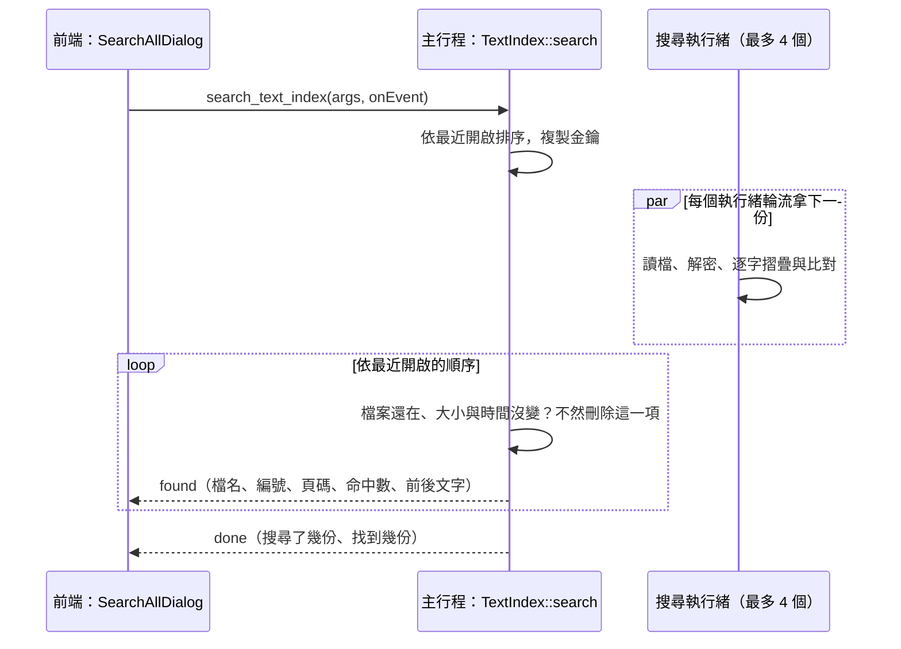

# 本機全文索引（在所有文件中搜尋）

工作卡 [#319](https://github.com/winner0988/Pdf-reader/issues/319)（B3-21），決定見 [ADR 0026](../adr/0026-cross-document-text-index.md)。使用者開過的文件的文字，加密存在這台電腦上，回答「哪一份文件有這句話」。

程式碼：

- `src-tauri/src/text_index.rs`：索引本身（收錄、擷取、存放、搜尋）；
- `src-tauri/src/index_crypto.rs`：金鑰（DPAPI）與 AES-256-GCM（CNG）；
- `src-tauri/src/drives.rs`：檔案在不在固定磁碟上；
- `crates/ipc_contract/src/matching.rs`：比對規則，worker 搜尋單一文件也用同一份；
- `src/features/textIndex/`：對話框、設定頁的區塊。

## 開關

- 設定 `textIndex`（預設 `false`）。**只有 `recordRecentFiles` 也開著時才有效**：關閉記錄最近開啟的檔案，索引也停用，設定頁的勾選框停用。
- 下列情況立即刪除整個索引（`TextIndex::clear`，先刪金鑰，見「存放」）：
  - 關閉 `textIndex` 或 `recordRecentFiles`（`set_settings`）；
  - 清除最近開啟的檔案（`clear_recent_files`）；
  - 設定頁的「清除索引」（`clear_text_index`）；
  - 啟動時設定是關閉的（例如上次關閉時刪不掉的檔案）。
- 開啟時，已經開著的文件都加入（`consider_all`）。

## 什麼會進索引

主行程在下列時候對一個分頁的文件呼叫 `TextIndex::consider`：開檔完成、存檔（`save_document`）、另存新檔、標記或取消機敏（這三個走 `commands::report`）、「不記錄此檔案」的變更（`set_file_recording`）。

| 文件 | 處理 |
|---|---|
| 機敏文件（`DocumentInfo::sensitive`） | 不收錄；**立即刪除**這個路徑的項目 |
| 要密碼才開得了的 PDF（輸入的或記住的密碼，`OpenDocument::protected`） | 同上 |
| 「不記錄此檔案」（`RecentFiles::is_recorded`） | 同上 |
| 不在固定磁碟上（`drives::is_fixed`） | 不收錄。UNC 路徑（`\\server\share`、`\\?\UNC\…`）只看名稱就判定，不詢問 Windows，不會連到網路位置；其他用 `GetVolumePathNameW` 與 `GetDriveTypeW` |
| 有未儲存的變更（含崩潰復原的編輯） | 不擷取；存檔後再收錄 |
| 沒有頁、路徑超過 4 KiB 或不是 Unicode | 不收錄 |

一個檔案以**正規化的路徑**（`fs::canonicalize`）、**大小**與**修改時間**（`FileIdentity`）辨認。用另一個路徑開同一個檔案是同一項；大小或時間不同就是新的內容：舊的項目與它的文字立即刪除，再重新擷取（存檔取代原檔、例如套用遮蔽後，遮掉的字不會留在索引裡）。

## 擷取文字

- 執行緒 `text-index` 處理佇列中的分頁。開檔後先等 2 秒，讓使用者與掃描頁的辨識先用 worker；這份文件的掃描頁正在辨識時（`Ocr::is_reading`）每 2 秒再看一次，辨識出的字也會收進來。
- 一次一頁，以「背景工作」排在渲染執行緒上（`Renderer::in_background`：有渲染請求時先渲染），向 worker 要 `PageText`：與選取、搜尋同一份文字層，含 OCR 的字與 app 文字方塊的字，每頁最多 100,000 字元；每行以換行接起來。頁與頁之間停 5 ms。
- 每拿到一頁都確認文件沒變（同一個 `DocumentId`、沒有未儲存的變更、仍然可以收錄），變了就停，已拿到的保留；文件關閉時也一樣。下次開啟同一個檔案時從停下的地方繼續。
- 每 10 秒與結束時寫入。沒有字的頁面下次開檔時再看一次（可能已經辨識出字）。
- 一份文件的文字到 16 MiB 就停，標記為只收錄前面的頁面。

## 存放

`%LOCALAPPDATA%\io.github.winner0988.pdfreader\index\`，只有主行程讀寫，照 [local-data.md](local-data.md) 的規則（暫存檔再換名、有讀取上限）。

| 檔案 | 內容 | 讀取上限 |
|---|---|---|
| `key` | 256 位元金鑰（`BCryptGenRandom`），以 DPAPI 保護（`CryptProtectData`，目前使用者，`CRYPTPROTECT_UI_FORBIDDEN`，加上 app 固定的 entropy） | 4 KiB |
| `catalog` | 文件清單（JSON）：編號、開啟時的路徑、正規化的路徑、檔名、大小、修改時間、最近開啟的順序、頁數、已擷取的頁數、空白頁數、是否只收錄前面的頁面、檔案大小。加密 | 32 MiB |
| `d<編號>`（16 位十六進位） | 一份文件每一頁的文字（頁數，再來每頁的長度與 UTF-8）。加密 | 32 MiB |

- **加密**：AES-256-GCM（CNG，`BCRYPT_AES_ALGORITHM` 與 `BCRYPT_CHAIN_MODE_GCM`）。每次加密都用 `BCryptGenRandom` 產生新的 12 bytes nonce，存成「nonce、密文、16 bytes 驗證標籤」。附加資料（associated data）寫明是目錄還是第幾號文件，一份文件的檔案不能冒充另一份或目錄。
- 金鑰與解密後的文字放在 `Zeroizing` 裡，用完清除；每個搜尋執行緒有自己的 CNG 金鑰物件。
- **索引壞了**：金鑰解不開、任何檔案驗證失敗、格式不對或超過上限時，刪除全部（先刪金鑰），再把開著的文件重新加入。目錄沒有列出的文件檔（寫到一半時 app 結束）在讀取時刪除。
- **清除**：先刪 `key`，再刪其他檔案與資料夾。刪不掉的檔案（被別的程式開著）沒有金鑰也讀不出來，下次讀取索引時發現沒有金鑰就整個刪除。背景執行緒在清除前開始的寫入不會再寫回（寫入在鎖裡先確認索引沒有被清除過）。
- **上限**（`crates/ipc_contract/src/limits.rs`）：

| 上限 | 值 |
|---|---|
| 文件數 | 2,000（`MAX_INDEX_DOCUMENTS`） |
| 全部（加密後，含目錄與金鑰） | 256 MiB（`MAX_INDEX_BYTES`） |
| 一份文件的文字 | 16 MiB（`MAX_INDEX_DOCUMENT_TEXT_BYTES`） |

超過時刪掉最久沒開的文件，正在寫入的那份不刪。

## 搜尋

- 比對規則與單一文件的搜尋相同（`ipc_contract::matching`：空白與大小寫摺疊、KMP），跨行的詞組也找得到。文字一個字元一個字元摺疊、比對，不另外保存（`Matcher`）。
- 每份文件的結果：命中數（最多 10,000）、有命中的頁數、前 20 頁各自的命中數與第一個命中前後各最多 40 字（`MAX_INDEX_PAGES_PER_DOCUMENT`、`MAX_INDEX_SNIPPET_CHARS`）。前後的字是複製用的純文字（控制字元換成空白、看不見的格式字元去掉、連續空白只留一個）；主行程送出前照 `Validate` 檢查。
- 結果依最近開啟的順序送出：各執行緒先完成的結果暫存，輪到它時才送。
- **沒有路徑**：結果只有檔名與編號（`IndexEntryId`），編號只在這次搜尋有效，下一次搜尋就作廢。
- 送出前檢查檔案還在、大小與修改時間沒變（只查固定磁碟）；不符合就刪除那一項、不送出，刪掉或改過的檔案不會再露出舊的文字片段。是不是固定磁碟，一次搜尋中每個資料夾只問 Windows 一次（`FixedFolders`：每問一次約 1 ms，檔案多半在少數幾個資料夾）。
- `cancel(request)` 停止；頻道關閉（對話框關了）也停止。
- `open_indexed_document`：用編號找到存著的路徑，再檢查一次，以新分頁開啟（結果走開檔頻道）。檔案不在或已變更時刪除那一項，回 `unreadable`；前端說明並從結果移除。前端在文件開好後跳到那一頁。
- 搜尋字串與結果不寫日誌、不進復原日誌。

## 效能

`PDF_READER_INDEX_BENCH=1 cargo test --release -p pdf-reader --locked bench_a_full_index -- --nocapture`：2,000 份文件、每份一頁 120 KiB 的英文字（加密後共 235 MiB，接近 256 MiB 的上限），在開發用的筆電上（4 個搜尋執行緒）：

| 查詢 | 找到 | 第一筆 | 全部 |
|---|---|---|---|
| `zebracorn`，檔案剛寫好後的第一次搜尋 | 4 份 | 1.09 秒 | 4.60 秒 |
| `zebracorn`，再一次 | 4 份 | 114 ms | 460 ms |
| `harbour budget`（每份都有） | 2,000 份 | 4 ms | 489 ms |
| `contract`（每份都有） | 2,000 份 | 4 ms | 494 ms |
| `no such words at all` | 0 份 | — | 489 ms |

- ADR 0026 的目標（第一筆 ≤ 300 ms、全部 ≤ 2 秒）在檔案讀過一次之後達到。`zebracorn` 的第一筆要 114 ms，是因為依最近開啟的順序，第一份有這個字的文件排在第 490 份左右。
- **剛寫好的檔案第一次被讀時慢**：同一台電腦上直接讀這 2,000 個檔案，第一次 13 秒、第二次 0.13 秒，推測是防毒軟體（Microsoft Defender）在第一次開啟時掃描剛寫好的檔案。實際使用時檔案是一份一份在開檔後寫的，掃描分散在那時候；但一次收錄很多份之後的第一次搜尋，可能要幾秒。預先篩選（ADR 0026 提到的加密三字元組索引）擋不掉這段：常見的字仍然要讀每一份。
- 送出前檢查檔案時，「是不是固定磁碟」原本每份都問 Windows（每次約 1.2 ms，2,000 份共 2.4 秒，全部要 3.2 秒）；改成每個資料夾問一次之後如上表。
- 收錄 2,000 份約 28 秒（每份都重寫目錄；實際使用是一次開一份，看不出來）。

## 前端

- 「⋯」→「在所有文件中搜尋…」（`Ctrl+Shift+F`），以及索引開著時開始畫面的「在所有文件中搜尋…」。對話框屬於 app（`TextIndexHost`），開出的文件在新分頁。
- 輸入停 250 ms 後搜尋，`Enter` 立即搜尋，`Aa` 區分大小寫；改字、關閉對話框都會取消進行中的搜尋。每次打開對話框都重新搜尋（索引可能已經變了，舊的編號也作廢）。
- 索引沒開時說明到哪裡開，輸入框停用。
- 設定頁「本機全文索引」：開關（記錄最近開啟的檔案關閉時停用）、收錄的文件數與大小、「清除索引」。

## 擋不到的

照 ADR 0026「後果」：以同一個 Windows 帳號執行的程式可以用 DPAPI 解開金鑰；在別的程式中標記機敏之前收錄的文字，要等下次在 app 中開啟才刪除；部分外接磁碟回報為固定磁碟；在 app 外刪除或修改的檔案，要等搜尋命中它或開啟它才刪除；檔案系統的快照與備份可能留有舊的加密內容。

## 測試

- `src-tauri/src/text_index.rs`：收錄與找到（沒有路徑）、磁碟上沒有明文（UTF-8 與 UTF-16 都查）、空白頁與 OCR、未儲存的變更、每一種不收錄的情況、標記機敏或不記錄時立即刪除、存檔後重新擷取、檔案改過或刪掉、最近開啟的在前、取消、檔案或目錄或金鑰壞了、孤立的文件檔、先刪金鑰、沒有資料夾、上限與淘汰、超過 16 MiB；`bench_a_full_index` 只在 `PDF_READER_INDEX_BENCH=1` 時執行。
- `src-tauri/src/index_crypto.rs`：加密解密、竄改、nonce 不重複、DPAPI；`src-tauri/src/drives.rs`：固定磁碟與網路位置。
- `crates/ipc_contract`：`Matcher` 與 `find` 一致、ASCII 捷徑與 Unicode 表一致、結果的驗證。
- `src/features/textIndex/TextIndex.test.tsx`：對話框、設定區塊、入口、快捷鍵。
- `tests/e2e/text-index.spec.ts`：真的 app 中預設不留下任何東西；開啟後開兩份、磁碟上沒有明文、關閉後找到兩份、從結果開到那一頁、標記一份為機敏後只找到另一份、清除。
