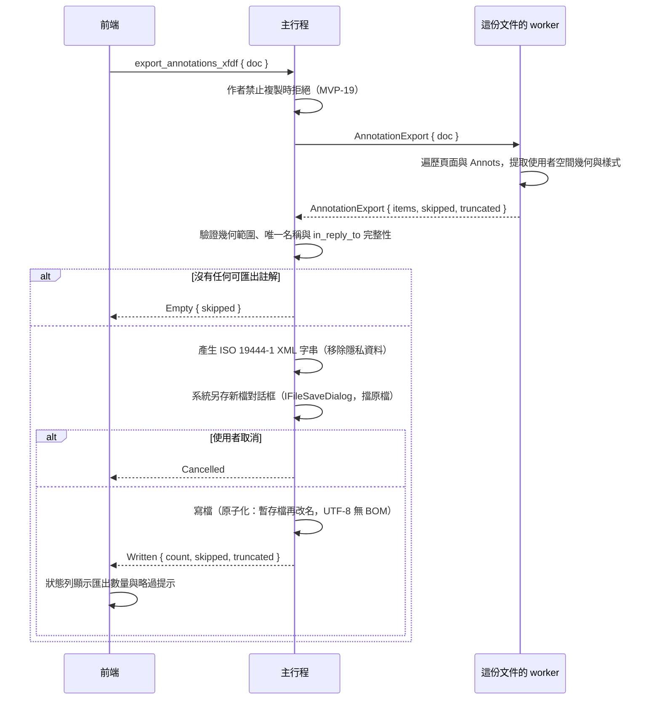

# 註解匯出成 XFDF（B5-09）

工作卡 [#446](https://github.com/winner0988/Pdf-reader/issues/446)；ISO 19444-1（XML Forms Data Format, XFDF）標準相容的註解匯出功能。另見 [annotation-summary.md](annotation-summary.md)。

將 PDF 中的註解匯出為標準 XFDF 1.0 XML 格式，使其他 PDF 軟體（如 Adobe Acrobat Reader）能完整匯入並呈現標記、附註、手繪線條與形狀。

## 流程

## 註解種類對照表

| PDF 註解子類型（`/Subtype`） | XFDF 元素 | 幾何與樣式屬性 | 子元素 |
|---|---|---|---|
| `/Highlight` | `<highlight>` | `page`, `rect`, `color`, `opacity`, `coords`, `flags`, `name` | `<contents>` |
| `/Underline` | `<underline>` | 同上 | `<contents>` |
| `/StrikeOut` | `<strikeout>` | 同上 | `<contents>` |
| `/Squiggly` | `<squiggly>` | 同上 | `<contents>` |
| `/Text` | `<text>` | `page`, `rect`, `color`, `opacity`, `icon`, `flags`, `name`, `inreplyto` | `<contents>` |
| `/Ink` | `<ink>` | `page`, `rect`, `color`, `opacity`, `width`, `flags`, `name` | `<inklist><gesture>...</gesture></inklist>` |
| `/Stamp`（標準印章） | `<stamp>` | `page`, `rect`, `flags`, `name`, `icon` | - |
| `/FreeText` | `<freetext>` | `page`, `rect`, `color`, `flags`, `name`, `justification` | `<defaultappearance>`, `<defaultstyle>`, `<contents>` |
| `/Square` | `<square>` | `page`, `rect`, `color`, `interior-color`, `opacity`, `width`, `flags`, `name`, `style`, `intensity` | - |
| `/Circle` | `<circle>` | `page`, `rect`, `color`, `interior-color`, `opacity`, `width`, `flags`, `name` | - |
| `/Line` | `<line>` | `page`, `rect`, `color`, `opacity`, `width`, `start`, `end`, `head`, `tail`, `flags`, `name` | `<contents>` |
| `/Polygon` | `<polygon>`（ISO 19444-1 § 6.4.11） | `page`, `rect`, `color`, `interior-color`, `opacity`, `width`, `flags`, `name`, `style`, `intensity`（§ 6.6.18 雲形邊框 `style="cloudy" intensity="1"`） | `<vertices>`（§ 6.5.31） |
| `/PolyLine` | `<polyline>`（ISO 19444-1 § 6.4.12） | `page`, `rect`, `color`, `opacity`, `width`, `flags`, `name` | `<vertices>`（§ 6.5.31） |

## 座標系統（PDF User Space）

- **標準單位**：PDF user space 點數（1/72 吋），原點位於頁面左下角。
- **未旋轉檔案座標**：直接讀取 PDF 物件字典內的原始 `/Rect`、`/QuadPoints`、`/InkList`、`/L` 陣列，不套用畫面旋轉（`/Rotate`）與顯示縮放，確保其他 PDF 檢視器匯入時對位完全一致。
- **數值格式化**：浮點數最高保留 4 位小數，去除結尾無效的 `0` 與小數點，不使用科學記號，避免 `-0`。
- **`coords` 順序**：四邊形座標依 PDF 標準格式（左上、右上、左下、右下）連續輸出 8 個數值。
- **手繪線條 `inklist`**：筆畫點對以逗號連接（`x,y`），點與點以分號分隔（`<gesture>x1,y1;x2,y2;...</gesture>`）。
- **多邊形／折線 `vertices`**：依 ISO 19444-1 § 6.5.31 以分號分隔點對 `<vertices>x1,y1;x2,y2;...</vertices>`；矩形與多邊形帶有 `/BE << /S /C /I 1 >>` 時依 § 6.6.18 加上 `style="cloudy" intensity="1"`。

## 唯一識別名稱與階層關係

1. **唯一名稱（`name`）**：
   - 優先讀取註解字典內的 `/NM`。長度在 1..=64 字元且為有效文字、且未重複時使用。
   - 若無 `/NM` 或名稱重複，自動產生格式為 `pdf-reader-<page>-<index>` 的唯一識別名稱（若衝突則附加數字後綴）。
2. **回覆階層（`inreplyto`）**：
   - 附註回覆讀取 `/IRT` 指向的父註解間接物件。
   - 若父註解成功匯出，則在其子註解加上 `inreplyto="<父註解名稱>"` 屬性。
   - 主行程嚴格驗證所有 `inreplyto` 參照的名稱必須存在於同一份匯出清單中，否則拒絕（`ProtocolViolation`）。

## 略過項目（Skipped Items）

- **自訂圖片印章（Image Stamps）**：
  - ISO 19444-1 XFDF 標準並未提供內嵌點陣圖資料的欄位（Adobe Acrobat 僅支援標準預設文字印章名稱如 `Approved`、`Draft` 等）。
  - 因此自訂圖片印章不予匯出，系統將其計入 `skipped` 計數，於介面提示使用者「已略過 N 個不支援的項目」。
- **無效或損毀的註解**：
  - 缺乏必要 `/Rect` 或幾何資料損毀的註解亦計入 `skipped`，不中斷整體匯出。

## 隱私與安全性（Privacy Guarantees）

- **無本機路徑**：`<f href="..."/>` 標籤僅包含純檔案名稱（去除任何 Windows 或 Unix 目錄路徑）。
- **無個人資訊與時間**：不輸出作者（`/T` / `title`）、建立時間（`/CreationDate` / `creationdate`）、修改時間（`/M` / `date`）、主旨（`/Subj` / `subject`）或檔案指紋（`<ids>`）。
- **XML 1.0 合規與跳脫**：
  - 自動清除 XML 1.0 禁止的控制字元（`U+0000`..=`U+0008`、`U+000B`、`U+000C`、`U+000E`..=`U+001F`、`U+FFFE`、`U+FFFF`）。
  - 行程換行符號正規化為 `\n`。
  - 屬性值完整跳脫 `&`、`<`、`>`、`"`、`'`；內容文字完整跳脫 `&`、`<`、`>`。

## 邊界上限與驗證（Limits & Validation）

| 檢查項目 | 限制值 | 超過時處理 |
|---|---|---|
| 單頁最大註解數 | `MAX_ANNOTATIONS_PER_PAGE`（2,000） | 截斷並標示 `truncated = true` |
| 全文件最大註解數 | `MAX_ANNOTATION_SUMMARY_ITEMS`（10,000） | 截斷並標示 `truncated = true` |
| 註解文字總長度 | `MAX_ANNOTATION_SUMMARY_TOTAL_BYTES`（4 MiB） | 截斷內容 |
| 頁面座標範圍 | `MAX_PAGE_SIDE_PT`（14,400 pt） | 超出範圍則跳過或標示無效 |
| 透明度範圍 | `0.0` ..= `1.0` | 非有效值回傳 `ProtocolViolation` |
| 線寬範圍 | `0.0` ..= `1,000.0` | 非有效值回傳 `ProtocolViolation` |
| 主行程安全驗證 | 頁碼小於總頁數、名稱唯一、`inreplyto` 參照存在 | 任一不合即終止並回傳 `ProtocolViolation` |
