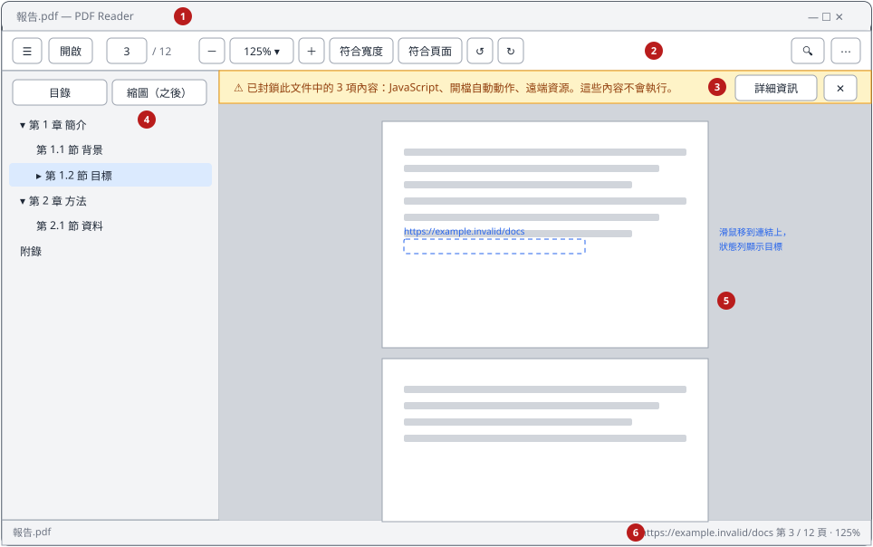
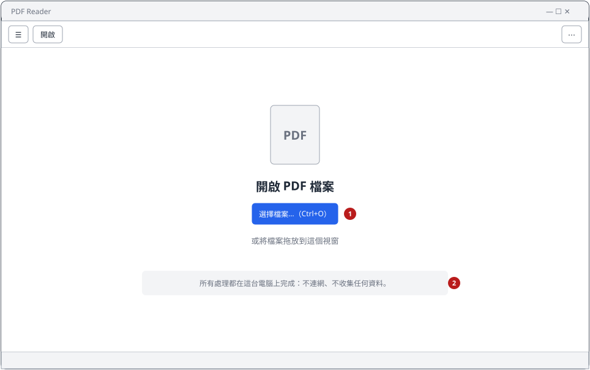
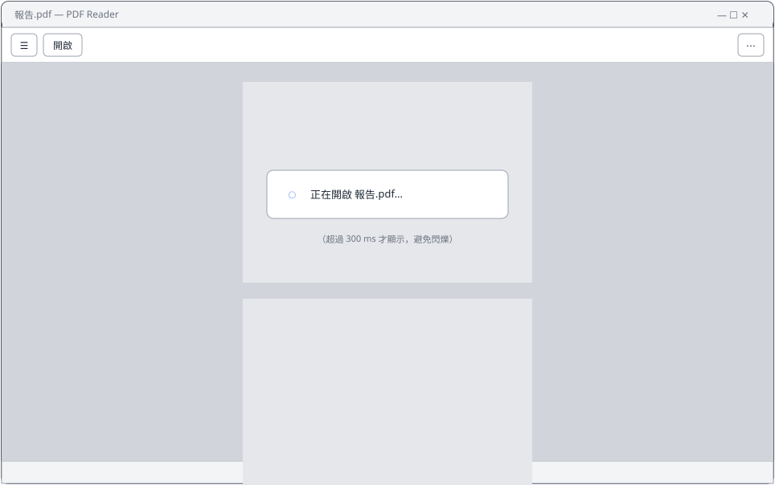
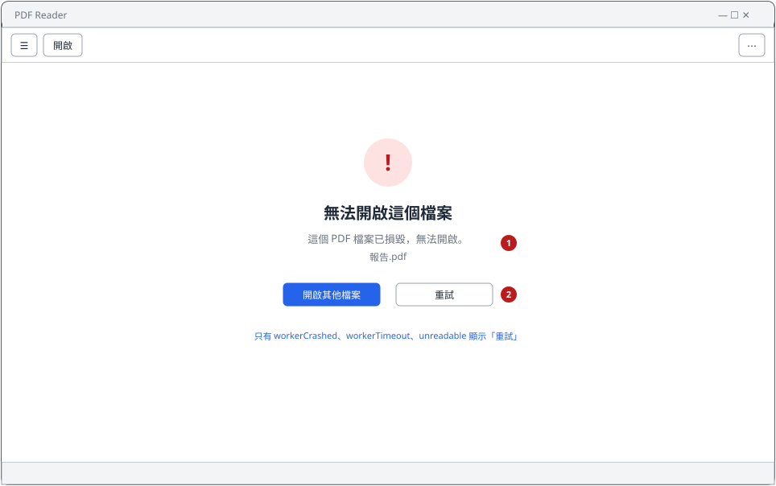
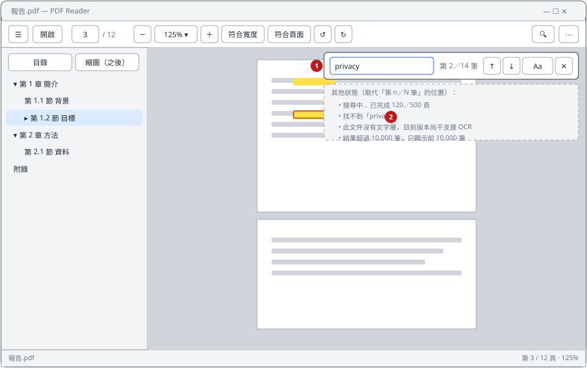
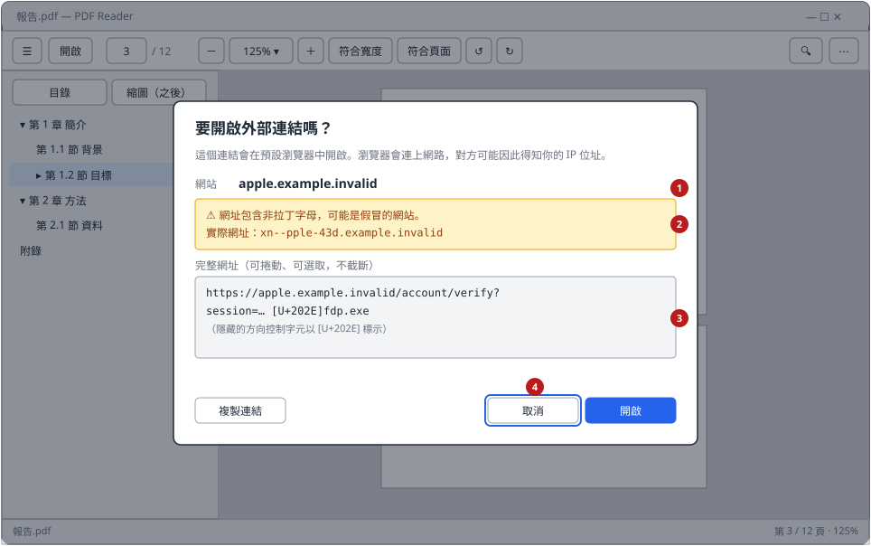
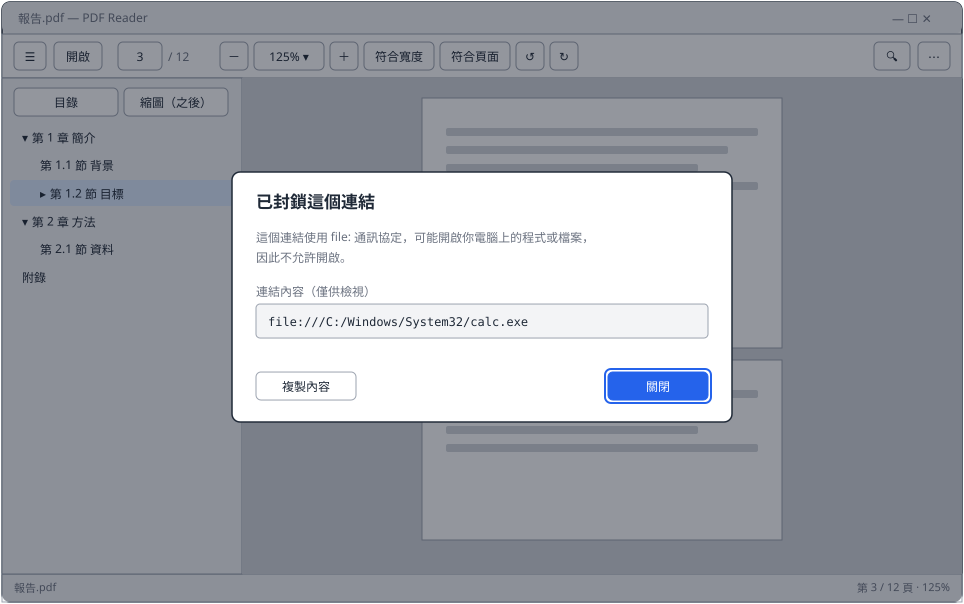
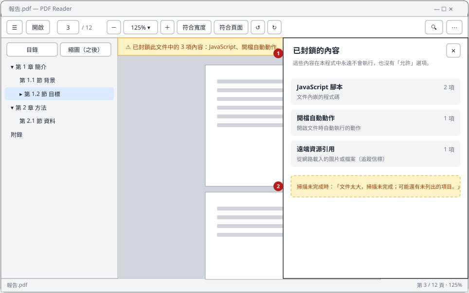
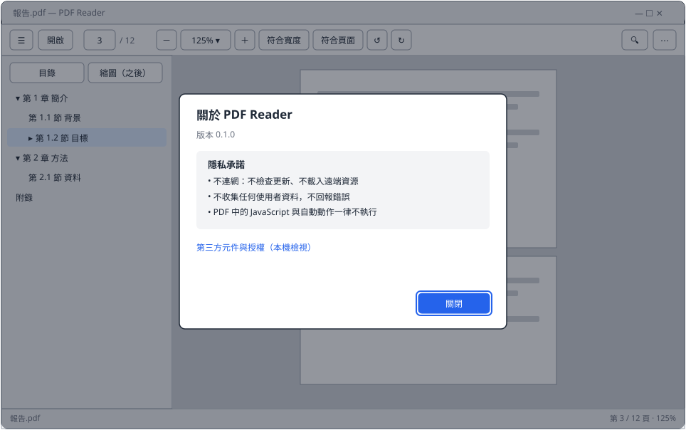

# 閱讀器畫面地圖與 UI 行為規格

對應工作卡 UX-01。MVP-05～MVP-12 的前端工作都以本文件為準；**需經負責人核准**。

- Wireframe 只呈現版面與文字，不代表視覺設計（顏色、圖示、字型之後再定）。
- Wireframe 由 [`wireframes/make_wireframes.py`](wireframes/make_wireframes.py) 產生：修改畫面時改腳本後重新執行，不要直接編輯 SVG。
- 所有使用者可見文字集中在「文字表」一節，實作時放進 `src/i18n/zh-TW.ts`，不得寫死在元件裡。

## 1. 主視窗

| # | 區域 | 內容與行為 | 實作卡 |
|---|---|---|---|
| 0 | 分頁列 | 有開啟檔案時出現在最上方。每個檔案一個分頁：檔名（太長時截斷，滑鼠停留顯示全名）；載入中顯示轉動圖示，開檔失敗顯示警告圖示。右側「＋」開啟檔案。✕ 或中鍵關閉分頁；關閉目前的分頁後顯示右邊的分頁，沒有就顯示左邊的。最多 20 個分頁。每個分頁記住自己的頁碼、縮放、旋轉、側欄與搜尋。 | MVP-14 |
| 1 | 標題列 | `<檔名> — PDF Reader`（目前分頁的檔名）；沒有開啟文件時只顯示 `PDF Reader`。只顯示檔名，不顯示路徑。 | MVP-05、14 |
| 2 | 工具列 | 左到右：側欄開關、開啟、頁碼輸入框／總頁數、縮小、縮放比例下拉、放大、符合寬度、符合頁面、逆時針旋轉、順時針旋轉；右側：搜尋、更多（⋯：設定、快捷鍵、關於）。沒有開啟文件時只顯示側欄開關、開啟、更多。每個圖示按鈕都有工具提示，內容包含快捷鍵。 | MVP-05、08 |
| 3 | 安全警示橫幅 | 文件含有已封鎖內容、或掃描未完成時才出現，位於工具列下方、頁面畫布上方。顯示摘要（最多列 3 類，其餘以「等」表示；數字是類別數，不是各類數量的總和，因為類別會重疊，例如頁面事件執行的腳本同時是「JavaScript」與「事件觸發動作」）與「詳細資訊」、關閉（✕）。沒有任何發現但掃描未完成時，摘要改為 scanIncomplete 的文字。關閉只對目前這份文件的這次開啟有效。 | MVP-11 |
| 3a | 未儲存變更的提示列 | 上一次執行留下這個檔案的未儲存變更時才出現（app 當機、被強制結束或斷電），位於工具列下方、安全警示橫幅上方。說明 recovery.available，按鈕 recovery.restore、recovery.discard、✕（recovery.later）；檔案在那之後被修改過時說明 recovery.stale，只有 recovery.discard 與 ✕。見「崩潰復原」。 | B2-13 |
| 4 | 側欄 | 預設寬 280 px，可拖曳調整為 200～480 px。分頁：「目錄」、「縮圖」、「附件」、「遮蔽」。目前頁面所屬的目錄項目以底色標示。「縮圖」：每頁一張，寬 128 px、依頁面比例（很細長的頁面最高 256 px），下方標示頁碼；只渲染畫面附近的縮圖，在畫面上停留片刻才渲染；點擊跳到該頁；目前頁以強調色外框標示並保持在畫面內；`↑`／`↓` 在縮圖之間移動，`Enter` 跳到該頁。縮圖可以多選並變更頁面（見第 7 節「頁面管理」）。視窗寬度小於 960 px 時側欄改為浮動覆蓋，開啟後點畫布即關閉。「附件」：列出文件層級與頁面附件註解，顯示真實副檔名與危險類型圖示，可「另存…」（B3-20，ADR 0025）。 | MVP-05、09、18、B3-20 |
| 5 | 頁面畫布 | 連續垂直捲動，頁與頁間距 12 px，水平置中；放大後比視窗寬時出現水平捲軸。尚未渲染的頁面顯示淺灰占位框（尺寸正確）。連結區域滑鼠游標變成手指，懸停時狀態列顯示目標。文字上方游標變成 I 字形，可以選取與複製文字；右鍵顯示 app 自己的功能表（見「選取與複製文字」）。 | MVP-07、08、12、15 |
| 6 | 狀態列 | 左：檔名；文件作者限制了複製或列印時，後面接著鎖頭圖示與 permissions.restricted（見「文件權限」）。辨識掃描頁的文字時：進度與「停止」（見「掃描頁的文字辨識」）；目前這一頁的文字是辨識出來的時候：ocr.pageNote。右：連結懸停目標（見「連結」）或暫時的提示（沒有文字層、作者不允許複製或列印、辨識的結果；螢幕閱讀器會讀出）、`第 n / N 頁 · 縮放%`。 | MVP-05、15、19、B2-10 |

「目前頁」定義：與畫布垂直中線相交的頁面；若中線落在頁與頁之間，取上方那一頁。

## 2. 狀態

| 空狀態 | 載入中 | 錯誤 |
|---|---|---|
|  |  |  |

- **空狀態**：①「選擇檔案…（Ctrl+O）」是主要按鈕，啟動後焦點預設在它上面；拖放提示下方有次要按鈕「從檔案建立 PDF…」（B3-03，見第 7 節）。② 隱私說明固定顯示。整個畫布都是拖放目標；拖曳進入時畫布邊框以強調色虛線標示。
- **最近開啟的檔案**（#73）：空狀態的拖放提示下方列出最近開啟的檔案，最新的在前，最多 20 筆；沒有時不顯示這一區。
  - 每一筆只顯示**檔名**（不顯示資料夾），按下以新分頁開啟；右側的 × 從清單移除。
  - 「清除清單」一鍵清除全部。
  - 檔案已經不在時顯示 recent.missing，並從清單移除。
  - 下方說明 recent.note。
  - 儲存方式見 [recent-files.md](../architecture/recent-files.md)。
- **不記錄此檔案**：開啟文件時，「⋯」選單有核取項目「不記錄此檔案」。勾選後這個檔案從清單移除，之後再開也不記錄；取消勾選後恢復記錄。
- **載入中**：開檔超過 300 ms 才顯示，避免快速開檔時閃爍。顯示頁面骨架與「正在開啟 <檔名>…」。
- **錯誤**：① 標題固定為「無法開啟這個檔案」，說明依錯誤碼（見文字表）。② 「開啟其他檔案」一律顯示；「重試」只在 `workerCrashed`、`workerTimeout`、`unreadable` 時顯示。
- **需要密碼**（MVP-16）：加密的檔案在它的分頁中顯示鎖頭圖示、「這份文件受密碼保護」、說明與密碼欄位（遮蔽輸入，焦點預設在欄位上），以及「解鎖」（欄位空白時停用）與「取消」。
  - `Enter` 或「解鎖」送出；送出後欄位立刻清空，分頁改為載入中。
  - 密碼不對時回到這個畫面，欄位下方以紅字顯示 password.wrong。
  - 「取消」關閉這個分頁。
  - 分頁列上這個分頁顯示鎖頭圖示。
  - 以憑證加密等不支援的方式時，顯示錯誤畫面與 unsupportedEncryption 的說明。
  - **記住密碼**（B2-26，ADR 0017；做法見 [encryption.md](../architecture/encryption.md)）：
    - 檔案的加密資料有可以查找的部分時（`passwordNeeded.canRemember`），密碼欄位下方有核取方塊 password.remember，**預設不勾**，旁邊小字說明 password.rememberNote（之後開啟就不必再輸入、搬移或改名也一樣；同一個 Windows 帳號的其他程式讀得到認證管理員裡的密碼）。勾選才存，而且是密碼**打開了文件之後**才存，輸入錯誤的不存。密碼不對時回到這個畫面，核取方塊保持使用者剛才的選擇；換一份文件則重新回到不勾。
    - 沒有可以查找的部分時（不是標準的密碼安全處理程序），不顯示核取方塊，改以小字說明 password.cannotRemember。
    - 這份文件記住的密碼打不開它（檔案的密碼可能改過了，`rememberedFailed`）：上方一行說明 password.rememberedFailed；沒有紅字，因為使用者沒有輸入錯的東西；舊的記錄不會被刪，勾選「記住」並輸入新密碼才取代它。
    - 存不進去時（沒有可以查找的部分、已達上限、密碼是空的或太長、無法使用 Windows 認證管理員），文件照常開啟，畫面下方的通知說明原因（password.notRemembered.noKey／full／unsuitable／unavailable，8 秒後自己消失，也可以關閉）。
- **用記住的密碼開啟的文件**（B2-26）：不出現密碼畫面；文件上方有一條提示列（region，名稱 password.recalled.label）說 password.recalled.text，有「忘記」（password.recalled.forget）與關閉的叉叉（password.recalled.dismiss，只是不再顯示，密碼仍然記著）。按「忘記」刪掉這份文件的記錄，提示列消失，狀態列顯示 password.forgotten 4 秒；下次開啟又會問。
  - 「⋯」選單有 password.forgetMenu：只在這份文件有記住的密碼時出現（包括這次是輸入後勾選記住的，那時沒有提示列）。
  - 設定頁的「記住的密碼」區：顯示 settings.passwords.count（沒有時 settings.passwords.none）與上限 settings.passwords.limit，達到上限時加一行 settings.passwords.full；說明 settings.passwords.note（密碼存在 Windows 認證管理員，同一個 Windows 帳號的其他程式讀得到；**沒有逐項列表**，因為條目裡沒有檔名，單一文件從它的「⋯」選單忘記）。「全部忘記…」先問（settings.passwords.confirmTitle／confirmText，焦點預設在「取消」），確認後刪除全部、顯示 settings.passwords.forgotAll，已開啟的文件同時失去提示列與選單項目。沒有記住的密碼時按鈕停用。無法使用認證管理員時顯示 settings.passwords.failed。
  - 同一個密碼用在很多檔案時，每個檔案要各記一次（每個檔案的鹽值不同）：這是為了不讓任何 worker 看到不屬於它的密碼。
- **單頁渲染失敗**（MVP-07）：該頁占位框內顯示「這一頁無法顯示」與「重試」，其他頁面不受影響。

## 3. 搜尋

- ① `Ctrl+F` 開啟搜尋列（浮在畫布右上角：在提示列與警示橫幅的下方、明細面板的左邊，不蓋住它們的按鈕，#281），焦點移到輸入框並全選既有文字。輸入停止 250 ms 後自動搜尋；`Enter` 立即搜尋或跳到下一筆。
- 顯示「第 n／N 筆」。搜尋中改顯示進度；其他狀態見圖中虛線框與文字表。
- ② 所有結果以黃色標示，目前結果另加橘色外框；跳到結果時捲動讓它位於畫布垂直 1/3 處。
- `Aa` 切換區分大小寫（預設不區分）。
- 開始新搜尋、改文字、關閉搜尋列（`Esc`、✕）都會取消進行中的搜尋；關閉時清除標示，焦點回到畫布。輸入法組字中不搜尋。
- 查詢超過 1,024 bytes（UTF-8）時輸入框不接受更多字元（`LIMITS.maxQueryBytes`）。

## 4. 連結

| 類型 | 懸停時狀態列 | 點擊 |
|---|---|---|
| 內部（頁面） | `前往第 n 頁` | 直接跳頁，不詢問 |
| 外部 `http`／`https`／`mailto` | 完整 URL（過長時以 … 截斷，只限狀態列） | 開啟「外部連結確認」對話框 |
| 其他 scheme、Launch、GoToR、GoToE、UNC 等 | `已封鎖：<原因>` | 開啟「已封鎖的連結」對話框 |

跳頁後可以 `Alt+←` 回到跳頁前的位置（之後實作，MVP 不強制）。

### 外部連結確認

- ① 「網站」一行以粗體顯示主機名稱；有國際化網域（IDN）時顯示原樣。
- ② 主機名稱含非 ASCII 字元時顯示警示與 punycode 版本；網址含雙向控制字元（U+202A～U+202E、U+2066～U+2069）或其他控制字元時，以 `[U+XXXX]` 標示並顯示警示。兩種警示可同時出現。
- ③ 完整網址放在可捲動、可選取的等寬字型區塊，**絕不截斷**（最長 32,768 bytes）。
- ④ 按鈕：「複製連結」、「取消」、「開啟」。**預設焦點在「取消」**；`Esc` 等同取消；`Enter` 觸發目前焦點的按鈕。
- 「開啟」只會由主行程以連結 ID 交給系統瀏覽器（見 IPC 合約）；此對話框本身不做任何網路存取。
- 不提供「永遠信任此網域」。

### 已封鎖的連結

說明封鎖原因（見文字表），並以等寬字型顯示 PDF 提供的內容（僅供檢視，可複製）。只有「複製內容」與「關閉」兩個按鈕，沒有任何「仍要開啟」的選項。

## 5. 已封鎖內容明細

- 從安全警示橫幅的「詳細資訊」開啟，為畫布右側的面板（寬 380 px），`Esc` 或 ✕ 關閉。
- ① 每類內容一列：名稱、說明、數量（名稱與說明見文字表）。依文字表的順序排列。「網路共用路徑」（UNC）以警示色與圖示特別標示：在 Windows 上存取 UNC 路徑可能洩漏帳號雜湊。
- 開啟時焦點移到面板的 ✕；關閉後焦點回到「詳細資訊」按鈕。
- ② 掃描未完成（`scanComplete = false`）時在清單下方顯示提醒。
- **沒有「允許」或「執行」按鈕**（信任例外不在 MVP）。

## 6. 關於與設定

- 「關於」：版本、隱私承諾、授權（AGPL-3.0-or-later）、原始碼的網址與這個版本的 tag、第三方元件授權（按「第三方元件授權…」在同一個對話框中檢視，本機的檔案，不連網；「返回」回到關於）。隱私承諾說明唯一的連網：使用者在設定中按下「檢查更新」時。
- 「設定」（B2-12）：「⋯」→「設定…」開啟對話框。變更立即套用並儲存，沒有「確定」按鈕。
  - **外觀**：跟隨系統（預設）／淺色／深色。與「⋯」選單的外觀是同一個設定，所有分頁共用，重新啟動後保留。
  - **最近開啟的檔案**：
    - 「記錄最近開啟的檔案」（預設開啟）：關閉時清除目前的清單，之後開啟的檔案都不記錄，「⋯」選單也不再有「不記錄此檔案」；
    - 「清除清單」、「清除『不記錄此檔案』的選擇」：完成後在下方說明（settings.listCleared、settings.exclusionsCleared）。
  - **更新**（#64，ADR 0009）：
    - settings.updatesNote 說明只在按下時查詢、不會自動下載或安裝，以及 GitHub 會看到 IP 位址與時間；
    - 「檢查更新」：每按一次向 GitHub 查詢一次，查詢期間停用。結果顯示在下方：settings.upToDate、settings.available、settings.noRelease 或 settings.checkFailed；
    - 有新版本時多一個「前往下載頁…」：與文件中的外部連結一樣，先顯示確認對話框（第 4 節）與完整網址，使用者確認後才交給瀏覽器開啟；網址固定為本專案的 GitHub Releases 頁面。
  - **文字辨識（OCR）**（B2-10，ADR 0015）：
    - 「開啟文件時自動辨識掃描頁的文字」（預設開啟，ocr.settings.auto 與 ocr.settings.autoNote）：關閉時只在使用者要求時辨識（「⋯」→「辨識此文件的文字」）；
    - 「辨識的語言」：下拉選單，第一項是 app 的選擇（ocr.settings.automatic：繁體中文的資料，也認得英文與數字），其後是安裝的語言（名稱與代碼，例如「English（eng）」）；沒有安裝的語言當成第一項；
    - 「匯入語言資料…」：主行程顯示開啟對話框，選一個 Tesseract 的 `.traineddata`（app 不下載任何東西）。成功顯示 ocr.settings.imported，被拒絕時顯示原因（ocr.settings.refused.*：讀不到、太大、不是語言資料、檔名不合、內附的語言不能取代、匯入太多）；
    - 匯入的語言列在「匯入的語言」下，各有一個「移除」按鈕（內附的沒有）；移除目前選的語言時，改回 app 的選擇。
  - **機敏文件**（B3-05）：sensitive.listTitle 下列出在這台電腦上標記的檔名（沒有時 sensitive.listNone），開著的標示 sensitive.listOpen，每筆有「移除」（名稱 sensitive.listRemove）：只是不再列出，檔案仍是機敏文件。下方說明 sensitive.listNote（要取消標記，開啟該檔案從「⋯」選單）。讀不到清單時顯示 sensitive.listFailed。
  - **自訂字型**（B2-32，#229，ADR 0018）：
    - 標題 settings.fonts.title 與版權提醒說明（settings.fonts.licenseNote）；
    - 「匯入字型檔…」（settings.fonts.importButton）：開啟對話框選一個 TrueType 字型檔（`.ttf`、`.ttc`）；成功顯示 settings.fonts.importSuccess，被拒絕時顯示原因（settings.fonts.refused.*：讀不到、太大、不是字型檔、已匯入過、達到上限、不是 TrueType、可變字型、彩色字型、受限授權、沒有字元等）；
    - 匯入的字型列在下方，顯示原始檔名、字型家族與樣式，每筆有「移除」（settings.fonts.removeButton）；
    - 有匯入字型時顯示「清除全部…」（settings.fonts.removeAllButton），點擊後跳出二次確認對話框（settings.fonts.removeAllConfirmTitle / Description），確認後清除全部匯入字型；
    - 文字方塊編輯對話框中的字型選單會包含已匯入字型，並附註「（已匯入）」。
  - **這台電腦上保存的資料**：列出 settings.dataItems 與 settings.dataLocation。
  - 設定寫不進檔案時顯示 settings.saveFailed：仍然套用，但重新啟動後會回到之前的設定。
  - 保存方式見 [local-data.md](../architecture/local-data.md)。

## 7. 行為規格

### 縮放與旋轉（MVP-08）

- 級距：25、33、50、67、75、90、100、110、125、150、175、200、250、300、400、500、800 %。範圍 25～800 %。
- 「符合寬度」：頁面寬度（含左右各 16 px 邊距）等於畫布寬度；「符合頁面」：整頁可見。這兩個是模式，視窗大小改變時持續生效，直到使用者手動縮放。
- 開啟文件時預設「符合寬度」，但不超過 200 %。
- 縮放錨點：`Ctrl+滾輪` 以游標位置為錨點；按鈕與快捷鍵以畫布中心為錨點。
- 旋轉以 90° 為單位作用於整份文件的檢視，**不修改檔案**；關閉文件後不保留。

### 捲動

- 滾輪與觸控板：一般捲動；`PageDown`／`PageUp`：捲動一個畫布高度減 40 px；`Home`／`End`：第一頁頂端／最後一頁底端。
- 頁碼輸入框：輸入數字按 `Enter` 跳到該頁頂端；超出範圍時框線變紅並顯示「頁碼需介於 1 與 N 之間」，不跳頁。
- 開啟文件時從第一頁開始（MVP 不記住上次位置，避免留存閱讀紀錄）。

### 選取與複製文字（MVP-15）

- **選取**：
  - 在文字上按住拖曳；拖到畫布邊緣時自動捲動，可以跨行、跨頁；
  - 雙擊選取一個詞（中文依系統的斷詞），三擊選取一整行；雙擊或三擊後繼續拖曳，以詞或行為單位延伸；
  - `Shift`+點擊延伸目前的選取；
  - 在文字以外的地方按一下取消選取。
- **標示**：半透明藍色，與搜尋的黃色標示並存；縮放、旋轉後仍在文字上。每個分頁有自己的選取。
- **複製**：`Ctrl+C`，或在畫布上按右鍵選「複製」。
  - 每一行之間換行，跨頁也換行；
  - 控制字元、雙向文字控制與零寬字元不會被複製；
  - 焦點在文字欄位（搜尋框、頁碼）時，`Ctrl+C` 複製欄位中的文字；對話框裡的文字由 WebView 自己複製。
- **右鍵功能表**：開啟文件時，在畫布上按右鍵顯示 app 自己的功能表，取代 WebView 預設的功能表：「複製」（沒有選取時停用），以及註解的「螢光筆」與「在這裡新增附註…」（見「註解」）。
- **沒有文字層的頁面**（掃描件）不能選取；在上面拖曳時，狀態列依情況顯示 4 秒：正在辨識文字時 ocr.selectWhileReading，沒有開始（手動、已停止、沒有語言）時 ocr.selectNotStarted，其他 text.noTextLayer。辨識好之後，那一頁和有文字層的頁面一樣可以選取、複製、搜尋與標示（見下節）。
- **作者禁止複製**時仍可選取，但 `Ctrl+C` 不複製，狀態列顯示 permissions.copyBlocked 4 秒；右鍵「複製」停用，快捷鍵的位置改為 permissions.notAllowed。

### 掃描頁的文字辨識（B2-10）

[ADR 0015](../adr/0015-ocr.md)；做法見 [ocr.md](../architecture/ocr.md)。「掃描頁」是沒有文字、圖片又涵蓋大部分頁面的頁面；辨識出的文字只存在記憶體中，不寫進檔案。

- **自動**（設定預設）：開啟文件後在背景進行，從使用者正在看的頁面開始；沒有掃描頁的文件什麼都不顯示，也不載入任何語言。
- **進度**：找到掃描頁、辨識進行中時，狀態列在檔名後顯示 ocr.running（「辨識文字：已完成／掃描頁數 頁」）與「停止」按鈕（aria 名稱 ocr.stopLabel）。停止後已辨識的文字保留。
- **結束**時狀態列顯示 4 秒：ocr.done（辨識的頁數，有失敗的頁面時一併說明）、ocr.stopped、ocr.noLanguage（沒有可用的語言，到設定匯入）或 ocr.failed。使用者自己按了「辨識此文件的文字」而文件沒有掃描頁時顯示 ocr.none。
- **手動**：「⋯」→「辨識此文件的文字」（ocr.menu；辨識中停用並改為 ocr.menuRunning）。自動關閉、已停止或失敗之後，用它重新開始。
- **標示**：目前這一頁的文字是辨識出來的，狀態列顯示 ocr.pageNote（可能有誤）。
- **使用**：辨識好的頁面和有文字層的頁面一樣：選取、複製、搜尋與螢光筆標示。在頁面上繼續辨識時，搜尋會在辨識暫停 1 秒後自動重新搜尋，包含新辨識的頁面。轉動頁面會丟掉那一頁的結果並重新辨識；復原、刪除或移動頁面時結果跟著頁面走。
- 文件在辨識時仍可以正常閱讀、縮放與編輯：辨識在 worker 的背景執行緒進行。

### 列印（MVP-17）

- `Ctrl+P` 或「⋯」→「列印…」開啟 app 的列印對話框（沒有開啟文件時停用；`Ctrl+P` 不會印出 app 本身）。
- **範圍**：全部（預設）、目前頁，或頁碼（例如 `1-3, 5`，可用 `,`、`，`、`、` 或空白分隔，範圍用 `-` 或 `~`）。
  - 頁碼不在文件中時顯示 print.invalid；
  - 一次最多 300 頁，超過時顯示 print.tooMany。
- **繼續**：逐頁準備列印，對話框顯示 print.preparing 的進度，可以取消。準備好後開啟系統的列印對話框，在那裡選印表機、份數、直向／橫向。
- 列印時不套用檢視用的旋轉與縮放；每一頁依紙張大小等比例縮放，完整印在一張紙上。
- 做法與限制見 [printing.md](../architecture/printing.md)。

### 匯出（B2-04）

- 「⋯」→「匯出…」開啟匯出對話框（沒有開啟文件時停用；作者禁止複製時停用並標示 permissions.notAllowed）。
- **格式**：純文字（.txt，預設）、Word 文件（export.docx，B3-02；選了之後下面多一行說明 export.docxNote：保留文字與圖片、不保留版面）、或頁面圖片：PNG 或 JPG（#111），每頁一個檔案；解析度 72／150（預設）／300 dpi，兩種圖片共用，只有選圖片時可用。還有兩種 PDF 格式（B2-06，見 [split.md](../architecture/split.md)）：export.pdf（選的頁面存成一個新檔案）與 export.pdfEvery（每幾頁存成一個檔案，旁邊的輸入框填頁數，預設 10；在輸入框打字就選了這一種）。加密的文件停用兩種 PDF 格式並顯示 export.encryptedNote。
- **頁面**：與列印相同的範圍（全部、目前頁、頁碼）；文字與圖片一次最多 1,000 頁，超過時顯示 export.tooMany；PDF 格式可以是整份文件的頁數。每個檔案的頁數不是 1 以上的整數時顯示 export.perFileInvalid，拆出的檔案超過 1,000 個時顯示 export.tooManyFiles。
- **匯出…**：主行程顯示系統的對話框：
  - 純文字：另存新檔，建議檔名 `<原檔名>.txt`，已存在時由對話框詢問是否取代；
  - Word 文件：另存新檔（標題 EXPORT_DOCX_DIALOG_TITLE），建議檔名 `<原檔名>.docx`；選到文件自己的檔案時以訊息方塊說明、可以再選；
  - 圖片：選擇資料夾，檔名是 `<原檔名>-p<頁碼>.png` 或 `.jpg`，已有同名檔案時以訊息方塊詢問是否覆寫；
  - 一個 PDF 檔案：另存新檔（標題「將選取的頁面另存為新檔」），建議檔名 `<原檔名>-p2-4.pdf`（頁面不連續時 `<原檔名>（選取的頁面）.pdf`）；選到文件自己的檔案時以訊息方塊說明、可以再選；
  - 每幾頁一個檔案：選擇資料夾，檔名 `<原檔名>-p1-10.pdf`…（頁面不連續時 `<原檔名>-01.pdf`…），已有同名檔案時詢問是否覆寫。

  關閉系統的對話框時回到匯出對話框，可以再試。
- 匯出時顯示 export.progress，按「停止」在下一頁之前停止。
- 結束後關閉對話框，狀態列顯示 export.done、export.splitDone（每幾頁一個檔案）或 export.stopped 4 秒。
- **從縮圖**：選好頁面（`Ctrl`／`Shift` 多選）後右鍵「pages.saveSelected」：開啟匯出對話框，格式是 PDF 檔案，頁面是選好的（例如「2-4, 6」）；作者禁止複製時停用並標示 permissions.notAllowed，加密的文件沒有這個項目。
- 做法與限制見 [export.md](../architecture/export.md)。

### 註解摘要（B3-18）

- 「⋯」→「匯出註解摘要…」（在「匯出…」之後）開啟對話框（沒有開啟文件時停用；作者禁止複製時停用並標示 permissions.notAllowed）。
- **格式**：純文字（.txt，預設）或 Markdown（.md）；**exportAnnotations.includeName**（預設勾選）：檔案開頭加上檔名。
- **匯出…**：
  - 文件沒有可以列出的註解時，對話框裡顯示 exportAnnotations.empty，不開另存對話框；
  - 否則主行程顯示系統的另存對話框（標題 EXPORT_ANNOTATIONS_DIALOG_TITLE），建議檔名 `<原檔名>（註解摘要）.txt` 或 `.md`；選到文件自己的檔案時以訊息方塊說明、可以再選；關閉時回到這個對話框。
- 結束後關閉對話框，狀態列顯示 exportAnnotations.done，摘要因為註解太多而沒有列完時顯示 exportAnnotations.truncated。失敗時對話框裡顯示 exportAnnotations.failed。
- 檔案的內容與順序見 [annotation-summary.md](../architecture/annotation-summary.md)。

### 加密並另存新檔（B2-15）

- 「⋯」→「加密並另存新檔…」（在「隱私匯出…」之後）開啟對話框。沒有開啟文件時停用；加密的文件停用，並標示 encryption.encrypted。做法見 [encrypt-copy.md](../architecture/encrypt-copy.md)。
- **對話框**：encryption.description；「開啟密碼」與再輸入一次（encryption.openPasswordHint：沒有的話任何人都能開）；「限制」三個核取方塊（encryption.restrict.*）、「權限密碼」與再輸入一次（encryption.permissionsPasswordHint）；encryption.note（密碼不會被記住也無法找回、限制由閱讀器自行遵守）與 encryption.signatures（有數位簽章的文件不能加密）。
- **提示**：欄位下方一行（`role="status"`）說明第一個問題：沒有設定任何東西、兩次輸入不同、有限制卻沒有權限密碼、權限密碼與開啟密碼相同、密碼太長（以位元組計）；有問題時「加密並另存新檔…」停用。
- **加密並另存新檔…**：主行程顯示系統的另存對話框，建議檔名 `<原檔名>（已加密）.pdf`，已存在時由對話框詢問是否取代；選到原本的檔案時以訊息方塊說明（ENCRYPTED_COPY_SAME_FILE_MESSAGE）再顯示一次。關閉系統的對話框時回到這個對話框，可以再試；失敗（例如有數位簽章）時顯示 encryption.failed，沒有檔案被留下。
- 關閉對話框或完成後，密碼欄位清空，不留任何密碼。完成後狀態列顯示 encryption.done 4 秒；分頁仍然是原本的文件。

### 壓縮圖片並另存新檔（B3-01）

- 「⋯」→「壓縮圖片並另存新檔…」（在「加密並另存新檔…」之後）開啟對話框。沒有開啟文件時停用；加密的文件停用，並標示 compress.encrypted。做法見 [compress-images.md](../architecture/compress-images.md)。
- **對話框**：compress.description；「品質」三個選項（compress.quality.*，預設「中」）、「圖片的最大尺寸」五個選項（不縮小、長邊最多 3000、2000、1500、1000 像素，預設 2000）；compress.note（只有變小的圖片才會換掉、哪些通常不會動、重新編碼的圖片不帶相機的資料）與 compress.signatures（已加密或有數位簽章的文件不能壓縮）。選項是原生的單選按鈕，`Tab` 進入一組後用方向鍵選擇。
- **選擇位置並壓縮…**：主行程顯示系統的另存對話框，建議檔名 `<原檔名>（已壓縮）.pdf`，已存在時由對話框詢問是否取代；選到原本的檔案時以訊息方塊說明（COMPRESSED_COPY_SAME_FILE_MESSAGE）再顯示一次。關閉系統的對話框時回到這個對話框，可以再試；失敗（有數位簽章、檔案不能寫入等）時顯示 compress.failed，沒有檔案被留下。壓縮中顯示 compress.running，選項與按鈕停用，不能關閉對話框。
- **結果**：成功後對話框換成結果（標題 compress.resultTitle，`role="status"`）：副本的大小、不壓縮圖片時的大小與少了多少百分比、重新編碼了幾張圖片（共幾張）；沒有圖片、或都沒有變小時照實說；時間不夠時加上 compress.result.partial。按「完成」（compress.close）關閉；對話框不會自己消失，因為數字要讀。分頁仍然是原本的文件，副本不加入最近開啟的檔案。

### 批次處理（B3-04）

- 批次進行中關閉視窗：視窗隱藏、系統列出現圖示（提示 batch tray 文字，選單「顯示視窗」「停止批次處理」），批次做完後在資料夾寫報告、跳出訊息方塊（標題「批次處理完成」）、按「確定」後程式結束；見 [batch.md](../architecture/batch.md)「背景執行」。
- 「⋯」→「批次處理…」（在「加密並另存新檔…」之後），沒有開啟文件時也能用。示範資料（沒有主行程）時停用。做法見 [batch.md](../architecture/batch.md)。
- **對話框**：batch.description；「要做的事」三個選項：batch.removeMetadata（預設）、batch.removeExif、batch.encrypt。選清除 EXIF 時下方出現 batch.exifNote。選加密時出現與「加密並另存新檔」相同的欄位（開啟密碼、限制、權限密碼，各輸入兩次），規則與提示也相同；有問題時「選擇檔案並開始…」停用，狀態列說明。下方列出 batch.notes。
- **選擇檔案並開始…**：主行程依序顯示系統的開啟對話框（可多選 PDF，標題 BATCH_FILES_DIALOG_TITLE）與資料夾對話框（BATCH_FOLDER_DIALOG_TITLE）。關閉任一個時回到這個對話框，可以再試。
- **處理中**：對話框改為列出每個檔案（`role="list"`，名稱 batch.filesLabel）：等待中、完成（副本的檔名）、失敗（原因，紅字）、略過；狀態列（`role="status"`）是 batch.running。「停止」在目前的檔案做完後停下（batch.stopping）。處理中不能關閉對話框，`Esc` 也不行。
- **完成**：狀態列是 batch.summary（完成、失敗、略過各幾個），按「完成」關閉。加密的密碼欄位在開始時與關閉時清空，不留任何密碼。
- 無法開始時（例如檔案太多）顯示 batch.failed。

### 從檔案建立 PDF（B3-03）

- 入口有兩個：空狀態的次要按鈕「從檔案建立 PDF…」（沒有文件開著時也能用），以及「⋯」→「從檔案建立 PDF…」（在「另存新檔…」之後；有文件開著時也能用，新的 PDF 在新分頁開啟，原本的分頁不變）。示範資料（沒有主行程）時兩處都停用或不顯示。做法見 [create-pdf.md](../architecture/create-pdf.md)。
- **對話框**：create.description，列出 create.kinds 與 create.limits（可以用哪些檔案、圖片可以多選、其他格式一次一個）；灰底區塊 create.experimentalTitle／create.experimental 說明 Office 文件是實驗性的；create.privacyTitle 下列出 create.privacy（不連網也不執行指令碼、不帶出作者與拍攝位置、在隔離的程序中進行）。
- **選擇檔案…**：主行程依序顯示系統的兩個對話框：
  - 開啟對話框（可多選；第一個篩選器是所有可以用的檔案，其後是圖片、網頁、純文字、電子書與固定版面、SVG、Office）；
  - 另存對話框，建議檔名 `<第一個檔名>.pdf`，已存在時由對話框詢問是否取代；選到來源檔時以訊息方塊說明（CREATE_PDF_SAME_FILE_MESSAGE）再顯示一次。
- 選的檔案不能一起（圖片與別的種類、或兩個以上不是圖片的檔案、不支援的副檔名）時，在對話框顯示 create.failures.invalidArgument，沒有檔案被留下。
- 進行中顯示 create.running（`role="status"`），「選擇檔案…」與「取消」停用，`Esc` 不關閉對話框。關閉任一個系統對話框時回到這個對話框，可以再試；失敗時顯示 create.failures 中該錯誤碼的說明（沒有的錯誤碼用一般的錯誤訊息，都沒有則 create.failed）。
- 完成後關閉對話框，新的 PDF 在新分頁開啟並成為目前的分頁；在有文件的視窗，狀態列顯示 create.done 4 秒。新的檔案和任何開啟的檔案一樣，依設定記錄在最近開啟的檔案。

### 機敏文件（B3-05）

- 「⋯」選單有 menu.markSensitive（機敏文件是 menu.unmarkSensitive），在「不記錄此檔案」的位置之前；機敏文件沒有「不記錄此檔案」（一律不記錄）。沒有開啟文件時沒有這一項。
- **對話框**（標題 sensitive.markTitle／unmarkTitle）：先說明（標記：sensitive.whatItDoes 的三點；取消：sensitive.whatUnmarkDoes），再顯示 sensitive.checking，主行程檢查檔案之後：
  - 可以寫入：sensitive.ready，按鈕「取消」與 sensitive.mark（取消標記時 sensitive.unmark）；
  - 加密的文件：再加 sensitive.needsPassword 與密碼欄（sensitive.passwordLabel，`type="password"`，送出後清空，不保留）；沒有輸入時按鈕停用；
  - 不能寫入：只說原因（sensitive.signed、readOnly、unsaved、changedOnDisk），只有一個按鈕 sensitive.close；
  - 檢查失敗：sensitive.checkFailed。
- 寫入時顯示 sensitive.running，對話框不能關閉。成功時關閉，狀態列顯示 sensitive.marked／unmarked 4 秒；失敗時在對話框中說明（sensitive.wrongPassword、notOwnerPassword、fileInUse、repaired、failed 或上面的原因），檔案沒有改變，可以再試。
- **狀態列**：機敏文件在檔名後顯示 sensitive.badge（盾牌圖示，滑鼠停留時 sensitive.badgeNote）。
- **複製**：機敏文件的 `Ctrl+C`、右鍵「複製」、連結對話框的「複製」，以及欄位裡的複製與剪下，都由主行程寫入剪貼簿，不進 Windows 的剪貼簿歷程與雲端剪貼簿；剪貼簿被占用時狀態列顯示 sensitive.copyFailed，選取太多時 sensitive.copyTooLarge。
- 做法見 [sensitive-files.md](../architecture/sensitive-files.md)。

### 隱私匯出（B2-03）

- 「⋯」→「隱私匯出…」（在「匯出…」之後）開啟說明對話框。沒有開啟文件時停用；加密的文件停用，並標示 privacyExport.encrypted。
- **對話框**：privacyExport.description，列出 privacyExport.removed（副本中會清除）與 privacyExport.kept（不會清除，分享前請自行檢查），以及 privacyExport.signatures。
- **選擇位置並匯出…**：主行程顯示系統的另存對話框，建議檔名 `<原檔名>（隱私匯出）.pdf`，已存在時由對話框詢問是否取代。
  - 選到原本的檔案時，以訊息方塊說明（PRIVACY_EXPORT_SAME_FILE_MESSAGE），再顯示一次另存對話框；
  - 關閉系統的對話框時回到說明對話框，可以再試；失敗時在對話框中顯示 privacyExport.failed。
- 完成後關閉對話框，狀態列顯示 privacyExport.done 4 秒。分頁仍然是原本的文件，副本不加入最近開啟的檔案。
- 做法與限制見 [privacy-export.md](../architecture/privacy-export.md)。

### 分享前淨化（B3-15）

- 「⋯」→「分享前淨化…」（在「隱私匯出…」之後）開啟選項對話框。沒有開啟文件時停用；加密的文件停用並標示 sanitize.encrypted；已簽章的文件停用並標示 sanitize.signatures。
- **對話框**：sanitize.description，包含各類別勾選框（sanitize.categoriesTitle，預設全勾）、保留一般網址連結勾選（sanitize.keepWebLinks，預設勾）、註解處理單選（sanitize.annotationsTitle，保留／移除／平面化，預設保留）、列出不會清除的項目（sanitize.keptTitle、sanitize.kept），若為機敏文件則說明副本是否還帶機敏標記：勾選隱藏資料時不帶（sanitize.sensitiveNote），沒勾時仍帶（sanitize.sensitiveKeptNote）。
- **選擇位置並淨化…**：主行程顯示系統的另存對話框，建議檔名 `<原檔名>（淨化副本）.pdf`，已存在時由對話框詢問是否取代。
  - 選到原本的檔案時，以訊息方塊說明（SANITIZED_COPY_SAME_FILE_MESSAGE），再顯示一次另存對話框；
  - 關閉系統對話框時回到選項對話框，可以再試；處理失敗時在對話框中顯示 sanitize.failed。
- **完成**：顯示完成標題（sanitize.doneTitle）與各類清除數量清單（sanitize.report.*）；按「完成」（sanitize.close）結束。分頁仍然是原本的文件，副本不加入最近開啟的檔案。
- 做法與限制見 [sanitize.md](../architecture/sanitize.md)。

### 頁碼與 Bates 編號（B3-16）

- 「⋯」→「頁碼與 Bates 編號…」（在「隱私匯出…」之後）開啟對話框。沒有開啟文件時停用；加密的文件停用，並標示 pageMarks.encrypted。
- **對話框**：
  - 頁碼、Bates 編號、頁首頁尾三區各自可開關；
  - 字級（6～72 點）、顏色、離邊（0～144 點）、頁面範圍（全部、第一頁以外、自訂範圍）；
  - **預覽**：頁面外框標出六格位置，並顯示第一個與最後一個要標的頁面會印出的文字；
  - 同一格放兩樣東西時顯示衝突錯誤並停用確定按鈕；起始號碼加上頁數超過 Bates 位數能表示的範圍時顯示錯誤並停用確定按鈕。
- **另存副本**：主行程顯示系統另存對話框，建議檔名 `<原檔名>（頁碼與 Bates）.pdf`；不能選原檔；暫存檔取代；不加入最近開啟。
- 做法與細節見 [page-marks.md](../architecture/page-marks.md)。

### 儲存（B2-02）

- 「⋯」→「儲存」（`Ctrl+S`）：沒有未儲存的變更時停用；「另存新檔…」（`Ctrl+Shift+S`）：有開啟的文件就可以用。沒有文件時 `Ctrl+S` 也不會讓 WebView 儲存網頁。
- 另存新檔由主行程顯示系統的另存對話框（建議原檔名；已存在時由對話框詢問是否取代）。關閉對話框什麼都不做。
- 成功：狀態列顯示 saving.saved 4 秒；已簽章的文件以附加的方式儲存，改顯示 saving.savedIncremental。另存之後分頁改用新檔名。
- 失敗：對話框 saving.failedTitle，說明原因（error.messages 的 readOnly、diskFull、fileInUse、changedOnDisk、unwritable）、saving.keptChanges，可能有幫助時加上 saving.trySaveAs 與「另存新檔…」按鈕。
- **未儲存的標示**：分頁名稱前有「•」（報讀 tabs.unsaved），視窗標題是「• 檔名 — PDF Reader」。
- **關閉前詢問**：
  - 關閉有未儲存變更的分頁（按鈕、`Ctrl+W`、中鍵）：saving.askTitle，說明 saving.askOne；按鈕「取消」、「不儲存」、「儲存」；
  - 關閉視窗時有未儲存的文件：saving.askMany 並列出檔名；按鈕「取消」、「不儲存」、「全部儲存」；
  - 儲存時顯示 saving.saving；失敗時在對話框中說明，分頁或視窗不關閉。
- 表單欄位輸入到一半時，儲存與另存新檔會先送出輸入的值（見下方「表單」）。
- 編輯的 UI 見下方「頁面管理」。做法與限制見 [saving.md](../architecture/saving.md)。

### 頁面管理（B2-05）

在側欄的「縮圖」中操作；存檔後才寫入檔案。

- **選取**：
  - 點擊選取一頁並跳到該頁；`Ctrl`＋點擊加選或取消，`Shift`＋點擊選取一段（都不跳頁）；
  - 鍵盤：`↑`／`↓`、`Home`／`End` 移動焦點，`Shift`＋方向鍵延伸選取，空白鍵加選或取消，`Ctrl+A` 全選，`Enter` 跳到該頁；
  - 選取的縮圖有底色；選取兩頁以上時，縮圖上方顯示 pages.selected。
- **右鍵功能表**（在沒有選取的縮圖上按右鍵，會先只選取它）：
  - pages.rotateCw、pages.rotateCcw：永久旋轉選取的頁面（與工具列只改變檢視的旋轉不同）；
  - pages.delete（`Delete`；沒有選取時，`Delete` 刪除有焦點的縮圖）：選取全部頁面時停用，按 `Delete` 則在縮圖上方顯示 pages.keepOne；
  - pages.insertBefore、pages.insertAfter：在第一個（或最後一個）選取的頁面前（或後）插入空白頁，大小與那一頁顯示的大小相同；
  - pages.insertFileBefore、pages.insertFileAfter（B2-06）：在第一個（或最後一個）選取的頁面前（或後）插入**其他 PDF 檔案的全部頁面**。系統的開啟對話框選檔案（單選，只列 PDF）；選好之後頁面依原來的順序插入，插入的頁面被選取；關閉對話框什麼都不發生。做法見 [merge.md](../architecture/merge.md)；
    - 檔案受密碼保護時，對話框 pages.sourcePassword.title（pages.sourcePassword.description）要密碼；密碼不對時顯示 pages.sourcePassword.wrong，對話框留著讓使用者再試；取消則不插入；密碼用完即清除，不會保留；
    - 檔案的作者不允許取出頁面時，縮圖上方顯示 pages.sourceNotAllowed；檔案太大、或插入後超過頁數與未儲存變更的上限時顯示 pages.sourceTooLarge；其他情形（不是 PDF、損毀）顯示 pages.sourceFailed；
    - 來源檔有主動內容時，內容不會進入文件，但警示橫幅（主視窗 3）列出它有哪些；使用者關閉過橫幅之後，插入的檔案讓橫幅有從沒說過的內容時才再顯示；復原與重做回到說過的內容時不會再出現；
    - 只在不是示範資料的文件顯示這兩項；作者不允許變更頁面時停用（pages.notAllowed）。
  - pages.moveTo：對話框 pages.move.title，輸入頁碼並選擇「之前／之後」；頁碼超出範圍時顯示 pages.move.outOfRange。
- **拖曳**：把選取的縮圖拖到兩張縮圖之間（以一條線標示位置），靠近清單上下緣時自動捲動；`Esc` 取消。拖曳沒有選取的縮圖時只移動它。
- **之後**：旋轉與移動的頁面仍保持選取，插入的空白頁被選取；刪除後不選取任何頁面。分頁標示未儲存（「•」）。
- **作者的權限**（MVP-19）：不允許組合文件與修改時，功能表的項目停用並標示 pages.notAllowed，`Delete` 與拖曳都不作用。
- 失敗時在縮圖上方顯示 pages.failed；未儲存的變更太多（最多 1,000 個編輯，崩潰復原日誌最大 4 MiB）時顯示 pages.saveFirst。
- **復原／重做**：`Ctrl+Z`／`Ctrl+Y`（或 `Ctrl+Shift+Z`），「⋯」→ menu.undo／menu.redo（不能用時停用）。回到存檔時的狀態後，分頁不再標示未儲存；存檔後不能復原到存檔之前。以密碼開啟的文件復原時，對話框 pages.undoPassword.title 再要一次密碼（pages.undoPassword.description）；密碼錯誤時顯示 pages.undoPassword.wrong，取消則不復原；重做不需要密碼。焦點在文字欄位時，這些鍵留給欄位。做法見 [page-management.md](../architecture/page-management.md)。

### 書籤編輯（B3-17）

在側欄的「目錄」中操作；存檔後才寫入檔案。文件作者不允許修改時（`permissions.modify` 為 false），沒有新增按鈕、右鍵選單與編輯快捷鍵。

- **新增**：新書籤指向目前閱讀的頁面（該頁顯示時的左上角），標題預設為 sidebar.defaultBookmarkTitle（例如「第 1 頁」），加入後立刻進入改名。
  - 目錄為空時，側欄顯示 sidebar.outlineEmpty 與按鈕 sidebar.addBookmark，按下後建立第一個書籤。
  - 目錄上方的按鈕 sidebar.addBookmark：放在目前頁面所屬書籤的後面、同一層；沒有這樣的書籤時放在最前面。
  - 項目有焦點時按 `Ctrl+B`，或在項目上按右鍵選 sidebar.addBookmark：放在該項目的後面、同一層（要放進去當子項目，再按 `Alt+→`）。
- **重新命名**：
  - 項目有焦點時按 `F2`，或右鍵選 sidebar.renameBookmark：變成行內輸入框（sidebar.renameInputLabel），原有文字全選。
  - `Enter` 或離開輸入框時套用，`Esc` 取消；`Enter`、`Esc` 後焦點回到該項目。
  - 換行、連續空白收成一個空白，看不見的格式字元（雙向文字控制、零寬字元）去掉；結果是空的就不改。
- **刪除**：
  - 項目有焦點時按 `Delete`，或右鍵選 sidebar.deleteBookmark。
  - 沒有子項目的書籤直接刪除；有子項目時先出現確認對話框（sidebar.deleteConfirmTitle、sidebar.deleteConfirmDescription），確定後連同底下的書籤一起刪除。
  - 刪除後焦點移到下一個顯示的項目（沒有就前一個）。
- **移動**：焦點留在移動的書籤上；移進收合的項目時，該項目會展開。
  - 同層上移：`Alt+↑` 或右鍵 sidebar.moveUp（同層第一個時停用）。
  - 同層下移：`Alt+↓` 或右鍵 sidebar.moveDown（同層最後一個時停用）。
  - 升級：`Alt+←` 或右鍵 sidebar.promote，放到原本父項目的後面（已在最上層時停用）。
  - 降級：`Alt+→` 或右鍵 sidebar.demote，成為前一個同層項目的最後一個子項目（沒有前一個時停用）。
- **一次一個**：一個編輯送出後，到新的目錄出現之前，其他編輯不作用（目錄標示忙碌中）。
- **失敗**：目錄上方顯示 sidebar.bookmarkFailed（未儲存的變更太多時是 pages.saveFirst）。目錄結構有問題的文件（例如目錄項目其實是頁面、層數或數量超過上限）不能編輯書籤，但照樣可以看。
- **復原／重做**：每個動作是一筆編輯（`AddBookmark`、`RenameBookmark`、`DeleteBookmark`、`MoveBookmark`），`Ctrl+Z`／`Ctrl+Y` 復原與重做，也寫進崩潰復原的日誌。做法見 [outline-editing.md](../architecture/outline-editing.md)。

### 崩潰復原（B2-13）

app 在編輯途中當機、被強制結束或斷電時，下次開啟同一個檔案會出現提示列（主視窗 3a）。做法見 [crash-recovery.md](../architecture/crash-recovery.md)。

- recovery.restore：重新套用上次的變更；之後分頁標示未儲存，可以逐一復原。文件已經有這次的變更時，狀態列提示 recovery.ownChanges。
- recovery.discard：刪除上次的變更，不再提示。
- ✕（recovery.later）：關閉提示列，下次開啟這個檔案時再提示。
- 檔案在那之後被其他程式修改過時（recovery.stale），不能還原，只能捨棄或稍後再決定。
- 上次做過「插入其他檔案的頁面」時，日誌放不下那個檔案：提示列說明插入與之後的變更無法還原，之前的變更可以還原（recovery.partial，有「還原變更」）；沒有之前的變更時只能捨棄或稍後再決定（recovery.lost）。
- 處理失敗時狀態列提示 recovery.failed。
- 以密碼開啟的文件，worker 崩潰後再輸入密碼時，變更自動重新套用，不顯示提示列。有記住密碼的文件連密碼都不必再輸入：分頁自己重新開啟，變更照樣補回（B2-26）。

### 註解（B2-07）

螢光筆與文字附註存成標準的 PDF 註解，其他閱讀器也看得到；不寫入作者、時間等可以識別使用者的資訊。做法見 [annotations.md](../architecture/annotations.md)。

- **螢光筆**：選取文字後，右鍵功能表的「annotations.highlight」展開四種顏色（黃、綠、藍、粉紅）；或按工具列的螢光筆按鈕，用上次的顏色（一開始是黃色）。
  - 沒有選取文字時，右鍵的項目與工具列的按鈕停用，按鈕的說明是 toolbar.highlightNeedsText；
  - 跨頁的選取是一個編輯，一次復原全部取消；
  - 標示之後選取清除。
- **附註**：在頁面上按右鍵，選「annotations.addNote」；對話框 annotations.noteDialog.addTitle，輸入內容後按「儲存」。空的顯示 annotations.noteDialog.empty，太長顯示 annotations.noteDialog.tooLong。在頁面以外按右鍵時，狀態列顯示 annotations.notOnPage。
- **選取註解**：
  - 頁面上每個註解（螢光筆、附註、文件原有的其他註解）有一個透明的輪廓，可以用 `Tab` 或點擊選取，選取時以虛線輪廓標示；
  - 選取的註解旁出現小工具列：螢光筆有四種顏色（目前的有外框）與刪除；附註顯示文字、「編輯附註…」與刪除；其他種類只有刪除；
  - `Delete` 刪除選取的註解，`Esc` 放開；在頁面上的其他地方點一下也放開；
  - 螢光筆下面的文字仍然可以選取。
- **作者不允許註解**時，上述的編輯都停用，右鍵的「新增附註」標示 permissions.notAllowed，工具列的按鈕說明 annotations.notAllowed；註解仍然顯示。
- 編輯失敗時，狀態列顯示 annotations.failed；未儲存的變更太多時顯示 pages.saveFirst。
- 沒有鍵盤快捷鍵（螢光筆可以從工具列的按鈕以鍵盤操作）。

### 手繪與印章（B2-08）

手繪線條與標準印章也存成標準的 PDF 註解（`Ink`、`Stamp`），不寫入作者與時間。做法見 [annotations.md](../architecture/annotations.md)。

- **工具列**：搜尋按鈕左邊依序是畫筆按鈕（annotations.pen，開啟時是按下的狀態）、它旁邊的小箭頭（annotations.penStyle，選單選顏色與粗細），與印章按鈕（annotations.stamp，選單列出八種印章）。
- **畫線**：按畫筆按鈕，狀態列顯示 annotations.penOn；在頁面上按住並拖曳畫線，放開就加上一筆（可以復原）。畫筆維持開啟，可以連續畫；`Esc` 或再按一次畫筆按鈕結束（選單開著時，第一次 `Esc` 只關選單）。
  - 顏色（annotations.inkColors）：黑、紅、藍、綠；粗細（annotations.inkWidths）：細、中、粗；一開始是黑色、中；只影響之後畫的線，只記在這次執行中；
  - 按一下沒有拖曳畫出一個圓點。
- **印章**：按印章按鈕選一種（annotations.stamps），狀態列顯示 annotations.placeStamp；在頁面上點一下，以點擊處為中心放下，放下後工具自動結束；按 `Enter` 放在目前這一頁的中央（給不能使用滑鼠的人）；`Esc` 取消。標準印章的文字是英文（由 PDF 引擎畫出，其他閱讀器看到的一樣），選單與說明用中文。
- **自訂圖片印章**：印章選單的最後一項「annotations.pickPicture」（前面有分隔線）。選了之後出現系統的開啟對話框（單選，只列 PNG 與 JPEG）；選好圖片後狀態列顯示 annotations.placePicture，在頁面上點一下放下（以點擊處為中心，保持圖片的形狀，較長的一邊 150 點），或按 `Enter` 放在這一頁的中央，`Esc` 取消。關閉對話框什麼都不發生。圖片不能用時狀態列說明：annotations.pictureTooLarge（太大）、annotations.tooManyPictures（尚未儲存的變更用了太多不同的圖片，要先存檔）、annotations.pictureFailed（其他，包含不是 PNG 或 JPEG）。圖片只留下像素，相機的資料（EXIF、GPS）不會進入文件。
- **移動與縮放**：選取手繪或印章（`Tab` 或點一下）時，周圍出現控制點；拖曳本體移動，拖曳控制點縮放。手繪有八個控制點，可以自由縮放；印章只有四個角，維持比例。拖曳時以虛線輪廓預覽，放開才生效（可以復原）。方向鍵移動 1 點，加 `Shift` 移動 10 點；按住不放不會連續移動。操作方式（annotations.moveHint）是這個輪廓的工具提示，也是螢幕閱讀器念出的說明。
- **旋轉圖片**（B3-01）：使用者自己的圖片印章選取時，上方多一個圓點（旋轉把手，annotations.turnHandle 是它的提示），拖曳它旋轉：圖片的輪廓（實線）跟著轉，放開才生效（可以復原），加 `Shift` 每次轉 15 度，接近 0、90、180、270 度時會靠上去。小工具列有「annotations.turnLeft」「annotations.turnRight」兩個按鈕（各轉 15 度），選取時按 `[` 與 `]` 也一樣（給不能使用滑鼠的人；按住不會連續轉）；選取的圖片的操作說明是 annotations.moveTurnHint。轉過之後，選取框是裝得下圖片的外框，縮放與移動沿用它的形狀；轉回 0 度就是原來的樣子。標準印章與別的軟體做的印章不能旋轉，沒有把手與按鈕。
- **作者不允許註解**時，畫筆與印章按鈕停用，說明是 annotations.notAllowed；已有的手繪與印章仍然顯示，可以選取，但沒有控制點，方向鍵與 `Delete` 不作用。
- 編輯失敗時，狀態列顯示 annotations.failed；未儲存的變更太多時顯示 pages.saveFirst。
- 沒有開啟畫筆或印章的快捷鍵（可以從工具列的按鈕以鍵盤操作）。

### 文字方塊（B2-30）

文字方塊是頁面上的 `FreeText` 註解，字型以子集嵌入檔案，其他閱讀器也看得到。做法見 [text-box-engine.md](../architecture/text-box-engine.md)，字型清單見 [text-boxes.md](../architecture/text-boxes.md)。畫面只送字型的代號與樣式，永遠拿不到字型檔或路徑。

- **放置**：
  - 工具列的「文字方塊」按鈕（annotations.textBox，字母 T 的圖示，在印章按鈕右邊，開啟時是按下的狀態），狀態列顯示 annotations.textBoxOn；在頁面上點一下，以點擊處為中心放一個 240 × 48 點的方框（不夠就移到頁面內），同時開啟對話框，放下後工具自動結束；
  - 工具開著時按 `Enter`，放在目前這一頁的中央（給不能使用滑鼠的人，焦點在頁面或這個按鈕上時；比照印章）；`Esc` 或再按一次按鈕結束；
  - 頁面上按右鍵，功能表的「annotations.addTextBox」，放在按右鍵的地方。
- **對話框**（新增：annotations.textBoxDialog.addTitle，改：annotations.textBoxDialog.editTitle）：
  - 文字（多行；`Enter` 換行，`Ctrl+Enter` 儲存）；用輸入法組字時，`Enter`、`Ctrl+Enter` 與其他按鍵都是輸入法的，不儲存，也不觸發應用程式的快捷鍵（全域的快捷鍵遇到組字中的按鍵一律不作用）；
  - 字型：下拉選單列出已安裝與已匯入字型的**家族**（每次開啟對話框都重新讀清單，匯入的字型排在最前並標示 annotations.textBoxDialog.importedBadge），旁邊的「粗體」「斜體」是同一家族的另一個字型；家族沒有那個變體時，說明 annotations.textBoxDialog.noBold／noItalic，按鈕不變，**不模擬**；換成沒有粗體或斜體的家族時，粗體或斜體會取消並同樣說明；選單下方一行說明 annotations.textBoxDialog.fontsHelp（可在設定匯入字型檔或在 Windows 安裝字型）；新的方塊一開始用上次的家族，沒有就用能顯示中日文的字型（微軟正黑體等），再沒有就用清單的第一個；
  - 大小（點，4 到 288）、顏色（七個顏色與自訂顏色）、對齊（靠左、置中、靠右）；
  - 儲存時畫面先請主行程準備文字與字型；字型不能用、字型沒有文字裡的某個字、文字需要字形變化（阿拉伯文、希伯來文、印度系文字、組合記號）、字型已不在，都在對話框裡顯示原因（錯誤碼的訊息：fontInvalid、fontNotTrueType、fontVariable、fontColour、fontNotEmbeddable、fontMissingGlyphs、textNotSupported、fontUnavailable），對話框不關，可以換字型再試；
  - 字型的授權只允許檢視與列印時，方塊照樣加上，狀態列顯示 annotations.textBoxViewOnly；
  - 空白、太長（4,096 位元組）、大小不對時，在對話框裡說明，不送出。
- **選取、移動、縮放與刪除**沿用註解的操作：`Tab` 或點一下選取，周圍有八個控制點可以自由縮放（文字重新斷行），拖曳本體移動；選取後方向鍵移動 1 點、加 `Shift` 移動 10 點；`Delete` 刪除；小工具列顯示文字、「編輯文字方塊…」（annotations.editTextBox）與刪除。
- **改文字與樣式**：小工具列的按鈕，或選取後按 `Enter`，開啟同一個對話框，從方塊現在的內容開始（文字、字型、大小、顏色、對齊）；只改樣式時不重新讀字型；改文字或字型時才重新準備；什麼都沒改就什麼都不送。方塊的字型這台電腦已經沒有時（解除安裝、換電腦），選單顯示 annotations.textBoxDialog.fontMissing，方塊照原樣顯示與列印，移動、縮放、改大小、顏色與對齊都照常；要改文字或換字型必須先選另一個字型（annotations.textBoxDialog.needFont）。文字超出方塊時，對話框提醒 annotations.textBoxDialog.overflow。
- **作者不允許註解**時，按鈕與右鍵項目停用並說明；已有的方塊仍然顯示，但沒有控制點，也不能改。
- 復原與重做、存檔、崩潰後還原都和別的註解一樣。
- **搜尋與複製**：方塊裡的字用搜尋找得到（標示在方塊裡的位置），也能像頁面上的字一樣選取、複製；在方塊上點一下是**選取方塊**（為了移動與縮放），所以要選方塊裡的字，從字上**按住拖曳**；雙擊選字在已選取的方塊上不作用（控制點蓋住了字）。
- 沒有開啟文字方塊工具的快捷鍵（可以從工具列的按鈕以鍵盤操作）。

### 表單（B2-09）

文件有表單（AcroForm）時，欄位直接顯示在頁面上，可以填寫。做法與限制見 [forms.md](../architecture/forms.md)。

- **欄位**：文字框（多行欄位是多行輸入框，密碼欄位顯示為圓點）、核取方塊、選項按鈕（同一群組只有一個停留點，方向鍵在群組內移動）、下拉選單（有些可以自己輸入）與清單方塊，位置與頁面上的欄位一致，縮放與旋轉時跟著移動。`Tab` 依頁面的順序在欄位之間移動，只用鍵盤就能填完整份表單。
- **送出的時機**：
  - 文字框在離開時（`Tab`、點別處）或按 `Enter`（多行欄位按 `Ctrl+Enter`）時送出，`Esc` 放棄剛輸入的；超過最大長度的字打不進去；
  - 核取方塊、選項按鈕、下拉選單與清單方塊在選擇的當下送出；
  - 之後分頁標示未儲存（「•」），可以用 `Ctrl+Z`／`Ctrl+Y` 一個值一個值復原與重做（焦點在文字框時，`Ctrl+Z` 是文字框自己的復原）；
  - 輸入到一半按 `Ctrl+S`、`Ctrl+Shift+S`、關閉分頁或關閉視窗（標題列的 ✕），會先送出輸入的值；儲存之後焦點仍在原來的欄位，可以接著輸入；關閉分頁與關閉視窗時照常詢問是否儲存（輸入的值是一個未儲存的變更）。
- **必填欄位**空著時有紅色外框。
- **唯讀欄位**與作者不允許填寫表單（MVP-19）：欄位只能看（文字框仍可選取與複製），滑鼠停留時說明原因（forms.readOnly、forms.notAllowed）；「扁平化表單…」停用並標示 permissions.notAllowed。
- **有腳本的欄位**：進入欄位時，狀態列顯示 forms.scriptNotRun 4 秒；欄位仍可填寫，腳本不會執行（自動計算、格式化與檢查都沒有作用）。
- 填寫失敗時，欄位回到原來的值，狀態列顯示 forms.failed；未儲存的變更太多時顯示 pages.saveFirst。
- **扁平化**：「⋯」→ forms.flatten（只在文件有表單時出現）；對話框 forms.flattenDialog.title 說明欄位會成為頁面的一部分、可以復原；按 forms.flattenDialog.confirm 後立刻顯示另存新檔的對話框（原檔不變）。有簽章的文件不能扁平化（forms.flattenFailed）。扁平化之後頁面上沒有欄位，選單裡也不再有這個項目。

### 安全遮蔽（B2-21）

安全遮蔽（Redaction）用於將機敏內容從檔案中徹底移除（ADR 0016）。

- **標記工具**：
  - 工具列的橡皮擦按鈕（redaction.tool），狀態列顯示 redaction.toolOn；在頁面上按住並拖曳框選任意矩形範圍，放開即加入待遮蔽標記；在頁面上按一下放置預設大小方塊（200 × 50 pt）；或在工具開著時按 `Enter` 放在目前頁面中央（給不能使用滑鼠的人）；`Esc` 或再按一次按鈕結束。
  - 選取文字後，右鍵功能表的「標記為待遮蔽」（redaction.markSelection），自動將選取文字的外框轉換為待遮蔽標記。
  - 待遮蔽標記以紅色外框、半透明底色顯示，標籤為「待遮蔽」（redaction.markLabel）。
  - **選取、移動、縮放與刪除**沿用註解的操作：`Tab` 或點一下選取，周圍有八個控制點可以自由縮放，拖曳本體移動；選取後方向鍵移動 1 點、加 `Shift` 移動 10 點；`Delete` 刪除。
- **側欄面板**：側欄分頁有「遮蔽」（redaction.tab）。
  - 標題與說明（redaction.panelTitle、panelDescription）。
  - 沒有標記時顯示 redaction.noMarks。
  - 有標記時顯示標記總數與頁數摘要（redaction.marksSummary），下方依頁碼分組列出（redaction.pageMarks），點擊可跳到該頁並提供單筆刪除按鈕。
  - 「全部刪除」（redaction.deleteAll）一鍵清空所有待遮蔽標記。
  - 「找出個資…」（redaction.findPersonalData）開啟「找出個資並標記遮蔽」對話框（redaction.findPersonalDataDialog.*）：
    - 可勾選搜尋身分證字號／新式居留證、手機號碼、市話號碼、電子郵件、信用卡卡號、統一編號，亦可輸入自訂關鍵字；
    - 點擊「開始搜尋」後在 worker 記憶體中搜尋比對（上限 1,000 筆，超過時提示 redaction.findPersonalDataDialog.hasMoreCaveat）；
    - 結果清單顯示類別、頁碼（點擊跳至該頁）、遮蔽預覽；支援全選／取消全選；
    - 點擊「標記勾選項目」將選取的項目批次新增為待遮蔽標記（Edit::AddRedaction，每一行一個標記），不自動套用；完成後狀態列顯示 redaction.findPersonalDataDialog.markedSuccess，失敗時顯示 markFailed。
    - 對話框每次打開都是新的：上一次的結果不保留（之後的編輯可能已經移動頁面）。
  - 「套用遮蔽…」（redaction.apply）開啟確認對話框；沒有標記時停用。
- **套用遮蔽確認對話框**（redaction.dialog.title）：
  - 說明即將套用之頁面數與標記數（redaction.dialog.summary）。
  - 4 項聲明：
    1. 刪除範圍內註解與表單欄位及數量（redaction.dialog.reachingDeletions / reachingNone）；
    2. 不會自動處理的 5 項範圍外內容（redaction.dialog.scopeCaveatsTitle / scopeCaveats）；
    3. 復原只到存檔為止（redaction.dialog.undoCaveat）；
    4. 舊位元組不會在磁碟抹除（redaction.dialog.diskCaveat）。
  - 按鈕「取消」與「確認套用」；確認套用後呼叫 `apply_redactions`。
- **存檔與驗證報告**：
  - 套用後在狀態列顯示 redaction.applied 4 秒；存檔時由 worker 進行全文件重寫與二次光柵化驗證，狀態列顯示 saving.savedRedaction（「已遮蔽並驗證」）。
- **停用條件**：
  - 已簽署的文件（數位簽章），或文件作者不允許修改時，工具按鈕與右鍵項目停用，並說明原因（redaction.signedDocument、redaction.notAllowed）。

### 數位簽章（B2-14）

文件有數位簽章時，畫布上方顯示簽章提示列（與安全警示橫幅並列），說明這些簽章合起來是什麼狀況。驗證在這台電腦上離線進行，不連網；做法與限制見 [signatures.md](../architecture/signatures.md)。

- **何時出現**：文件開啟之後在背景驗證，不擋開檔與渲染，驗證完才出現提示列。沒有簽章的文件、驗證失敗的文件都沒有提示列。簽章是檔案的：文件有未儲存的變更時不重新驗證，儲存之後依新的檔案重新驗證。
- **顏色與句子**依最糟的那一個簽章：全部有效且簽署者受信任 → 綠色；有效但無法確認簽署者、簽署後有變更、無法驗證 → 琥珀色；有任何一個無效 → 紅色。只有一個簽章時句子說明它的狀況（signatures.summaryOne.*）；有多個時說明各種狀況各有幾個（signatures.summaryMany）；欄位太多沒有全部驗證時加一句說明。
- **「簽章資料」**開啟畫布右側的面板（寬 380 px，`Esc` 或 ✕ 關閉，焦點回到按鈕；與已封鎖內容明細輪流開啟，一次只開一個）：每個簽章一筆，有欄位名稱、狀態（文字與圖示，不只靠顏色）、說明、簽署者（取自憑證）、簽署時間（標示為簽署者自己聲稱、沒有時間戳記證明）與認證簽章允許的變更；認證簽章不允許任何變更、但文件有變更時多一行警告。最上方一律說明離線驗證、不保證簽署者的身分、沒有檢查撤銷狀態（signatures.detailsNote）。
- **✕** 關閉提示列（下次開啟這個檔案又會出現）。
- 「簽章有效」從不說成「可信任」；「受信任」只在簽署者的憑證鏈接到這台電腦的 Windows 信任的根憑證時使用。

### 文件權限（MVP-19）

加密的 PDF 可以限制複製與列印，app 比照 Adobe Acrobat 遵守（[encryption.md](../architecture/encryption.md)「權限」）。

| 作者的限制 | 畫面 |
|---|---|
| 禁止複製 | 見上方「選取與複製文字」 |
| 禁止列印 | 「⋯」→「列印…」停用，快捷鍵的位置改為 permissions.notAllowed；`Ctrl+P` 在狀態列顯示 permissions.printBlocked 4 秒 |
| 只允許低解析度列印 | 列印對話框多一行 permissions.lowResNote；頁面以 150 dpi 列印 |

狀態列在檔名後面列出所有限制，例如「已限制：不可複製、不可列印」。

### 快捷鍵

依 Windows 與常見 PDF 閱讀器的慣例；`Ctrl+/` 開啟快捷鍵說明。

| 動作 | 快捷鍵 |
|---|---|
| 開啟檔案 | `Ctrl+O`（對話框可以選多個檔案，每個一個分頁） |
| 儲存／另存新檔 | `Ctrl+S`／`Ctrl+Shift+S` |
| 復原／重做 | `Ctrl+Z`／`Ctrl+Y`（或 `Ctrl+Shift+Z`）；焦點在文字欄位時是欄位自己的復原 |
| 關閉分頁 | `Ctrl+W`（有未儲存的變更時先詢問）；焦點在分頁時 `Delete` |
| 複製選取的文字 | `Ctrl+C`（焦點在文字欄位時複製欄位中的文字） |
| 列印 | `Ctrl+P` |
| 下一個／上一個分頁 | `Ctrl+Tab`（或 `Ctrl+PageDown`）／`Ctrl+Shift+Tab`（或 `Ctrl+PageUp`）；焦點在分頁列時用 `←`／`→`、`Home`／`End` |
| 搜尋 | `Ctrl+F` |
| 下一筆／上一筆結果 | `Enter`／`Shift+Enter`（搜尋列中）；`F3`／`Shift+F3`（任何時候） |
| 放大／縮小 | `Ctrl+=`（或 `Ctrl++`）／`Ctrl+-`；`Ctrl+滾輪` |
| 符合頁面／實際大小（100%）／符合寬度 | `Ctrl+0`／`Ctrl+1`／`Ctrl+2` |
| 順時針／逆時針旋轉 | `Ctrl+]`／`Ctrl+[` |
| 跳到頁碼 | `Ctrl+G`（焦點移到頁碼輸入框） |
| 第一頁／最後一頁 | `Home`／`End`（焦點在縮圖時：第一張／最後一張縮圖） |
| 刪除選取的項目 | `Delete`（焦點在縮圖時刪除頁面；焦點在目錄項目時刪除書籤） |
| 全選頁面 | `Ctrl+A`（焦點在縮圖時） |
| 新增書籤 | `Ctrl+B`（焦點在目錄時） |
| 重新命名書籤 | `F2`（焦點在目錄項目時） |
| 上移／下移書籤 | `Alt+↑`／`Alt+↓`（焦點在目錄項目時） |
| 升級／降級書籤 | `Alt+←`／`Alt+→`（焦點在目錄項目時） |
| 開關側欄 | `F4` |
| 在區域間移動焦點 | `F6`／`Shift+F6`（工具列 → 橫幅 → 側欄 → 畫布） |
| 關閉對話框、面板、搜尋列 | `Esc` |
| 快捷鍵說明 | `Ctrl+/` |

焦點在文字輸入框時，只保留 `Ctrl` 組合鍵與 `Esc`，其他單鍵快捷鍵不作用；下拉選單與清單方塊也一樣（單鍵用來選擇選項）。

### 右鍵

WebView 預設的右鍵功能表（重新整理、另存新檔、列印網頁等）不出現。文字欄位（搜尋框、頁碼）保留原生功能表，可以剪下、複製、貼上。

### 焦點與無障礙

- `Tab` 順序：工具列（左到右）→ 提示列（簽章提示列、安全警示橫幅）→ 側欄 → 畫布 → 搜尋列（開啟時）。
- 所有互動元件都能只用鍵盤操作；焦點框清楚可見（2 px 強調色外框）。
- 圖示按鈕都有可讀名稱（`aria-label`）；點擊區至少 32 × 32 px。
- 對話框開啟時焦點鎖在對話框內，關閉後回到觸發它的元件。
- 文字對比符合 WCAG AA；尊重系統的「減少動態效果」設定。
- 目錄樹以方向鍵操作：`↑`／`↓` 移動、`→` 展開／進入子項、`←` 收合／回到父項、`Enter` 跳頁。
- 地標（landmark）：分頁列是 `nav`，工具列在 `header`（banner）裡，側欄是 `aside`，頁面區是 `main`，狀態列是 `footer`（contentinfo）；警示橫幅與復原提示列是有名稱的 `region`。
- 自動檢查：`src/test/axe.ts` 以 axe-core（WCAG 2.0／2.1 的 A 與 AA，加上 best-practice）檢查主視窗的每個狀態、每個對話框與選單，以及頁面上的欄位、連結與註解（`src/features/shell/Accessibility*.test.tsx`）。jsdom 沒有版面與繪製，所以色彩對比在下一條的檢查。略過的規則都寫了原因：彈出的選單不在地標裡（`region`）；分頁列的關閉按鈕已移到 tablist 外面（[#188](https://github.com/winner0988/Pdf-reader/issues/188)）。新增畫面或對話框時，在這些測試中加一個檢查。
- 真正的 app 中的檢查（#192）：`tests/e2e/accessibility.spec.ts` 在淺色與深色各檢查一次主視窗、文件（目錄、縮圖、搜尋列）、警示橫幅、表單、要密碼的檔案與各個對話框，包含色彩對比。略過的規則寫在檔案裡：axe 不會往有名稱的分頁面板裡找它包著的地標（`region`）、桌面視窗不是網頁（`page-has-heading-one`）。小字的灰色文字在 `--muted` 底上要有 4.5:1，所以 `--muted-foreground` 是 `oklch(0.52 0 0)`。
- 系統設為「減少動態效果」時，所有轉場與動畫縮到 0.01 ms，不再移動或淡入淡出（`src/index.css`，E2E 檢查）。畫面區（`main`）在 Tab 順序中（有焦點時有 2 px 的外框），鍵盤才捲得動頁面，即使裡面沒有別的可以聚焦的東西。

### 深色模式

- 預設跟隨系統；設定可改為固定淺色或深色。
- 深色模式只改介面與畫布背景，**頁面內容照原樣顯示**（不反色）。

### 視窗

- 最小 800 × 600；預設 1200 × 800。寬度 800～2560 px 版面都不能破（MVP-05 驗收）。

## 8. 文字表

以下文字實作時放進 `src/i18n/zh-TW.ts`。`<…>` 為變數。

### 一般

| 鍵 | 文字 |
|---|---|
| appName | PDF Reader |
| emptyTitle | 開啟 PDF 檔案 |
| emptyOpenButton | 選擇檔案…（Ctrl+O） |
| emptyDropHint | 或將檔案拖放到這個視窗 |
| empty.createButton | 從檔案建立 PDF… |
| privacyNote | 所有處理都在這台電腦上完成：不會自行連網、不收集任何資料。 |
| recent.title | 最近開啟的檔案 |
| recent.remove | 從清單移除「<檔名>」 |
| recent.clear | 清除清單 |
| recent.missing | 找不到「<檔名>」，已從清單移除。 |
| recent.failed | 無法開啟這個檔案，請再試一次。 |
| recent.note | 清單只顯示檔名；完整路徑只存在這台電腦上的 app 資料中。 |
| menu.dontRecord | 不記錄此檔案 |
| menu.markSensitive／unmarkSensitive | 標記為機敏…／取消機敏標記… |
| loading | 正在開啟 <檔名>… |
| pageStatus | 第 <n> / <N> 頁 · <縮放>% |
| pageOutOfRange | 頁碼需介於 1 與 <N> 之間 |
| pageRenderFailed | 這一頁無法顯示 |
| retry | 重試 |
| openAnother | 開啟其他檔案 |
| errorTitle | 無法開啟這個檔案 |

### 錯誤訊息（依 `ErrorCode`）

| ErrorCode | 文字 |
|---|---|
| unknownDocument | 文件已關閉，請重新開啟。 |
| invalidArgument | 發生內部錯誤（參數不正確）。 |
| cancelled | （不顯示） |
| notPdf | 這不是 PDF 檔案。 |
| corrupted | 這個 PDF 檔案已損毀，無法開啟。 |
| encrypted | 這份文件需要密碼才能開啟。 |
| unsupportedEncryption | 這份文件使用本程式不支援的加密方式（例如以憑證加密），無法開啟。 |
| notAllowed | 這份文件的作者不允許這個動作。 |
| unreadable | 無法讀取這個檔案，請確認檔案存在且你有存取權限。 |
| tooLarge | 檔案太大，無法開啟。 |
| limitExceeded | 內容超過可處理的上限，部分內容可能無法顯示。 |
| workerCrashed | PDF 引擎發生錯誤，已重新啟動。 |
| workerTimeout | PDF 引擎沒有回應，已重新啟動。 |
| protocolViolation | PDF 引擎回傳了無效的資料，已停止處理這份文件。 |
| signed | 這份文件有數位簽章，不能寫入檔案。 |
| internal | 發生未預期的錯誤。 |

### 搜尋

| 鍵 | 文字 |
|---|---|
| searchPlaceholder | 搜尋文件 |
| searchCount | 第 <n>／<N> 筆 |
| searchProgress | 搜尋中… 已完成 <已搜尋頁數>／<總頁數> 頁 |
| searchNoResults | 找不到「<查詢>」 |
| searchNoTextLayer | 此文件沒有文字層（掃描檔可以在「⋯」選單選「辨識此文件的文字」） |
| searchTruncated | 結果超過 <上限> 筆，只顯示前 <上限> 筆 |
| searchFailed | 搜尋失敗，請再試一次。 |
| searchCaseSensitive | 區分大小寫 |

### 目錄與側欄

| 鍵 | 文字 |
|---|---|
| outlineTab | 目錄 |
| thumbnailsTab | 縮圖 |
| attachmentsTab | 附件 |
| outlineEmpty | 這份文件沒有目錄 |
| outlineLoading | 正在讀取目錄… |
| outlineFailed | 無法讀取這份文件的目錄 |
| outlineTruncated | 目錄項目過多或層級過深，只顯示部分內容 |
| outlineExpand／outlineCollapse | 展開／收合（展開鈕的可讀名稱） |
| outlineExternalLink | 外部連結（指向網址的目錄項目上的圖示） |
| outlineBlockedAction | 已封鎖的動作（指向其他檔案、程式或腳本的目錄項目上的圖示） |
| addBookmark | 新增書籤 |
| renameBookmark | 重新命名 |
| deleteBookmark | 刪除 |
| moveUp | 上移 |
| moveDown | 下移 |
| promote | 升級 |
| demote | 降級 |
| defaultBookmarkTitle | 第 <n> 頁 |
| bookmarkFailed | 無法變更書籤。目錄結構有問題的文件不能編輯書籤；其他原因請再試一次。 |
| deleteConfirmTitle | 刪除書籤 |
| deleteConfirmDescription | 這個書籤包含子項目，確定要一併刪除嗎？ |
| deleteConfirmConfirm | 刪除 |
| deleteConfirmCancel | 取消 |
| renameInputLabel | 書籤名稱 |

### 附件（B3-20, ADR 0025）

| 鍵 | 文字 |
|---|---|
| title | 附件 |
| empty | 這份文件沒有附件 |
| loading | 正在讀取附件… |
| failed | 無法讀取這份文件的附件 |
| count | 共 <n> 個附件 |
| save | 另存… |
| saving | 正在另存… |
| saveSuccess | 已另存附件 |
| saveFailed | 無法另存附件，請再試一次。 |
| sourceDocument | 文件層級 |
| sourcePage | 第 <n> 頁 |
| noExtension | 無副檔名 |
| claimedSize | 宣稱大小：<size> |
| unknownSize | 大小未知 |
| dangerousWarning | 可執行檔案類型，另存前請確認來源可信 |
| dangerConfirmTitle | 另存可執行檔案 |
| dangerConfirmMessage | 這是可以執行的檔案類型（<ext>）。它來自 PDF，可能有害。只在你信任寄件者時才開啟它。 |
| sensitiveWarning | 存下來的檔案不在機敏保護內。 |
| notMarked | 這個檔案沒有『來自網際網路』的標記，Windows 不會在開啟前額外檢查。 |

### 連結

| 鍵 | 文字 |
|---|---|
| linkHoverPage | 前往第 <n> 頁 |
| linkHoverBlocked | 已封鎖：<原因> |
| linkConfirmTitle | 要開啟外部連結嗎？ |
| linkConfirmBody | 這個連結會在預設瀏覽器中開啟。瀏覽器會連上網路，對方可能因此得知你的 IP 位址。 |
| linkConfirmHost | 網站 |
| linkConfirmFullUrl | 完整網址 |
| linkWarnIdn | 網址包含非拉丁字母，可能是假冒的網站。實際網址：<punycode 主機> |
| linkWarnControl | 網址包含會改變文字顯示方向的隱藏字元，已以 [U+XXXX] 標示。 |
| linkCopy | 複製連結 |
| linkCancel | 取消 |
| linkOpen | 開啟 |
| linkBlockedTitle | 已封鎖這個連結 |
| linkBlockedContent | 連結內容（僅供檢視） |
| linkBlockedCopy | 複製內容 |
| close | 關閉 |

封鎖原因（`linkHoverBlocked` 的 `<原因>` 與對話框說明）：

| 情況 | 狀態列 | 對話框說明 |
|---|---|---|
| `file:` | 本機檔案連結 | 這個連結使用 file: 通訊協定，可能開啟你電腦上的程式或檔案，因此不允許開啟。 |
| `javascript:` | 腳本連結 | 這個連結會執行程式碼，因此不允許開啟。 |
| `smb:`、UNC（`\\伺服器\…`） | 網路共用路徑 | 這個連結指向網路共用資料夾，Windows 可能因此自動傳送你的帳號資訊，因此不允許開啟。 |
| 其他 scheme（`ms-*`、`search-ms:`、`data:` 等） | 不支援的連結類型 | 這個連結會交給其他程式處理，可能被用來啟動程式，因此不允許開啟。 |
| Launch | 啟動外部程式 | 這個連結會啟動電腦上的程式，因此不允許開啟。 |
| GoToR | 開啟其他文件 | 這個連結會開啟其他檔案或網路位置，因此不允許開啟。 |
| GoToE | 開啟內嵌文件 | 這個連結會開啟文件內嵌的其他文件，目前版本不支援。 |
| SubmitForm | 表單傳送 | 這個連結會把表單內容送到網路或其他位置，因此不允許開啟。 |
| ImportData | 匯入外部資料 | 這個連結會從其他檔案讀取資料，因此不允許開啟。 |

### 已封鎖內容

| 鍵 | 文字 |
|---|---|
| bannerSummary | 已封鎖此文件中的 <類別數> 項內容：<類別 1>、<類別 2>、<類別 3>（等）。這些內容不會執行。 |
| bannerDetails | 詳細資訊 |
| detailsTitle | 已封鎖的內容 |
| detailsNote | 這些內容在本程式中永遠不會執行，也沒有「允許」選項。 |
| detailsCount | <n> 項 |
| detailsClose | 關閉已封鎖的內容（✕ 的無障礙名稱） |
| scanIncomplete | 文件太大，掃描未完成；可能還有未列出的項目。 |

依以下順序顯示（`FindingKind` → 名稱／說明）：

| FindingKind | 名稱 | 說明 |
|---|---|---|
| javaScript | JavaScript 腳本 | 文件內嵌的程式碼 |
| openAction | 開檔自動動作 | 開啟文件時自動執行的動作 |
| additionalActions | 事件觸發動作 | 開啟頁面、輸入欄位等時機自動執行的動作 |
| launch | 啟動外部程式 | 會開啟電腦上其他程式的動作 |
| submitForm | 表單傳送 | 把表單內容送到網路或其他位置 |
| importData | 匯入外部資料 | 從其他檔案讀取資料到表單 |
| remoteGoTo | 開啟其他文件 | 連到其他檔案或網路位置的文件 |
| embeddedGoTo | 開啟內嵌文件 | 開啟文件內嵌的其他文件 |
| remoteFileSpec | 遠端資源引用 | 從網路載入的圖片或檔案（可能用來追蹤開啟時間與 IP） |
| uncReference | 網路共用路徑 | 指向 `\\伺服器` 的路徑，Windows 可能自動傳送帳號資訊 |
| xfa | XFA 動態表單 | 舊式動態表單，可能包含腳本與網路傳送 |
| richMedia | 多媒體內容 | 內嵌的影片、音訊或互動元件 |
| embeddedFile | 內嵌附件 | 文件夾帶的其他檔案（不會自動開啟） |

### 關於與設定

| 鍵 | 文字 |
|---|---|
| aboutTitle | 關於 PDF Reader |
| aboutVersion | 版本 <版本> |
| aboutPrivacyTitle | 隱私承諾 |
| aboutPrivacy1 | 不會自行連網：只有在設定中按下「檢查更新」時，才向 GitHub 查詢最新的版本號碼；不載入遠端資源 |
| aboutPrivacy2 | 不收集任何使用者資料，不回報錯誤 |
| aboutPrivacy3 | PDF 中的 JavaScript 與自動動作一律不執行 |
| about.license | 授權：GNU Affero General Public License 第 3 版或之後的版本（AGPL-3.0-or-later）。 |
| about.source | 原始碼：<網址> |
| about.sourceTag | 每個版本的完整原始碼是這個 repository 的 tag v<版本>。 |
| about.thirdParty | 第三方元件授權… |
| licenses.title | 第三方元件授權 |
| licenses.description | PDF Reader 內含的元件各自的授權；安裝檔附上同一份檔案（THIRD_PARTY_LICENSES.txt）。這裡不連網。 |
| licenses.textLabel | 第三方元件授權全文 |
| licenses.loading／failed／back | 正在載入…／無法載入授權文字。／返回 |
| settingsAppearance | 外觀 |
| settingsSystem | 跟隨系統 |
| settingsLight | 淺色 |
| settingsDark | 深色 |
| menu.settings | 設定… |
| settings.title | 設定 |
| settings.description | 變更會立即套用並儲存在這台電腦上。 |
| settings.recent | 最近開啟的檔案 |
| settings.record | 記錄最近開啟的檔案 |
| settings.recordNote | 關閉時也會清除目前的清單，之後開啟的檔案都不會記錄。 |
| settings.clearList | 清除清單 |
| settings.listCleared | 已清除最近開啟的檔案。 |
| settings.clearExclusions | 清除「不記錄此檔案」的選擇 |
| settings.exclusionsCleared | 之前選擇不記錄的檔案，之後開啟時會再記錄。 |
| settings.failed | 無法完成，請再試一次。 |
| settings.dataTitle | 這台電腦上保存的資料 |
| settings.dataItems | 最近開啟的檔案：完整路徑，只在這台電腦上；畫面只顯示檔名／設定：外觀、是否記錄最近開啟的檔案／畫面元件（WebView2）的暫存資料 |
| settings.dataLocation | 全部都在 %LOCALAPPDATA%\io.github.winner0988.pdfreader 資料夾中，不會同步到其他電腦，也不會上傳。關閉 app 後可以直接刪除這個資料夾。 |
| settings.saveFailed | 設定無法儲存：目前已套用，但重新啟動後會回到之前的設定。 |
| settings.updates | 更新 |
| settings.updatesNote | 只在你按下時向 GitHub 查詢最新的版本號碼，不會自動下載或安裝。GitHub 會看到你的 IP 位址與查詢的時間。 |
| settings.checkUpdates | 檢查更新 |
| settings.checking | 正在向 GitHub 查詢… |
| settings.upToDate | 已是最新版本（<目前版本>）。 |
| settings.available | 有新版本 <最新版本>（目前是 <目前版本>）。 |
| settings.noRelease | GitHub 上還沒有任何發行版本。 |
| settings.checkFailed | 無法檢查更新，請確認網路連線後再試一次。 |
| settings.openReleases | 前往下載頁… |
| menu.setDefault | 設為預設 PDF 閱讀器 |
| defaultApp.failedTitle | 無法開啟 Windows 設定 |
| defaultApp.failedHelp | 請手動開啟：設定 → 應用程式 → 預設應用程式，搜尋「PDF Reader」，再把 .pdf 設為用它開啟。 |

### 分頁

| 鍵 | 文字 |
|---|---|
| tabs.label | 已開啟的文件 |
| tabs.open | 開啟檔案 |
| tabs.close | 關閉「<檔名>」 |
| tabs.loading | （正在開啟） |
| tabs.failed | （無法開啟） |
| tabs.locked | （需要密碼） |
| tabs.tabLimit | 最多同時開啟 <上限> 份文件，有 <數量> 個檔案沒有開啟。 |

### 選取與複製文字

| 鍵 | 文字 |
|---|---|
| text.copy | 複製 |
| text.noTextLayer | 這一頁沒有文字層，無法選取文字。 |
| shortcuts.descriptions.copy | 複製選取的文字 |

### 機敏文件（B3-05）

| 鍵 | 文字 |
|---|---|
| sensitive.markTitle／unmarkTitle | 標記為機敏／取消機敏標記 |
| sensitive.whatItDoes | 從這份文件複製的文字不會進入 Windows 的剪貼簿歷程（Win+V），也不會同步到雲端剪貼簿／不會記錄在最近開啟的檔案／標記寫在檔案本身：搬移、改名、複製檔案都仍是機敏；隱私匯出的副本不是 |
| sensitive.whatUnmarkDoes | 取消後，這份文件複製的文字會像其他文件一樣進入剪貼簿歷程，檔案也會記錄在最近開啟的檔案。 |
| sensitive.checking／checkFailed | 正在檢查這個檔案…／無法檢查這個檔案，請再試一次。 |
| sensitive.ready | 會修改這個檔案：在檔案結尾附加一筆紀錄，檔案原本的內容不變，但修改時間會改變。 |
| sensitive.needsPassword／passwordLabel | 這份文件有加密：要寫入檔案，需要它的權限密碼（不是開啟密碼）。／權限密碼 |
| sensitive.signed | 這份文件有數位簽章，不能標記：寫入任何東西都會讓簽章驗證顯示「簽署後已被修改」，禁止修改的認證簽章更會失效。 |
| sensitive.readOnly | 這個檔案是唯讀的，或所在的資料夾不能寫入，所以無法標記。 |
| sensitive.unsaved | 這份文件有尚未儲存的變更：請先儲存或復原，否則它們會一起寫進檔案。 |
| sensitive.changedOnDisk | 其他程式在開啟後修改了這個檔案：請關閉分頁、重新開啟後再試。 |
| sensitive.mark／unmark／cancel／close | 標記為機敏／取消標記／取消／確定 |
| sensitive.running | 正在寫入檔案… |
| sensitive.marked／unmarked | 已標記為機敏文件。／已取消機敏標記。 |
| sensitive.wrongPassword／notOwnerPassword | 密碼不正確。／這是開啟用的密碼：寫入檔案需要權限密碼。 |
| sensitive.fileInUse | 其他程式正在使用這個檔案：請關閉它再試一次。 |
| sensitive.repaired | 這個檔案的結構有誤，開啟時經過修復，無法只在結尾附加：請先另存新檔，再標記新的檔案。 |
| sensitive.failed | 無法寫入檔案，檔案沒有改變。 |
| sensitive.badge／badgeNote | 機敏文件／複製的文字不會進入剪貼簿歷程 |
| sensitive.copyFailed | 無法複製：剪貼簿正被其他程式使用，請再試一次。 |
| sensitive.copyTooLarge | 選取的文字太多，無法複製。請分段選取。 |
| sensitive.listTitle／listNone | 機敏文件／沒有在這台電腦上標記的文件。 |
| sensitive.listNote | 標記寫在檔案本身，這裡只列出在這台電腦上標記過的檔名（不含路徑）。要取消標記，請開啟該檔案，在「⋯」選單選「取消機敏標記」。從清單移除不會改變檔案。 |
| sensitive.listOpen／listRemoveShort | 已開啟／移除 |
| sensitive.listRemove | 從清單移除 <檔名> |
| sensitive.listFailed | 無法讀取機敏文件的清單。 |

### 需要密碼（MVP-16）

| 鍵 | 文字 |
|---|---|
| password.title | 這份文件受密碼保護 |
| password.description | 輸入密碼以開啟「<檔名>」。密碼只用來開啟這份文件；除非你勾選下方的「記住」，否則不會被儲存。 |
| password.label | 密碼 |
| password.submit | 解鎖 |
| password.cancel | 取消 |
| password.wrong | 密碼不正確，請再試一次。 |
| password.remember | 記住這份文件的密碼（存在 Windows 認證管理員） |
| password.rememberNote | 之後開啟這份文件（搬移或改名後的複本也一樣）就不必再輸入。同一個 Windows 帳號的其他程式讀得到認證管理員裡的密碼。 |
| password.cannotRemember | 這份文件不能記住密碼：它的加密資料沒有可以用來查找的部分。 |
| password.rememberedFailed | 記住的密碼打不開這份文件，可能已經改過了。請輸入目前的密碼；勾選「記住」會取代舊的。 |
| password.notRemembered.noKey | 沒有記住密碼：這份文件的加密資料沒有可以用來查找的部分。 |
| password.notRemembered.full | 沒有記住密碼：記住的密碼已達上限。請先到「設定」忘記一些。 |
| password.notRemembered.unsuitable | 沒有記住密碼：密碼是空的或太長。 |
| password.notRemembered.unavailable | 沒有記住密碼：無法使用 Windows 認證管理員。 |
| password.recalled.label／text | 記住的密碼／已用記住的密碼開啟這份文件。 |
| password.recalled.forget／dismiss | 忘記／關閉這則說明 |
| password.forgetMenu | 忘記這份文件的密碼 |
| password.forgotten | 已忘記這份文件的密碼。 |
| settings.passwords.title | 記住的密碼 |
| settings.passwords.count／none | 已記住 N 份文件的密碼／沒有記住的密碼。 |
| settings.passwords.limit／full | 最多記住 N 份；滿了就不再記新的，要先忘記一些。／已達上限：要記住新的密碼，請先忘記一些。 |
| settings.passwords.note | 密碼存在 Windows 認證管理員，不在 app 的資料夾，也不在 PDF 檔案裡；同一個 Windows 帳號的其他程式讀得到。條目裡沒有檔名，所以這裡沒有清單；單一文件的密碼從該文件的「⋯」選單忘記。 |
| settings.passwords.forgetAll／confirmTitle | 全部忘記…／忘記全部記住的密碼？ |
| settings.passwords.confirmText | 會刪除 Windows 認證管理員裡 N 份文件的密碼；之後開啟這些文件要重新輸入。 |
| settings.passwords.confirm／cancel／forgotAll／failed | 全部忘記／取消／已忘記 N 份文件的密碼。／無法使用 Windows 認證管理員。 |
| error.messages.credentialsUnavailable | 無法使用 Windows 認證管理員，請稍後再試。 |

### 列印（MVP-17）

| 鍵 | 文字 |
|---|---|
| menu.print | 列印… |
| shortcuts.descriptions.print | 列印 |
| print.title | 列印 |
| print.note | 先選要列印的頁面；印表機、份數與直向／橫向在下一步的列印對話框中選擇。 |
| print.range | 列印範圍 |
| print.all | 全部（<N> 頁） |
| print.current | 目前頁（第 <n> 頁） |
| print.pages | 頁碼 |
| print.pagesPlaceholder | 例如 1-3, 5 |
| print.next | 繼續 |
| print.cancel | 取消 |
| print.invalid | 請輸入 1 到 <N> 之間的頁碼，例如 1-3, 5 |
| print.tooMany | 一次最多列印 <上限> 頁，請分次列印。 |
| print.preparing | 正在準備列印…（<n>／<N> 頁） |
| print.failed | 有頁面無法準備列印，請再試一次。 |

### 匯出（B2-04）

| 鍵 | 文字 |
|---|---|
| menu.export | 匯出… |
| export.title | 匯出 |
| export.note | 檔案只在這台電腦上產生；按「匯出…」後選擇存放的位置。 |
| export.format | 格式 |
| export.text | 純文字（.txt） |
| export.docx | Word 文件（.docx，文字與圖片，不保留版面） |
| export.docxNote | 只匯出頁面上的文字（保留字型、大小、粗體、斜體與顏色）與圖片，依閱讀順序排成段落，每一頁一節；欄位、表格與圖片的位置不會保留，要原樣請存成 PDF。 |
| export.png | 頁面圖片（PNG，每頁一個檔案） |
| export.jpg | 頁面圖片（JPG，每頁一個檔案，檔案較小） |
| export.pdf | PDF 檔案（選的頁面存成一個新檔案） |
| export.pdfEvery | PDF 檔案（每幾頁存成一個檔案） |
| export.perFile | 每個檔案的頁數（輸入框的可讀名稱） |
| export.encryptedNote | 加密的文件不能存成 PDF 檔案：拆出來的檔案不會再有作者設定的保護。 |
| export.perFileInvalid | 請輸入每個檔案的頁數（1 以上的整數）。 |
| export.tooManyFiles | 一次最多拆成 <上限> 個檔案，請增加每個檔案的頁數。 |
| export.resolution | 解析度 |
| export.dpi | <dpi> dpi |
| export.range | 頁面 |
| export.tooMany | 一次最多匯出 <上限> 頁，請分次匯出。 |
| export.start | 匯出… |
| export.cancel | 取消 |
| export.stop | 停止 |
| export.progress | 正在匯出…（<n>／<N> 頁） |
| export.done | 已匯出 <N> 頁。 |
| export.splitDone | 已將 <N> 頁存成 <K> 個檔案。 |
| export.stopped | 已停止，已匯出 <n> 頁。 |
| export.failed | 匯出失敗，請再試一次。 |
| EXPORT_TEXT_DIALOG_TITLE（主行程） | 匯出純文字 |
| EXPORT_DOCX_DIALOG_TITLE／DOCX_FILTER_NAME（主行程） | 匯出 Word 文件／Word 文件（.docx） |
| TEXT_FILTER_NAME（主行程） | 純文字檔 |
| EXPORT_IMAGES_DIALOG_TITLE（主行程） | 選擇匯出頁面圖片的資料夾 |
| SPLIT_DIALOG_TITLE（主行程） | 將選取的頁面另存為新檔 |
| SPLIT_FOLDER_DIALOG_TITLE（主行程） | 選擇存放拆分後檔案的資料夾 |
| SPLIT_SAME_FILE_TITLE／SPLIT_SAME_FILE_MESSAGE（主行程） | 請選擇其他檔案／拆分出的頁面是一份新的檔案，不會取代原本的檔案。請選擇原檔以外的位置或檔名。 |
| OVERWRITE_TITLE（主行程） | 檔案已經存在 |

### 註解摘要（B3-18）

| 鍵 | 文字 |
|---|---|
| menu.exportAnnotations | 匯出註解摘要… |
| exportAnnotations.title | 匯出註解摘要 |
| exportAnnotations.description | 依頁碼與位置列出這份文件的註解：螢光筆標示的文字、附註與文字方塊的內容；手繪線條與印章只列出在第幾頁。存成純文字或 Markdown 檔。 |
| exportAnnotations.format | 格式 |
| exportAnnotations.text | 純文字（.txt） |
| exportAnnotations.markdown | Markdown（.md） |
| exportAnnotations.includeName | 開頭加上檔名 |
| exportAnnotations.start | 匯出… |
| exportAnnotations.cancel | 取消 |
| exportAnnotations.running | 正在匯出… |
| exportAnnotations.empty | 這份文件沒有可以匯出的註解。 |
| exportAnnotations.failed | 匯出失敗，請再試一次。 |
| exportAnnotations.done | 已匯出 <N> 個註解的摘要。 |
| exportAnnotations.truncated | 已匯出前 <N> 個註解的摘要；註解太多，其餘沒有列出。 |
| EXPORT_ANNOTATIONS_DIALOG_TITLE／MARKDOWN_FILTER_NAME（主行程） | 匯出註解摘要／Markdown 文件（.md） |
| annotation_kind_name（主行程，檔案裡的種類） | 螢光筆標示／附註／文字方塊／手繪線條／印章 |
| annotation_summary_page（主行程，檔案裡的頁碼） | 第 <n> 頁 |
| ANNOTATION_SUMMARY_TRUNCATED（主行程，檔案的最後一行） | （註解太多，其餘沒有列出。） |

### 頁面管理（B2-05）

| 鍵 | 文字 |
|---|---|
| pages.selected | 已選取 <N> 頁 |
| pages.rotateCw／pages.rotateCcw | 向右旋轉 90°／向左旋轉 90° |
| pages.delete | 刪除 |
| pages.insertBefore／pages.insertAfter | 在前面插入空白頁／在後面插入空白頁 |
| pages.insertFileBefore／pages.insertFileAfter | 在前面插入其他檔案的頁面…／在後面插入其他檔案的頁面… |
| pages.sourcePassword.title | 這個檔案受密碼保護 |
| pages.sourcePassword.description | 輸入密碼才能取出這個檔案的頁面。密碼只用在這一次，不會被儲存。 |
| pages.sourcePassword.label／confirm／cancel | 密碼／插入頁面／取消 |
| pages.sourcePassword.wrong | 密碼不正確，請再試一次。 |
| pages.sourceNotAllowed | 這個檔案的作者不允許取出它的頁面。 |
| pages.sourceTooLarge | 這個檔案太大，或插入之後會超過頁數、尚未儲存的變更的上限；請先存檔，或選擇小一點的檔案。 |
| pages.sourceFailed | 無法插入這個檔案的頁面，請確認它是沒有損毀的 PDF 檔案。 |
| pages.moveTo | 移到… |
| pages.saveSelected | 將選取的頁面另存為新檔… |
| pages.notAllowed | 文件作者不允許變更頁面 |
| pages.keepOne | 至少要留下一頁，無法刪除全部頁面 |
| pages.failed | 無法變更頁面，請再試一次。 |
| pages.saveFirst | 未儲存的變更太多，請先存檔再繼續編輯。 |
| pages.undoPassword.title | 輸入密碼以復原 |
| pages.undoPassword.description | 這份文件以密碼開啟。復原要重新開啟文件，所以需要再輸入一次密碼；密碼用完即清除，不會保留。 |
| pages.undoPassword.label／confirm／cancel | 密碼／復原／取消 |
| pages.undoPassword.wrong | 密碼不正確，請再試一次。 |
| menu.undo／menu.redo | 復原／重做 |
| pages.move.title | 移動頁面 |
| pages.move.description | 將選取的 <N> 頁移到： |
| pages.move.page | 頁碼 |
| pages.move.before／pages.move.after | 之前／之後（pages.move.position：位置，選項組的可讀名稱） |
| pages.move.outOfRange | 頁碼需介於 1 與 <總頁數> 之間 |
| pages.move.confirm／pages.move.cancel | 移動／取消 |

### 註解（B2-07）

| 鍵 | 文字 |
|---|---|
| annotations.highlight | 螢光筆 |
| annotations.colors.* | 黃色、綠色、藍色、粉紅色 |
| annotations.highlightIn(color) | 螢光筆標示（<顏色>）（頁面上輪廓與工具列的名稱） |
| annotations.noteSaying(text) | 附註：<文字> |
| annotations.kind.highlight／note／other | 螢光筆標示／附註／註解 |
| annotations.addNote | 在這裡新增附註… |
| annotations.editNote | 編輯附註… |
| annotations.delete | 刪除註解 |
| annotations.notAllowed | 文件作者不允許變更註解 |
| annotations.failed | 無法變更註解，請再試一次。 |
| annotations.tooMuch | 選取的範圍太大，請分段標示。 |
| annotations.notOnPage | 請在頁面上按右鍵，才能新增附註。 |
| annotations.noteDialog.addTitle／editTitle | 新增附註／編輯附註 |
| annotations.noteDialog.label | 附註內容 |
| annotations.noteDialog.save／cancel | 儲存／取消 |
| annotations.noteDialog.empty | 請輸入附註內容。 |
| annotations.noteDialog.tooLong | 附註太長了，請縮短一些。 |
| toolbar.highlight(color) | 螢光筆（<顏色>） |
| toolbar.highlightNeedsText | 螢光筆：先選取文字 |

### 手繪與印章（B2-08）

| 鍵 | 文字 |
|---|---|
| annotations.pen | 畫筆 |
| annotations.penStyle | 畫筆的顏色與粗細 |
| annotations.inkColors.* | 黑色、紅色、藍色、綠色 |
| annotations.inkWidths.* | 細、中、粗 |
| annotations.stamp | 新增印章 |
| annotations.stamps.* | 已核准、未核准、草稿、最終版、機密、供評論、照現狀、絕密 |
| annotations.kind.ink／stamp | 手繪線條／印章（頁面上輪廓與工具列的名稱） |
| annotations.penOn | 畫筆已開啟：在頁面上按住並拖曳來畫線，按 Esc 結束。 |
| annotations.placeStamp(name) | 在頁面上點一下放下「<名稱>」印章（或按 Enter 放在這一頁的中央），按 Esc 取消。 |
| annotations.pickPicture | 自訂圖片… |
| annotations.placePicture | 在頁面上點一下放下圖片印章（或按 Enter 放在這一頁的中央），按 Esc 取消。 |
| annotations.pictureFailed | 無法使用這張圖片，請選擇 PNG 或 JPEG 檔案。 |
| annotations.pictureTooLarge | 這張圖片太大了，請選擇小一點的圖片。 |
| annotations.tooManyPictures | 尚未儲存的變更裡用了太多不同的圖片，請先儲存。 |
| annotations.moveHint | 拖曳移動；拖曳控制點調整大小；方向鍵移動 1 點，加 Shift 移動 10 點。 |
| annotations.moveTurnHint | 拖曳移動；拖曳控制點調整大小；方向鍵移動 1 點，加 Shift 移動 10 點；拖曳上方的圓點旋轉（加 Shift 每次轉 15 度），或按 [ 與 ] 每次轉 15 度。 |
| annotations.turnLeft | 向左轉 15 度 |
| annotations.turnRight | 向右轉 15 度 |
| annotations.turnHandle | 拖曳旋轉（加 Shift 每次轉 15 度） |

### 崩潰復原（B2-13）

| 鍵 | 文字 |
|---|---|
| recovery.label | 上次未儲存的變更（提示列的可讀名稱） |
| recovery.available | 上次編輯這個檔案時，變更還沒儲存程式就結束了。要還原這些變更嗎？ |
| recovery.stale | 上次編輯這個檔案時，變更還沒儲存程式就結束了；之後這個檔案被修改過，所以無法還原。 |
| recovery.partial | 上次編輯這個檔案時，變更還沒儲存程式就結束了。插入其他檔案的頁面，以及在那之後的變更無法還原；在那之前的變更可以還原。要還原嗎？ |
| recovery.lost | 上次編輯這個檔案時，變更還沒儲存程式就結束了。那些變更是從插入其他檔案的頁面開始的，無法還原。 |
| recovery.restore／recovery.discard／recovery.later | 還原變更／捨棄變更／稍後再決定 |
| recovery.ownChanges | 請先復原目前的變更，再還原上次的變更。 |
| recovery.failed | 無法處理上次的變更，請再試一次。 |

### 隱私匯出（B2-03）

| 鍵 | 文字 |
|---|---|
| menu.privacyExport | 隱私匯出… |
| privacyExport.title | 隱私匯出 |
| privacyExport.description | 另存一份清除中繼資料的副本，方便分享。原本的檔案不會改變。 |
| privacyExport.removedTitle | 副本中會清除 |
| privacyExport.removed | 文件資訊：作者、標題、主旨、關鍵字、建立與修改的程式、日期／XMP 中繼資料：文件、頁面、圖片等各處的（可能含有 GPS 位置）／應用程式的私有資料、頁面縮圖與修改時間／註解的作者與日期（註解本身保留）／文件識別碼：換成新的亂數 |
| privacyExport.keptTitle | 不會清除（分享前請自行檢查） |
| privacyExport.kept | 頁面上的文字與圖片，以及註解的內容／圖片本身的 EXIF（例如相片中的 GPS 位置）／附加的檔案、表單欄位的值、書籤 |
| privacyExport.signatures | 副本中的數位簽章會失效。 |
| privacyExport.start | 選擇位置並匯出… |
| privacyExport.cancel | 取消 |
| privacyExport.running | 正在匯出… |
| privacyExport.done | 已匯出隱私副本。 |
| privacyExport.failed | 隱私匯出失敗，請再試一次。 |
| privacyExport.encrypted | 加密的文件不適用 |
| PRIVACY_EXPORT_DIALOG_TITLE（主行程） | 隱私匯出：選擇副本的位置 |
| privacy_export_file_name（主行程） | <原檔名>（隱私匯出）.pdf |
| PRIVACY_EXPORT_SAME_FILE_TITLE（主行程） | 請選擇其他檔案 |
| PRIVACY_EXPORT_SAME_FILE_MESSAGE（主行程） | 隱私匯出會產生一份副本，不會改動原本的檔案。請選擇原檔以外的位置或檔名。 |
| overwrite_message（主行程） | 這個資料夾已經有 <N> 個同名的檔案。要覆寫嗎？ |
| NO_TEXT_LAYER_PAGE（主行程，寫在文字檔中） | （此頁沒有文字層） |

### 頁碼與 Bates 編號（B3-16）

| 鍵 | 文字 |
|---|---|
| menu.pageMarks | 頁碼與 Bates 編號… |
| pageMarks.title | 頁碼與 Bates 編號 |
| pageMarks.description | 在副本的頁面加上頁碼、Bates 編號或頁首頁尾。目前的文件與它的檔案不會改變。 |
| pageMarks.signatures | 副本中的數位簽章會失效。 |
| pageMarks.start | 選擇位置並另存新檔… |
| pageMarks.cancel | 取消 |
| pageMarks.running | 正在建立副本… |
| pageMarks.done | 已另存加上頁碼的副本。 |
| pageMarks.failed | 儲存副本失敗，請再試一次。 |
| pageMarks.encrypted | 加密的文件不適用 |
| pageMarks.previewTitle／firstPagePreview／lastPagePreview | 效果預覽／第一頁標記效果／最後一頁標記效果 |
| pageMarks.previewPageNumber(page)／previewPageContent | （第 <page> 頁）／PDF 頁面內容（預覽中頁面的位置） |
| pageMarks.pageNumberTitle／format | 頁碼（也是勾選框）／格式 |
| pageMarks.formatNumber／formatPage／formatPageOfTotal／formatCustom | 純數字（1）／第 N 頁（第 1 頁）／第 N 頁／共 Total 頁（第 1 頁／共 10 頁）／自訂前後綴 |
| pageMarks.customPrefix／customSuffix／customPrefixPlaceholder／customSuffixPlaceholder | 前綴／後綴／「第 」／「 頁」 |
| pageMarks.startNumber／position | 起始號碼／位置 |
| pageMarks.batesTitle／batesPrefix／batesPrefixHint | Bates 編號（也是勾選框）／前綴／最多 32 個字元 |
| pageMarks.batesDigits／batesDigitsHint／batesStart／batesOverflow | 位數／1 至 12 位（自動補零）／起始號碼／起始號碼加上頁數超出位數可表示範圍 |
| pageMarks.headerFooterTitle | 頁首與頁尾（也是勾選框） |
| pageMarks.headerLeft／headerCenter／headerRight／footerLeft／footerCenter／footerRight | 頁首左側／頁首中央／頁首右側／頁尾左側／頁尾中央／頁尾右側 |
| pageMarks.textLimitHint | 每格最多 100 個字元，不支援換行 |
| pageMarks.posTopLeft／posTopCenter／posTopRight／posBottomLeft／posBottomCenter／posBottomRight | 上左／上中／上右／下左／下中／下右 |
| pageMarks.conflictError／noMarksError | 有多個標記放在同一個位置：／請至少啟用一項標記（頁碼、Bates 編號或頁首頁尾） |
| pageMarks.commonTitle／fontSize／color／marginPt | 外觀與範圍／字級（點）／文字顏色／邊距（點） |
| pageMarks.colorBlack／colorGray／colorRed／colorBlue | 黑色／灰色／紅色／藍色 |
| pageMarks.pages／pagesAll／pagesAllButFirst／pagesCustom | 頁面範圍／全部頁面／第一頁以外／自訂範圍 |
| pageMarks.pagesCustomPlaceholder／pagesCustomError | 例如：1-5, 8, 11-13／頁面範圍格式無效或超出文件總頁數 |
| PAGE_MARKS_DIALOG_TITLE（主行程） | 頁碼與 Bates 編號：選擇副本的位置 |
| page_marks_file_name（主行程） | <原檔名>（頁碼與 Bates）.pdf |
| PAGE_MARKS_SAME_FILE_TITLE（主行程） | 請選擇其他檔案 |
| PAGE_MARKS_SAME_FILE_MESSAGE（主行程） | 頁碼與 Bates 編號會產生一份副本，不會改動原本的檔案。請選擇原檔以外的位置或檔名。 |

### 批次處理（B3-04）

| 鍵 | 文字 |
|---|---|
| menu.batch | 批次處理… |
| batch.title | 批次處理 |
| batch.description | 對多個 PDF 檔案做同一件事：每個檔案產生一份副本，放在你選的資料夾。原本的檔案不會改變，資料夾裡已經有的檔案也不會被覆寫。 |
| batch.operation | 要做的事 |
| batch.removeMetadata／batch.encrypt | 清除中繼資料（與「隱私匯出」相同）／加密（AES-256，與「加密並另存新檔」相同） |
| batch.removeExif | 清除圖片的 EXIF（相機、拍攝時間與地點等） |
| batch.exifNote | 只清除圖片裡的資訊：相機型號、拍攝時間、GPS 位置、縮圖與其他程式寫進去的說明。圖片不重新編碼，看起來完全一樣。文件本身的中繼資料（作者、標題等）不在其中，請另外用「清除中繼資料」。 |
| batch.notes(limit) | 一次最多 <limit> 個檔案，一個接一個處理；一個失敗不影響其他的。／有密碼的 PDF 會略過：批次處理不詢問密碼。／處理中可以關閉視窗：批次處理會在系統列繼續，做完後跳出結果、在資料夾留一份報告，然後程式結束。 |
| batch.start／batch.cancel／batch.stop／batch.close | 選擇檔案並開始…／取消／停止／完成 |
| batch.filesLabel | 檔案 |
| batch.running(done, total) | 正在處理…（<done>／<total>） |
| batch.stopping | 目前的檔案完成後就會停止… |
| batch.summary(done, failed, skipped) | 完成 <N> 個，失敗 <N> 個，略過 <N> 個。（是 0 的部分不說） |
| batch.waiting／batch.done(output)／batch.failedFile(reason)／batch.skipped | 等待中／完成：<副本檔名>／失敗：<原因>／略過（已停止） |
| batch.reasons.encrypted | 有密碼的檔案，批次處理不詢問密碼 |
| batch.reasons.invalidArgument | 這個檔案不能這樣處理，例如有數位簽章的文件不能加密或清除 EXIF（簽章會失效） |
| error.messages.pictureNotCleaned | 有一張圖片的儲存方式無法安全清除它的 EXIF，所以沒有建立副本。 |
| batch.reasons.notPdf／corrupted | 不是 PDF 檔案／檔案已損毀（其他原因用一般的錯誤訊息） |
| batch.failed | 無法開始批次處理，請再試一次。 |
| BATCH_FILES_DIALOG_TITLE（主行程） | 選擇要批次處理的 PDF 檔案 |
| BATCH_FOLDER_DIALOG_TITLE（主行程） | 選擇存放批次處理結果的資料夾 |
| batch_tray_tooltip(done, total)（主行程，系統列圖示） | PDF Reader：批次處理中（<done>／<total>），完成後就會結束 |
| BATCH_TRAY_SHOW／BATCH_TRAY_STOP（主行程，圖示的選單） | 顯示視窗／停止批次處理 |
| BATCH_DONE_TITLE（主行程，訊息方塊） | 批次處理完成 |
| batch_done_message(summary, report)（主行程） | <完成 N 個，失敗 N 個，略過 N 個。>＋空一行＋每個檔案的結果寫在：<報告的路徑>（報告寫不進資料夾時：報告無法寫進資料夾。） |
| BATCH_REPORT_FILE_NAME（主行程） | 批次處理報告.txt |
| BATCH_REPORT_TITLE／batch_report_operation／batch_report_folder／BATCH_NOT_DONE（主行程，寫在報告中） | PDF Reader 批次處理報告／要做的事：<清除中繼資料或加密>／資料夾：<路徑>／沒有處理 |
| batch_outcome(outcome)（主行程，報告每個檔案的結果） | 完成：<副本檔名>／失敗：<原因，與 batch.reasons 相同的說法>／略過（已停止） |

### 從檔案建立 PDF（B3-03）

| 鍵 | 文字 |
|---|---|
| menu.createPdf | 從檔案建立 PDF… |
| create.title | 從檔案建立 PDF |
| create.description | 把圖片、網頁、純文字、電子書或 Office 文件轉成一份新的 PDF，新的 PDF 會在新分頁開啟。原本的檔案不會改變。 |
| create.kindsTitle | 可以用的檔案 |
| create.kinds | 圖片（PNG、JPEG、GIF、BMP、TIFF）：可以一次選很多張，依檔名順序排列，一張一頁／網頁（HTML）、純文字（TXT）、SVG 向量圖、電子書（EPUB）、XPS：一次一個檔案／Word（DOCX）、Excel（XLSX）、PowerPoint（PPTX）：一次一個檔案，是實驗性的功能 |
| create.limits | 每個檔案最多 64 MB，一次最多 200 個檔案。 |
| create.experimentalTitle | Office 文件是實驗性的 |
| create.experimental | 轉換用的是 PDF 引擎內建的功能，不是 Office：版面、字型、圖表和格式可能和原本不同，也不是每個功能都支援。重要的文件請在轉好後逐頁檢查。 |
| create.privacyTitle | 轉換時 |
| create.privacy | 不會連網：網頁裡的圖片、樣式表與其他遠端資源都不會載入，網頁裡的指令碼也不會執行／來源檔的作者、標題、日期等資訊不會帶進 PDF；圖片只留下畫面，沒有相機型號與拍攝位置／在隔離的程序中進行：損壞或惡意的檔案只會讓這次轉換失敗 |
| create.start／create.cancel | 選擇檔案…／取消 |
| create.running | 正在建立 PDF… |
| create.done(pages) | 已建立 <N> 頁的 PDF，並在新分頁開啟。 |
| create.failures.invalidArgument | 選的檔案不能一起轉成 PDF：圖片可以一次選很多張，其他格式一次只能選一個檔案；其他副檔名的檔案也不能用。 |
| create.failures.corrupted | 選的檔案打不開，或不是它的副檔名所說的格式，沒有建立 PDF。 |
| create.failures.tooLarge | 選的檔案太大，每個檔案最多 64 MB。 |
| create.failures.limitExceeded | 選的檔案太大、太複雜或頁數太多，超過可處理的上限，沒有建立 PDF。 |
| create.failures.unreadable | 讀不到選的檔案，或寫不進選的位置，請確認檔案存在且你有存取權限。 |
| create.failures.workerTimeout | 轉換花了太久，已經停止。檔案可能太大或太複雜。 |
| create.failures.workerCrashed | 轉換時 PDF 引擎意外結束，沒有建立 PDF。 |
| create.failed | 無法建立 PDF，請再試一次。 |
| CREATE_SOURCES_DIALOG_TITLE（主行程） | 選擇要建立 PDF 的檔案 |
| CREATE_ALL_FILTER_NAME／CREATE_IMAGES_FILTER_NAME（主行程） | 所有可以建立 PDF 的檔案／圖片（PNG、JPEG、GIF、BMP、TIFF） |
| CREATE_HTML_FILTER_NAME／CREATE_TEXT_FILTER_NAME（主行程） | 網頁（HTML）／純文字（TXT） |
| CREATE_BOOKS_FILTER_NAME／CREATE_SVG_FILTER_NAME（主行程） | 電子書與固定版面（EPUB、XPS）／SVG 向量圖 |
| CREATE_OFFICE_FILTER_NAME（主行程） | Office 文件（DOCX、XLSX、PPTX；實驗性） |
| CREATE_PDF_DIALOG_TITLE（主行程） | 建立 PDF：選擇 PDF 的位置 |
| created_pdf_file_name（主行程） | <第一個檔名>.pdf |
| CREATE_PDF_SAME_FILE_TITLE／MESSAGE（主行程） | 請選擇其他檔案／建立 PDF 不會改動原本的檔案。請選擇原檔以外的位置或檔名。 |

### 加密並另存新檔（B2-15）

| 鍵 | 文字 |
|---|---|
| menu.encryptCopy | 加密並另存新檔… |
| encryption.title | 加密並另存新檔 |
| encryption.description | 把目前的文件以 AES-256 加密後另存成新檔。目前的文件與它的檔案不會改變。 |
| encryption.openPassword／encryption.again | 開啟密碼／再輸入一次（第二個欄位的名稱是「開啟密碼（再輸入一次）」） |
| encryption.openPasswordHint | 沒有開啟密碼的話，任何人都能開啟這份副本。 |
| encryption.restrictionsTitle | 限制 |
| encryption.restrict.print／copy／modify | 不允許列印／不允許複製文字與圖片／不允許修改（包含頁面整理、註解與填寫表單） |
| encryption.permissionsPassword | 權限密碼（再輸入一次的欄位同上） |
| encryption.permissionsPasswordHint | 用來解除下面的限制；有任何限制時一定要設，而且要與開啟密碼不同。 |
| encryption.note | 密碼不會被記住，也無法找回：忘記了就打不開這份副本。限制由閱讀器自行遵守，這個 app 與 Acrobat 都遵守，但有些程式會忽略；要真正保密請設開啟密碼。 |
| encryption.signatures | 有數位簽章的文件不能加密：簽章會失效。 |
| encryption.start／encryption.cancel | 加密並另存新檔…／取消 |
| encryption.running／encryption.done | 正在加密…／已加密並另存新檔。 |
| encryption.failed | 無法加密這份文件。有數位簽章的文件不能加密；其他原因請再試一次。 |
| encryption.problem.nothing | 請設定開啟密碼，或至少選一項限制。 |
| encryption.problem.openMismatch／permissionsMismatch | 兩次輸入的開啟密碼不一樣。／兩次輸入的權限密碼不一樣。 |
| encryption.problem.permissionsNeeded | 有任何限制時，一定要設權限密碼。 |
| encryption.problem.same | 權限密碼要與開啟密碼不同，否則知道開啟密碼的人也能解除限制。 |
| encryption.problem.tooLong(max) | 密碼最多 <max> 個位元組（一個中文字是 3 個）。 |
| encryption.encrypted | 已加密的文件不適用（選單中，取代快捷鍵的位置） |
| ENCRYPTED_COPY_DIALOG_TITLE（主行程） | 加密並另存新檔：選擇副本的位置 |
| encrypted_copy_file_name（主行程） | <原檔名>（已加密）.pdf |
| ENCRYPTED_COPY_SAME_FILE_TITLE／MESSAGE（主行程） | 請選擇其他檔案／加密會產生一份副本，不會改動原本的檔案。請選擇原檔以外的位置或檔名。 |

### 壓縮圖片並另存新檔（B3-01）

| 鍵 | 文字 |
|---|---|
| menu.compressImages | 壓縮圖片並另存新檔… |
| compress.title | 壓縮圖片並另存新檔 |
| compress.description | 把文件裡的圖片重新編碼成較小的檔案，存成新檔。目前的文件與它的檔案不會改變，全部在這台電腦上完成。 |
| compress.qualityTitle | 品質 |
| compress.quality.high／medium／low | 高：畫面最接近原本／中（建議）：看起來幾乎一樣，檔案小很多／低：檔案最小，近看看得出差異 |
| compress.sizeTitle | 圖片的最大尺寸 |
| compress.sizeNone／compress.size(side) | 不縮小／長邊最多 <side> 像素 |
| compress.note | 只有變小的圖片才會換掉。掃描的黑白頁面、有遮罩的圖片、色盤圖片與線條圖通常不會動。重新編碼的圖片不帶相機的資料（EXIF、GPS）。 |
| compress.signatures | 已加密或有數位簽章的文件不能壓縮。 |
| compress.start／compress.cancel／compress.close | 選擇位置並壓縮…／取消／完成 |
| compress.running | 正在壓縮圖片… |
| compress.failed | 無法壓縮這份文件。已加密或有數位簽章的文件不能壓縮；其他原因請再試一次。 |
| compress.resultTitle | 已存成新檔 |
| compress.result.done(before, after, saved, changed, images) | 副本大小 <after>（不壓縮圖片是 <before>，少了 <saved>%）。<images> 張圖片中的 <changed> 張重新編碼了。 |
| compress.result.unchanged(size, images) | 副本大小 <size>。<images> 張圖片都沒有變小，所以沒有動。 |
| compress.result.none(size) | 副本大小 <size>。文件裡沒有可以壓縮的圖片。 |
| compress.result.partial | 時間不夠，其餘的圖片沒有處理。 |
| compress.kilobytes(kb)／compress.megabytes(mb) | <kb> KB／<mb> MB（不到 1 MB 用 KB，其餘一位小數的 MB） |
| compress.encrypted | 已加密的文件不適用（選單中，取代快捷鍵的位置） |
| COMPRESSED_COPY_DIALOG_TITLE（主行程） | 壓縮圖片並另存新檔：選擇副本的位置 |
| compressed_copy_file_name（主行程） | <原檔名>（已壓縮）.pdf |
| COMPRESSED_COPY_SAME_FILE_TITLE／MESSAGE（主行程） | 請選擇其他檔案／壓縮會產生一份副本，不會改動原本的檔案。請選擇原檔以外的位置或檔名。 |

### 儲存（B2-02）

| 鍵 | 文字 |
|---|---|
| menu.save | 儲存 |
| menu.saveAs | 另存新檔… |
| tabs.unsaved | （有未儲存的變更） |
| saving.saved | 已儲存。 |
| saving.savedIncremental | 已儲存。為了保留數位簽章，變更附加在檔案後面：刪除的內容仍會留在檔案中。 |
| saving.failedTitle | 無法儲存 |
| saving.keptChanges | 變更仍保留在這裡，沒有遺失。 |
| saving.trySaveAs | 可以改用「另存新檔」存成另一個檔案。 |
| saving.saveAs | 另存新檔… |
| saving.ok | 確定 |
| saving.askTitle | 要儲存變更嗎？ |
| saving.askOne | 「<檔名>」有尚未儲存的變更。 |
| saving.askMany | 有 <N> 份文件的變更尚未儲存： |
| saving.save | 儲存 |
| saving.saveAll | 全部儲存 |
| saving.discard | 不儲存 |
| saving.cancel | 取消 |
| saving.saving | 正在儲存… |
| error.messages.readOnly | 檔案或它所在的資料夾是唯讀的，無法寫入。 |
| error.messages.diskFull | 磁碟空間不足，無法寫入。 |
| error.messages.fileInUse | 檔案正被其他程式使用，無法寫入。 |
| error.messages.changedOnDisk | 檔案在開啟後被其他程式修改過；為了不覆寫那些修改，沒有儲存。 |
| error.messages.unwritable | 無法寫入檔案。 |
| SAVE_AS_DIALOG_TITLE（主行程） | 另存新檔 |
| window_title（主行程，有未儲存的變更時） | • <檔名> — PDF Reader |

### 表單（B2-09）

| 鍵 | 文字 |
|---|---|
| forms.scriptNotRun | 這個欄位有腳本（自動計算、格式化或檢查），本程式不會執行它。 |
| forms.notAllowed | 文件作者不允許填寫表單 |
| forms.readOnly | 這個欄位是唯讀的 |
| forms.failed | 無法填寫這個欄位，請再試一次。 |
| forms.choice(group, choice) | <群組>：<選擇>（選項按鈕的可讀名稱） |
| forms.flatten | 扁平化表單… |
| forms.flattenFailed | 無法扁平化表單（有簽章的文件不能扁平化）。 |
| forms.flattenDialog.title | 扁平化表單 |
| forms.flattenDialog.description | 欄位目前填的內容會成為頁面的一部分，之後不能再修改，也不再有表單欄位。可以用「復原」（Ctrl+Z）取消；也可以另存新檔，保留原來的檔案。 |
| forms.flattenDialog.confirm／forms.flattenDialog.cancel | 扁平化並另存新檔…／取消 |

### 數位簽章（B2-14）

| 鍵 | 文字 |
|---|---|
| signatures.label | 數位簽章 |
| signatures.details／signatures.dismiss | 簽章資料／關閉簽章提示 |
| signatures.summaryOne.valid | 此文件有數位簽章：簽章有效，簽署者受信任。 |
| signatures.summaryOne.unconfirmed | 此文件有數位簽章：簽章有效，但無法確認簽署者是誰。 |
| signatures.summaryOne.changed | 此文件有數位簽章：簽署之後文件又有變更。 |
| signatures.summaryOne.invalid | 此文件的數位簽章無效：簽署之後文件被改動，或簽章與文件不符。 |
| signatures.summaryOne.unverifiable | 此文件有數位簽章，但本程式無法驗證它。 |
| signatures.summaryMany(total, parts) | 此文件有 <total> 個數位簽章：<parts 以「、」相接>。 |
| signatures.summaryPart.valid／unconfirmed／changed／invalid／unverifiable | <n> 個有效，簽署者受信任／<n> 個有效但無法確認簽署者／<n> 個在簽署後有變更／<n> 個無效／<n> 個無法驗證 |
| signatures.truncated(max) | 這份文件的簽章欄位太多，只驗證了前 <max> 個。 |
| signatures.detailsTitle／signatures.detailsClose | 數位簽章／關閉簽章資料 |
| signatures.detailsNote | 簽章在這台電腦上離線驗證，不會連上網路。「簽章有效」表示簽署之後內容沒有被改動，不保證簽署者的身分；憑證是否已被撤銷也沒有檢查。 |
| signatures.unnamed(index) | 簽章 <index>（簽章欄位沒有名字時） |
| signatures.status.valid | 簽章有效，簽署者受信任 |
| signatures.status.unconfirmed | 簽章有效，但無法確認簽署者 |
| signatures.status.changed | 簽署之後文件有變更 |
| signatures.status.invalid／signatures.status.unverifiable | 簽章無效／無法驗證 |
| signatures.explanation.valid | 簽署之後文件沒有被改動，而且簽署者的憑證鏈接到這台電腦的 Windows 信任的根憑證。 |
| signatures.explanation.unconfirmed | 簽署之後文件沒有被改動，但簽署者的憑證不是由這台電腦的 Windows 信任的單位簽發（例如自己簽發的憑證），無法確認簽署者是誰。 |
| signatures.explanation.changed | 簽章對簽署時的內容仍然有效，但文件在簽署之後又有變更（也可能只是又加了別人的簽章）。 |
| signatures.explanation.invalid | 簽署之後文件被改動，或簽章本身與文件不符：不要相信這份文件是簽署者簽署的樣子。 |
| signatures.reason.unsupportedFormat | 這種簽章的格式本程式不驗證。 |
| signatures.reason.unsupportedAlgorithm | 這台電腦的 Windows 不支援它使用的演算法。 |
| signatures.reason.tooLarge／signatures.reason.notAvailable | 簽章的資料太大，本程式不驗證。／這個系統無法驗證簽章。 |
| signatures.signer／signatures.time | 簽署者／簽署時間 |
| signatures.timeNote | 簽署者自己聲稱的時間，沒有時間戳記證明 |
| signatures.certification | 認證簽章 |
| signatures.certificationLevel.noChanges | 簽署者不允許簽署之後有任何變更 |
| signatures.certificationLevel.fillForms | 簽署者只允許簽署之後填寫表單與簽署 |
| signatures.certificationLevel.fillFormsAndAnnotate | 簽署者只允許簽署之後填寫表單、簽署與加註解 |
| signatures.certificationBroken | 這是認證簽章，不允許簽署之後有任何變更，但文件有變更。 |

### 安全遮蔽（B2-21）

| 鍵 | 文字 |
|---|---|
| redaction.tool | 安全遮蔽 |
| redaction.toolOn | 遮蔽已開啟：在頁面上拖曳框選待遮蔽的範圍，按 Esc 結束。 |
| redaction.markSelection | 標記為待遮蔽 |
| redaction.markLabel | 待遮蔽 |
| redaction.tab | 遮蔽 |
| redaction.panelTitle | 安全遮蔽 |
| redaction.panelDescription | 將敏感內容從檔案中徹底移除。標記範圍後確認套用，存檔時將整份重寫。 |
| redaction.noMarks | 這份文件沒有待遮蔽的標記。 |
| redaction.marksSummary(marks, pages) | 待遮蔽標記：共 <marks> 處（<pages> 頁） |
| redaction.pageMarks(page, count) | 第 <page> 頁（<count> 處） |
| redaction.marksListLabel | 待遮蔽標記清單 |
| redaction.deleteAll | 全部刪除 |
| redaction.apply | 套用遮蔽… |
| redaction.applied | 已套用遮蔽。請在儲存檔案後檢查驗證結果。 |
| redaction.signedDocument | 已簽署的文件無法遮蔽 |
| redaction.notAllowed | 文件作者不允許變更此文件 |
| redaction.dialog.title | 套用安全遮蔽 |
| redaction.dialog.summary(marks, pages) | 即將套用 <pages> 個頁面上的 <marks> 處遮蔽標記。 |
| redaction.dialog.reachingDeletions(annotations, fields) | 遮蔽範圍內的其他項目將一併刪除：<annotations> 個註解、<fields> 個表單欄位（包含其填寫的值）。 |
| redaction.dialog.reachingNone | 遮蔽範圍內沒有其他註解或表單欄位會被刪除。 |
| redaction.dialog.scopeCaveatsTitle | 以下項目不會自動處理，請另行確認： |
| redaction.dialog.scopeCaveats | 1. 書籤標題與頁面標籤 2. 縮圖與內嵌的檔案 3. 標記結構的替代文字（ActualText） 4. 文件資訊與 XMP 中繼資料（請使用「隱私匯出」清除） 5. 內嵌字型子集中的字形外框 |
| redaction.dialog.undoCaveat | 套用後可透過復原（Ctrl+Z）取消，但僅能復原到存檔為止；一旦存檔，檔案中的內容將徹底移除，無法復原。 |
| redaction.dialog.diskCaveat | 存檔不會抹除磁碟上舊檔案的位元組；若要避免在磁碟殘留舊資料，請「另存新檔」存成新檔案，再自行以安全抹除工具處理原檔案。 |
| redaction.dialog.cancel／confirm | 取消／確認套用 |
| redaction.findPersonalData | 找出個資… |
| redaction.findPersonalDataDialog.title | 找出個資並標記遮蔽 |
| redaction.findPersonalDataDialog.description | 在文件中找出符合規則的個資或自訂關鍵字。比對只在這台電腦的記憶體中進行；清單只顯示遮住一部分的預覽，完整內容不會寫入任何記錄。 |
| redaction.findPersonalDataDialog.categoriesLabel | 搜尋類別 |
| redaction.findPersonalDataDialog.categories.taiwanId | 身分證字號／新式居留證 |
| redaction.findPersonalDataDialog.categories.mobilePhone | 手機號碼（09 開頭） |
| redaction.findPersonalDataDialog.categories.landlinePhone | 市話號碼 |
| redaction.findPersonalDataDialog.categories.email | 電子郵件 |
| redaction.findPersonalDataDialog.categories.creditCard | 信用卡卡號 |
| redaction.findPersonalDataDialog.categories.unifiedBusinessNumber | 統一編號 |
| redaction.findPersonalDataDialog.badges.taiwanId／mobilePhone／landlinePhone／email／creditCard／unifiedBusinessNumber／keyword | 身分證／居留證、手機、市話、電子郵件、信用卡、統編、關鍵字（結果清單每一筆的類別） |
| redaction.findPersonalDataDialog.customKeywordLabel | 自訂關鍵字 |
| redaction.findPersonalDataDialog.customKeywordPlaceholder | 輸入欲搜尋的關鍵字… |
| redaction.findPersonalDataDialog.startSearch | 開始搜尋 |
| redaction.findPersonalDataDialog.searching | 搜尋中… |
| redaction.findPersonalDataDialog.noMatches | 未找到符合的個資或關鍵字。 |
| redaction.findPersonalDataDialog.matchesFound(count) | 找到 <count> 筆符合項目 |
| redaction.findPersonalDataDialog.hasMoreCaveat | 結果已達 1,000 筆上限，可能有更多符合項目未列出。 |
| redaction.findPersonalDataDialog.selectAll／deselectAll | 全選／取消全選 |
| redaction.findPersonalDataDialog.pageLabel(page) | 第 <page> 頁 |
| redaction.findPersonalDataDialog.markSelected(count) | 標記勾選項目（<count>） |
| redaction.findPersonalDataDialog.cancel／close | 取消／關閉 |
| redaction.findPersonalDataDialog.failed | 搜尋個資失敗，請稍後再試。 |
| redaction.findPersonalDataDialog.markedSuccess(count) | 已將 <count> 筆項目新增為待遮蔽標記。 |
| redaction.findPersonalDataDialog.markFailed | 標記遮蔽失敗，部分項目可能沒有標記；請在遮蔽清單確認。 |

### 掃描頁的文字辨識（B2-10）

| 鍵 | 文字 |
|---|---|
| ocr.running(完成, 掃描頁) | 辨識文字：<完成> / <掃描頁> 頁 |
| ocr.stop／ocr.stopLabel | 停止／停止辨識文字 |
| ocr.done(辨識, 失敗) | 已辨識 <辨識> 頁的文字。（有失敗的：已辨識 <辨識> 頁的文字，<失敗> 頁無法辨識。） |
| ocr.stopped | 已停止辨識文字。 |
| ocr.none | 沒有需要辨識的頁面：每一頁都有文字，或不是圖片頁。 |
| ocr.noLanguage | 沒有可用的 OCR 語言，無法辨識掃描頁的文字。請在「設定」匯入語言資料。 |
| ocr.failed | 無法辨識這份文件的文字。 |
| ocr.pageNote | 此頁文字由 OCR 辨識，可能有誤 |
| ocr.menu／ocr.menuRunning | 辨識此文件的文字／正在辨識文字… |
| ocr.selectWhileReading | 這一頁是掃描頁，文字還在辨識中。 |
| ocr.selectNotStarted | 這一頁是掃描頁，沒有文字可以選取。可以在「⋯」選單選「辨識此文件的文字」。 |
| ocr.languages.* | English、繁體中文、简体中文、日本語、한국어、Deutsch、Français、Español、Italiano、Русский（其他語言顯示代碼） |
| ocr.settings.title | 文字辨識（OCR） |
| ocr.settings.auto／ocr.settings.autoNote | 開啟文件時自動辨識掃描頁的文字／只辨識沒有文字的圖片頁；在背景進行，不會碰到檔案。關閉後，可以在「⋯」選單選「辨識此文件的文字」。辨識的結果只存在記憶體中，關閉文件就丟棄。 |
| ocr.settings.language／ocr.settings.automatic(名稱) | 辨識的語言／自動（<名稱>） |
| ocr.settings.noneInstalled／ocr.settings.languageNote | 沒有可用的語言／繁體中文的資料也認得英文與數字；英文的資料認不得中文。一次只用一種語言。 |
| ocr.settings.importButton／ocr.settings.importNote | 匯入語言資料…／選一個 Tesseract 的 .traineddata 檔案（例如 deu.traineddata）。app 不會下載任何東西；檔案會複製到這台電腦的資料資料夾。 |
| ocr.settings.imported／ocr.settings.importedLanguages | 已匯入語言資料。／匯入的語言 |
| ocr.settings.remove(名稱)／ocr.settings.removeButton／ocr.settings.removed | 移除 <名稱>／移除／已移除。 |
| ocr.settings.refused.unreadable | 無法讀取這個檔案。 |
| ocr.settings.refused.tooLarge | 這個檔案太大（上限 64 MB）。 |
| ocr.settings.refused.notLanguageData | 這不是 Tesseract 的語言資料，或不含 LSTM 模型。 |
| ocr.settings.refused.badName | 檔名要像 eng.traineddata：英文字母開頭，只有字母、數字、底線與連字號。 |
| ocr.settings.refused.nameTaken | app 已經內附這個語言，不能取代。 |
| ocr.settings.refused.tooMany | 匯入的語言已經太多，請先移除一些。 |
| ocr.settings.failed | 無法完成，請再試一次。 |

### 文件權限（MVP-19）

| 鍵 | 文字 |
|---|---|
| permissions.restricted | 已限制：<限制，以「、」分隔> |
| permissions.noCopy | 不可複製 |
| permissions.noPrint | 不可列印 |
| permissions.lowResPrint | 只能低解析度列印 |
| permissions.notAllowed | 作者不允許 |
| permissions.copyBlocked | 文件作者不允許複製此文件的文字 |
| permissions.printBlocked | 文件作者不允許列印此文件 |
| permissions.lowResNote | 文件作者只允許低解析度列印：頁面會以 <dpi> dpi 列印。 |

### 主行程的原生對話框

這些文字由主行程自己顯示，放在 `src-tauri/src/strings.rs`。

| 鍵 | 文字 |
|---|---|
| OPEN_DIALOG_TITLE | 開啟 PDF 檔案 |
| PDF_FILTER_NAME | PDF 檔案 |
| LANGUAGE_DIALOG_TITLE／LANGUAGE_FILTER_NAME | 匯入 OCR 語言資料／Tesseract 語言資料（.traineddata）（B2-10） |
| window_title | `<檔名> — PDF Reader`；沒有開啟文件時為 `PDF Reader` |
| WEBVIEW2_MISSING_TITLE | 無法開啟 PDF Reader |
| WEBVIEW2_MISSING_MESSAGE | 這台電腦缺少 Microsoft Edge WebView2 Runtime，PDF Reader 需要它才能顯示畫面。（空一行）Windows 11 已內建 WebView2。如果它被移除了，請到 Microsoft 官方網站下載並安裝「WebView2 Runtime」，然後再開啟 PDF Reader：https://developer.microsoft.com/microsoft-edge/webview2/（空一行）PDF Reader 不會自行下載任何東西。 |

## 9. 驗收截圖清單

各卡片的 PR 必須附上下列截圖（淺色與深色各一張，除非另外註明；截圖中不得有私人內容，一律使用 `tests/corpus/`）。

| 卡片 | 截圖 |
|---|---|
| MVP-05 | 空狀態、載入中、錯誤（損毀）、已開啟（假資料）；工具列有鍵盤焦點的畫面；視窗寬 800 px 與 2560 px 各一張（淺色即可） |
| MVP-06 | 以對話框開啟 `benign/multi-page-10.pdf`；拖放多個檔案的提示；`benign/encrypted-rc4-40.pdf` 的錯誤；`malformed/not-a-pdf.pdf` 的錯誤 |
| MVP-07 | 大型檔捲動到中段；單頁渲染失敗的占位框 |
| MVP-08 | 400 % 縮放；旋轉 90°；「符合寬度」與「符合頁面」 |
| MVP-09 | `benign/outline-3-levels.pdf` 目錄展開並標示目前頁；無目錄；截斷提示（`outline-100k-items.pdf`） |
| MVP-10 | `benign/multi-page-10.pdf` 搜尋 `needle` 的結果與標示；搜尋進度；`benign/image-only.pdf` 的無文字層提示 |
| MVP-11 | `malicious/openaction-js.pdf` 的警示橫幅；明細面板；掃描未完成提示 |
| MVP-12 | `benign/external-https-link.pdf` 確認對話框；`link-idn-homograph.pdf`、`link-rtl-override.pdf` 的警示；`link-long-url.pdf`；`link-file-scheme.pdf` 與 `launch.pdf` 的封鎖對話框 |
| MVP-14 | 三個分頁（一個已開啟、一個在背景、一個開檔失敗）的淺色與深色 |
| MVP-15 | `benign/mixed-text-zh-en.pdf` 跨中英文兩行的選取與右鍵功能表；順時針旋轉 90° 並放大到 400% 時的選取 |
| MVP-16 | `benign/encrypted-aes256.pdf` 詢問密碼；密碼錯誤的提示（淺色與深色） |
| MVP-17 | `benign/mixed-page-sizes.pdf` 的列印對話框（淺色與深色）；送到印表機的頁面（列印媒體下的畫面） |
| MVP-18 | `benign/multi-page-10.pdf` 的縮圖側欄，標示目前頁（淺色與深色）；空狀態的最近開啟的檔案；「⋯」選單的「不記錄此檔案」 |
| MVP-19 | `benign/restricted-no-copy-no-print.pdf` 的狀態列與停用的「列印…」；`benign/restricted-low-res-print.pdf` 的列印對話框（淺色與深色） |
| B2-12 | 設定對話框（淺色與深色） |
| B2-04 | 匯出對話框（淺色與深色） |
| B2-02 | 有未儲存變更的分頁與關閉分頁時的詢問（淺色與深色） |
| B2-05 | `benign/multi-page-10.pdf` 的縮圖多選與右鍵功能表；「移到…」對話框（淺色與深色，`screenshots/b2-05/`） |
