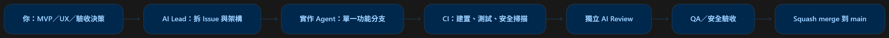
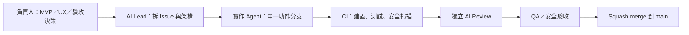

# 開發流程





## 角色

| 角色 | 負責 |
|---|---|
| 負責人（你） | 決定 MVP 範圍、優先順序、UX 與安全例外；把 ADR 改成「已接受」；核准安全敏感 PR 與發布 |
| AI Lead | 把需求拆成工作卡、維護架構文件、提出「提議中」的 ADR |
| 核心 agent | MuPDF 整合、渲染、搜尋、`pdf_worker` 隔離 |
| 前端 agent | 閱讀器 UI、快捷鍵、無障礙、視覺測試 |
| QA／安全 agent | 惡意、損毀、加密、簽章、超大 PDF 測試集與 fuzzing |
| Review／Release agent | CI、PR 規則、依賴掃描、安裝包與簽章；review 其他 agent 的 PR |

## 規則

1. 一個 agent 同時只做一張 Issue；一張 Issue 一個 branch；一個 PR 只做一件事。
2. `main` 永遠保持可建置；不直接 push 到 `main`。
3. PR 必須 CI 全綠、由**不同於作者**的 agent 或人 review，才能 squash merge。審查與除錯的做法（給 Antigravity 等其他 agent）見 [agents/independent-review.md](agents/independent-review.md)。
4. AI review 不能取代安全審查：安全敏感 PR（見 [AGENTS.md](../AGENTS.md#需要人工安全審查的變更)）必須由負責人親自核准。
5. 分支命名與 PR 標題格式見 [AGENTS.md](../AGENTS.md#工作方式)。

## CI 檢查

| Workflow | Job（檢查名稱） | 內容 |
|---|---|---|
| CI | `Guardrails` | 禁用遙測／網路依賴、ADR 編號與索引、CSP／開發模式 CSP／capability 政策、PR 不能關掉判斷它的檢查（僅 PR）、守門腳本自身的測試。PR 上的守門腳本用 base 分支的版本跑（見[下方](#pr-不能關掉判斷它的檢查)） |
| CI | `PR hygiene` | PR 標題符合 Conventional Commits、內文連結 Issue（僅 PR） |
| CI | `Rust (Windows)` | `cargo fmt`、`clippy -D warnings`、`cargo test` |
| CI | `Frontend` | `pnpm lint`、`typecheck`、`test`、`build`、建置產物不得引用外部資源（PR 上用 base 分支的守門腳本） |
| CI | `E2E (Windows)` | 建置 release app 與 worker，以 Playwright 操作真正的 app（`pnpm e2e`，見 [e2e.md](architecture/e2e.md)）；失敗時上傳截圖與日誌（保留 7 天） |
| Installer | `Installer (Windows)` | `pnpm bundle` 建置安裝檔，檢查內容（worker、OCR 語言資料、`LICENSE`、第三方元件聲明）、靜默安裝、PDF 關聯、不需要 VC++ 執行階段、安裝後的 worker、解除安裝，並留下 SHA-256；push 到 `main` 與變更會進入安裝檔的 PR（見 [packaging.md](architecture/packaging.md#ci)） |
| Release | `Release checks`、`Installer`、`Draft release` | 版本、tag、變更記錄一致，第三方元件聲明是最新的；推 `v<x.y.z>` tag 後建置安裝檔並建立**草稿** release，不發布；手動執行是演練，做到建立草稿之前（見 [release.md](release.md)）。改到 `release.yml` 或 `scripts/release/` 的 PR 只跑檢查 |
| Security | `Secret scan` | gitleaks 掃描所有 commit |
| Security | `Dependency audit` | `cargo deny check`（弱點、禁用 crate、授權、來源）、`pnpm audit`；每週一排程 |
| Fuzz | `Fuzz (worker_messages)`、`Fuzz (open_document)` | cargo-fuzz：IPC 解碼與以 MuPDF 開啟 PDF（見 [fuzzing.md](security/fuzzing.md)）；每週一排程，修改相關檔案的 PR 跑 2 分鐘 |

### PR 不能關掉判斷它的檢查

AGENTS.md「禁止事項」第 1 條：不得關閉、略過或刪除測試與 CI 檢查來讓 CI 變綠。CI 用兩種方式把關（#630）。

**守門腳本用 base 分支的版本跑**

- PR 上，`Guardrails` 與 `Frontend` 先把 base 分支的 `scripts/ci/` 放到 `scripts/ci-base/`，再用它檢查 PR 的檔案。PR 改不了判斷它的規則。
- base 還沒有的守門腳本，照 PR 裡的版本跑。
- 改守門腳本的 PR，合併後才生效。同一個 PR 又改守門腳本、又改它檢查的內容，CI 會用舊規則判斷而變紅：拆成兩個 PR，先合併改守門腳本的那個。
  - 最常見的是加新的 Tauri 命令：它的權限要加進 `check-security-config.mjs` 的 `ALLOWED_PERMISSIONS`，base 的版本沒有這一筆。
  - 先開一個只在 `ALLOWED_PERMISSIONS` 加這一筆的 PR（附上理由，加 `needs-security-review`），合併後再送功能的 PR。
  - 或者在功能 PR 的說明寫明，交給負責人照紅合併。
- 守門腳本自身的測試（`node --test scripts/ci/*.test.mjs`）照 PR 的版本跑。
- `Guardrails` 的每一項檢查都會跑，前面的檢查紅了也一樣。所以預期中的紅，不會蓋掉同一個 PR 的其他發現。

**`check-test-integrity.mjs` 比對 PR 與 base**

出現下面任何一種就失敗，並印出檔案與行號：

- **跳過**：
  - Rust：`#[ignore]`、永遠不成立的 `#[cfg(any())]`、加在既有測試上的 `#[should_panic]`。
  - 測試檔：`.skip(`、`.only(`、`.fixme(`、`.todo(`、`.fail(`、`xit(` 這類寫法，以及 `{ skip: true }`。
  - 例外：新測試裡依環境跳過的 `test.skip(條件, 原因)`，例如只在拋棄式 runner 匯入憑證。
  - 測試檔被刪掉，或改名到測試工具找不到的地方。
- **重試**：`retries`、`retry` 大於 0，在測試、測試設定或 workflow 裡都算。
- **改變跑哪些測試**：
  - 測試設定的 `include`、`testIgnore`、`grep`、`forbidOnly` 等；
  - workflow 指令加上 `--skip`、`--exclude` 這類旗標；
  - `package.json` 的 `lint`、`typecheck`、`test`、`e2e`。
- **workflow**：
  - 不是 `false` 的 `continue-on-error`；
  - 原本就有的 job 或 step 加上或改了 `if:`。只會讓它多跑的條件不算，例如 `always()`、「原條件 `||` 別的條件」。
  - job 或執行檢查的 step 原本有 `always()` 或 `!cancelled()`（前面失敗也照樣跑），這個條件被拿掉；
  - job 或 step 被刪掉；
  - pull request 的觸發條件變了（只多加 paths 不算）；
  - 決定其他 job 跑不跑的 job（例如 `detect`）變了；
  - 守門腳本或檢查指令不再照原樣執行，或失敗被忽略：`|| true`、`| tee`、`if 指令; then`、`set +e`。守門腳本改成從 `scripts/ci-base/` 執行可以，反過來不行。
- **禁用清單**：
  - 刪掉 `scripts/ci/forbidden-patterns.txt` 的規則；
  - 刪掉 `deny.toml` 的 `[advisories]`、`[bans]` 的一行，或在 `[advisories]` 的 `ignore` 加上公告；
  - 刪掉或關掉 `eslint.config.js` 的 `no-restricted-*`，或把檔案排除在 lint 之外；
  - 用 `eslint-disable` 關掉全部規則或 `no-restricted-*`；
  - 叫 gitleaks 略過發現（`gitleaks:allow`、`.gitleaksignore`）。

真的需要例外時，例如刪掉過時的測試、改寫 CI 的步驟：

- 在 PR 說明寫明原因，由負責人親自合併（ruleset 的 bypass）。
- agent 不要為了讓這項變綠而改掉該做的變更，也不要繞過規則；在 PR 說明寫清楚，交給負責人。

在本機執行 `node scripts/ci/check-test-integrity.mjs`，會和 `origin/main` 的 merge base 比對。

### dependabot 的 PR 在 Fuzz targets compile 失敗時

- **原因**：兩個 lockfile（#382）。`fuzz/` 是獨立的 Cargo workspace，有自己的 `fuzz/Cargo.lock`，透過 path 依賴使用 `crates/pdf_worker` 與 `crates/ipc_contract`。當 dependabot 升級這些 crate 的依賴時，只更新根目錄的 `Cargo.lock`，會導致 `fuzz/Cargo.lock` 不符合版本需求而在「Fuzz targets compile」檢查中失敗。
- **步驟**：在該 PR 的分支跑 `cargo update --manifest-path fuzz/Cargo.toml --workspace`，只 commit `fuzz/Cargo.lock`，推上去，等 CI 全綠再合併。
- **注意**：CI 沒有全綠的 PR 不要合併。

「不連網、零遙測」的完整驗證方式（含發布前的手動檢查）見 [docs/security/offline-verification.md](security/offline-verification.md)。

## GitHub 設定（需在網頁上手動完成）

### 1. 分支保護

> 公開 repo 在 GitHub Free 方案就能使用 Rulesets。repo 改為公開後請盡快設定；設定前，上述規則只能靠紀律與 agent 遵守 AGENTS.md。

Settings → Rules → Rulesets → New branch ruleset：

- Target：`main`
- 勾選 **Restrict deletions**、**Block force pushes**、**Require linear history**
- 勾選 **Require a pull request before merging**
  - Allowed merge methods：只留 **Squash**
- 勾選 **Require status checks to pass**，加入：`Guardrails`、`PR hygiene`、`Rust (Windows)`、`Frontend`、`E2E (Windows)`、`Secret scan`
  - `Dependency audit` 建議先不設為必要（新公告的弱點會讓無關 PR 突然失敗），改看每週排程結果
  - `Fuzz` 不能設為必要：它只在修改相關檔案時執行，沒執行的必要檢查會讓 PR 一直等待
- 若你是唯一維護者，**不要**勾「Require approvals」，否則你無法合併 AI 以你帳號開的 PR；改用 CODEOWNERS + `needs-security-review` 標籤當人工關卡

### 2. 合併設定

Settings → General → Pull Requests：只啟用 **Allow squash merging**（預設訊息選 *Pull request title and description*），勾選 **Automatically delete head branches**。

### 3. Actions

Settings → Actions → General：

- Workflow permissions 選 **Read repository contents**。
- Approval for running fork pull request workflows from contributors 選 **Require approval for all external contributors**：外部貢獻者的 PR 要你看過程式碼、按下核准後才會執行 CI。

> 公開 repo 使用 GitHub 提供的標準 runner 不計分鐘數。但 Actions 的**日誌與 artifact 也是公開的**：任何人都能看日誌，登入 GitHub 的人都能下載 artifact。所以 fuzzing 的日誌只顯示統計，崩潰樣本加密後才上傳，見 [fuzzing.md](security/fuzzing.md#公開-repo-的保護)。

### 4. 標籤與工作卡

安裝 [GitHub CLI](https://cli.github.com/) 並登入（`gh auth login`）後執行：

```bash
bash scripts/backlog-to-issues.sh --dry-run   # 先預覽
bash scripts/backlog-to-issues.sh             # 建立標籤與第一批 Issue
```

之後建立一個 GitHub Project（Board），欄位建議：`Backlog → Ready → In progress → In review → Done`，把 Issue 全部加進去。

### 5. 安全設定（公開 repo）

Settings → Advanced Security（舊版介面叫 Code security）：

- **Private vulnerability reporting**：啟用。[SECURITY.md](../SECURITY.md) 的回報方式需要它。
- **Dependabot alerts**：啟用。版本更新的 PR 由 [dependabot.yml](../.github/dependabot.yml) 設定。
- **Secret scanning** 與 **Push protection**：公開 repo 免費，啟用後含有憑證的 push 會直接被擋下。CI 的 `Secret scan`（gitleaks）照樣保留。
